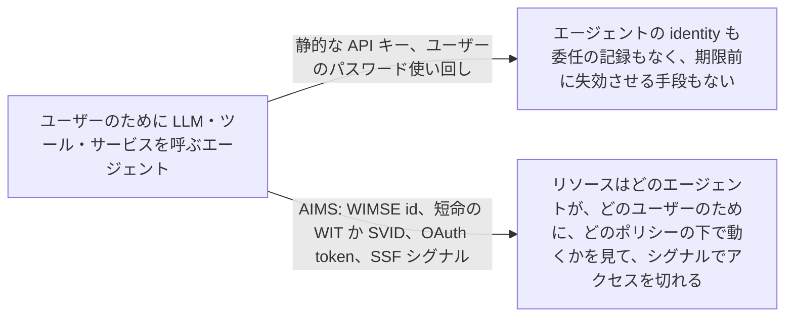
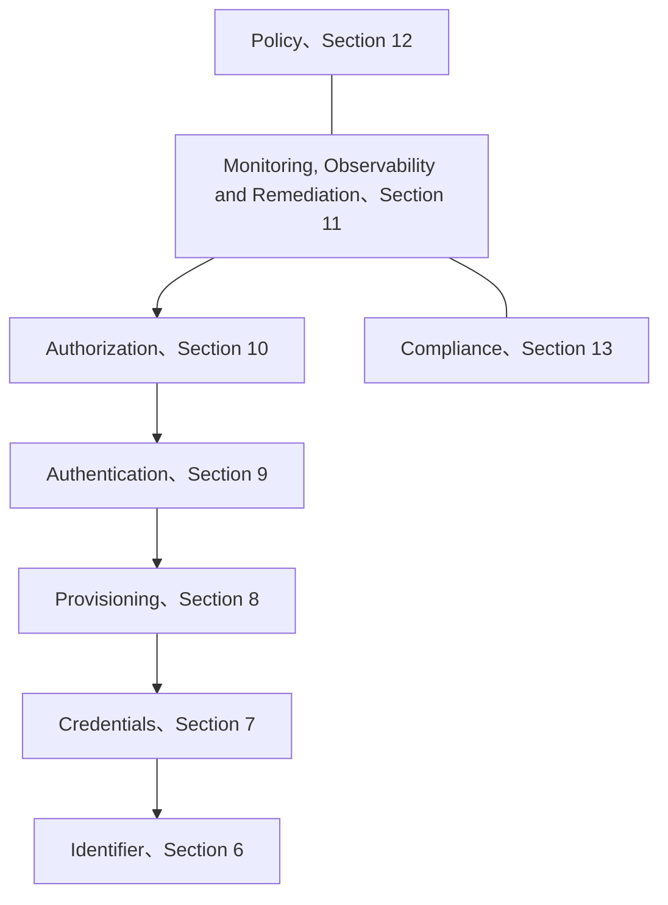
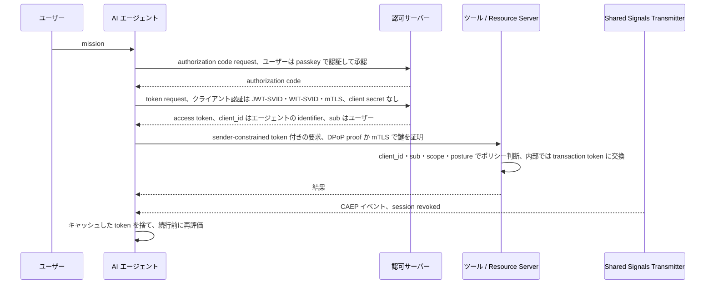

# AI Identity Management System (AIMS)

> 一言で言うと: AI エージェントはワークロードなので、WIMSE identifier と鍵に結び付いた短命クレデンシャルを持たせ、誰のために何をするかは OAuth で認可し、shared signals でアクセスを引き戻す。AIMS はその既存標準の積み重ねに付けた名前であって、新しいプロトコルではない。

## どういうときに使うか

- **チームがエージェントとツールを静的な API キーでつないでいる**: API キーは長命の bearer で、identity を伝えず、ローテーションも難しい。AIMS はそれを WIMSE identifier と、実行時に provisioning され自然に期限切れになる WIT・WIC・SVID に置き換える (Section 6、Section 7)。
- **エージェントがユーザーの代理で動き、リソース側が両者を知る必要がある**: access token はエージェントを `client_id`、委任したユーザーを `sub` に載せ、resource server は判断に両方を使わなければならない (Section 10.3)。
- **エージェントの通信が TLS を終端する proxy・gateway・serverless を通る**: mTLS の identity は hop を越えて残らないので、エージェントは WIT に結び付いた WIMSE Proof Token か HTTP Message Signatures でアプリケーション層で認証する (Section 9.1.1、Section 9.2)。
- **侵害された、あるいは挙動のおかしいエージェントのアクセスを token の期限を待たずに止めたい**: どの参加者も CAEP・RISC・WISE などの SSF イベントを購読でき、失効通知を受けたらキャッシュした token を使い続けてはならない (Section 11)。

## 解決する問題

エージェントの認証・認可は各所で孤立して作られがちで、すでにある仕組みを再発明し、互換性のない実装を生む危険がある (Section 1)。この文書の答えは、エージェントをあるがままに扱うことだ。つまり LLM とツール・サービス・リソースの集合を終了条件まで繰り返し呼ぶワークロードであり、それらの相手が認証して何を許すか決められるように identifier とクレデンシャルが要る。ユーザーやシステムの代理で動くなら、その主体が権限を委任し、認可判断と監査証跡の中で見え続けなければならない (Section 4)。

AIMS は製品でもプロトコルでもなく概念モデルとして定義される。1 つのコンポーネントでも、identity provider・provisioning サービス・認可サーバー・ポリシーエンジン・enforcement point に分散していてもよい。層は下から上に依存する。identifier、credentials、provisioning、authentication、authorization、そして monitoring と remediation で、policy と compliance がそれを囲む (Section 5)。

## 仕組み

エージェントはちょうど 1 つの WIMSE identifier (SPIFFE ID でもよい) と、それに鍵を結び付けるクレデンシャル (WIT・WIC・SVID) を持ち、posture assessment を経て実行時に provisioning される (Section 6、Section 7、Section 8)。ユーザーが委任するときは authorization code grant を使い、token endpoint へのクライアント認証は静的 secret ではなく RFC 7523・RFC 8705・SPIFFE client authentication で行う (Section 10.5.1)。得られる access token は `client_id` にエージェント、`sub` にユーザーを載せる (Section 10.3)。token は certificate binding か DPoP で sender-constrained にでき、ポリシーが resource server の外にあるなら AuthZEN API で判断を取りに行ける (Section 10.4)。microservice で組まれたツールの内部では access token を回さず transaction token に交換する (Section 10.6)。SSF プロファイルのシグナルが remediation を駆動する (Section 11)。

## 仕様が求めること

- エージェントは一意に識別されなければならず (MUST)、ちょうど 1 つの WIMSE identifier を割り当てられる (MUST)。それは SPIFFE ID でもよい (MAY)。退役したエージェントの identifier は再割り当てしてはならない (Section 6)。
- エージェントは identifier に暗号的に結び付くクレデンシャルを持たなければならず (MUST)、短命であるべきで (SHOULD)、明示的な有効期限を含まなければならない (MUST)。静的 API キーは antipattern (Section 7)。
- LLM はエージェントのクレデンシャルにも、ツールやサービスへのアクセスに要るクレデンシャルにもアクセスできてはならない (MUST NOT) (Section 8)。
- アプリケーション層認証には channel binding がないので、token や署名済みメッセージを本来の文脈の外で受け付ける場合の relay・replay リスクを考慮しなければならない (MUST) (Section 9.2.3)。
- resource server は `client_id` と `sub` を他の claim とともにアクセス判断に使わなければならない (MUST) (Section 10.3)。token endpoint でのクライアント認証は RFC 7523・RFC 8705・SPIFFE client authentication で行い、静的で長命な secret は使わない (Section 10.5.1、Section 10.5.2)。
- 認可サーバーをまたぐときは OAuth Identity and Authorization Chaining か、Identity Assertion JWT Authorization Grant のような派生プロファイルを使うべき (SHOULD) (Section 10.7)。
- 配備はエージェントの挙動を再構成できる monitoring を維持し (MUST)、耐改ざんで永続的な監査ログを残し (MUST)、最低限エージェント identifier・委任元の subject・リソース・アクションと判断・timestamp と相関 ID・posture 状態・remediation イベントを記録する (MUST)。失効やリスク通知の後にキャッシュした判断や token を使い続けてはならない (MUST NOT) (Section 11)。

## 注意点

- posture はクレデンシャルの発行・更新時に評価され、要求時ではない。lifetime を短くするか eventing を使い、発行後の posture 変化が失効や down-scoping につながるようにする (Section 8)。
- エージェントフレームワークのローカル UI での確認は認可ではない。認可サーバーが発行する検証可能な grant (例えば CIBA による step-up) に結び付けなければならず (MUST)、CIBA 自体は client 起点しか扱わないので、実行途中の確認にはまだ設計作業が要る (Section 10.8)。
- ツールがエージェントから受け取った access token を下流サービスにそのまま転送するのは anti-pattern。Token Exchange か chaining を使う (Section 10.9)。
- 長命セッションは、それを開いたクレデンシャルより長生きする。クレデンシャルをローテーションし、期限で認可を再検証し、シグナルを受けたらセッションを最後まで走らせず終了か down-scope する (Section 9.3)。
- token はユーザーとエージェントの identifier や transaction の詳細を含み得る。claim を最小化し、最小化が必要なら introspection 付きの opaque token を優先し、委任されたユーザー identity を無関係なサービスに晒してはならない (MUST NOT) (Section 10.10)。
- ポリシーの形式と compliance の基準は配備固有で範囲外なので、相互運用性は共通のポリシー言語ではなく、やり取りする token と claim から生まれる (Section 10.4、Section 12、Section 13)。

## 出典

- [draft-ietf-wimse-aims, Section 1](https://datatracker.ietf.org/doc/html/draft-ietf-wimse-aims#section-1)
- [draft-ietf-wimse-aims, Section 4](https://datatracker.ietf.org/doc/html/draft-ietf-wimse-aims#section-4)
- [draft-ietf-wimse-aims, Section 5](https://datatracker.ietf.org/doc/html/draft-ietf-wimse-aims#section-5)
- [draft-ietf-wimse-aims, Section 6](https://datatracker.ietf.org/doc/html/draft-ietf-wimse-aims#section-6)
- [draft-ietf-wimse-aims, Section 7](https://datatracker.ietf.org/doc/html/draft-ietf-wimse-aims#section-7)
- [draft-ietf-wimse-aims, Section 8](https://datatracker.ietf.org/doc/html/draft-ietf-wimse-aims#section-8)
- [draft-ietf-wimse-aims, Section 9.1.1](https://datatracker.ietf.org/doc/html/draft-ietf-wimse-aims#section-9.1.1)
- [draft-ietf-wimse-aims, Section 9.2](https://datatracker.ietf.org/doc/html/draft-ietf-wimse-aims#section-9.2)
- [draft-ietf-wimse-aims, Section 9.2.3](https://datatracker.ietf.org/doc/html/draft-ietf-wimse-aims#section-9.2.3)
- [draft-ietf-wimse-aims, Section 9.3](https://datatracker.ietf.org/doc/html/draft-ietf-wimse-aims#section-9.3)
- [draft-ietf-wimse-aims, Section 10.3](https://datatracker.ietf.org/doc/html/draft-ietf-wimse-aims#section-10.3)
- [draft-ietf-wimse-aims, Section 10.4](https://datatracker.ietf.org/doc/html/draft-ietf-wimse-aims#section-10.4)
- [draft-ietf-wimse-aims, Section 10.5.1](https://datatracker.ietf.org/doc/html/draft-ietf-wimse-aims#section-10.5.1)
- [draft-ietf-wimse-aims, Section 10.5.2](https://datatracker.ietf.org/doc/html/draft-ietf-wimse-aims#section-10.5.2)
- [draft-ietf-wimse-aims, Section 10.6](https://datatracker.ietf.org/doc/html/draft-ietf-wimse-aims#section-10.6)
- [draft-ietf-wimse-aims, Section 10.7](https://datatracker.ietf.org/doc/html/draft-ietf-wimse-aims#section-10.7)
- [draft-ietf-wimse-aims, Section 10.8](https://datatracker.ietf.org/doc/html/draft-ietf-wimse-aims#section-10.8)
- [draft-ietf-wimse-aims, Section 10.9](https://datatracker.ietf.org/doc/html/draft-ietf-wimse-aims#section-10.9)
- [draft-ietf-wimse-aims, Section 10.10](https://datatracker.ietf.org/doc/html/draft-ietf-wimse-aims#section-10.10)
- [draft-ietf-wimse-aims, Section 11](https://datatracker.ietf.org/doc/html/draft-ietf-wimse-aims#section-11)
- [draft-ietf-wimse-aims, Section 12](https://datatracker.ietf.org/doc/html/draft-ietf-wimse-aims#section-12)
- [draft-ietf-wimse-aims, Section 13](https://datatracker.ietf.org/doc/html/draft-ietf-wimse-aims#section-13)
