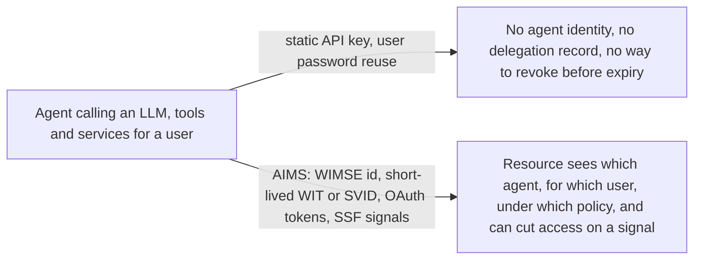
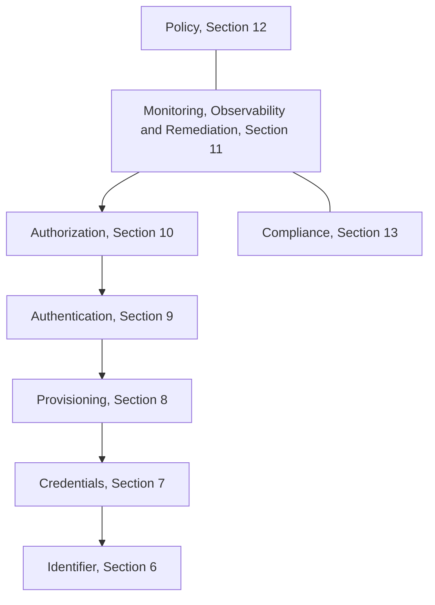
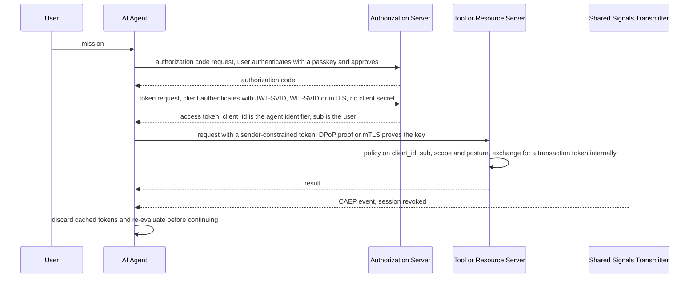

# AI Identity Management System (AIMS)

> In one line: an AI agent is a workload, so give it a WIMSE identifier, a key-bound short-lived credential, OAuth-based authorization for what it does on whose behalf, and a shared-signals feed to pull access back; AIMS is the name for that stack of existing standards, not a new protocol.

## When you reach for it

- **A team is wiring an agent to tools with static API keys**: the keys are long-lived bearer artifacts that convey no identity and are hard to rotate. AIMS replaces them with a WIMSE identifier plus a WIT, WIC or SVID provisioned at runtime and expiring on its own (Section 6, Section 7).
- **An agent acts for a user and the resource must know both parties**: the access token carries the agent as `client_id` and the delegating user as `sub`, and the resource server must use both when deciding (Section 10.3).
- **Agent traffic crosses proxies, gateways or serverless hops that terminate TLS**: mTLS identity does not survive, so the agent authenticates at the application layer with a WIMSE Proof Token or HTTP Message Signatures bound to its WIT (Section 9.1.1, Section 9.2).
- **A compromised or misbehaving agent must lose access now, not at token expiry**: every participant can subscribe to SSF events such as CAEP, RISC or WISE and must stop using cached tokens once a revocation arrives (Section 11).

## The problem it solves

Agent authentication and authorization efforts tend to be built in isolation, reinventing mechanisms that already exist and risking incompatible implementations (Section 1). The document's answer is to treat the agent as what it is, a workload that iterates against an LLM and a set of tools, services and resources until a terminating condition, and that therefore needs an identifier and credentials so each of those parties can authenticate it and decide what it may do. When it acts for a user or system, that principal must delegate authority to it and stay visible in authorization decisions and audit trails (Section 4).

AIMS is defined as a conceptual model, not a product or protocol. It may be one component or spread across identity providers, provisioning services, authorization servers, policy engines and enforcement points. Its layers depend on each other from the bottom up: identifier, credentials, provisioning, authentication, authorization, then monitoring and remediation, framed by policy and compliance (Section 5).

## How it works

The agent carries exactly one WIMSE identifier, which may be a SPIFFE ID, and a credential that binds a key to it, a WIT, a WIC or an SVID, provisioned at runtime after posture assessment (Section 6, Section 7, Section 8). When a user delegates, the agent runs the authorization code grant and then authenticates to the token endpoint with RFC 7523, RFC 8705 or SPIFFE client authentication rather than a static secret (Section 10.5.1). The resulting access token names the agent in `client_id` and the user in `sub` (Section 10.3). It can be sender-constrained with certificate binding or DPoP, and where policy lives outside the resource server, the decision can be fetched over the AuthZEN API (Section 10.4). Inside a tool built from microservices the access token is exchanged for a transaction token instead of being passed around (Section 10.6). Signals from SSF profiles drive remediation (Section 11).

## What the spec requires

- An agent MUST be uniquely identified and MUST be assigned exactly one WIMSE identifier, which MAY be a SPIFFE ID. A retired agent's identifier must not be reassigned (Section 6).
- Agents MUST possess credentials that cryptographically bind to the identifier, SHOULD be short-lived, and MUST include an explicit expiration time. Static API keys are an antipattern (Section 7).
- The LLM MUST NOT have access to the agent's credentials or to credentials needed for tools and services (Section 8).
- Application-layer authentication has no channel binding, so implementations MUST consider relay and replay when tokens or signed messages are accepted outside their intended context (Section 9.2.3).
- Resource servers MUST use the `client_id` and `sub` identifiers, with the other claims, to decide access (Section 10.3). Client authentication at the token endpoint uses RFC 7523, RFC 8705 or SPIFFE client authentication, not static long-lived secrets (Section 10.5.1, Section 10.5.2).
- Across authorization servers an agent SHOULD use OAuth Identity and Authorization Chaining or a derived profile such as the Identity Assertion JWT Authorization Grant (Section 10.7).
- Deployments MUST maintain monitoring sufficient to reconstruct agent behavior, MUST produce durable, tamper-evident audit logs recording at least the agent identifier, delegated subject, resource, action and decision, timestamp and correlation id, posture state, and remediation events, and MUST NOT keep using cached decisions or tokens after a revocation or risk notification (Section 11).

## Watch out

- Posture is assessed when a credential is issued or renewed, not when a request is made. Shorten lifetimes or use eventing so a posture change after issuance leads to revocation or down-scoping (Section 8).
- Local UI confirmation in an agent framework is not authorization. It MUST be bound to a verifiable grant from the authorization server, for example a step-up via CIBA, and CIBA itself only covers client initiation, so mid-execution confirmation still needs design work (Section 10.8).
- Tools forwarding the access token they received from the agent to downstream services is an anti-pattern; use Token Exchange or chaining instead (Section 10.9).
- Long-lived sessions outlive the credential that opened them. Rotate credentials, re-validate authorization at expiry, and terminate or down-scope on signals rather than letting the session run out (Section 9.3).
- Tokens may carry user and agent identifiers and transaction details. Minimize claims, prefer opaque tokens with introspection where minimization is required, and MUST NOT expose delegated user identity to unrelated services (Section 10.10).
- Policy format and compliance criteria are deployment-specific and out of scope, so interoperability comes from the tokens and claims exchanged, not from a shared policy language (Section 10.4, Section 12, Section 13).

## Sources

- [draft-ietf-wimse-aims, Section 1](https://datatracker.ietf.org/doc/html/draft-ietf-wimse-aims#section-1)
- [draft-ietf-wimse-aims, Section 4](https://datatracker.ietf.org/doc/html/draft-ietf-wimse-aims#section-4)
- [draft-ietf-wimse-aims, Section 5](https://datatracker.ietf.org/doc/html/draft-ietf-wimse-aims#section-5)
- [draft-ietf-wimse-aims, Section 6](https://datatracker.ietf.org/doc/html/draft-ietf-wimse-aims#section-6)
- [draft-ietf-wimse-aims, Section 7](https://datatracker.ietf.org/doc/html/draft-ietf-wimse-aims#section-7)
- [draft-ietf-wimse-aims, Section 8](https://datatracker.ietf.org/doc/html/draft-ietf-wimse-aims#section-8)
- [draft-ietf-wimse-aims, Section 9.1.1](https://datatracker.ietf.org/doc/html/draft-ietf-wimse-aims#section-9.1.1)
- [draft-ietf-wimse-aims, Section 9.2](https://datatracker.ietf.org/doc/html/draft-ietf-wimse-aims#section-9.2)
- [draft-ietf-wimse-aims, Section 9.2.3](https://datatracker.ietf.org/doc/html/draft-ietf-wimse-aims#section-9.2.3)
- [draft-ietf-wimse-aims, Section 9.3](https://datatracker.ietf.org/doc/html/draft-ietf-wimse-aims#section-9.3)
- [draft-ietf-wimse-aims, Section 10.3](https://datatracker.ietf.org/doc/html/draft-ietf-wimse-aims#section-10.3)
- [draft-ietf-wimse-aims, Section 10.4](https://datatracker.ietf.org/doc/html/draft-ietf-wimse-aims#section-10.4)
- [draft-ietf-wimse-aims, Section 10.5.1](https://datatracker.ietf.org/doc/html/draft-ietf-wimse-aims#section-10.5.1)
- [draft-ietf-wimse-aims, Section 10.5.2](https://datatracker.ietf.org/doc/html/draft-ietf-wimse-aims#section-10.5.2)
- [draft-ietf-wimse-aims, Section 10.6](https://datatracker.ietf.org/doc/html/draft-ietf-wimse-aims#section-10.6)
- [draft-ietf-wimse-aims, Section 10.7](https://datatracker.ietf.org/doc/html/draft-ietf-wimse-aims#section-10.7)
- [draft-ietf-wimse-aims, Section 10.8](https://datatracker.ietf.org/doc/html/draft-ietf-wimse-aims#section-10.8)
- [draft-ietf-wimse-aims, Section 10.9](https://datatracker.ietf.org/doc/html/draft-ietf-wimse-aims#section-10.9)
- [draft-ietf-wimse-aims, Section 10.10](https://datatracker.ietf.org/doc/html/draft-ietf-wimse-aims#section-10.10)
- [draft-ietf-wimse-aims, Section 11](https://datatracker.ietf.org/doc/html/draft-ietf-wimse-aims#section-11)
- [draft-ietf-wimse-aims, Section 12](https://datatracker.ietf.org/doc/html/draft-ietf-wimse-aims#section-12)
- [draft-ietf-wimse-aims, Section 13](https://datatracker.ietf.org/doc/html/draft-ietf-wimse-aims#section-13)
