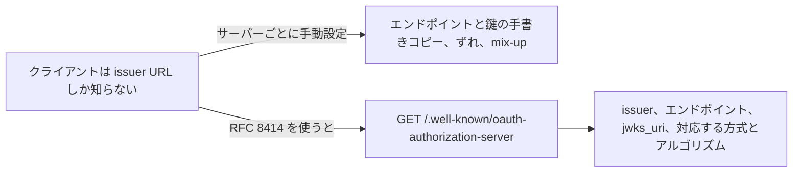
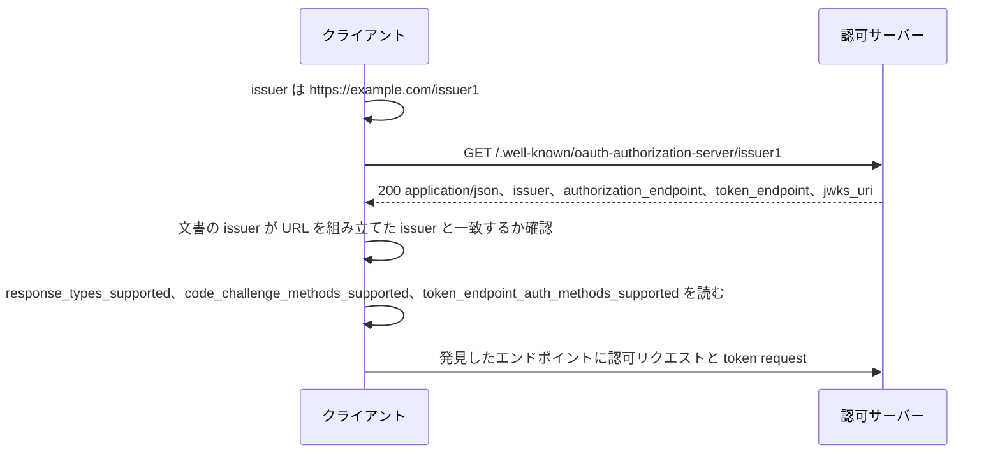

# Authorization Server Metadata

> 一言で言うと: well-known URL にある 1 つの JSON 文書が、認可サーバーの全エンドポイントと機能をクライアントに伝えるので、手で設定するものがなくなる。

## どういうときに使うか

- **多数の認可サーバーを相手にするクライアント**: issuer URL さえあれば、クライアントは `/.well-known/oauth-authorization-server` を取得して `authorization_endpoint`、`token_endpoint`、`jwks_uri`、対応機能を知る。サーバーごとの設定ファイルは要らない (Section 1、3)。
- **OpenID Connect を使わない素の OAuth 配備**: この形式は OpenID Connect Discovery を一般化したもので、OAuth だけのサーバーも同じ種類の文書を公開できる (Section 1)。
- **最初のリクエストの前に機能を把握する**: `code_challenge_methods_supported`、`token_endpoint_auth_methods_supported`、`grant_types_supported` がサーバーの受け付けるものを伝え、他の仕様が追加の項目を定義してもよい (Section 2)。
- **mix-up 対策**: 文書内の `issuer` はクライアントが出発した issuer と一致しなければならないので、悪意あるサーバーがクライアントを他人のエンドポイントに向けることを防げる (Section 3.3、6.2)。

## 解決する問題

OAuth クライアントは最初のリクエストを送る前に、authorization endpoint、token endpoint、署名鍵、サーバーが対応する機能の一覧を知る必要がある。これを設定で配る方法は 1 サーバーなら動くが、規模が大きくなると壊れる。値はずれ、新機能は気付かれず、エンドポイントの設定ミスは code やトークンを間違った相手に送る。

RFC 8414 は、サーバーが issuer 識別子から導かれる場所に公開する JSON メタデータ文書を定める。データは TLS 上で自己主張してもよいし、署名付き JWT の claim として運んでもよい。OpenID Connect Discovery を手本にしつつ、OpenID 固有の要件を外して、どの OAuth 2.0 サーバーでも使えるようにしている (Section 1)。

## 仕組み

クライアントは issuer 識別子のホストとパスの間に `/.well-known/oauth-authorization-server` を挿入し (末尾のスラッシュは先に取る)、HTTP GET を送る (Section 3、3.1)。サーバーは `application/json` で 200 を返す。`issuer` と `response_types_supported` は必須、`authorization_endpoint` と `token_endpoint` は対応する grant が使わない場合を除いて必須で、`scopes_supported` は推奨、残りは任意だ: `jwks_uri`、`registration_endpoint`、`grant_types_supported`、`token_endpoint_auth_methods_supported`、`revocation_endpoint`、`introspection_endpoint`、`code_challenge_methods_supported` など (Section 2)。サーバーは同じ値を `signed_metadata` の JWT に包むこともでき、クライアントが対応していれば署名付きの値が平文の値より優先される (Section 2.1)。

## 仕様が求めること

- `issuer` と `response_types_supported` は必須。`authorization_endpoint` はどの grant type も使わない場合を除いて必須、`token_endpoint` は implicit grant だけに対応する場合を除いて必須 (Section 2)。
- `code_challenge_methods_supported` が省略されていたら、クライアントはサーバーが PKCE に対応していないと見なす (Section 2)。
- well-known 文字列は issuer のホストとパスの間に挿入するので、パス付き issuer では `/.well-known/oauth-authorization-server/issuer1` のような URL になる (Section 3、3.1)。
- 成功応答は `application/json` の 200 OK で、多値のパラメータは配列、空のパラメータは省略する (Section 3.2)。
- 応答の `issuer` はリクエスト URL を組み立てるのに使った issuer 識別子と一致しなければならない。一致しなければクライアントはそのデータを使ってはならない (Section 3.3)。
- 署名付きメタデータの JWT は JWS で署名か MAC されていなければならず、`iss` claim を含まなければならない (Section 2.1)。

## 注意点

- **パスの位置が OpenID Connect Discovery と違う**: この仕様は well-known 文字列を issuer のパスの前に挿入し、Discovery は後ろに付ける。移行期間はまずこの仕様の場所を試し、`openid-configuration` に限って Discovery の場所にフォールバックする (Section 5)。
- **TLS は必須**: サーバーは TLS 1.2 に対応しなければならず、クライアントは RFC 6125 に従ってサーバー証明書を検証しなければならない。検証に失敗すると攻撃者が鍵とエンドポイントをすり替えられる (Section 6.1、6.2)。
- **公開されたメタデータは攻撃者も助ける**: 標準形式は誰にとってもサーバーを使いやすくするので、メタデータの公開方法にかかわらず同じ防御を適用する (Section 6.3)。
- **どのリソースを呼ぶかは教えてくれない**: protected resource の選択は範囲外で、間違ったリソースを選んだクライアントは検知されない中間者攻撃にさらされる (Section 6.4)。

## 出典

- [RFC 8414, Section 1](https://www.rfc-editor.org/rfc/rfc8414#section-1)
- [RFC 8414, Section 2](https://www.rfc-editor.org/rfc/rfc8414#section-2)
- [RFC 8414, Section 2.1](https://www.rfc-editor.org/rfc/rfc8414#section-2.1)
- [RFC 8414, Section 3](https://www.rfc-editor.org/rfc/rfc8414#section-3)
- [RFC 8414, Section 3.1](https://www.rfc-editor.org/rfc/rfc8414#section-3.1)
- [RFC 8414, Section 3.2](https://www.rfc-editor.org/rfc/rfc8414#section-3.2)
- [RFC 8414, Section 3.3](https://www.rfc-editor.org/rfc/rfc8414#section-3.3)
- [RFC 8414, Section 5](https://www.rfc-editor.org/rfc/rfc8414#section-5)
- [RFC 8414, Section 6.1](https://www.rfc-editor.org/rfc/rfc8414#section-6.1)
- [RFC 8414, Section 6.2](https://www.rfc-editor.org/rfc/rfc8414#section-6.2)
- [RFC 8414, Section 6.3](https://www.rfc-editor.org/rfc/rfc8414#section-6.3)
- [RFC 8414, Section 6.4](https://www.rfc-editor.org/rfc/rfc8414#section-6.4)
