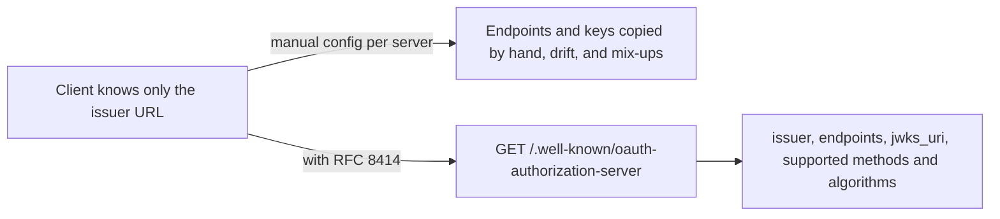
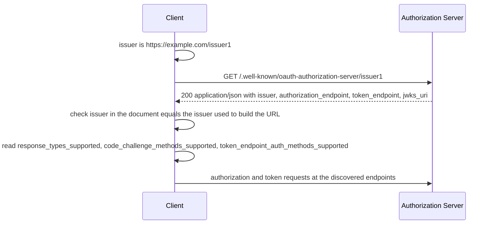

# Authorization Server Metadata

> In one line: one JSON document at a well-known URL tells a client every endpoint and capability of an authorization server, so nothing has to be hand-configured.

## When you reach for it

- **A client that must work against many authorization servers**: given only the issuer URL, the client fetches `/.well-known/oauth-authorization-server` and learns the `authorization_endpoint`, `token_endpoint`, `jwks_uri` and supported features without a per-server config file (Sections 1, 3).
- **Plain OAuth deployments with no OpenID Connect**: the format generalizes OpenID Connect Discovery so an OAuth-only server can publish the same kind of document (Section 1).
- **Feature negotiation before the first request**: `code_challenge_methods_supported`, `token_endpoint_auth_methods_supported` and `grant_types_supported` tell the client what the server accepts, and other specifications may define additional entries (Section 2).
- **Mix-up defense**: the `issuer` value in the document must match the issuer the client started from, which stops a hostile server from pointing a client at someone else's endpoints (Sections 3.3, 6.2).

## The problem it solves

An OAuth client needs the authorization endpoint, token endpoint, signing keys and a list of what the server supports before it can send its first request. Shipping that in configuration works for one server and breaks at scale: values drift, new features go unnoticed, and a misconfigured endpoint can send a code or token to the wrong party.

RFC 8414 defines a JSON metadata document the server publishes at a location derived from its issuer identifier. The data can be self-asserted over TLS or carried as claims in a signed JWT. It is modeled on OpenID Connect Discovery but drops the OpenID-specific requirements so any OAuth 2.0 server can use it (Section 1).

## How it works

The client inserts `/.well-known/oauth-authorization-server` between the host and the path of the issuer identifier, removing a trailing slash first, and sends an HTTP GET (Sections 3, 3.1). The server answers 200 with `application/json`. `issuer` and `response_types_supported` are required, `authorization_endpoint` and `token_endpoint` are required unless no supported grant uses them, `scopes_supported` is recommended, and the rest is optional: `jwks_uri`, `registration_endpoint`, `grant_types_supported`, `token_endpoint_auth_methods_supported`, `revocation_endpoint`, `introspection_endpoint`, `code_challenge_methods_supported` and others (Section 2). A server can wrap the same values in a JWT under `signed_metadata`; where a client supports it, signed values take precedence over the plain ones (Section 2.1).

## What the spec requires

- `issuer` and `response_types_supported` are required. `authorization_endpoint` is required unless no grant type uses it, and `token_endpoint` is required unless only the implicit grant is supported (Section 2).
- If `code_challenge_methods_supported` is omitted, the client assumes the server does not support PKCE (Section 2).
- The well-known string is inserted between host and path of the issuer, so an issuer with a path yields a URL such as `/.well-known/oauth-authorization-server/issuer1` (Sections 3, 3.1).
- A successful response is 200 OK with `application/json`, multi-valued parameters are arrays, and empty parameters are omitted (Section 3.2).
- The `issuer` in the response must match the issuer identifier used to build the request URL. If it does not, the client must not use the data (Section 3.3).
- The signed metadata JWT must be signed or MACed with JWS and must include an `iss` claim (Section 2.1).

## Watch out

- **Path placement differs from OpenID Connect Discovery**: this spec inserts the well-known string before the issuer path, while Discovery appends it. During a transition, try this location first and fall back to the Discovery location only for `openid-configuration` (Section 5).
- **TLS is mandatory**: servers must support TLS 1.2, and clients must check the server certificate per RFC 6125, since a failed check lets an attacker substitute keys and endpoints (Sections 6.1, 6.2).
- **Published metadata helps attackers too**: the standard format makes the server easier to use for everyone, so the same protections apply regardless of how metadata is published (Section 6.3).
- **It does not tell you which resources to call**: choosing protected resources is out of scope, and a client that picks the wrong one is open to an undetected man-in-the-middle (Section 6.4).

## Sources

- [RFC 8414, Section 1](https://www.rfc-editor.org/rfc/rfc8414#section-1)
- [RFC 8414, Section 2](https://www.rfc-editor.org/rfc/rfc8414#section-2)
- [RFC 8414, Section 2.1](https://www.rfc-editor.org/rfc/rfc8414#section-2.1)
- [RFC 8414, Section 3](https://www.rfc-editor.org/rfc/rfc8414#section-3)
- [RFC 8414, Section 3.1](https://www.rfc-editor.org/rfc/rfc8414#section-3.1)
- [RFC 8414, Section 3.2](https://www.rfc-editor.org/rfc/rfc8414#section-3.2)
- [RFC 8414, Section 3.3](https://www.rfc-editor.org/rfc/rfc8414#section-3.3)
- [RFC 8414, Section 5](https://www.rfc-editor.org/rfc/rfc8414#section-5)
- [RFC 8414, Section 6.1](https://www.rfc-editor.org/rfc/rfc8414#section-6.1)
- [RFC 8414, Section 6.2](https://www.rfc-editor.org/rfc/rfc8414#section-6.2)
- [RFC 8414, Section 6.3](https://www.rfc-editor.org/rfc/rfc8414#section-6.3)
- [RFC 8414, Section 6.4](https://www.rfc-editor.org/rfc/rfc8414#section-6.4)
