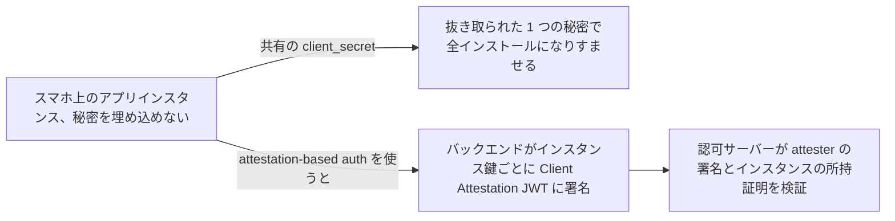
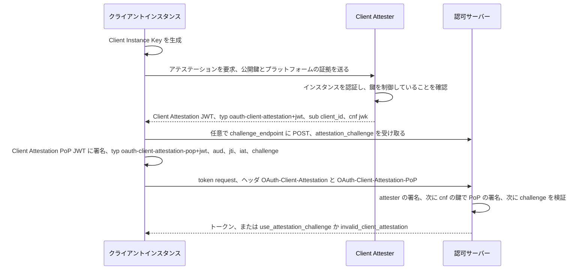

# Attestation-Based Client Authentication

> 一言で言うと: 秘密を保持できないアプリが、自分のバックエンドが自分について発行した JWT と、その JWT に書かれた鍵を持っている証明で認証する。

## どういうときに使うか

- **client secret を持てないモバイルウォレットやネイティブアプリ**: アプリのバックエンド (Client Attester) がインストールごとのインスタンスを保証し、インスタンスの公開鍵を書いた Client Attestation JWT に署名する。インスタンスはその鍵の所持を証明する (Section 1、4、5)。
- **認可サーバーと直接通信させたくないバックエンド**: アテステーションはクライアント経由のフロントチャネルで運ばれるので、クライアントのバックエンドは認可サーバーと直接つながる必要がなく、インスタンスのやり取りを突き合わせる立場にならない (Section 1)。
- **モバイルアプリの整合性チェックのようなプラットフォームのアテステーション**: モバイルのネイティブアプリなど、クライアントインスタンスを検証するプラットフォームの仕組みをアテステーションに活かせる (Section 1)。
- **すでに DPoP を使っているクライアント**: combined mode なら 1 つの鍵と 1 つの DPoP proof で、クライアント認証とトークン結合の両方を済ませられる (Section 5.2)。

## 解決する問題

ネイティブアプリやウォレットは全ユーザーに同じバイナリを配るので、中に入れた秘密は公開情報だ。クレデンシャルがなければ、token endpoint は本物のインスタンスとスクリプトを区別できず、refresh token を特定のインストールに結び付けることもできない。一方、クライアントの運営者は自分のインスタンスを知っている。プラットフォームのシグナルを確認し、インスタンスを認証し、インスタンスが鍵を制御していることを確かめられる。

このドラフトはその知識をクレデンシャルに変える。Client Attester がクライアントを名指しし Client Instance Key を結び付けた Client Attestation JWT を発行する。インスタンスは認可サーバーへのリクエストごとに、その鍵で Proof of Possession に署名する。バックエンドとサーバーの間のチャネルは意図的に避けている。attester が誰と誰が通信しているかを突き合わせられるようになるからだ (Section 1)。

## 仕組み

Client Attestation JWT は `typ` が `oauth-client-attestation+jwt` の JWS で、`sub` はクライアントの `client_id`、`cnf` には Client Instance Key を `jwk` で入れ、`iat` と `exp` で有効期間を区切る。クライアントは `OAuth-Client-Attestation` HTTP ヘッダで送る (Section 4)。Proof of Possession はインスタンス鍵で署名した 2 つ目の JWS で、`typ` は `oauth-client-attestation-pop+jwt`、`aud` にサーバー、一意な `jti`、`iat`、サーバーが challenge を出していれば `challenge` claim を入れる。これは `OAuth-Client-Attestation-PoP` ヘッダで送る (Section 5.1)。サーバーは challenge を、エラー応答や以前の応答では `OAuth-Client-Attestation-Challenge` ヘッダで、専用の `challenge_endpoint` では JSON ボディの `attestation_challenge` で配れる (Section 6)。サーバーは `token_endpoint_auth_methods_supported` に `attest_jwt_client_auth` (combined mode なら `attest_jwt_client_auth_dpop`) を載せてこの方式を公開し、受け付けるアルゴリズムを `client_attestation_signing_alg_values_supported` と `client_attestation_pop_signing_alg_values_supported` に列挙する (Section 8)。

## 仕様が求めること

- アテステーションの `sub` は `client_id` でなければならず、`cnf` は RFC 7800 に従う鍵を持ち、`exp` と `iat` が必須 (Section 4)。
- PoP は `aud`、一意な `jti`、`iat` を持たなければならない。challenge を使うときは `challenge` claim にサーバーが提供した値を入れる (Section 5.1)。
- クライアントは最後に受け取った challenge を含めなければならず、`use_attestation_challenge` を返すサーバーは一緒に challenge を提供しなければならない (Section 6)。
- サーバーは、アテステーションの署名が既知で信頼できる Client Attester の鍵で検証できること、ローカルポリシー上十分に新しいことを確認する (Section 7.1)。
- アテステーションが古いときは `use_fresh_attestation` を使わなければならず、`invalid_client_attestation` は `invalid_client` に加えて返してもよい (Section 7.4)。
- アテステーションで認証したクライアントに発行する refresh token は、クライアントだけでなくクライアントインスタンスに結び付けなければならない (Section 10.3)。

## 注意点

- **鍵のローテーションは新しいアテステーションを意味する**: その場での鍵更新はない。新しい Client Instance Key には attester から新しい Client Attestation JWT をもらう必要がある (Section 10.6)。
- **リプレイ**: サーバーは PoP のリプレイを、まず `iat` を評価し、スライディングウィンドウ内で `jti` を記録するか、challenge に頼って検出すべきである (Section 10.7、12.1)。
- **サーバー間の追跡**: 1 つのアテステーションをどこでも使い回すと、サーバー同士でインスタンスを突き合わせられる。サーバーごとに別のアテステーションと鍵を使い、attester はタイムスタンプを丸めるか乱数化する (Section 11.1)。
- **信頼は attester 次第**: アテステーション内の claim は、サーバーが発行した attester に置く信頼の分しか信用できない (Section 12.3)。
- **ヘッダサイズ**: 2 つの JWT を HTTP ヘッダで運ぶので、一般的なサーバーの上限である約 8 kB に収める (Section 10.5)。

## 出典

- [draft-ietf-oauth-attestation-based-client-auth, Section 1](https://datatracker.ietf.org/doc/html/draft-ietf-oauth-attestation-based-client-auth#section-1)
- [draft-ietf-oauth-attestation-based-client-auth, Section 4](https://datatracker.ietf.org/doc/html/draft-ietf-oauth-attestation-based-client-auth#section-4)
- [draft-ietf-oauth-attestation-based-client-auth, Section 5](https://datatracker.ietf.org/doc/html/draft-ietf-oauth-attestation-based-client-auth#section-5)
- [draft-ietf-oauth-attestation-based-client-auth, Section 5.1](https://datatracker.ietf.org/doc/html/draft-ietf-oauth-attestation-based-client-auth#section-5.1)
- [draft-ietf-oauth-attestation-based-client-auth, Section 5.2](https://datatracker.ietf.org/doc/html/draft-ietf-oauth-attestation-based-client-auth#section-5.2)
- [draft-ietf-oauth-attestation-based-client-auth, Section 6](https://datatracker.ietf.org/doc/html/draft-ietf-oauth-attestation-based-client-auth#section-6)
- [draft-ietf-oauth-attestation-based-client-auth, Section 7.1](https://datatracker.ietf.org/doc/html/draft-ietf-oauth-attestation-based-client-auth#section-7.1)
- [draft-ietf-oauth-attestation-based-client-auth, Section 7.4](https://datatracker.ietf.org/doc/html/draft-ietf-oauth-attestation-based-client-auth#section-7.4)
- [draft-ietf-oauth-attestation-based-client-auth, Section 8](https://datatracker.ietf.org/doc/html/draft-ietf-oauth-attestation-based-client-auth#section-8)
- [draft-ietf-oauth-attestation-based-client-auth, Section 10.3](https://datatracker.ietf.org/doc/html/draft-ietf-oauth-attestation-based-client-auth#section-10.3)
- [draft-ietf-oauth-attestation-based-client-auth, Section 10.5](https://datatracker.ietf.org/doc/html/draft-ietf-oauth-attestation-based-client-auth#section-10.5)
- [draft-ietf-oauth-attestation-based-client-auth, Section 10.6](https://datatracker.ietf.org/doc/html/draft-ietf-oauth-attestation-based-client-auth#section-10.6)
- [draft-ietf-oauth-attestation-based-client-auth, Section 10.7](https://datatracker.ietf.org/doc/html/draft-ietf-oauth-attestation-based-client-auth#section-10.7)
- [draft-ietf-oauth-attestation-based-client-auth, Section 11.1](https://datatracker.ietf.org/doc/html/draft-ietf-oauth-attestation-based-client-auth#section-11.1)
- [draft-ietf-oauth-attestation-based-client-auth, Section 12.1](https://datatracker.ietf.org/doc/html/draft-ietf-oauth-attestation-based-client-auth#section-12.1)
- [draft-ietf-oauth-attestation-based-client-auth, Section 12.3](https://datatracker.ietf.org/doc/html/draft-ietf-oauth-attestation-based-client-auth#section-12.3)
