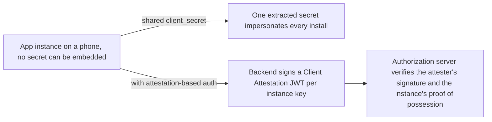
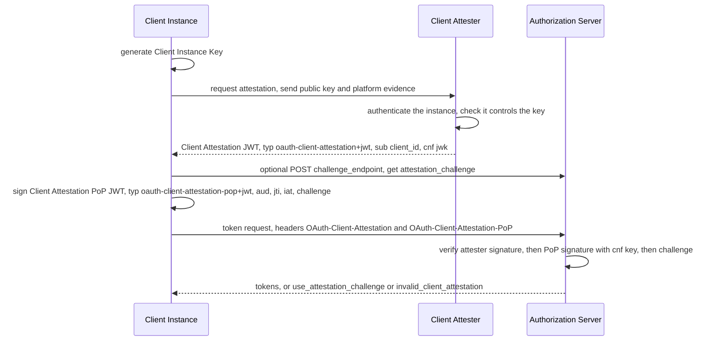

# Attestation-Based Client Authentication

> In one line: an app that cannot keep a secret authenticates with a JWT its own backend issued about it, plus a proof that it holds the key named in that JWT.

## When you reach for it

- **A mobile wallet or native app with no client secret**: the app's backend, the Client Attester, vouches for each installed instance by signing a Client Attestation JWT that names the instance's public key, and the instance proves it holds that key (Sections 1, 4, 5).
- **A backend that must not talk to the authorization server directly**: the attestation travels through the client over the front channel, so the client's backend needs no direct connection to the authorization server that would let it correlate the instance's interactions (Section 1).
- **Platform attestation such as a mobile app integrity check**: platform mechanisms that validate a client instance, such as a mobile native app, feed into the attestation (Section 1).
- **A client that already uses DPoP**: in combined mode one key and one DPoP proof serve both client authentication and token binding (Section 5.2).

## The problem it solves

Native apps and wallets ship the same binary to every user, so any secret inside them is public. Without a credential, a token endpoint cannot tell a genuine instance from a script, and it cannot bind refresh tokens to a specific install. The client's operator does know its instances: it can check platform signals, authenticate the instance, and confirm the instance controls a key.

This draft turns that knowledge into a credential. The Client Attester issues a Client Attestation JWT that names the client and binds a Client Instance Key. The instance then signs a Proof of Possession with that key on each request to the authorization server. The design deliberately avoids a backend-to-server channel, which would let the attester correlate who talks to whom (Section 1).

## How it works

The Client Attestation JWT is a JWS with `typ` set to `oauth-client-attestation+jwt`. Its `sub` is the client's `client_id`, `cnf` carries the Client Instance Key as a `jwk`, and `iat` and `exp` bound its lifetime. The client sends it in the `OAuth-Client-Attestation` HTTP header (Section 4). The Proof of Possession is a second JWS with `typ` set to `oauth-client-attestation-pop+jwt`, signed by the instance key, with `aud` naming the server, a unique `jti`, `iat`, and a `challenge` claim when the server issued one. It goes in the `OAuth-Client-Attestation-PoP` header (Section 5.1). Servers can hand out challenges in error responses and in earlier responses through the `OAuth-Client-Attestation-Challenge` header, or from a dedicated `challenge_endpoint` that returns `attestation_challenge` in a JSON body (Section 6). The server advertises the method as `attest_jwt_client_auth`, or `attest_jwt_client_auth_dpop` for combined mode, in `token_endpoint_auth_methods_supported` and lists accepted algorithms in `client_attestation_signing_alg_values_supported` and `client_attestation_pop_signing_alg_values_supported` (Section 8).

## What the spec requires

- The attestation's `sub` must be the `client_id`, `cnf` must hold a key per RFC 7800, and `exp` and `iat` must be present (Section 4).
- The PoP must carry `aud`, a unique `jti`, and `iat`. Its `challenge` claim must hold the value the server provided when a challenge is in use (Section 5.1).
- A client must include the most recently received challenge, and a server returning `use_attestation_challenge` must supply a challenge with it (Section 6).
- The server verifies that the attestation signature checks out against a known and trusted Client Attester and that the attestation is fresh enough by local policy (Section 7.1).
- `use_fresh_attestation` must be used when the attestation is stale, and `invalid_client_attestation` may be returned alongside `invalid_client` (Section 7.4).
- A refresh token issued to a client that authenticated with an attestation must be bound to the Client Instance, not just the client (Section 10.3).

## Watch out

- **Key rotation means a new attestation**: there is no in-place rotation. A new Client Instance Key requires a new Client Attestation JWT from the attester (Section 10.6).
- **Replay**: servers should detect PoP replay by evaluating `iat` first and tracking `jti` within a sliding window, or by relying on challenges (Sections 10.7, 12.1).
- **Cross-server tracking**: one attestation reused everywhere lets servers correlate an instance. Use different attestations and keys per server, and have the attester round or randomize timestamps (Section 11.1).
- **Only as trustworthy as the attester**: claims in the attestation deserve exactly as much trust as the server places in the issuing attester (Section 12.3).
- **Header size**: two JWTs ride in HTTP headers, so stay inside typical server limits of about 8 kB (Section 10.5).

## Sources

- [draft-ietf-oauth-attestation-based-client-auth, Section 1](https://datatracker.ietf.org/doc/html/draft-ietf-oauth-attestation-based-client-auth#section-1)
- [draft-ietf-oauth-attestation-based-client-auth, Section 4](https://datatracker.ietf.org/doc/html/draft-ietf-oauth-attestation-based-client-auth#section-4)
- [draft-ietf-oauth-attestation-based-client-auth, Section 5](https://datatracker.ietf.org/doc/html/draft-ietf-oauth-attestation-based-client-auth#section-5)
- [draft-ietf-oauth-attestation-based-client-auth, Section 5.1](https://datatracker.ietf.org/doc/html/draft-ietf-oauth-attestation-based-client-auth#section-5.1)
- [draft-ietf-oauth-attestation-based-client-auth, Section 5.2](https://datatracker.ietf.org/doc/html/draft-ietf-oauth-attestation-based-client-auth#section-5.2)
- [draft-ietf-oauth-attestation-based-client-auth, Section 6](https://datatracker.ietf.org/doc/html/draft-ietf-oauth-attestation-based-client-auth#section-6)
- [draft-ietf-oauth-attestation-based-client-auth, Section 7.1](https://datatracker.ietf.org/doc/html/draft-ietf-oauth-attestation-based-client-auth#section-7.1)
- [draft-ietf-oauth-attestation-based-client-auth, Section 7.4](https://datatracker.ietf.org/doc/html/draft-ietf-oauth-attestation-based-client-auth#section-7.4)
- [draft-ietf-oauth-attestation-based-client-auth, Section 8](https://datatracker.ietf.org/doc/html/draft-ietf-oauth-attestation-based-client-auth#section-8)
- [draft-ietf-oauth-attestation-based-client-auth, Section 10.3](https://datatracker.ietf.org/doc/html/draft-ietf-oauth-attestation-based-client-auth#section-10.3)
- [draft-ietf-oauth-attestation-based-client-auth, Section 10.5](https://datatracker.ietf.org/doc/html/draft-ietf-oauth-attestation-based-client-auth#section-10.5)
- [draft-ietf-oauth-attestation-based-client-auth, Section 10.6](https://datatracker.ietf.org/doc/html/draft-ietf-oauth-attestation-based-client-auth#section-10.6)
- [draft-ietf-oauth-attestation-based-client-auth, Section 10.7](https://datatracker.ietf.org/doc/html/draft-ietf-oauth-attestation-based-client-auth#section-10.7)
- [draft-ietf-oauth-attestation-based-client-auth, Section 11.1](https://datatracker.ietf.org/doc/html/draft-ietf-oauth-attestation-based-client-auth#section-11.1)
- [draft-ietf-oauth-attestation-based-client-auth, Section 12.1](https://datatracker.ietf.org/doc/html/draft-ietf-oauth-attestation-based-client-auth#section-12.1)
- [draft-ietf-oauth-attestation-based-client-auth, Section 12.3](https://datatracker.ietf.org/doc/html/draft-ietf-oauth-attestation-based-client-auth#section-12.3)
