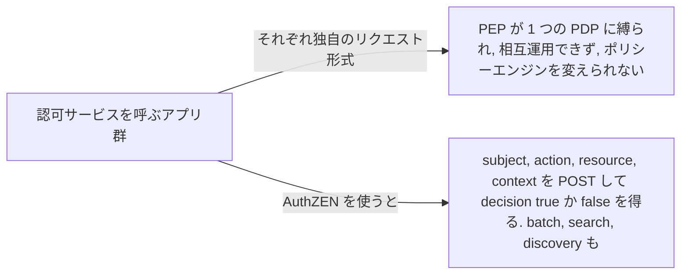
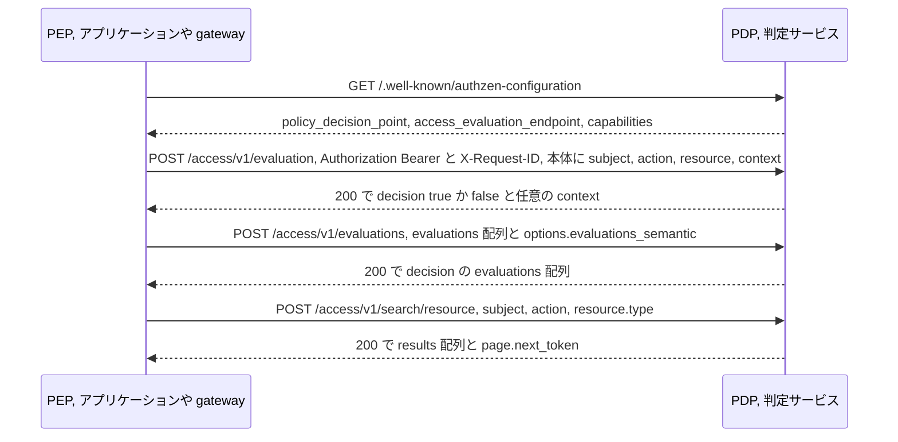

# AuthZEN Authorization API 1.0

> 一言で言うと: アクセスを実施するコードと判定するサービスの間の HTTP リクエストと応答を 1 つに標準化し、呼び出し側を書き直さずにポリシーエンジンを入れ替えられるようにする仕様。

## どういうときに使うか

- **複数のアプリに 1 つのポリシーエンジン**: チームごとに認可サービスへの呼び出しを手書きしていると、エンジンを差し替えられない。AuthZEN は Policy Decision Point と Policy Enforcement Point の契約を定め、異なるプロバイダの PDP と PEP が特定の実装に縛られず相互運用できるようにする (Section 1、Section 2)。
- **リクエストごとに yes か no が欲しい API gateway やサービス**: Access Evaluation API は `subject`、`action`、`resource` と任意の `context` を受け取り、`decision` を boolean で返す (Section 6)。
- **何十ものチェックが要る画面の描画**: Access Evaluations API は `evaluations` 配列を 1 回の呼び出しで送り、トップレベルの既定値と `execute_all`、`deny_on_first_deny`、`permit_on_first_permit` の選択ができる (Section 7)。
- **ユーザーが見てよいものの一覧**: Search API は与えられた組に対して許可される subject、resource、action をすべて返し、ページングには `page` オブジェクトを使う (Section 8)。

## 解決する問題

外部化された認可の形は誰もが同意している。アプリケーションが判定サービスに、この subject がこの resource にこの action をしてよいかを尋ねる。合意がなかったのはワイヤ形式で、PDP ごとにリクエスト本体が違い、あるベンダーのエンジン向けに書いた PEP は別のエンジンに使えなかった。この仕様は、異なるプロバイダが特定の実装に縛られずに PDP と PEP の機能を提供できるようにするためにある (Section 1)。

AuthZEN は情報モデルと HTTPS JSON binding を固定する。PDP はこの API を実装するサービス、PEP はそのクライアントで、仕様はトランスポート非依存、HTTPS を規範的な binding とする (Section 2)。拒否は HTTP エラーではなく `decision` が false の通常の 200 応答なので、呼び出し側はポリシーの結果とトランスポートの失敗を区別できる (Section 10.1.2)。

## 仕組み

PEP は `/.well-known/authzen-configuration` の metadata 文書で PDP を発見できる。そこには `policy_decision_point`、`access_evaluation_endpoint`、任意で evaluations と search のエンドポイントが載る (Section 9.1、Section 9.2)。HTTPS binding の API リクエストはすべて `Content-Type: application/json` の `POST` で、成功は 200 (Section 10.1)。evaluation の本体は `type` と `id` を持つ `subject`、`name` を持つ `action`、`type` と `id` を持つ `resource`、任意の `properties` と `context` を運ぶ (Section 5、Section 6.1)。応答は Decision で、boolean の `decision` と、理由や obligation のための任意の `context` (Section 5.5)。batch では項目ごとの上書きを `evaluations` に入れ、トップレベルのキーが既定値になる (Section 7.1.1)。search は探す type を指定し、`results` 配列と `page` オブジェクトを返す (Section 8.2、Section 8.3)。

## 仕様が求めること

- Subject は REQUIRED な `type` と `id` の 2 つのキーを持ち、Resource も同様、Action は REQUIRED な `name` を持つ。いずれも任意の `properties` オブジェクトを持てる (Section 5.1、Section 5.2、Section 5.3)。
- Access Evaluation のリクエストは `subject`、`action`、`resource` が必須で `context` は OPTIONAL。応答は REQUIRED な boolean `decision` を持つ Decision (Section 6.1、Section 6.2、Section 5.5)。
- Access Evaluations API では個々の evaluation 内のキーがトップレベルの既定値を上書きし、`execute_all` が既定のセマンティクス。`deny_on_first_deny` と `permit_on_first_permit` は途中で打ち切る (Section 7.1.1、Section 7.1.2.1)。
- ページングされた search 応答は不透明な `next_token` を持つ `page` オブジェクトを含まなければならず、続きがなければその値は空文字列でなければならない (Section 8.2)。
- metadata をサポートする PDP は `/.well-known/authzen-configuration` に JSON 文書を公開しなければならず、`policy_decision_point` の値は取得に使った識別子と同一でなければならない。そうでなければそのデータを使ってはならない (Section 9.2、Section 9.2.3)。
- エラーは 400、401、403、500 を使う。401 は PEP が PDP に正しく認証できなかったことを示す。リクエストに `X-Request-ID` があれば PDP はそれを返さなければならない (Section 10.1.2、Section 10.1.3)。

## 注意点

- PEP と PDP の間の接続は TLS などで保護しなければならず、PDP は mTLS、OAuth、API key で呼び出し元の PEP を認証すべき (Section 11.1、Section 11.2)。
- モデルは PDP が PEP を信頼しなければならないことを前提にする。判定を実施する責任は最終的に PEP にあるため (Section 11.4)。
- TLS は判定を書き換える中間者から守ってくれないので、PDP は応答に署名してもよい (Section 11.6)。
- PDP は巨大なペイロード、過剰なリクエスト、壊れた JSON に対して rate limiting などで備えるべき (Section 11.7)。
- JSON ペイロードは I-JSON に従い、null 値のプロパティは送らず省略すべき (Section 11.5)。

## 出典

- [Authorization API 1.0, Section 1](https://openid.net/specs/authorization-api-1_0.html#section-1)
- [Authorization API 1.0, Section 2](https://openid.net/specs/authorization-api-1_0.html#section-2)
- [Authorization API 1.0, Section 5](https://openid.net/specs/authorization-api-1_0.html#section-5)
- [Authorization API 1.0, Section 5.1](https://openid.net/specs/authorization-api-1_0.html#section-5.1)
- [Authorization API 1.0, Section 5.2](https://openid.net/specs/authorization-api-1_0.html#section-5.2)
- [Authorization API 1.0, Section 5.3](https://openid.net/specs/authorization-api-1_0.html#section-5.3)
- [Authorization API 1.0, Section 5.5](https://openid.net/specs/authorization-api-1_0.html#section-5.5)
- [Authorization API 1.0, Section 6](https://openid.net/specs/authorization-api-1_0.html#section-6)
- [Authorization API 1.0, Section 6.1](https://openid.net/specs/authorization-api-1_0.html#section-6.1)
- [Authorization API 1.0, Section 6.2](https://openid.net/specs/authorization-api-1_0.html#section-6.2)
- [Authorization API 1.0, Section 7](https://openid.net/specs/authorization-api-1_0.html#section-7)
- [Authorization API 1.0, Section 7.1.1](https://openid.net/specs/authorization-api-1_0.html#section-7.1.1)
- [Authorization API 1.0, Section 7.1.2.1](https://openid.net/specs/authorization-api-1_0.html#section-7.1.2.1)
- [Authorization API 1.0, Section 8](https://openid.net/specs/authorization-api-1_0.html#section-8)
- [Authorization API 1.0, Section 8.2](https://openid.net/specs/authorization-api-1_0.html#section-8.2)
- [Authorization API 1.0, Section 8.3](https://openid.net/specs/authorization-api-1_0.html#section-8.3)
- [Authorization API 1.0, Section 9.1](https://openid.net/specs/authorization-api-1_0.html#section-9.1)
- [Authorization API 1.0, Section 9.2](https://openid.net/specs/authorization-api-1_0.html#section-9.2)
- [Authorization API 1.0, Section 9.2.3](https://openid.net/specs/authorization-api-1_0.html#section-9.2.3)
- [Authorization API 1.0, Section 10.1](https://openid.net/specs/authorization-api-1_0.html#section-10.1)
- [Authorization API 1.0, Section 10.1.2](https://openid.net/specs/authorization-api-1_0.html#section-10.1.2)
- [Authorization API 1.0, Section 10.1.3](https://openid.net/specs/authorization-api-1_0.html#section-10.1.3)
- [Authorization API 1.0, Section 11.1](https://openid.net/specs/authorization-api-1_0.html#section-11.1)
- [Authorization API 1.0, Section 11.2](https://openid.net/specs/authorization-api-1_0.html#section-11.2)
- [Authorization API 1.0, Section 11.4](https://openid.net/specs/authorization-api-1_0.html#section-11.4)
- [Authorization API 1.0, Section 11.5](https://openid.net/specs/authorization-api-1_0.html#section-11.5)
- [Authorization API 1.0, Section 11.6](https://openid.net/specs/authorization-api-1_0.html#section-11.6)
- [Authorization API 1.0, Section 11.7](https://openid.net/specs/authorization-api-1_0.html#section-11.7)
