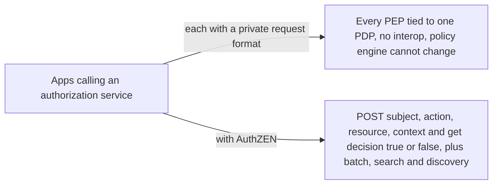
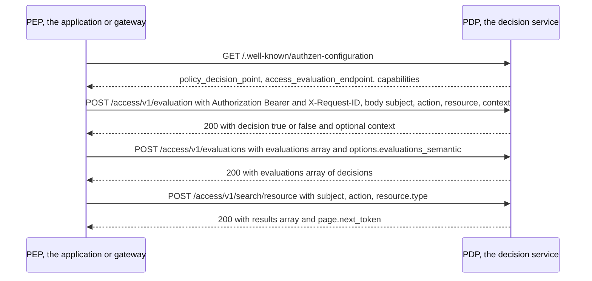

# AuthZEN Authorization API 1.0

> In one line: one standard HTTP request and response between the code that enforces access and the service that decides it, so you can swap the policy engine without rewriting every caller.

## When you reach for it

- **Several apps, one policy engine**: each team hand-rolls its own call to the authorization service and the engine cannot be replaced. AuthZEN defines the Policy Decision Point and Policy Enforcement Point contract so PDP and PEP capabilities from different providers interoperate without binding to one implementation (Section 1, Section 2).
- **An API gateway or service that needs a yes or no per request**: the Access Evaluation API takes `subject`, `action`, `resource` and optional `context` and returns `decision` as a boolean (Section 6).
- **Rendering a page that needs dozens of checks**: the Access Evaluations API sends an `evaluations` array in one call, with top-level defaults and a choice of `execute_all`, `deny_on_first_deny` or `permit_on_first_permit` (Section 7).
- **Listing what a user may see**: the Search APIs return all subjects, resources or actions that are permitted for a given tuple, with a `page` object for pagination (Section 8).

## The problem it solves

Externalized authorization has a shape everyone agrees on: the application asks a decision service whether this subject may perform this action on this resource. What nobody agreed on was the wire format. Each PDP had its own request body, so a PEP written for one vendor's engine was useless against another. The spec exists so that different providers can offer PDP and PEP capabilities without binding to one implementation (Section 1).

AuthZEN fixes the information model and an HTTPS JSON binding. The PDP is the service that implements the API, the PEP is its client, and the spec is transport-agnostic with HTTPS as the normative binding (Section 2). A denial is a normal 200 response with `decision` false, not an HTTP error, so callers can tell policy outcomes from transport failures (Section 10.1.2).

## How it works

A PEP can discover the PDP through its metadata document at `/.well-known/authzen-configuration`, which names `policy_decision_point`, the `access_evaluation_endpoint` and optional endpoints for evaluations and search (Section 9.1, Section 9.2). Every API request in the HTTPS binding is a `POST` with `Content-Type: application/json`, and a success is a 200 (Section 10.1). The body of an evaluation carries a `subject` with `type` and `id`, an `action` with `name`, a `resource` with `type` and `id`, and optional `properties` and `context` (Section 5, Section 6.1). The response is a Decision: a boolean `decision` and an optional `context` for reasons or obligations (Section 5.5). Batch requests put per-item overrides in `evaluations` while top-level keys act as defaults (Section 7.1.1). Search requests name the type to search for and return a `results` array with a `page` object (Section 8.2, Section 8.3).

## What the spec requires

- A Subject contains two REQUIRED keys, `type` and `id`; a Resource likewise; an Action contains a REQUIRED `name`; each may carry an optional `properties` object (Section 5.1, Section 5.2, Section 5.3).
- The Access Evaluation request requires `subject`, `action` and `resource`, with `context` OPTIONAL; the response is a Decision with a REQUIRED boolean `decision` (Section 6.1, Section 6.2, Section 5.5).
- In the Access Evaluations API, any key in an individual evaluation overrides the top-level default, and `execute_all` is the default semantic; `deny_on_first_deny` and `permit_on_first_permit` stop early (Section 7.1.1, Section 7.1.2.1).
- A paginated search response MUST include a `page` object with an opaque `next_token`, and that value MUST be an empty string when there are no more results (Section 8.2).
- PDPs supporting metadata MUST publish a JSON document at `/.well-known/authzen-configuration`, and the `policy_decision_point` value MUST be identical to the identifier used to fetch it or the data must not be used (Section 9.2, Section 9.2.3).
- Errors use 400, 401, 403 and 500; a 401 means the PEP did not properly authenticate to the PDP; if the request carried `X-Request-ID` the PDP must echo it back (Section 10.1.2, Section 10.1.3).

## Watch out

- The connection between PEP and PDP MUST be secured, for example with TLS, and the PDP SHOULD authenticate the calling PEP with mTLS, OAuth or API keys (Section 11.1, Section 11.2).
- The model assumes the PDP must trust the PEP, because the PEP is ultimately responsible for enforcing the decision (Section 11.4).
- TLS does not protect against an intermediary that rewrites a decision, so a PDP MAY sign responses (Section 11.6).
- The PDP should guard against oversized payloads, excessive requests and malformed JSON, for example with rate limiting (Section 11.7).
- JSON payloads follow I-JSON, and null-valued properties should be omitted rather than sent (Section 11.5).

## Sources

- [Authorization API 1.0, Section 1](https://openid.net/specs/authorization-api-1_0.html#section-1)
- [Authorization API 1.0, Section 2](https://openid.net/specs/authorization-api-1_0.html#section-2)
- [Authorization API 1.0, Section 5](https://openid.net/specs/authorization-api-1_0.html#section-5)
- [Authorization API 1.0, Section 5.1](https://openid.net/specs/authorization-api-1_0.html#section-5.1)
- [Authorization API 1.0, Section 5.2](https://openid.net/specs/authorization-api-1_0.html#section-5.2)
- [Authorization API 1.0, Section 5.3](https://openid.net/specs/authorization-api-1_0.html#section-5.3)
- [Authorization API 1.0, Section 5.5](https://openid.net/specs/authorization-api-1_0.html#section-5.5)
- [Authorization API 1.0, Section 6](https://openid.net/specs/authorization-api-1_0.html#section-6)
- [Authorization API 1.0, Section 6.1](https://openid.net/specs/authorization-api-1_0.html#section-6.1)
- [Authorization API 1.0, Section 6.2](https://openid.net/specs/authorization-api-1_0.html#section-6.2)
- [Authorization API 1.0, Section 7](https://openid.net/specs/authorization-api-1_0.html#section-7)
- [Authorization API 1.0, Section 7.1.1](https://openid.net/specs/authorization-api-1_0.html#section-7.1.1)
- [Authorization API 1.0, Section 7.1.2.1](https://openid.net/specs/authorization-api-1_0.html#section-7.1.2.1)
- [Authorization API 1.0, Section 8](https://openid.net/specs/authorization-api-1_0.html#section-8)
- [Authorization API 1.0, Section 8.2](https://openid.net/specs/authorization-api-1_0.html#section-8.2)
- [Authorization API 1.0, Section 8.3](https://openid.net/specs/authorization-api-1_0.html#section-8.3)
- [Authorization API 1.0, Section 9.1](https://openid.net/specs/authorization-api-1_0.html#section-9.1)
- [Authorization API 1.0, Section 9.2](https://openid.net/specs/authorization-api-1_0.html#section-9.2)
- [Authorization API 1.0, Section 9.2.3](https://openid.net/specs/authorization-api-1_0.html#section-9.2.3)
- [Authorization API 1.0, Section 10.1](https://openid.net/specs/authorization-api-1_0.html#section-10.1)
- [Authorization API 1.0, Section 10.1.2](https://openid.net/specs/authorization-api-1_0.html#section-10.1.2)
- [Authorization API 1.0, Section 10.1.3](https://openid.net/specs/authorization-api-1_0.html#section-10.1.3)
- [Authorization API 1.0, Section 11.1](https://openid.net/specs/authorization-api-1_0.html#section-11.1)
- [Authorization API 1.0, Section 11.2](https://openid.net/specs/authorization-api-1_0.html#section-11.2)
- [Authorization API 1.0, Section 11.4](https://openid.net/specs/authorization-api-1_0.html#section-11.4)
- [Authorization API 1.0, Section 11.5](https://openid.net/specs/authorization-api-1_0.html#section-11.5)
- [Authorization API 1.0, Section 11.6](https://openid.net/specs/authorization-api-1_0.html#section-11.6)
- [Authorization API 1.0, Section 11.7](https://openid.net/specs/authorization-api-1_0.html#section-11.7)
