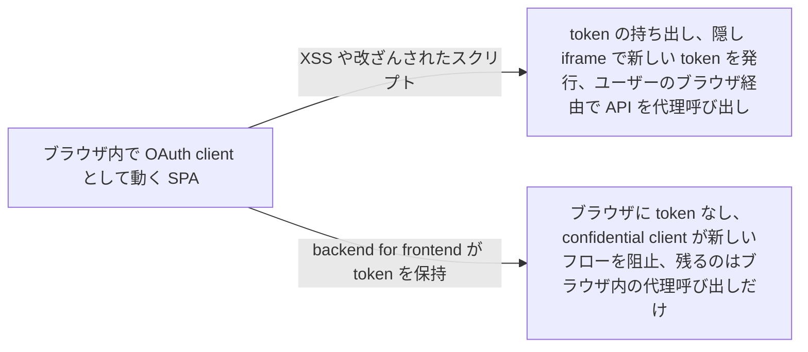
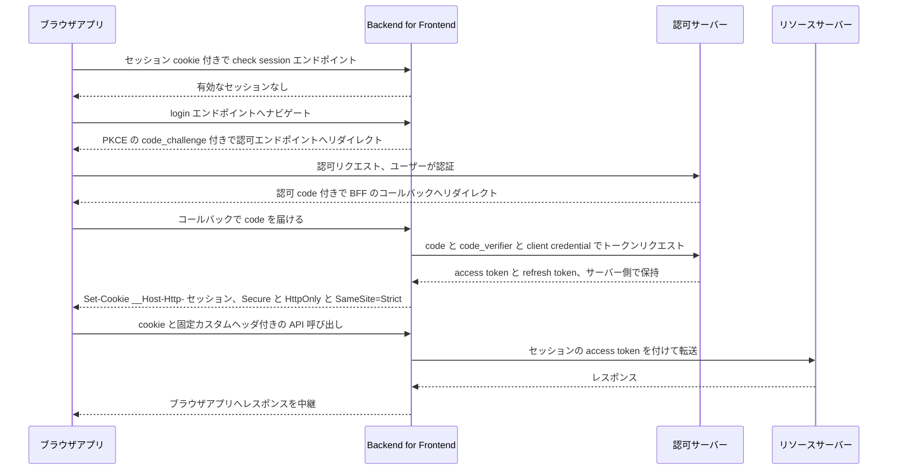

# OAuth 2.0 for Browser-Based Applications

> 一言で言うと: SPA に入り込んだ悪意ある JavaScript は自分のコードと同じ権限を持つ。だから OAuth の token を置く一番安全な場所は、token をブラウザに一切出さないサーバー側の backend for frontend である。

## どういうときに使うか

- **JavaScript が持つ access token で API を呼ぶ業務系・機微な SPA**: XSS が 1 つあれば攻撃者はその token を取れるし、隠し iframe で silent な認可コードフローを走らせて新しい token を作れる。BFF パターンは token をサーバーに置き、業務アプリと個人データを扱うアプリに強く推奨される (Section 6.1.4.3)。
- **まだ implicit grant の SPA**: access token が URL フラグメントで戻ってきて横取りされうる。ブラウザベース client は認可コードグラントを使わなければならず、implicit を使ってはならない (Section 7.2)。
- **service worker で token をページのコードから隠そうと考えているチーム**: 悪意あるコードは worker を unregister し、worker の付いていない新しい frame でフローを始められる。このパターンは推奨されない (Section 7.4.1.1)。
- **本当にバックエンドを持たない public な SPA**: 自分が OAuth client になってもよいが、その場合 PKCE を使い、サーバーがそれを強制し、リフレッシュトークンはローテーションか sender-constrained で寿命に上限がなければならない (Section 6.3.2.1, 6.3.2.3)。

## 解決する問題

攻撃者がアプリケーションの origin で JavaScript を実行すると、そのコードはアプリケーションから隔離されない。origin ベースのストレージを読み、origin からリクエストを送り、アプリケーションレベルの防御を改変できる。悪意あるコードは正規のコードと同じ権限を持つからだ (Section 5)。OAuth client に対してこれは、今の token を盗む以上のことを意味する。攻撃者は token を継続的に盗んで短い寿命やリフレッシュトークンのローテーションを無効化できるし (Section 5.1.2)、保存された token を無視して隠し iframe を開き、認可サーバーでのユーザーのセッションを再利用して独立した新しい token 一式を得られる。フロントエンドのどのストレージ方式も、DPoP でさえこれを止められない。攻撃者のフローは正規のフローと区別がつかず、攻撃者は自分の DPoP 鍵を使えるからだ (Section 5.1.3)。

そこで仕様は、この攻撃面をどれだけ減らせるかで 3 つのアーキテクチャを順位付けする。BFF、token-mediating backend、ブラウザベース client の順である (Section 6)。

## 仕組み

フロントエンドはまず BFF の check session エンドポイントを呼ぶ。セッションがなければ BFF の login エンドポイントにナビゲートし、BFF は認可コードグラント + PKCE でブラウザを認可エンドポイントへリダイレクトする (Section 6.1.1)。ブラウザが認可 code を BFF に届け、BFF は client credential と `code_verifier` で引き換える。BFF は confidential client でなければならないからだ (Section 6.1.3.1)。token は cookie ベースのセッションに紐付けられ、ブラウザには決して渡らない (Section 6.1)。フロントエンドからの API 呼び出しはすべて BFF に向かい、BFF は cookie を外し、access token を付けてリソースサーバーに転送する (Section 6.1.1)。セッション cookie は `Secure` と `HttpOnly` を持ち、`SameSite=Strict` と `__Host-Http-` プレフィックスを付けるべきで (Section 6.1.3.2)、BFF は `My-Static-Header: 1` のような固定カスタムリクエストヘッダを要求して、すべての cross-origin 呼び出しに CORS preflight を必要にすべきである (Section 6.1.3.3.2)。

## 仕様が求めること

- BFF は認可サーバーに credential を持つ confidential client として振る舞い、RFC 9700 Section 2.1.1 のとおり認可コードグラントを使わなければならない (Section 6.1.3.1)。
- BFF は cookie に `Secure` と `HttpOnly` を付けなければならず、`SameSite=Strict` を付け、path を `/` にして `Domain` 属性を付けず、名前を `__Host-Http-` で始めるべきである (Section 6.1.3.2)。
- BFF は適切な CSRF 対策を実装しなければならず (Section 6.1.3.3)、リクエストを転送する前に宛先ホストの明示的な allowlist を強制しなければならない (Section 6.1.3.6)。
- ブラウザベースの public client は PKCE を実装しなければならず、認可サーバーはそうした client に PKCE を対応・強制しなければならない (Section 6.3.2.1)。redirect URI への CSRF は PKCE 強制、一意の `state`、OpenID Connect の `nonce` のいずれかで防がなければならない (Section 6.3.2.2)。
- ブラウザベース client にリフレッシュトークンを出すなら、サーバーはローテーションか sender-constrained にし、最大寿命か無活動タイムアウトで寿命を区切り、ローテーション後の token の寿命を最初の token を超えて延ばしてはならない (Section 6.3.2.3)。
- 認可サーバーは認可レスポンスで access token を発行してはならない。ブラウザベース client は認可コードグラントを使い、implicit grant を使ってはならない (Section 7.2)。
- resource owner password credentials grant は使ってはならず、ブラウザベースアプリはリダイレクトベースのフローを使わなければならない (Section 7.3)。

## 注意点

- BFF は攻撃者がユーザーのブラウザ経由でリクエストを代理送信するのを止めない。これは web アプリケーションに固有のものとして受け入れられており、`HttpOnly` cookie が効くのはそのためで、client の乗っ取りからセッションの乗っ取りへの昇格を防ぐ (Section 6.1)。
- BFF が他のアプリケーションと site を共有するとき、`SameSite=Strict` だけでは CSRF 対策として足りない。`b.example.com` のサブドメイン乗っ取りが `a.example.com` の BFF への CSRF を可能にする (Section 6.1.3.3.1)。
- DPoP は問題を token の保護から秘密鍵の保護に移す。export 不可の WebCrypto 鍵を使い、新しいフローを走らせられる攻撃者は自分の鍵を束縛できることを忘れない (Section 9.2, 5.1.3)。

## 出典

- [RFC 10017, Section 5](https://www.rfc-editor.org/rfc/rfc10017#section-5)
- [RFC 10017, Section 5.1.2](https://www.rfc-editor.org/rfc/rfc10017#section-5.1.2)
- [RFC 10017, Section 5.1.3](https://www.rfc-editor.org/rfc/rfc10017#section-5.1.3)
- [RFC 10017, Section 6](https://www.rfc-editor.org/rfc/rfc10017#section-6)
- [RFC 10017, Section 6.1](https://www.rfc-editor.org/rfc/rfc10017#section-6.1)
- [RFC 10017, Section 6.1.1](https://www.rfc-editor.org/rfc/rfc10017#section-6.1.1)
- [RFC 10017, Section 6.1.3.1](https://www.rfc-editor.org/rfc/rfc10017#section-6.1.3.1)
- [RFC 10017, Section 6.1.3.2](https://www.rfc-editor.org/rfc/rfc10017#section-6.1.3.2)
- [RFC 10017, Section 6.1.3.3](https://www.rfc-editor.org/rfc/rfc10017#section-6.1.3.3)
- [RFC 10017, Section 6.1.3.3.1](https://www.rfc-editor.org/rfc/rfc10017#section-6.1.3.3.1)
- [RFC 10017, Section 6.1.3.3.2](https://www.rfc-editor.org/rfc/rfc10017#section-6.1.3.3.2)
- [RFC 10017, Section 6.1.3.6](https://www.rfc-editor.org/rfc/rfc10017#section-6.1.3.6)
- [RFC 10017, Section 6.1.4.3](https://www.rfc-editor.org/rfc/rfc10017#section-6.1.4.3)
- [RFC 10017, Section 6.3.2.1](https://www.rfc-editor.org/rfc/rfc10017#section-6.3.2.1)
- [RFC 10017, Section 6.3.2.2](https://www.rfc-editor.org/rfc/rfc10017#section-6.3.2.2)
- [RFC 10017, Section 6.3.2.3](https://www.rfc-editor.org/rfc/rfc10017#section-6.3.2.3)
- [RFC 10017, Section 7.2](https://www.rfc-editor.org/rfc/rfc10017#section-7.2)
- [RFC 10017, Section 7.3](https://www.rfc-editor.org/rfc/rfc10017#section-7.3)
- [RFC 10017, Section 7.4.1.1](https://www.rfc-editor.org/rfc/rfc10017#section-7.4.1.1)
- [RFC 10017, Section 9.2](https://www.rfc-editor.org/rfc/rfc10017#section-9.2)
