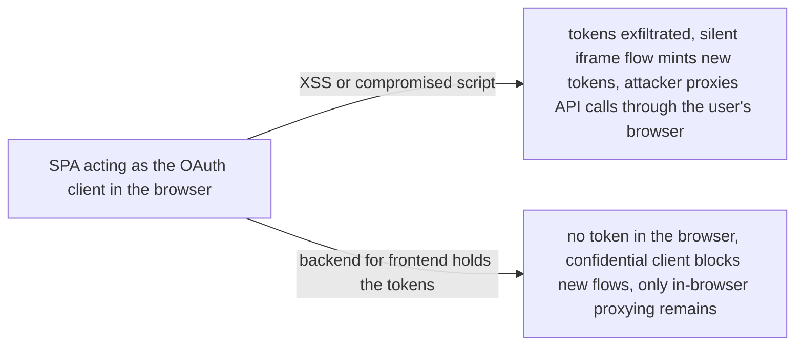
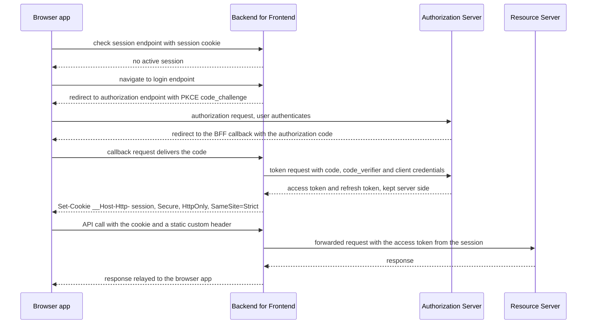

# OAuth 2.0 for Browser-Based Applications

> In one line: malicious JavaScript in your SPA has every privilege your own code has, so the safest place for OAuth tokens is a server-side backend for frontend that keeps them out of the browser entirely.

## When you reach for it

- **A business or sensitive SPA that calls APIs with access tokens held in JavaScript**: one XSS gives the attacker those tokens, or lets them run a silent authorization code flow in a hidden iframe to mint new ones. The BFF pattern keeps tokens on the server and is strongly recommended for business applications and anything handling personal data (Section 6.1.4.3).
- **A SPA still on the implicit grant**: the access token comes back in the URL fragment where it can be intercepted. Browser-based clients MUST use the authorization code grant and MUST NOT use implicit (Section 7.2).
- **A team considering a service worker to hide tokens from page code**: malicious code can unregister the worker and start a fresh flow in a new frame with no worker attached, so the pattern is not recommended (Section 7.4.1.1).
- **A public SPA that genuinely has no backend**: it may act as the OAuth client itself, but then it MUST use PKCE, the server MUST enforce it, and refresh tokens must rotate or be sender-constrained with a bounded lifetime (Sections 6.3.2.1, 6.3.2.3).

## The problem it solves

When an attacker runs JavaScript in the application's origin, that code is not isolated from the application: it can read origin-based storage, send requests from the origin, and tamper with any application-level defense, because malicious code has the same privileges as the legitimate code (Section 5). Against an OAuth client that means more than stealing the current token. The attacker can steal tokens continuously, which defeats short lifetimes and refresh token rotation (Section 5.1.2), or ignore stored tokens altogether and open a hidden iframe that reuses the user's session at the authorization server to obtain a new, independent token set. No frontend storage scheme and not even DPoP stops that, because the attacker's flow is indistinguishable from a legitimate one and the attacker can use their own DPoP key (Section 5.1.3).

The specification therefore ranks three architectures by how much of that attack surface they remove, from the BFF, through a token-mediating backend, to a browser-based client (Section 6).

## How it works

The frontend first calls the BFF's check session endpoint; with no session it navigates to the BFF's login endpoint, and the BFF redirects the browser to the authorization endpoint with the authorization code grant plus PKCE (Section 6.1.1). The browser delivers the authorization code to the BFF, which exchanges it using its client credentials and `code_verifier`, because the BFF MUST be a confidential client (Section 6.1.3.1). Tokens are associated with a cookie-based session and never reach the browser (Section 6.1). Every API call from the frontend goes to the BFF, which removes the cookie, attaches the access token and forwards the request to the resource server (Section 6.1.1). The session cookie carries `Secure` and `HttpOnly`, should be `SameSite=Strict` with a `__Host-Http-` prefix (Section 6.1.3.2), and the BFF should require a static custom request header such as `My-Static-Header: 1` so every cross-origin call needs a CORS preflight (Section 6.1.3.3.2).

## What the spec requires

- The BFF MUST act as a confidential client with credentials at the authorization server and MUST use the authorization code grant as in RFC 9700 Section 2.1.1 (Section 6.1.3.1).
- The BFF MUST set `Secure` and `HttpOnly` on its cookies, SHOULD set `SameSite=Strict`, SHOULD use a path of `/` with no `Domain` attribute, and SHOULD prefix the name with `__Host-Http-` (Section 6.1.3.2).
- The BFF MUST implement a proper CSRF defense (Section 6.1.3.3), and MUST enforce an explicit allowlist of destination hosts before proxying a request (Section 6.1.3.6).
- Browser-based public clients MUST implement PKCE, and authorization servers MUST support and enforce it for such clients (Section 6.3.2.1); they MUST prevent CSRF against the redirect URI via PKCE enforcement, a unique `state`, or the OpenID Connect `nonce` (Section 6.3.2.2).
- If refresh tokens go to browser-based clients, the server MUST rotate them or sender-constrain them, MUST bound their lifetime by a maximum or an inactivity timeout, and MUST NOT extend a rotated token's lifetime beyond the initial one (Section 6.3.2.3).
- The authorization server MUST NOT issue access tokens in the authorization response; browser-based clients MUST use the authorization code grant and MUST NOT use the implicit grant (Section 7.2).
- The resource owner password credentials grant MUST NOT be used, and browser-based apps MUST use a redirect-based flow (Section 7.3).

## Watch out

- The BFF does not stop an attacker from proxying requests through the user's browser; that attack is accepted as inherent to web applications and is why `HttpOnly` cookies matter, since they prevent escalation from client hijacking to session hijacking (Section 6.1).
- `SameSite=Strict` alone is not a sufficient CSRF defense when the BFF shares a site with other applications: a subdomain takeover of `b.example.com` enables CSRF against the BFF at `a.example.com` (Section 6.1.3.3.1).
- DPoP shifts the problem from protecting the token to protecting the private key; use a non-exportable WebCrypto key, and remember that an attacker who can run a new flow can bind their own key (Sections 9.2, 5.1.3).

## Sources

- [RFC 10017, Section 5](https://www.rfc-editor.org/rfc/rfc10017#section-5)
- [RFC 10017, Section 5.1.2](https://www.rfc-editor.org/rfc/rfc10017#section-5.1.2)
- [RFC 10017, Section 5.1.3](https://www.rfc-editor.org/rfc/rfc10017#section-5.1.3)
- [RFC 10017, Section 6](https://www.rfc-editor.org/rfc/rfc10017#section-6)
- [RFC 10017, Section 6.1](https://www.rfc-editor.org/rfc/rfc10017#section-6.1)
- [RFC 10017, Section 6.1.1](https://www.rfc-editor.org/rfc/rfc10017#section-6.1.1)
- [RFC 10017, Section 6.1.3.1](https://www.rfc-editor.org/rfc/rfc10017#section-6.1.3.1)
- [RFC 10017, Section 6.1.3.2](https://www.rfc-editor.org/rfc/rfc10017#section-6.1.3.2)
- [RFC 10017, Section 6.1.3.3](https://www.rfc-editor.org/rfc/rfc10017#section-6.1.3.3)
- [RFC 10017, Section 6.1.3.3.1](https://www.rfc-editor.org/rfc/rfc10017#section-6.1.3.3.1)
- [RFC 10017, Section 6.1.3.3.2](https://www.rfc-editor.org/rfc/rfc10017#section-6.1.3.3.2)
- [RFC 10017, Section 6.1.3.6](https://www.rfc-editor.org/rfc/rfc10017#section-6.1.3.6)
- [RFC 10017, Section 6.1.4.3](https://www.rfc-editor.org/rfc/rfc10017#section-6.1.4.3)
- [RFC 10017, Section 6.3.2.1](https://www.rfc-editor.org/rfc/rfc10017#section-6.3.2.1)
- [RFC 10017, Section 6.3.2.2](https://www.rfc-editor.org/rfc/rfc10017#section-6.3.2.2)
- [RFC 10017, Section 6.3.2.3](https://www.rfc-editor.org/rfc/rfc10017#section-6.3.2.3)
- [RFC 10017, Section 7.2](https://www.rfc-editor.org/rfc/rfc10017#section-7.2)
- [RFC 10017, Section 7.3](https://www.rfc-editor.org/rfc/rfc10017#section-7.3)
- [RFC 10017, Section 7.4.1.1](https://www.rfc-editor.org/rfc/rfc10017#section-7.4.1.1)
- [RFC 10017, Section 9.2](https://www.rfc-editor.org/rfc/rfc10017#section-9.2)
