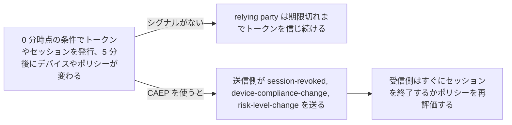
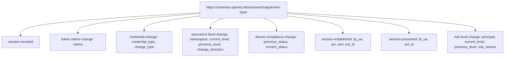
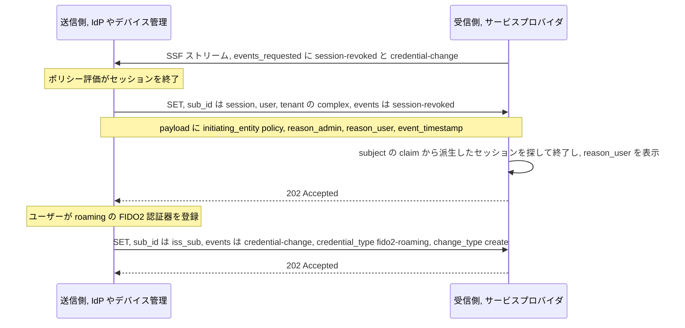

# Continuous Access Evaluation Profile (CAEP)

> 一言で言うと: CAEP は、セッション・トークンの claim・資格情報・デバイスのコンプライアンス・保証レベル・リスクレベルが変わったことを relying party に伝える SSF のイベント型の集まりで、トークンの期限切れを待たずに今アクセスを再評価できるようにする。

## どういうときに使うか

- **ログイン中に管理対象デバイスがコンプライアンス違反になった**: デバイス管理システムが `previous_status` を `compliant`、`current_status` を `not-compliant` にした `device-compliance-change` を送り、受信側はそのデバイスのコンプライアンス状態が変わったことを知る (Section 3.5)。
- **ポリシーが発火して IdP がセッションを終了した**: `session-revoked` はセッションそのものを名指しするか、`user`・`device`・`tenant` を持つ complex subject でそれらの claim から派生したすべてのセッションを受信側に見つけさせる。`initiating_entity` は `policy`、本人に見せる `reason_user` はローカライズされている (Section 2, 3.1)。
- **発行済みトークンのロールが期限前に変わった**: `token-claims-change` は `jwt_id` か `saml_assertion_id` の subject でトークンを特定し、新しい値を `claims` に入れる (Section 3.2)。
- **ユーザーが FIDO2 キーを登録した、あるいはパスワードがリセットされた**: `credential_type` と `change_type` を持つ `credential-change` が、資格情報の作成・失効・更新・削除を受信側に伝える (Section 3.3)。
- **Service A にパスワードでサインインしたユーザーが、後から Service B で MFA をした**: `namespace`・`current_level`・`change_direction` が `increase` の `assurance-level-change` で、Service A はより強い認証が行われたことを知る (Section 3.4)。

## 解決する問題

セッションやトークンは発行した瞬間の条件を映している。ユーザーのデバイスがコンプライアンスを外れ、管理者がセッションを失効させ、資格情報が置き換わり、リスクエンジンが判定を変えても、そのセッションを持つサービスプロバイダにはそれを知る標準的な手段がない。CAEP は協調するプロバイダのネットワークでアクセスの安全を保つための SSF の応用で、送信側が送るイベント型を定め、受信側が共有される人間やロボットのユーザー・デバイス・セッション・アプリケーションへのアクセスを絞れるようにする (Abstract, Section 1)。

CAEP は独自のトランスポートを定義しない。すべてのイベントは `sub_id` を持つ SSF の SET で、SSF のストリームで配信される。プロファイルが加えるのは、全イベント共通の少数の任意 claim と、各イベント型固有の claim だ (Section 2, 3)。

## 仕組み

受信側は SSF のストリームで、自分が対応できる CAEP のイベント型を購読する。送信側がセッションを終了すると、`events` のメンバーが `session-revoked` の URI で、`sub_id` がセッションを直接指すか complex subject で表す SET を送る。complex subject の場合、失効はそれらの claim の組み合わせから派生するすべてのセッションに及ぶ (Section 3.1)。payload には `event_timestamp` (epoch 秒)、`initiating_entity` (`admin`・`user`・`policy`・`system`)、BCP 47 言語タグをキーにした `reason_admin` と `reason_user` を入れられる (Section 2)。資格情報の変更も同じ形で、イベント型が `credential-change`、payload に `credential_type` と `change_type` が入る (Section 3.3.1)。受信側は SSF と RFC 8935 / RFC 8936 の定めどおり配信を ack してから動く。

## 仕様が求めること

- CAEP イベント型のベース URI は `https://schemas.openid.net/secevent/caep/event-type/` (Section 3)。
- `event_timestamp`・`initiating_entity`・`reason_admin`・`reason_user` はすべてのイベントで任意。`initiating_entity` は `admin`・`user`・`policy`・`system` のいずれかでなければならず、reason の object は BCP 47 言語タグをキー、メッセージを値とする 1 つ以上のペアを含まなければならない (Section 2)。
- `session-revoked` にイベント固有の claim はない。`event_timestamp` を入れるなら失効が起きた時刻でなければならない (Section 3.1.1)。
- `token-claims-change` は新しい値を持つ JSON object の `claims` が必須 (Section 3.2.1)。
- `credential-change` は `credential_type` (`password`、`pin`、`x509`、`fido2-platform`、`fido2-roaming`、`fido-u2f`、`verifiable-credential`、`phone-voice`、`phone-sms`、`app`、または双方が対応する型) と `change_type` (`create`、`revoke`、`update`、`delete`) が必須 (Section 3.3.1)。
- `assurance-level-change` は `namespace` と `current_level` が必須。`previous_level` が省かれたら受信側は、以前のレベルを送信側が把握していないとみなさなければならない。`change_direction` を入れるなら `increase` か `decrease` (Section 3.4.1)。
- `device-compliance-change` は `previous_status` と `current_status` が必須で、それぞれ `compliant` か `not-compliant` (Section 3.5.1)。
- `risk-level-change` は `principal` と `current_level` が必須で、レベルは `LOW`・`MEDIUM`・`HIGH`。`previous_level` が省かれたら受信側は、以前のレベルを送信側が把握していないとみなさなければならない (Section 3.8.1)。

## 注意点

- **SSF の外で CAEP を使わない**: 実装は Shared Signals Framework に準拠すべきで、準拠せずにこれらのイベントを交換するとセキュリティ上の問題を招きうる (Section 4)。
- **`fp_ua` はセッション識別子ではない**: `session-established` と `session-presented` のユーザーエージェント指紋はセッションの性質を示すもので、セッションを識別するためのものではない (Section 3.6.1, 3.7.1)。
- **独自の assurance namespace**: 列挙されたもの以外の `namespace` は、送信側と受信側が合意した独自 namespace の別名としてだけ使える (Section 3.4.1)。
- **`session-established` は双方向に使える**: 送信側として動くサービスがフェデレーションログイン後に IdP とループを閉じられ、IdP はそこから意図しないログインを検知できる (Section 3.6)。

## 出典

- [OpenID CAEP 1.0, Abstract](https://openid.net/specs/openid-caep-1_0-final.html#abstract)
- [OpenID CAEP 1.0, Section 1](https://openid.net/specs/openid-caep-1_0-final.html#section-1)
- [OpenID CAEP 1.0, Section 2](https://openid.net/specs/openid-caep-1_0-final.html#section-2)
- [OpenID CAEP 1.0, Section 3](https://openid.net/specs/openid-caep-1_0-final.html#section-3)
- [OpenID CAEP 1.0, Section 3.1](https://openid.net/specs/openid-caep-1_0-final.html#section-3.1)
- [OpenID CAEP 1.0, Section 3.1.1](https://openid.net/specs/openid-caep-1_0-final.html#section-3.1.1)
- [OpenID CAEP 1.0, Section 3.2](https://openid.net/specs/openid-caep-1_0-final.html#section-3.2)
- [OpenID CAEP 1.0, Section 3.2.1](https://openid.net/specs/openid-caep-1_0-final.html#section-3.2.1)
- [OpenID CAEP 1.0, Section 3.3](https://openid.net/specs/openid-caep-1_0-final.html#section-3.3)
- [OpenID CAEP 1.0, Section 3.3.1](https://openid.net/specs/openid-caep-1_0-final.html#section-3.3.1)
- [OpenID CAEP 1.0, Section 3.4](https://openid.net/specs/openid-caep-1_0-final.html#section-3.4)
- [OpenID CAEP 1.0, Section 3.4.1](https://openid.net/specs/openid-caep-1_0-final.html#section-3.4.1)
- [OpenID CAEP 1.0, Section 3.5](https://openid.net/specs/openid-caep-1_0-final.html#section-3.5)
- [OpenID CAEP 1.0, Section 3.5.1](https://openid.net/specs/openid-caep-1_0-final.html#section-3.5.1)
- [OpenID CAEP 1.0, Section 3.6](https://openid.net/specs/openid-caep-1_0-final.html#section-3.6)
- [OpenID CAEP 1.0, Section 3.6.1](https://openid.net/specs/openid-caep-1_0-final.html#section-3.6.1)
- [OpenID CAEP 1.0, Section 3.7.1](https://openid.net/specs/openid-caep-1_0-final.html#section-3.7.1)
- [OpenID CAEP 1.0, Section 3.8.1](https://openid.net/specs/openid-caep-1_0-final.html#section-3.8.1)
- [OpenID CAEP 1.0, Section 4](https://openid.net/specs/openid-caep-1_0-final.html#section-4)
