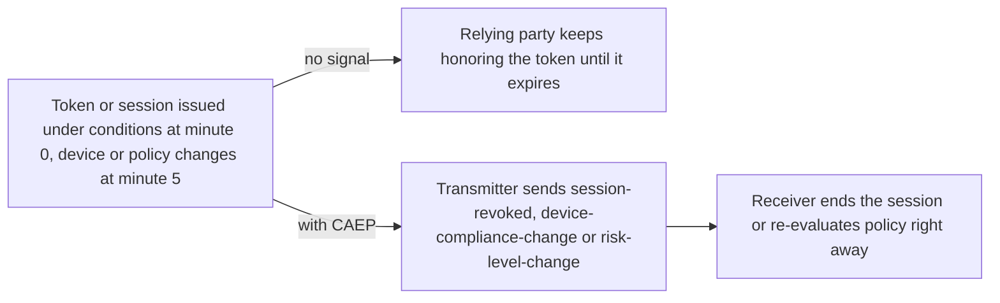
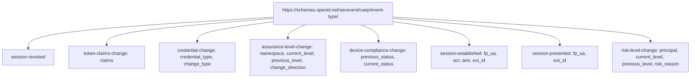
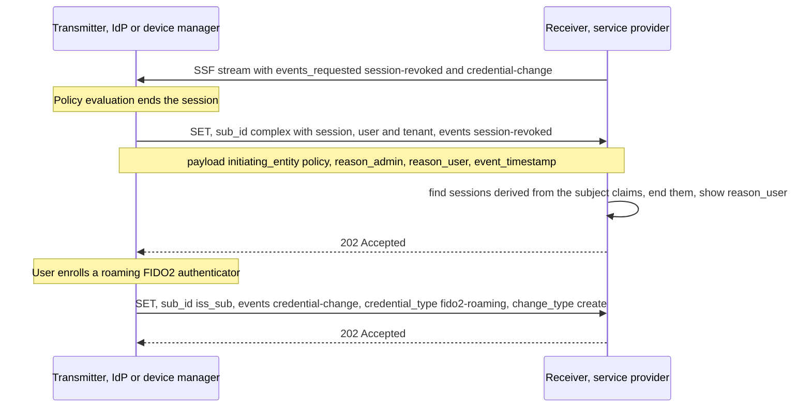

# Continuous Access Evaluation Profile (CAEP)

> In one line: CAEP is the set of SSF event types that tell a relying party that a session, a token's claims, a credential, a device's compliance, an assurance level or a risk level changed, so it can re-evaluate access now instead of waiting for the token to expire.

## When you reach for it

- **A managed device falls out of compliance while the user is logged in**: the device management system sends `device-compliance-change` with `previous_status` `compliant` and `current_status` `not-compliant`, so the receiver learns the device's compliance status changed (Section 3.5).
- **The identity provider ends a session because a policy fired**: `session-revoked` names the session, or a complex subject with `user`, `device` and `tenant` so the receiver can find every session derived from those claims, with `initiating_entity` `policy` and a localized `reason_user` to show the person (Sections 2 and 3.1).
- **A role in an issued token changed before the token expired**: `token-claims-change` identifies the token with a `jwt_id` or `saml_assertion_id` subject and carries the new values in `claims` (Section 3.2).
- **A user enrolled a FIDO2 key, or had a password reset**: `credential-change` with `credential_type` and `change_type` tells receivers that a credential was created, revoked, updated or deleted (Section 3.3).
- **A user who signed in to Service A with a password later did MFA at Service B**: `assurance-level-change` with `namespace`, `current_level` and `change_direction` `increase` tells Service A about the stronger authentication (Section 3.4).

## The problem it solves

A session or token reflects the conditions at the moment it was issued. When the user's device stops being compliant, an administrator revokes the session, a credential is replaced or a risk engine changes its verdict, the service provider holding that session has no standard way to hear about it. CAEP is the application of SSF to ensure access security in a network of cooperating providers: it specifies the event types a transmitter sends so that receivers can attenuate access to shared human or robotic users, devices, sessions and applications (Abstract, Section 1).

CAEP defines no transport of its own. Every event is an SSF SET with a `sub_id`, delivered over an SSF stream, and the profile adds a small set of optional claims shared by all events plus the event-specific claims for each type (Sections 2 and 3).

## How it works

The receiver subscribes to the CAEP event types it can act on through its SSF stream. When the transmitter ends a session it sends a SET whose `events` member is the `session-revoked` URI and whose `sub_id` names the session directly, or describes it as a complex subject; with a complex subject the revocation applies to any session derived from matching those combined claims (Section 3.1). The payload may carry `event_timestamp` (seconds since the epoch), `initiating_entity` (`admin`, `user`, `policy` or `system`), and `reason_admin` and `reason_user` objects keyed by BCP 47 language tags (Section 2). A credential change is the same shape with `credential-change` as the event type and `credential_type` and `change_type` in the payload (Section 3.3.1). The receiver acknowledges delivery as SSF and RFC 8935 or RFC 8936 require, then acts.

## What the spec requires

- The base URI for CAEP event types is `https://schemas.openid.net/secevent/caep/event-type/` (Section 3).
- `event_timestamp`, `initiating_entity`, `reason_admin` and `reason_user` are optional in every event; `initiating_entity` MUST be one of `admin`, `user`, `policy` or `system`; the reason objects MUST contain one or more BCP 47 language tag keys with the message as value (Section 2).
- `session-revoked` has no event-specific claims; when `event_timestamp` is present it MUST be the time the revocation occurred (Section 3.1.1).
- `token-claims-change` REQUIRES `claims`, a JSON object with the new values (Section 3.2.1).
- `credential-change` REQUIRES `credential_type` (`password`, `pin`, `x509`, `fido2-platform`, `fido2-roaming`, `fido-u2f`, `verifiable-credential`, `phone-voice`, `phone-sms`, `app`, or a mutually supported type) and `change_type` (`create`, `revoke`, `update`, `delete`) (Section 3.3.1).
- `assurance-level-change` REQUIRES `namespace` and `current_level`; if `previous_level` is omitted the receiver MUST assume the previous level is unknown to the transmitter; `change_direction`, when present, MUST be `increase` or `decrease` (Section 3.4.1).
- `device-compliance-change` REQUIRES `previous_status` and `current_status`, each `compliant` or `not-compliant` (Section 3.5.1).
- `risk-level-change` REQUIRES `principal` and `current_level`, with levels `LOW`, `MEDIUM` or `HIGH`; if `previous_level` is omitted the receiver MUST assume the previous level is unknown to the transmitter (Section 3.8.1).

## Watch out

- **Do not run CAEP outside SSF**: implementations SHOULD comply with the Shared Signals Framework, and exchanging these events without it may result in security issues (Section 4).
- **`fp_ua` is not a session identifier**: in `session-established` and `session-presented` the user agent fingerprint presents qualities of the session, not its identity (Sections 3.6.1 and 3.7.1).
- **Custom assurance namespaces**: a `namespace` value other than the listed ones is valid only as an alias for a custom namespace agreed between transmitter and receiver (Section 3.4.1).
- **`session-established` works both ways**: a service acting as transmitter can close the loop with the IdP after a federated login, and an IdP can detect unintended logins from it (Section 3.6).

## Sources

- [OpenID CAEP 1.0, Abstract](https://openid.net/specs/openid-caep-1_0-final.html#abstract)
- [OpenID CAEP 1.0, Section 1](https://openid.net/specs/openid-caep-1_0-final.html#section-1)
- [OpenID CAEP 1.0, Section 2](https://openid.net/specs/openid-caep-1_0-final.html#section-2)
- [OpenID CAEP 1.0, Section 3](https://openid.net/specs/openid-caep-1_0-final.html#section-3)
- [OpenID CAEP 1.0, Section 3.1](https://openid.net/specs/openid-caep-1_0-final.html#section-3.1)
- [OpenID CAEP 1.0, Section 3.1.1](https://openid.net/specs/openid-caep-1_0-final.html#section-3.1.1)
- [OpenID CAEP 1.0, Section 3.2](https://openid.net/specs/openid-caep-1_0-final.html#section-3.2)
- [OpenID CAEP 1.0, Section 3.2.1](https://openid.net/specs/openid-caep-1_0-final.html#section-3.2.1)
- [OpenID CAEP 1.0, Section 3.3](https://openid.net/specs/openid-caep-1_0-final.html#section-3.3)
- [OpenID CAEP 1.0, Section 3.3.1](https://openid.net/specs/openid-caep-1_0-final.html#section-3.3.1)
- [OpenID CAEP 1.0, Section 3.4](https://openid.net/specs/openid-caep-1_0-final.html#section-3.4)
- [OpenID CAEP 1.0, Section 3.4.1](https://openid.net/specs/openid-caep-1_0-final.html#section-3.4.1)
- [OpenID CAEP 1.0, Section 3.5](https://openid.net/specs/openid-caep-1_0-final.html#section-3.5)
- [OpenID CAEP 1.0, Section 3.5.1](https://openid.net/specs/openid-caep-1_0-final.html#section-3.5.1)
- [OpenID CAEP 1.0, Section 3.6](https://openid.net/specs/openid-caep-1_0-final.html#section-3.6)
- [OpenID CAEP 1.0, Section 3.6.1](https://openid.net/specs/openid-caep-1_0-final.html#section-3.6.1)
- [OpenID CAEP 1.0, Section 3.7.1](https://openid.net/specs/openid-caep-1_0-final.html#section-3.7.1)
- [OpenID CAEP 1.0, Section 3.8.1](https://openid.net/specs/openid-caep-1_0-final.html#section-3.8.1)
- [OpenID CAEP 1.0, Section 4](https://openid.net/specs/openid-caep-1_0-final.html#section-4)
