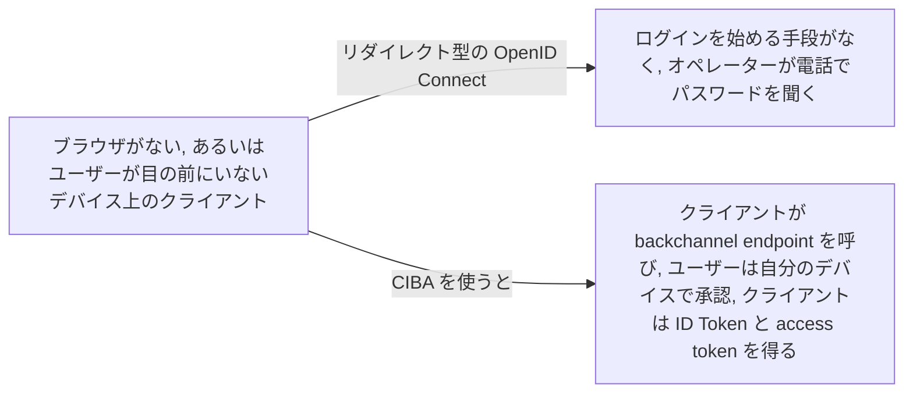
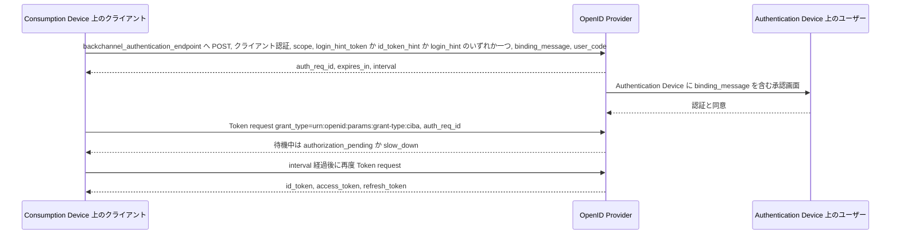

# Client-Initiated Backchannel Authentication (CIBA)

> 一言で言うと: クライアントがブラウザのリダイレクトなしに OpenID Provider と直接やり取りして OpenID Connect のログインを開始し、ユーザーはスマートフォンなど別のデバイスで承認する仕様。

## どういうときに使うか

- **コールセンターのオペレーターが電話の相手を認証したい**: オペレーターのシステムが Consumption Device、相手のスマートフォンが Authentication Device で、リダイレクトさせるブラウザがない (Section 2、Section 6)。
- **店頭の POS 端末での支払い**: ユーザーは point of sale 端末で行っている支払いを自分のスマートフォンで承認したい。端末がリクエストを開始し、スマートフォンが承認する (Section 6)。
- **ログイン画面を出せないデバイス**: フローはユーザーのブラウザを経由せずクライアントから OpenID Provider への直接通信で進み、OP はユーザーを out of band で認証する (Section 1)。
- **ユーザーに何を承認しているか見せたい**: `binding_message` は両方のデバイスに表示され、ユーザーは手元の取引とスマートフォンの承認画面を結び付けられる。`user_code` で OP はユーザーだけが知る秘密を要求できる (Section 7.1、Section 7.1.2)。

## 解決する問題

他の OpenID Connect のフローはすべて、End-User がクライアントの前にいて OpenID Provider にリダイレクトできることを前提にする。クライアントがコールセンターの端末、POS 端末、サーバー側のジョブだとこの前提が崩れる。ユーザーは電話の向こうかカウンターの反対側にいて、認証できるデバイスはポケットの中にある。標準がなければ、秘密を口頭で読み上げるか、独自の push 承認の仕組みを作ることになる。

CIBA は OpenID Connect の認証のセマンティクスを変えず、新しいエンドポイントを 1 つと、結果を非同期に届ける手段を足す。クライアントが Backchannel Authentication Endpoint にリクエストを POST すると、OP は識別子を即座に返してバックグラウンドでユーザーを認証し、トークンは Poll、Ping、Push のいずれかで届く (Section 1、Section 3)。

## 仕組み

クライアントは Backchannel Authentication Endpoint に認証し、`scope` とユーザーを特定する hint をちょうど一つ送る (Section 7.1)。OP は少なくとも 128 bit のエントロピーを持つ不透明な識別子 `auth_req_id`、その寿命 `expires_in`、Poll と Ping モードでは既定値 5 秒の `interval` を返す (Section 7.3)。続いて OP はユーザー自身のデバイスで認証を行う。Poll モードのクライアントはトークンを得るまで `grant_type=urn:openid:params:grant-type:ciba` と `auth_req_id` でトークンエンドポイントを呼ぶ (Section 10.1)。Ping モードでは OP がまずクライアントの notification endpoint に通知し、その後クライアントがトークンエンドポイントを呼ぶ。Push モードでは OP が ID Token を含む結果全体をクライアントの notification endpoint に POST する (Section 5、Section 10.3)。

## 仕様が求めること

- クライアントは登録済みの方式で Backchannel Authentication Endpoint に認証しなければならず、`login_hint_token`、`id_token_hint`、`login_hint` のうちちょうど一つを渡さなければならない (Section 7.1)。
- Ping か Push で登録したクライアントには `client_notification_token` が REQUIRED で、Client Notification Endpoint へのリクエストはその bearer token で HTTPS 上で認証される (Section 7.1、Section 9)。
- OP の metadata は `backchannel_token_delivery_modes_supported` と `backchannel_authentication_endpoint` を公開しなければならず、各クライアントは `poll`、`ping`、`push` のいずれか一つを `backchannel_token_delivery_mode` として登録する (Section 4)。
- 受理応答は `auth_req_id` と `expires_in` を含む。`interval` がなければクライアントは既定値 5 を使わなければならない (Section 7.3)。
- トークンリクエストは `grant_type` に `urn:openid:params:grant-type:ciba` と `auth_req_id` を使い、`interval` より頻繁にポーリングしてはならず、トークン応答に引き換えた `auth_req_id` はもう有効ではない (Section 10.1、Section 10.1.1)。
- Push モードでは OP は ID Token に access token の `at_hash`、`auth_req_id` そのものを `urn:openid:params:jwt:claim:auth_req_id` claim として、refresh token を発行するならそのハッシュを `urn:openid:params:jwt:claim:rt_hash` として含めなければならない。クライアントは bearer token を検証し、ID Token を検証し、受け取った値とこれらの claim を突き合わせなければならない (Section 10.3)。
- トークンエンドポイントのエラーは `authorization_pending`、interval を少なくとも 5 秒延ばす `slow_down`、`expired_token`、`access_denied`、`invalid_grant`、`invalid_request`、そして Push クライアントがポーリングした場合の `unauthorized_client` (Section 11)。

## 注意点

- `login_hint_token` は発行者がデジタル署名すべきで、`id_token_hint` は通常の JWT の規則では検証できないため、OP は可能な範囲で issuer、audience、署名を確認すべき (Section 14)。
- OP は `backchannel_client_notification_endpoint` がクライアントの管理下にあることを確認すべき (SHOULD) で、Push モードのクライアントはそのエンドポイントに適切なセキュリティ統制が要る。Push を使う実装者は送信者制約 access token の発行も検討すべき (Section 14)。
- クライアントは `user_code` を保存してはならず、CIBA フローのたびにユーザーに入力してもらうべき (Section 7.1.2)。
- 認証リクエストは `expired_login_hint_token`、`unknown_user_id`、`missing_user_code`、`invalid_user_code`、`invalid_binding_message` で失敗しうる。ユーザーに何かが届く前に、hint や message が拒否されるケースをクライアントで処理すること (Section 13)。

## 出典

- [CIBA Core 1.0, Section 1](https://openid.net/specs/openid-client-initiated-backchannel-authentication-core-1_0.html#rfc.section.1)
- [CIBA Core 1.0, Section 2](https://openid.net/specs/openid-client-initiated-backchannel-authentication-core-1_0.html#rfc.section.2)
- [CIBA Core 1.0, Section 3](https://openid.net/specs/openid-client-initiated-backchannel-authentication-core-1_0.html#rfc.section.3)
- [CIBA Core 1.0, Section 4](https://openid.net/specs/openid-client-initiated-backchannel-authentication-core-1_0.html#rfc.section.4)
- [CIBA Core 1.0, Section 5](https://openid.net/specs/openid-client-initiated-backchannel-authentication-core-1_0.html#rfc.section.5)
- [CIBA Core 1.0, Section 6](https://openid.net/specs/openid-client-initiated-backchannel-authentication-core-1_0.html#rfc.section.6)
- [CIBA Core 1.0, Section 7.1](https://openid.net/specs/openid-client-initiated-backchannel-authentication-core-1_0.html#rfc.section.7.1)
- [CIBA Core 1.0, Section 7.1.2](https://openid.net/specs/openid-client-initiated-backchannel-authentication-core-1_0.html#rfc.section.7.1.2)
- [CIBA Core 1.0, Section 7.3](https://openid.net/specs/openid-client-initiated-backchannel-authentication-core-1_0.html#rfc.section.7.3)
- [CIBA Core 1.0, Section 9](https://openid.net/specs/openid-client-initiated-backchannel-authentication-core-1_0.html#rfc.section.9)
- [CIBA Core 1.0, Section 10.1](https://openid.net/specs/openid-client-initiated-backchannel-authentication-core-1_0.html#rfc.section.10.1)
- [CIBA Core 1.0, Section 10.1.1](https://openid.net/specs/openid-client-initiated-backchannel-authentication-core-1_0.html#rfc.section.10.1.1)
- [CIBA Core 1.0, Section 10.3](https://openid.net/specs/openid-client-initiated-backchannel-authentication-core-1_0.html#rfc.section.10.3)
- [CIBA Core 1.0, Section 11](https://openid.net/specs/openid-client-initiated-backchannel-authentication-core-1_0.html#rfc.section.11)
- [CIBA Core 1.0, Section 13](https://openid.net/specs/openid-client-initiated-backchannel-authentication-core-1_0.html#rfc.section.13)
- [CIBA Core 1.0, Section 14](https://openid.net/specs/openid-client-initiated-backchannel-authentication-core-1_0.html#rfc.section.14)
