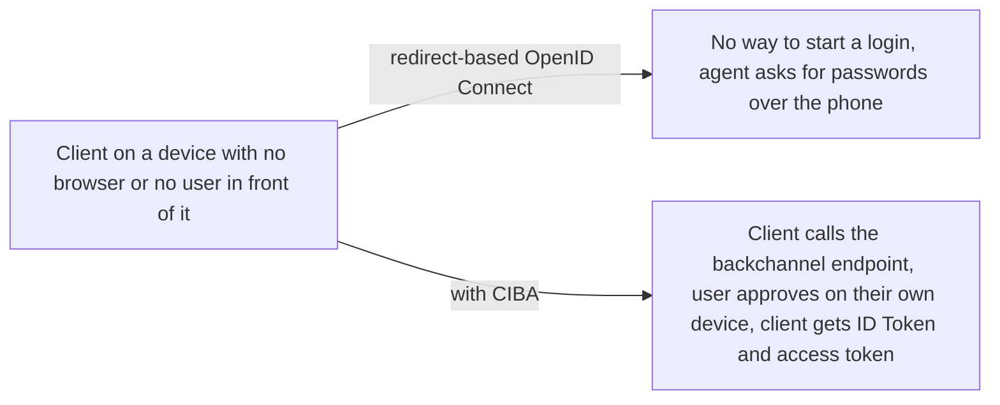
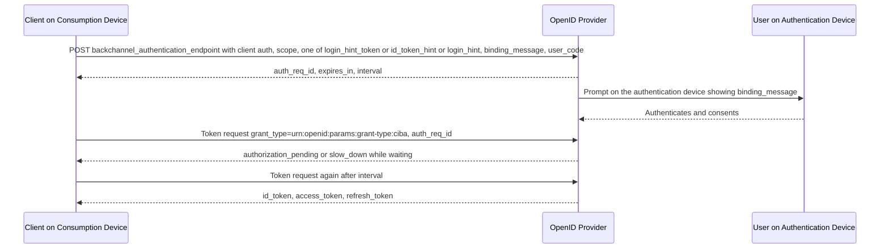

# Client-Initiated Backchannel Authentication (CIBA)

> In one line: CIBA lets a client start an OpenID Connect login directly with the provider, with no browser redirect, and the user approves it on a separate device such as their phone.

## When you reach for it

- **A call centre agent needs to authenticate the caller**: the agent's system is the Consumption Device, the caller's smartphone is the Authentication Device, and there is no browser to redirect (Section 2, Section 6).
- **A payment at a point of sale terminal**: the user wants to use their smartphone to authorize a payment they are making at a point of sale terminal, so the terminal starts the request and the phone approves it (Section 6).
- **A device that cannot show a login page**: the flow involves direct communication from the client to the OpenID Provider without redirect through the user's browser, and the OP authenticates the user out of band (Section 1).
- **The user must see what they are approving**: `binding_message` is shown on both devices so the user can tie the prompt on their phone to the transaction in front of them, and `user_code` lets the OP require a secret only the user knows (Section 7.1, Section 7.1.2).

## The problem it solves

Every other OpenID Connect flow assumes the End-User is sitting at the client and can be redirected to the OpenID Provider. When the client is a call centre desk, a point of sale terminal or a server-side job, that assumption fails: the user is on the phone or across the counter, and the device that can authenticate them is in their pocket. Without a standard, deployments fall back to reading secrets aloud or building private push-to-approve schemes.

CIBA keeps OpenID Connect's authentication semantics and adds one new endpoint plus an asynchronous way to deliver the result. The client posts a request to the Backchannel Authentication Endpoint, the OP returns an identifier immediately and authenticates the user in the background, and the tokens arrive by Poll, Ping or Push (Section 1, Section 3).

## How it works

The client authenticates to the Backchannel Authentication Endpoint and sends `scope` plus exactly one hint that identifies the user (Section 7.1). The OP acknowledges with `auth_req_id`, an opaque identifier with at least 128 bits of entropy, its lifetime in `expires_in`, and for Poll and Ping modes an `interval` that defaults to 5 seconds (Section 7.3). The OP then authenticates the user on their own device. In Poll mode the client calls the token endpoint with `grant_type=urn:openid:params:grant-type:ciba` and `auth_req_id` until it gets tokens (Section 10.1). In Ping mode the OP first notifies the client's notification endpoint and the client then calls the token endpoint. In Push mode the OP posts the full result, including the ID Token, to the client's notification endpoint (Section 5, Section 10.3).

## What the spec requires

- The client MUST authenticate to the Backchannel Authentication Endpoint using its registered method, and MUST provide one and only one of `login_hint_token`, `id_token_hint` or `login_hint` (Section 7.1).
- `client_notification_token` is REQUIRED when the client is registered for Ping or Push, and requests to the Client Notification Endpoint are authenticated with that bearer token over HTTPS (Section 7.1, Section 9).
- The OP metadata MUST publish `backchannel_token_delivery_modes_supported` and `backchannel_authentication_endpoint`, and each client registers one `backchannel_token_delivery_mode` of `poll`, `ping` or `push` (Section 4).
- The acknowledgement contains `auth_req_id` and `expires_in`; if no `interval` is given, clients MUST use 5 as the default (Section 7.3).
- The token request uses `grant_type` `urn:openid:params:grant-type:ciba` with `auth_req_id`, must not poll more often than `interval`, and once redeemed for a successful token response the `auth_req_id` is no longer valid (Section 10.1, Section 10.1.1).
- In Push mode the OP MUST include `at_hash` for the access token, the `auth_req_id` itself in the `urn:openid:params:jwt:claim:auth_req_id` claim and, if a refresh token is issued, its hash in `urn:openid:params:jwt:claim:rt_hash` within the ID Token; the client MUST verify the bearer token, validate the ID Token and check those claims against what it received (Section 10.3).
- Token endpoint errors are `authorization_pending`, `slow_down`, which raises the interval by at least 5 seconds, `expired_token`, `access_denied`, `invalid_grant`, `invalid_request` and `unauthorized_client` for Push clients that poll (Section 11).

## Watch out

- The `login_hint_token` SHOULD be digitally signed by its issuer, and an `id_token_hint` cannot be validated with the usual JWT rules, so the OP should still check its issuer, audience and signature where possible (Section 14).
- The OP SHOULD confirm that the `backchannel_client_notification_endpoint` is under the client's administrative authority, and Push mode clients need appropriate security controls on that endpoint; implementers using Push should also consider issuing sender-constrained access tokens (Section 14).
- The client MUST NOT store the `user_code`; it should ask the user for it on each CIBA flow (Section 7.1.2).
- The authentication request can fail with `expired_login_hint_token`, `unknown_user_id`, `missing_user_code`, `invalid_user_code` or `invalid_binding_message`, so the client must handle a rejected hint or message before anything reaches the user (Section 13).

## Sources

- [CIBA Core 1.0, Section 1](https://openid.net/specs/openid-client-initiated-backchannel-authentication-core-1_0.html#rfc.section.1)
- [CIBA Core 1.0, Section 2](https://openid.net/specs/openid-client-initiated-backchannel-authentication-core-1_0.html#rfc.section.2)
- [CIBA Core 1.0, Section 3](https://openid.net/specs/openid-client-initiated-backchannel-authentication-core-1_0.html#rfc.section.3)
- [CIBA Core 1.0, Section 4](https://openid.net/specs/openid-client-initiated-backchannel-authentication-core-1_0.html#rfc.section.4)
- [CIBA Core 1.0, Section 5](https://openid.net/specs/openid-client-initiated-backchannel-authentication-core-1_0.html#rfc.section.5)
- [CIBA Core 1.0, Section 6](https://openid.net/specs/openid-client-initiated-backchannel-authentication-core-1_0.html#rfc.section.6)
- [CIBA Core 1.0, Section 7.1](https://openid.net/specs/openid-client-initiated-backchannel-authentication-core-1_0.html#rfc.section.7.1)
- [CIBA Core 1.0, Section 7.1.2](https://openid.net/specs/openid-client-initiated-backchannel-authentication-core-1_0.html#rfc.section.7.1.2)
- [CIBA Core 1.0, Section 7.3](https://openid.net/specs/openid-client-initiated-backchannel-authentication-core-1_0.html#rfc.section.7.3)
- [CIBA Core 1.0, Section 9](https://openid.net/specs/openid-client-initiated-backchannel-authentication-core-1_0.html#rfc.section.9)
- [CIBA Core 1.0, Section 10.1](https://openid.net/specs/openid-client-initiated-backchannel-authentication-core-1_0.html#rfc.section.10.1)
- [CIBA Core 1.0, Section 10.1.1](https://openid.net/specs/openid-client-initiated-backchannel-authentication-core-1_0.html#rfc.section.10.1.1)
- [CIBA Core 1.0, Section 10.3](https://openid.net/specs/openid-client-initiated-backchannel-authentication-core-1_0.html#rfc.section.10.3)
- [CIBA Core 1.0, Section 11](https://openid.net/specs/openid-client-initiated-backchannel-authentication-core-1_0.html#rfc.section.11)
- [CIBA Core 1.0, Section 13](https://openid.net/specs/openid-client-initiated-backchannel-authentication-core-1_0.html#rfc.section.13)
- [CIBA Core 1.0, Section 14](https://openid.net/specs/openid-client-initiated-backchannel-authentication-core-1_0.html#rfc.section.14)
