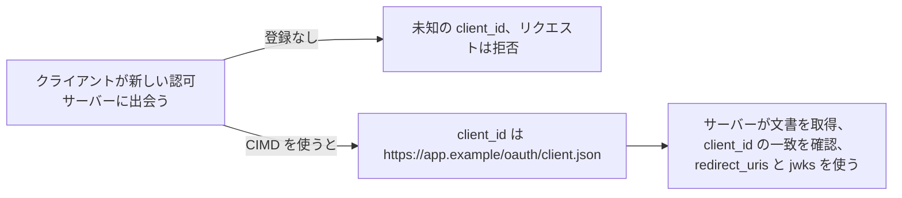
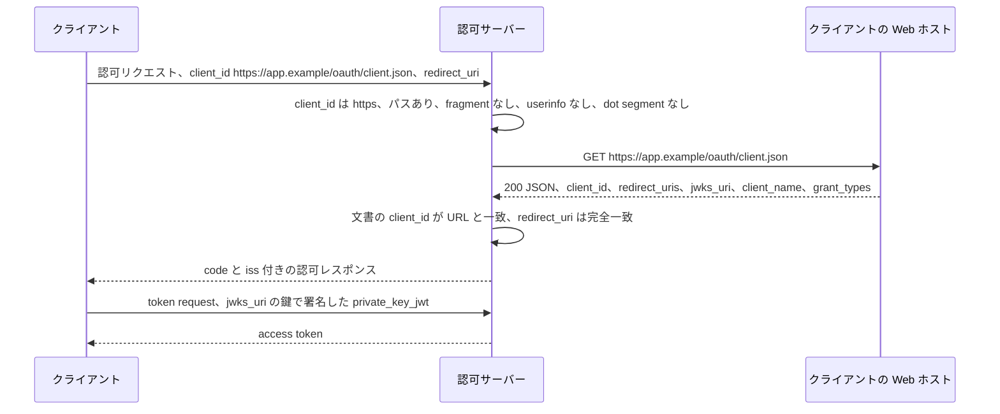

# Client ID Metadata Documents

> 一言で言うと: client_id を HTTPS URL にして、その URL にある JSON 文書をクライアントの登録情報とみなすので、どの認可サーバーも登録手順の代わりにそれを取得できる。

## どういうときに使うか

- **これから使うサーバーと何の関係もないクライアント**: 関係のない認可サーバーと話すクライアントは手作業で登録できない。このドラフトなら URL だけを `client_id` として名乗れる (Section 1)。
- **安定した公開の Web プレゼンスを持つクライアント**: この方式は、公開 HTTPS URL にすでに何かをホストしていて、その隣にメタデータ文書を置けるクライアントで最もうまく働く (Section 1)。
- **現実的でない dynamic registration**: RFC 7591 の登録は、登録データの管理と使われなくなったクライアントの掃除を残す。この方式ではサーバーがクライアント自身の文書を取得する (Section 1、6)。
- **共有秘密なしの鍵ベースのクライアント認証**: 文書で `jwks` か `jwks_uri` を公開し、クライアントは `private_key_jwt` などで認証する。`client_secret` は決して使わない (Section 4.1、5)。

## 解決する問題

どの OAuth クライアントも、話す相手の認可サーバーごとに `client_id` が要る。事前登録には人間が要り、RFC 7591 には registration endpoint と、誰が使ってよいかのポリシーと、クライアントごとの記録が要る。どちらも、聞いたこともないサーバーに出会うクライアントには合わない。

このドラフトは `client_id` を自己記述的にする。`client_id` は HTTPS URL で、サーバーはそれを RFC 7591 と同じ語彙の JSON メタデータ文書に解決する。クライアントは文書をホストすることで URL の制御を証明し、文書に載せた公開鍵で token endpoint での身元を証明する (Section 1、3、4、5)。

## 仕組み

サーバーはまず URL 自体を検査する。`https` スキームを使い、`/` 以外のパスを含み、fragment、userinfo、single-dot や double-dot のパス要素を含んではならない。比較は単純な文字列比較で、サーバーは URL を正規化してはならない (Section 3)。次に文書を取得する。文書は 200 OK で返されなければならず、サーバーはリダイレクトを自動で追ってはならない (Section 6)。文書の `client_id` は取得元の URL と一致しなければならず (Section 4)、認可リクエストの `redirect_uri` は登録された `redirect_uris` のいずれかと完全一致でなければならない (Section 4.2)。`redirect_uris` や `jwks_uri` のような機能的 URI はサーバーが使い、`logo_uri` や `tos_uri` のような情報的 URI はユーザーに表示される (Section 4.4)。サーバーは自分のメタデータの `client_id_metadata_document_supported` で対応を公開する (Section 8)。

## 仕様が求めること

- Client Identifier URL は単純な文字列比較で比較しなければならず、サーバーは正規化してはならない (Section 3)。
- 文書は Client Identifier URL と一致する値の `client_id` を含まなければならない (Section 4)。
- `client_secret` と `client_secret_expires_at` は使ってはならず、秘密鍵の素材を文書に含めてはならない (Section 4.1)。
- サーバーは文書の取得時に HTTP リダイレクトを自動で追ってはならず、エラー応答や無効な文書をキャッシュしてはならない (Section 6、6.2)。
- 取得や検証に失敗したとき、サーバーは user agent をクライアントにリダイレクトしてはならず、token endpoint では `invalid_client` を、一時的な失敗なら 503 を返す (Section 6.1)。
- 認可レスポンスには `iss` パラメータを含めなければならない (Section 7)。

## 注意点

- **SSRF**: サーバーは攻撃者が選んだ URL を取得する。特殊用途の IP アドレスに解決される文書やその中の URL を取得してはならず、SSRF のガイダンスに従うべきである (Section 10.7)。
- **応答サイズ**: 読み込む最大サイズの推奨は 5 キロバイト (Section 10.11)。
- **URL の混同**: サーバーは自分の issuer 識別子と等しい Client Identifier URL を拒否すべきで、自分でも `client_id` を発行するサーバーはそれが `https://` で始まらないようにすべきである (Section 10.1、9.1)。
- **ロゴ**: サーバーは `logo_uri` のファイルを事前取得し、自分が信頼するサーバーからエンドユーザーに配信しなければならない。クライアントの URL から直接読ませない (Section 10.9)。
- **URL は永続する**: 運用者は URL が無期限に解決可能で自分の制御下にあり続けるよう計画すべきで、`client_id` の不一致は未使用の refresh token を無効にすべきである (Section 10.4、6.1)。
- **取得によるサイドチャネル**: 取得のタイミングと頻度は、クライアントのホストにいつどこで使われているかを教える (Section 11.1)。

## 出典

- [draft-ietf-oauth-client-id-metadata-document, Section 1](https://datatracker.ietf.org/doc/html/draft-ietf-oauth-client-id-metadata-document#section-1)
- [draft-ietf-oauth-client-id-metadata-document, Section 3](https://datatracker.ietf.org/doc/html/draft-ietf-oauth-client-id-metadata-document#section-3)
- [draft-ietf-oauth-client-id-metadata-document, Section 4](https://datatracker.ietf.org/doc/html/draft-ietf-oauth-client-id-metadata-document#section-4)
- [draft-ietf-oauth-client-id-metadata-document, Section 4.1](https://datatracker.ietf.org/doc/html/draft-ietf-oauth-client-id-metadata-document#section-4.1)
- [draft-ietf-oauth-client-id-metadata-document, Section 4.2](https://datatracker.ietf.org/doc/html/draft-ietf-oauth-client-id-metadata-document#section-4.2)
- [draft-ietf-oauth-client-id-metadata-document, Section 4.4](https://datatracker.ietf.org/doc/html/draft-ietf-oauth-client-id-metadata-document#section-4.4)
- [draft-ietf-oauth-client-id-metadata-document, Section 5](https://datatracker.ietf.org/doc/html/draft-ietf-oauth-client-id-metadata-document#section-5)
- [draft-ietf-oauth-client-id-metadata-document, Section 6](https://datatracker.ietf.org/doc/html/draft-ietf-oauth-client-id-metadata-document#section-6)
- [draft-ietf-oauth-client-id-metadata-document, Section 6.1](https://datatracker.ietf.org/doc/html/draft-ietf-oauth-client-id-metadata-document#section-6.1)
- [draft-ietf-oauth-client-id-metadata-document, Section 6.2](https://datatracker.ietf.org/doc/html/draft-ietf-oauth-client-id-metadata-document#section-6.2)
- [draft-ietf-oauth-client-id-metadata-document, Section 7](https://datatracker.ietf.org/doc/html/draft-ietf-oauth-client-id-metadata-document#section-7)
- [draft-ietf-oauth-client-id-metadata-document, Section 8](https://datatracker.ietf.org/doc/html/draft-ietf-oauth-client-id-metadata-document#section-8)
- [draft-ietf-oauth-client-id-metadata-document, Section 9.1](https://datatracker.ietf.org/doc/html/draft-ietf-oauth-client-id-metadata-document#section-9.1)
- [draft-ietf-oauth-client-id-metadata-document, Section 10.1](https://datatracker.ietf.org/doc/html/draft-ietf-oauth-client-id-metadata-document#section-10.1)
- [draft-ietf-oauth-client-id-metadata-document, Section 10.4](https://datatracker.ietf.org/doc/html/draft-ietf-oauth-client-id-metadata-document#section-10.4)
- [draft-ietf-oauth-client-id-metadata-document, Section 10.7](https://datatracker.ietf.org/doc/html/draft-ietf-oauth-client-id-metadata-document#section-10.7)
- [draft-ietf-oauth-client-id-metadata-document, Section 10.9](https://datatracker.ietf.org/doc/html/draft-ietf-oauth-client-id-metadata-document#section-10.9)
- [draft-ietf-oauth-client-id-metadata-document, Section 10.11](https://datatracker.ietf.org/doc/html/draft-ietf-oauth-client-id-metadata-document#section-10.11)
- [draft-ietf-oauth-client-id-metadata-document, Section 11.1](https://datatracker.ietf.org/doc/html/draft-ietf-oauth-client-id-metadata-document#section-11.1)
