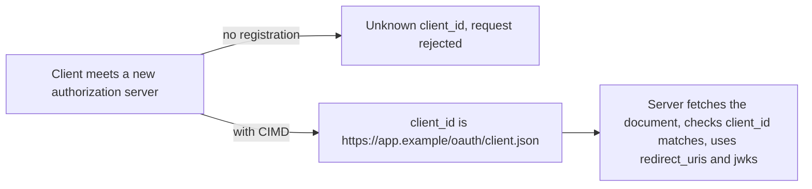
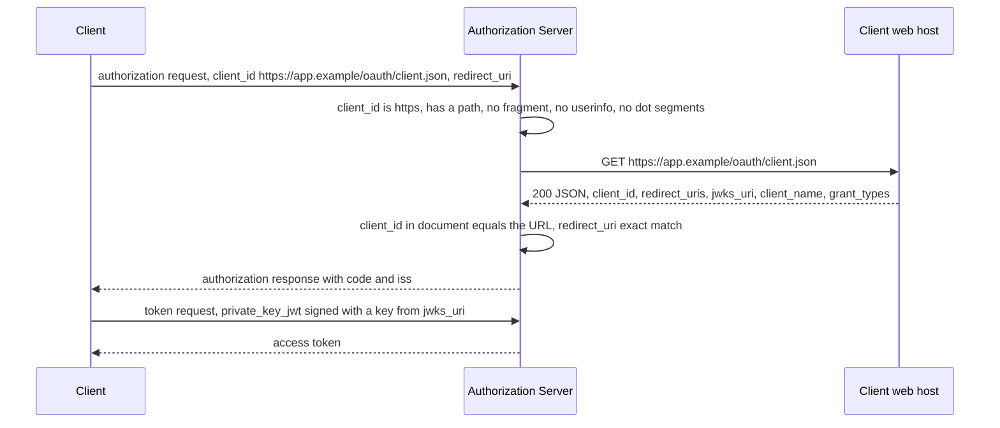

# Client ID Metadata Documents

> In one line: the client_id is an HTTPS URL, and the JSON document at that URL is the client's registration, so any authorization server can fetch it instead of running a registration step.

## When you reach for it

- **A client with no relationship to the server it is about to use**: a client that interacts with authorization servers it has no relationship with cannot be registered by hand, and the draft lets it show up with only a URL as its `client_id` (Section 1).
- **A client with a stable public web presence**: the approach works best for clients that already host something at a public HTTPS URL, where the metadata document can live next to it (Section 1).
- **Dynamic registration that is not practical**: RFC 7591 registration leaves registration data to manage and inactive clients to clean up. Here the server fetches the client's own document instead (Sections 1, 6).
- **Key-based client authentication without shared secrets**: the document publishes `jwks` or `jwks_uri`, and the client authenticates with `private_key_jwt` or similar, never with a `client_secret` (Sections 4.1, 5).

## The problem it solves

Every OAuth client needs a `client_id` at every authorization server it talks to. Pre-registration needs a human; RFC 7591 needs a registration endpoint, a policy for who may use it, and a record per client. Neither fits clients that meet servers they have never heard of.

This draft makes the `client_id` self-describing. It is an HTTPS URL, and the server resolves it to a JSON metadata document using the same vocabulary as RFC 7591. The client proves control of the URL by hosting the document, and proves its identity at the token endpoint with public keys listed in that document (Sections 1, 3, 4, 5).

## How it works

The server first checks the URL itself: it must use the `https` scheme, must contain a path component other than `/`, and must not contain a fragment, userinfo, or single-dot or double-dot path components. Comparison is simple string comparison, and the server must not normalize the URL (Section 3). It then fetches the document, which must be served with 200 OK, and must not automatically follow redirects (Section 6). The document's `client_id` must match the URL it was fetched from (Section 4), and the `redirect_uri` in the authorization request must be an exact match against a registered `redirect_uris` entry (Section 4.2). Functional URIs such as `redirect_uris` and `jwks_uri` are used by the server, while informative ones such as `logo_uri` and `tos_uri` are shown to users (Section 4.4). The server advertises support with `client_id_metadata_document_supported` in its own metadata (Section 8).

## What the spec requires

- Client Identifier URLs must be compared using simple string comparison, and the server must not normalize them (Section 3).
- The document must contain a `client_id` whose value matches the Client Identifier URL (Section 4).
- `client_secret` and `client_secret_expires_at` must not be used, and private key material must not be included in the document (Section 4.1).
- The server must not automatically follow HTTP redirects when fetching the document, and must not cache error responses or invalid documents (Sections 6, 6.2).
- When fetching or validating fails, the server must not redirect the user agent to the client, and at the token endpoint it returns `invalid_client`, or 503 for a transient failure (Section 6.1).
- The authorization response must include the `iss` parameter (Section 7).

## Watch out

- **SSRF**: the server fetches an attacker-chosen URL. It must not fetch documents or URLs within them that resolve to special-use IP addresses, and should follow SSRF guidance (Section 10.7).
- **Response size**: the recommended maximum size to read is 5 kilobytes (Section 10.11).
- **URL confusion**: a server should reject a Client Identifier URL equal to its own issuer identifier, and a server that also mints `client_id` values should keep them from starting with `https://` (Sections 10.1, 9.1).
- **Logos**: the server must prefetch the file at `logo_uri` and serve it to the end user from servers it trusts, rather than loading it from the client's URL (Section 10.9).
- **The URL is forever**: operators should plan for the URL to remain resolvable and under their control indefinitely, and a `client_id` mismatch should invalidate outstanding refresh tokens (Sections 10.4, 6.1).
- **Fetch side channel**: the timing and frequency of fetches tell the client's host when and where it is being used (Section 11.1).

## Sources

- [draft-ietf-oauth-client-id-metadata-document, Section 1](https://datatracker.ietf.org/doc/html/draft-ietf-oauth-client-id-metadata-document#section-1)
- [draft-ietf-oauth-client-id-metadata-document, Section 3](https://datatracker.ietf.org/doc/html/draft-ietf-oauth-client-id-metadata-document#section-3)
- [draft-ietf-oauth-client-id-metadata-document, Section 4](https://datatracker.ietf.org/doc/html/draft-ietf-oauth-client-id-metadata-document#section-4)
- [draft-ietf-oauth-client-id-metadata-document, Section 4.1](https://datatracker.ietf.org/doc/html/draft-ietf-oauth-client-id-metadata-document#section-4.1)
- [draft-ietf-oauth-client-id-metadata-document, Section 4.2](https://datatracker.ietf.org/doc/html/draft-ietf-oauth-client-id-metadata-document#section-4.2)
- [draft-ietf-oauth-client-id-metadata-document, Section 4.4](https://datatracker.ietf.org/doc/html/draft-ietf-oauth-client-id-metadata-document#section-4.4)
- [draft-ietf-oauth-client-id-metadata-document, Section 5](https://datatracker.ietf.org/doc/html/draft-ietf-oauth-client-id-metadata-document#section-5)
- [draft-ietf-oauth-client-id-metadata-document, Section 6](https://datatracker.ietf.org/doc/html/draft-ietf-oauth-client-id-metadata-document#section-6)
- [draft-ietf-oauth-client-id-metadata-document, Section 6.1](https://datatracker.ietf.org/doc/html/draft-ietf-oauth-client-id-metadata-document#section-6.1)
- [draft-ietf-oauth-client-id-metadata-document, Section 6.2](https://datatracker.ietf.org/doc/html/draft-ietf-oauth-client-id-metadata-document#section-6.2)
- [draft-ietf-oauth-client-id-metadata-document, Section 7](https://datatracker.ietf.org/doc/html/draft-ietf-oauth-client-id-metadata-document#section-7)
- [draft-ietf-oauth-client-id-metadata-document, Section 8](https://datatracker.ietf.org/doc/html/draft-ietf-oauth-client-id-metadata-document#section-8)
- [draft-ietf-oauth-client-id-metadata-document, Section 9.1](https://datatracker.ietf.org/doc/html/draft-ietf-oauth-client-id-metadata-document#section-9.1)
- [draft-ietf-oauth-client-id-metadata-document, Section 10.1](https://datatracker.ietf.org/doc/html/draft-ietf-oauth-client-id-metadata-document#section-10.1)
- [draft-ietf-oauth-client-id-metadata-document, Section 10.4](https://datatracker.ietf.org/doc/html/draft-ietf-oauth-client-id-metadata-document#section-10.4)
- [draft-ietf-oauth-client-id-metadata-document, Section 10.7](https://datatracker.ietf.org/doc/html/draft-ietf-oauth-client-id-metadata-document#section-10.7)
- [draft-ietf-oauth-client-id-metadata-document, Section 10.9](https://datatracker.ietf.org/doc/html/draft-ietf-oauth-client-id-metadata-document#section-10.9)
- [draft-ietf-oauth-client-id-metadata-document, Section 10.11](https://datatracker.ietf.org/doc/html/draft-ietf-oauth-client-id-metadata-document#section-10.11)
- [draft-ietf-oauth-client-id-metadata-document, Section 11.1](https://datatracker.ietf.org/doc/html/draft-ietf-oauth-client-id-metadata-document#section-11.1)
