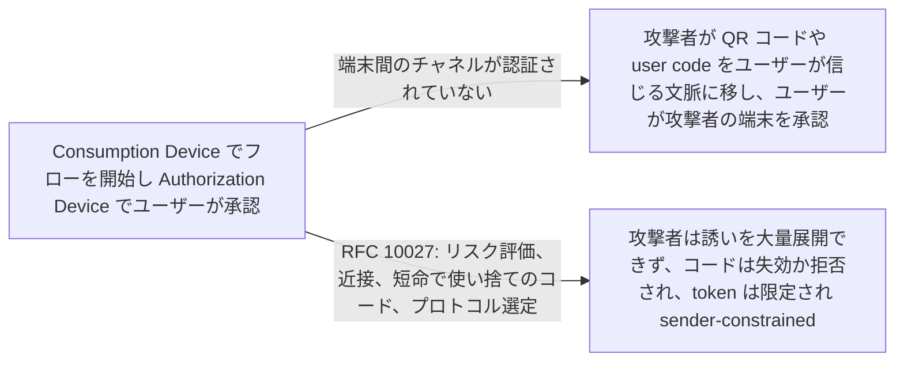
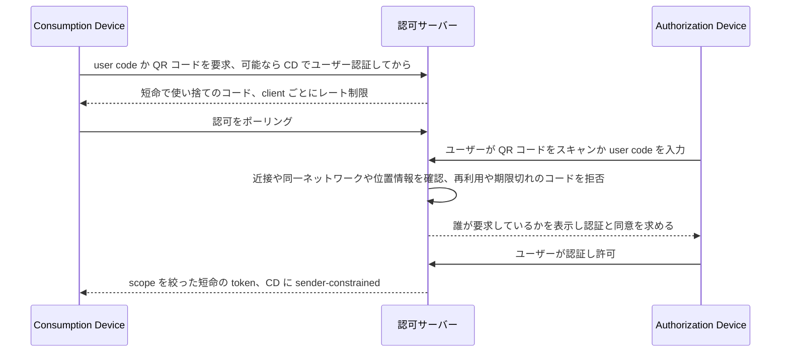

# Security of Cross-Device Flows

> 一言で言うと: テレビやキオスクで始めてスマートフォンで終えるフローでは、2 つの端末の間のチャネルを認証するものがユーザーの判断しかない。この BCP は、その隙を攻撃者に突かせないための対策とプロトコル選定を列挙する。

## どういうときに使うか

- **スマホでスキャンする QR コードを表示するスマートテレビのストリーミングアプリ**: 攻撃者は自分の QR コードを取得し、ロイヤルティ特典と称して何千人にもメールできる。スキャンして承認したユーザー全員が、攻撃者のテレビに access token と refresh token を渡してしまう (Section 4.3.1)。
- **CIBA で顧客のスマホに取引承認をプッシュする銀行**: 銀行のヘルプデスクを装った攻撃者が一連の取引を発生させ、怪しく見えるものはユーザーに拒否させたうえで、後続の 1 つを承認するよう説得できる (Section 4.3.4.2)。
- **ホワイトボードやプリンタ向けに device authorization grant を展開する企業**: このグラントは対応デバイスが最も広いが、BCP は他のプロトコルが使えないときだけ使い、追加対策なしに機微なリソースには使わず、同一デバイスでは使うなと言う (Section 6.2.1.5)。
- **device grant・CIBA・FIDO2 のクロスデバイス認証から選ぶプロダクトチーム**: 無線近接を使う FIDO2/WebAuthn が推奨で、CIBA が代替、device grant は最後 (Section 6.2.4)。

## 解決する問題

クロスデバイス認可では、スマートテレビのような Consumption Device とスマホのような Authorization Device は直接つながっておらず、相互認証できない。認可リクエストは認証されていないチャネルを渡り、唯一の対策は QR コード・user code・プッシュ要求が正当かというユーザーの判断である (Section 1.1)。Cross-Device Consent Phishing (CDCP) はこれを突く。攻撃者は credential を集めず、攻撃者の端末に認可を与えるようユーザーを説得する。多要素認証があっても効く (Section 1.1)。Cross-Device Session Phishing (CDSP) はセッション転送フローで同じことをし、攻撃者はパスワードの代わりに転送コードを集める (Section 1.2)。

BCP は両方のユースケースを 3 つの認可パターンにわたって扱う。device authorization grant のような user-transferred session data、CIBA のような backchannel-transferred session、スマホに届く 6 桁コードのような user-transferred authorization data である (Section 3.1)。

## 仕組み

ユーザーは Consumption Device から始める。端末は認可サーバーに QR か user code を求めて表示し、ポーリングを始める。ユーザーは Authorization Device でコードをスキャンするか入力し、認証して同意し、サーバーは Consumption Device に token を発行する (Section 3.1.1)。BCP はこのフローに対策を重ねる。物理接続・NFC・BLE・UWB・同一ネットワーク・位置情報による近接確認は、攻撃者が地理的に散らばった被害者にコードを送る能力を制限する (Section 6.1.1)。短命・使い捨て・一意のコードは時間窓を狭め、同じコードが繰り返し提示されたことをサーバーが検知できるようにする (Section 6.1.2〜6.1.4)。フロー開始前に Consumption Device でフィッシング耐性のある認証を求めれば、攻撃者はそもそもコードを得られない (Section 6.1.15)。攻撃が成功した後は、限定 scope・短命 token・sender-constrained token が攻撃者にできることを減らし、token を端末から持ち出して売るのを止める (Section 6.1.9, 6.1.10, 6.1.12)。

## 仕様が求めること

- 実装者はクロスデバイスフローを実装する前に、CDCP と CDSP のリスクをユーザーの利益と天秤にかけるリスク評価を行わなければならず (MUST)、リスクを十分に緩和できないならクロスデバイスフローを避けるべき (SHOULD) (Section 2)。
- 実装者は見つけたリスクに対処する対策を Section 6.1 から選ばなければならず、Section 6.2 のプロトコル選定指針に従うべきで、可能なら近接を選んだ対策の 1 つに含めるべき (Section 2)。
- これらの実践は device authorization grant、CIBA、SIOPv2、OpenID for Verifiable Presentations、OpenID for Verifiable Credential Issuance の pre-authorized code flow、その他端末間チャネルの認証をユーザーに頼るすべてのプロトコルに適用される (Section 2)。
- すべてのクロスデバイスフローに 1 つ以上の実践的対策を適用することが推奨される。それぞれが攻撃を防ぐ・妨げる・回復する層になる (Section 6.1)。
- リスクプロファイルによっては複数の近接機構を組み合わせる必要がありうる。位置情報に基づく近接はプライバシーへの影響を評価すべき (Section 6.1.1)。
- device authorization grant は、認証されていないチャネルへの攻撃に対する追加対策を配備したときだけ推奨される。CIBA を使うなら近接と信頼済み端末やネットワークを検討すべき (Section 6.2.4)。

## 注意点

- 近接確認は VPN や GNSS 位置の偽装で回避でき、IP 位置情報は国境付近や VPN 利用時に誤るので、1 つの確認だけでは足りない (Section 6.1.1)。
- 短命コードは、被害者がフィッシングリンクをクリックしてから初めてコードを要求する攻撃者には効きにくい (Section 6.1.2)。
- 使い捨てコードは、低遅延が求められるグローバル分散システムでは強制しにくく、フロー途中でセッションが切れたユーザーを困らせる。実装者は同じコードを数回提示できるようにしてもよい (Section 6.1.3)。
- 短命の access token は有効だが、攻撃者が refresh token を手にすれば新しい token を作り続けられる。refresh token の強制失効はユーザー体験を損なう (Section 6.1.10)。

## 出典

- [RFC 10027, Section 1.1](https://www.rfc-editor.org/rfc/rfc10027#section-1.1)
- [RFC 10027, Section 1.2](https://www.rfc-editor.org/rfc/rfc10027#section-1.2)
- [RFC 10027, Section 2](https://www.rfc-editor.org/rfc/rfc10027#section-2)
- [RFC 10027, Section 3.1](https://www.rfc-editor.org/rfc/rfc10027#section-3.1)
- [RFC 10027, Section 3.1.1](https://www.rfc-editor.org/rfc/rfc10027#section-3.1.1)
- [RFC 10027, Section 4.3.1](https://www.rfc-editor.org/rfc/rfc10027#section-4.3.1)
- [RFC 10027, Section 4.3.4.2](https://www.rfc-editor.org/rfc/rfc10027#section-4.3.4.2)
- [RFC 10027, Section 6.1](https://www.rfc-editor.org/rfc/rfc10027#section-6.1)
- [RFC 10027, Section 6.1.1](https://www.rfc-editor.org/rfc/rfc10027#section-6.1.1)
- [RFC 10027, Section 6.1.2](https://www.rfc-editor.org/rfc/rfc10027#section-6.1.2)
- [RFC 10027, Section 6.1.3](https://www.rfc-editor.org/rfc/rfc10027#section-6.1.3)
- [RFC 10027, Section 6.1.4](https://www.rfc-editor.org/rfc/rfc10027#section-6.1.4)
- [RFC 10027, Section 6.1.9](https://www.rfc-editor.org/rfc/rfc10027#section-6.1.9)
- [RFC 10027, Section 6.1.10](https://www.rfc-editor.org/rfc/rfc10027#section-6.1.10)
- [RFC 10027, Section 6.1.12](https://www.rfc-editor.org/rfc/rfc10027#section-6.1.12)
- [RFC 10027, Section 6.1.15](https://www.rfc-editor.org/rfc/rfc10027#section-6.1.15)
- [RFC 10027, Section 6.2.1.5](https://www.rfc-editor.org/rfc/rfc10027#section-6.2.1.5)
- [RFC 10027, Section 6.2.4](https://www.rfc-editor.org/rfc/rfc10027#section-6.2.4)
