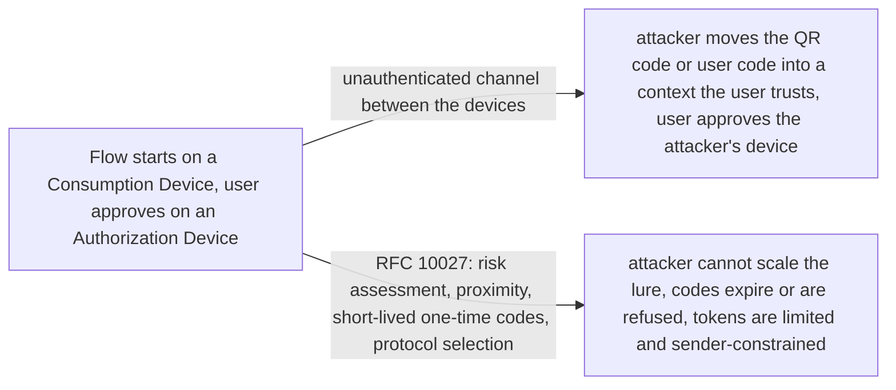
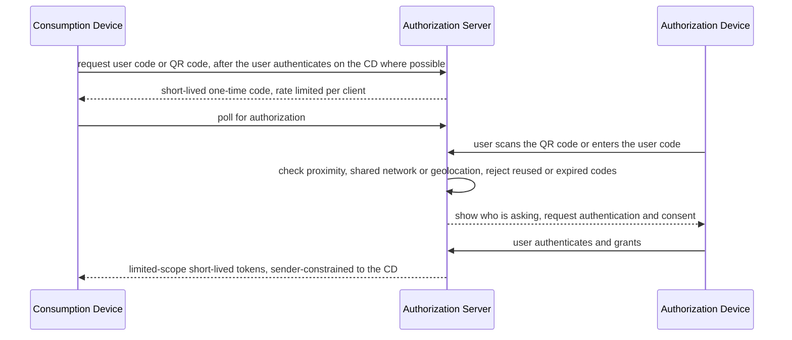

# Security of Cross-Device Flows

> In one line: when a flow starts on a TV or kiosk and finishes on a phone, nothing authenticates the channel between the two devices except the user's judgement, and this BCP lists the mitigations and protocol choices that stop attackers from exploiting that gap.

## When you reach for it

- **A streaming app on a smart TV that shows a QR code to scan with a phone**: an attacker can request their own QR code, email it to thousands of people as a loyalty reward, and every user who scans and approves hands the attacker's TV an access and refresh token (Section 4.3.1).
- **A bank that pushes a transaction approval to the customer's phone with CIBA**: an attacker posing as the bank's help desk can trigger a sequence of transactions, have the user decline the suspicious-looking ones, and then talk them into approving a later one (Section 4.3.4.2).
- **An enterprise rolling out the device authorization grant for whiteboards and printers**: the grant has the broadest device support, but the BCP says to use it only when other protocols are not viable, never for sensitive resources without extra mitigations, and never on the same device (Section 6.2.1.5).
- **A product team choosing between device grant, CIBA and FIDO2 cross-device authentication**: FIDO2/WebAuthn with wireless proximity is the recommended choice, with CIBA as the fallback and the device grant last (Section 6.2.4).

## The problem it solves

In cross-device authorization, the Consumption Device such as a smart TV and the Authorization Device such as a phone are never directly connected and cannot mutually authenticate. The authorization request crosses an unauthenticated channel, and the only mitigation is the user's judgement about whether a QR code, user code or push request is legitimate (Section 1.1). Cross-Device Consent Phishing (CDCP) exploits this: the attacker does not harvest credentials, they persuade the user to grant authorization to the attacker's device, which works even when multi-factor authentication is in place (Section 1.1). Cross-Device Session Phishing (CDSP) does the same for session transfer flows, where the attacker collects the transfer code rather than a password (Section 1.2).

The BCP covers both use cases across three authorization patterns: user-transferred session data as in the device authorization grant, backchannel-transferred session as in CIBA, and user-transferred authorization data such as a 6-digit code sent to the phone (Section 3.1).

## How it works

The user starts on the Consumption Device, which asks the authorization server for a QR or user code, displays it, and starts polling; the user scans or enters the code on the Authorization Device, authenticates, grants consent, and the server issues tokens to the Consumption Device (Section 3.1.1). The BCP layers mitigations onto that flow. Proximity, via physical connection, NFC, BLE, UWB, a shared network or geolocation, limits an attacker's ability to send codes to geographically dispersed victims (Section 6.1.1). Short-lived, one-time and unique codes shrink the window and let the server detect the same code being presented repeatedly (Sections 6.1.2 to 6.1.4). Requiring phishing-resistant authentication on the Consumption Device before the flow starts prevents an attacker from obtaining a code at all (Section 6.1.15). After a successful attack, limited scopes, short-lived tokens and sender-constrained tokens reduce what the attacker can do with the result and stop tokens being moved off the device and sold (Sections 6.1.9, 6.1.10, 6.1.12).

## What the spec requires

- Implementers MUST perform a risk assessment weighing CDCP and CDSP risks against user benefit before implementing a cross-device flow, and SHOULD avoid cross-device flows if the risks cannot be sufficiently mitigated (Section 2).
- Implementers MUST select mitigations from Section 6.1 to address the risks found, SHOULD follow the protocol selection guidance in Section 6.2, and SHOULD include proximity as one of the selected mitigations if possible (Section 2).
- These practices apply to the device authorization grant, CIBA, SIOPv2, OpenID for Verifiable Presentations, the pre-authorized code flow of OpenID for Verifiable Credential Issuance, and any other protocol that relies on the user to authenticate the channel between devices (Section 2).
- It is RECOMMENDED that one or more practical mitigations be applied to every cross-device flow; each provides a layer that prevents, disrupts or remediates an attack (Section 6.1).
- Depending on the risk profile it MAY be necessary to combine more than one proximity mechanism, and location-based proximity SHOULD be evaluated for privacy impact (Section 6.1.1).
- The device authorization grant is RECOMMENDED only when additional mitigations are deployed against attacks on the unauthenticated channel; if CIBA is used, proximity and trusted devices or networks SHOULD be considered (Section 6.2.4).

## Watch out

- Proximity checks can be circumvented with a VPN or a spoofed GNSS position, and IP geolocation misfires near borders or when a user is on a VPN, so one check alone is not enough (Section 6.1.1).
- Short-lived codes are weakened by attackers who only request the code once the victim has clicked the phishing link (Section 6.1.2).
- One-time codes may be hard to enforce in globally distributed low-latency systems, and they hurt users whose session is interrupted mid-flow; implementers MAY allow a code to be presented a few times (Section 6.1.3).
- Short-lived access tokens help, but once the attacker has a refresh token they keep minting new tokens, and forcing refresh token expiry costs user experience (Section 6.1.10).

## Sources

- [RFC 10027, Section 1.1](https://www.rfc-editor.org/rfc/rfc10027#section-1.1)
- [RFC 10027, Section 1.2](https://www.rfc-editor.org/rfc/rfc10027#section-1.2)
- [RFC 10027, Section 2](https://www.rfc-editor.org/rfc/rfc10027#section-2)
- [RFC 10027, Section 3.1](https://www.rfc-editor.org/rfc/rfc10027#section-3.1)
- [RFC 10027, Section 3.1.1](https://www.rfc-editor.org/rfc/rfc10027#section-3.1.1)
- [RFC 10027, Section 4.3.1](https://www.rfc-editor.org/rfc/rfc10027#section-4.3.1)
- [RFC 10027, Section 4.3.4.2](https://www.rfc-editor.org/rfc/rfc10027#section-4.3.4.2)
- [RFC 10027, Section 6.1](https://www.rfc-editor.org/rfc/rfc10027#section-6.1)
- [RFC 10027, Section 6.1.1](https://www.rfc-editor.org/rfc/rfc10027#section-6.1.1)
- [RFC 10027, Section 6.1.2](https://www.rfc-editor.org/rfc/rfc10027#section-6.1.2)
- [RFC 10027, Section 6.1.3](https://www.rfc-editor.org/rfc/rfc10027#section-6.1.3)
- [RFC 10027, Section 6.1.4](https://www.rfc-editor.org/rfc/rfc10027#section-6.1.4)
- [RFC 10027, Section 6.1.9](https://www.rfc-editor.org/rfc/rfc10027#section-6.1.9)
- [RFC 10027, Section 6.1.10](https://www.rfc-editor.org/rfc/rfc10027#section-6.1.10)
- [RFC 10027, Section 6.1.12](https://www.rfc-editor.org/rfc/rfc10027#section-6.1.12)
- [RFC 10027, Section 6.1.15](https://www.rfc-editor.org/rfc/rfc10027#section-6.1.15)
- [RFC 10027, Section 6.2.1.5](https://www.rfc-editor.org/rfc/rfc10027#section-6.2.1.5)
- [RFC 10027, Section 6.2.4](https://www.rfc-editor.org/rfc/rfc10027#section-6.2.4)
