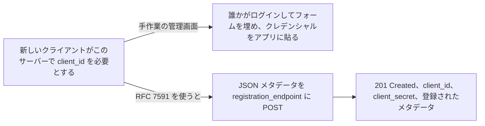
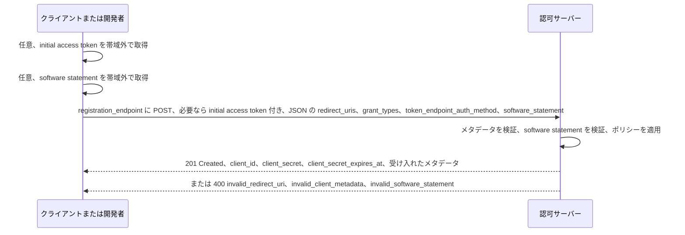

# Dynamic Client Registration

> 一言で言うと: クライアントが自分のメタデータを registration endpoint に POST して client_id を受け取るので、オンボーディングが管理画面のフォームではなく API 呼び出しになる。

## どういうときに使うか

- **見たことのない認可サーバーに出会うソフトウェア**: クライアントインスタンスは `redirect_uris`、`grant_types`、`client_name` を `registration_endpoint` に送り、その場で `client_id` を受け取る。開発者が介在しない (Section 1.3、3.1)。
- **ユーザーごとのインストールに固有のクレデンシャルが要る**: ネイティブアプリの各インスタンスが自分で登録し、埋め込んだ 1 つの秘密を全コピーで共有する代わりに、別々の `client_id` と `client_secret` を得られる (Appendix A.4、Section 5)。
- **複数のサーバーに自社ソフトウェアを認識させたいベンダー**: 開発者は署名付き software statement をアプリに同梱する。サーバーはその発行者への信頼を登録可否の判断材料にし、その claim は平文の JSON 値より優先される (Section 2、2.3)。
- **レート制限や入口の制御が要るオープン登録**: サーバーは initial access token を要求してもよいし、オープンなリクエストを受け付けて絞ってもよい (Section 3)。

## 解決する問題

OAuth 2.0 は全クライアントが事前に認可サーバーに登録されていることを前提にしつつ、その方法を範囲外にしている。実際には管理画面の人間がやってきたが、実行時にサーバーを発見するソフトウェア、数千の relying party があるエコシステム、1 つの秘密を全員で共有すべきでないネイティブアプリには通用しない。

RFC 7591 は registration endpoint と、クライアントメタデータの共通語彙を定める。クライアントかその開発者が希望するメタデータを送り、サーバーはクライアントを登録して、実際に受け入れたメタデータとクライアント識別子、必要ならクレデンシャルを返す。署名付き software statement を使えば、インスタンス自身には主張を任せられないメタデータを、信頼できる当事者が保証できる (Section 1)。

## 仕組み

登録は registration endpoint への JSON ボディ付き HTTP POST だ。ボディには Section 2 で定義されたフィールドを入れる: `redirect_uris`、`token_endpoint_auth_method`、`grant_types`、`response_types`、`client_name`、`client_uri`、`logo_uri`、`scope`、`contacts`、`tos_uri`、`policy_uri`、`jwks_uri` か `jwks`、`software_id`、`software_version`。任意の `software_statement` メンバーには開発者か信頼できる当事者が署名した JWT を入れ、同じ名前では平文の JSON 値よりその claim が勝つ (Section 2、2.3、3.1.1)。成功するとサーバーは 201 Created で `client_id`、任意で `client_secret`、`client_id_issued_at`、`client_secret_expires_at`、それに登録したすべてのメタデータを返す。これは要求と異なることがある (Section 3.2.1)。エラーは 400 で、`error` は `invalid_redirect_uri`、`invalid_client_metadata`、`invalid_software_statement`、`unapproved_software_statement` のいずれかになる (Section 3.2.2)。

## 仕様が求めること

- サーバーは理解できないクライアントメタデータを無視しなければならない (Section 2)。
- 同じ名前がリクエストボディと信頼する software statement の両方にあるときは、software statement の値が優先されなければならない (Section 2、3.1.1)。
- software statement は JWS で署名か MAC されていなければならず、`iss` claim を含まなければならない (Section 2.3)。
- registration endpoint は JSON エンコードのパラメータを持つ HTTP POST を受け付けなければならず、transport-layer security で保護されなければならない (Section 3)。
- 応答の `client_id` は必須で、`client_secret` を発行したときは `client_secret_expires_at` が必須。0 は無期限を意味する (Section 3.2.1)。
- software statement 由来でない限り、サーバーは全クライアントメタデータを自己主張として扱わなければならない (Section 5)。

## 注意点

- **redirect URI が主な攻撃面**: リダイレクトを使う grant では登録済み redirect URI が必須で、HTTPS、localhost の HTTP、アプリ固有スキームに限る (Section 5)。
- **表示される URL は悪用できる**: ロゴ、利用規約、ポリシー、クライアントの URI はユーザーに表示されるので、サーバーは redirect URI と突き合わせ、悪意ある内容を検査すべきである (Section 5)。
- **インスタンス間で秘密を共有しない**: サーバーは同じ client secret を複数のインスタンスに発行することを避けるべきである (Section 5)。
- **追跡**: インスタンスごとのクライアント識別子は特定のインストールの追跡に使え、`contacts` フィールドは連絡先を露出する (Section 6)。

## 出典

- [RFC 7591, Section 1](https://www.rfc-editor.org/rfc/rfc7591#section-1)
- [RFC 7591, Section 1.3](https://www.rfc-editor.org/rfc/rfc7591#section-1.3)
- [RFC 7591, Section 2](https://www.rfc-editor.org/rfc/rfc7591#section-2)
- [RFC 7591, Section 2.3](https://www.rfc-editor.org/rfc/rfc7591#section-2.3)
- [RFC 7591, Section 3](https://www.rfc-editor.org/rfc/rfc7591#section-3)
- [RFC 7591, Section 3.1](https://www.rfc-editor.org/rfc/rfc7591#section-3.1)
- [RFC 7591, Section 3.1.1](https://www.rfc-editor.org/rfc/rfc7591#section-3.1.1)
- [RFC 7591, Section 3.2.1](https://www.rfc-editor.org/rfc/rfc7591#section-3.2.1)
- [RFC 7591, Section 3.2.2](https://www.rfc-editor.org/rfc/rfc7591#section-3.2.2)
- [RFC 7591, Section 5](https://www.rfc-editor.org/rfc/rfc7591#section-5)
- [RFC 7591, Section 6](https://www.rfc-editor.org/rfc/rfc7591#section-6)
- [RFC 7591, Appendix A.4](https://www.rfc-editor.org/rfc/rfc7591#appendix-A.4)
