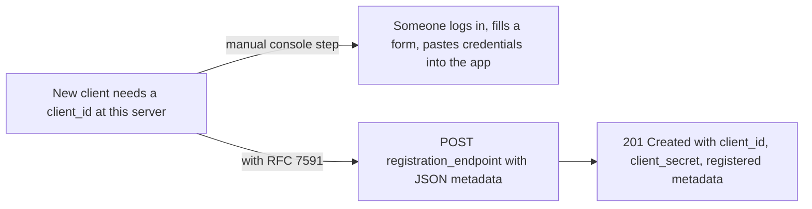
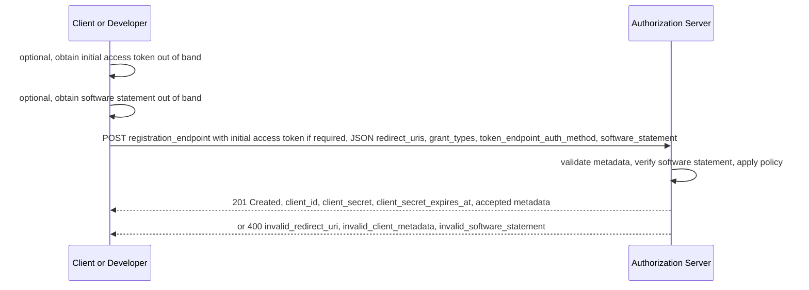

# Dynamic Client Registration

> In one line: a client POSTs its own metadata to a registration endpoint and gets back a client_id, so onboarding is an API call instead of a form in an admin console.

## When you reach for it

- **Software that meets authorization servers it has never seen**: the client instance sends its `redirect_uris`, `grant_types` and `client_name` to the `registration_endpoint` and receives a `client_id` on the spot, with no developer in the loop (Sections 1.3, 3.1).
- **One installed copy per user that needs its own credentials**: each native app instance can register itself and get a distinct `client_id` and `client_secret`, instead of every copy sharing one embedded secret (Appendix A.4, Section 5).
- **A vendor whose software should be recognized across servers**: the developer ships a signed software statement with the app. The server's trust in its issuer feeds the registration decision, and its claims take precedence over the plain JSON values (Sections 2, 2.3).
- **Open registration that still needs rate limiting or gating**: the server may require an initial access token or accept open requests and throttle them (Section 3).

## The problem it solves

OAuth 2.0 assumes every client was registered with the authorization server ahead of time, and leaves how out of scope. In practice that meant a human in a console, which does not work for software that discovers servers at runtime, for ecosystems with thousands of relying parties, or for native apps that should not all share one secret.

RFC 7591 defines a registration endpoint and a common vocabulary of client metadata. A client or its developer sends the desired metadata, the server registers the client and returns the metadata it actually accepted plus a client identifier and any credentials. A signed software statement lets a trusted party vouch for metadata the instance itself cannot be trusted to assert (Section 1).

## How it works

Registration is an HTTP POST with a JSON body to the registration endpoint. The body carries the fields defined in Section 2: `redirect_uris`, `token_endpoint_auth_method`, `grant_types`, `response_types`, `client_name`, `client_uri`, `logo_uri`, `scope`, `contacts`, `tos_uri`, `policy_uri`, `jwks_uri` or `jwks`, `software_id` and `software_version`. An optional `software_statement` member carries a JWT signed by the developer or a trusted party, and its claims win over plain JSON values for the same name (Sections 2, 2.3, 3.1.1). On success the server replies 201 Created with `client_id`, optionally `client_secret`, `client_id_issued_at` and `client_secret_expires_at`, plus every piece of metadata it registered, which may differ from what was asked for (Section 3.2.1). Errors are 400 with `error` set to one of `invalid_redirect_uri`, `invalid_client_metadata`, `invalid_software_statement` or `unapproved_software_statement` (Section 3.2.2).

## What the spec requires

- The server must ignore any client metadata it does not understand (Section 2).
- Where the same name appears in the request body and in a trusted software statement, the software statement value must take precedence (Sections 2, 3.1.1).
- A software statement must be signed or MACed with JWS and must include an `iss` claim (Section 2.3).
- The registration endpoint must accept HTTP POST with JSON-encoded parameters and must be protected by transport-layer security (Section 3).
- `client_id` is required in the response, and `client_secret_expires_at` is required whenever a `client_secret` is issued, with 0 meaning never (Section 3.2.1).
- The server must treat all client metadata as self-asserted unless it came from a software statement (Section 5).

## Watch out

- **Redirect URIs are the main attack surface**: redirect-based grants require registered redirect URIs, limited to HTTPS, localhost HTTP or app-specific schemes (Section 5).
- **Displayed URLs can be abused**: logo, terms, policy and client URIs are shown to users, so the server should check them against the redirect URIs and screen them for malicious content (Section 5).
- **Do not share secrets across instances**: the server should avoid issuing the same client secret to multiple instances (Section 5).
- **Tracking**: a per-instance client identifier can be used to track a particular installation, and the `contacts` field exposes contact information (Section 6).

## Sources

- [RFC 7591, Section 1](https://www.rfc-editor.org/rfc/rfc7591#section-1)
- [RFC 7591, Section 1.3](https://www.rfc-editor.org/rfc/rfc7591#section-1.3)
- [RFC 7591, Section 2](https://www.rfc-editor.org/rfc/rfc7591#section-2)
- [RFC 7591, Section 2.3](https://www.rfc-editor.org/rfc/rfc7591#section-2.3)
- [RFC 7591, Section 3](https://www.rfc-editor.org/rfc/rfc7591#section-3)
- [RFC 7591, Section 3.1](https://www.rfc-editor.org/rfc/rfc7591#section-3.1)
- [RFC 7591, Section 3.1.1](https://www.rfc-editor.org/rfc/rfc7591#section-3.1.1)
- [RFC 7591, Section 3.2.1](https://www.rfc-editor.org/rfc/rfc7591#section-3.2.1)
- [RFC 7591, Section 3.2.2](https://www.rfc-editor.org/rfc/rfc7591#section-3.2.2)
- [RFC 7591, Section 5](https://www.rfc-editor.org/rfc/rfc7591#section-5)
- [RFC 7591, Section 6](https://www.rfc-editor.org/rfc/rfc7591#section-6)
- [RFC 7591, Appendix A.4](https://www.rfc-editor.org/rfc/rfc7591#appendix-A.4)
