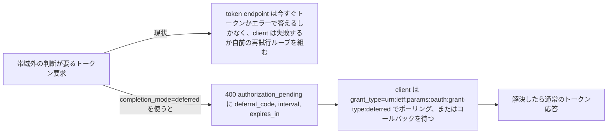
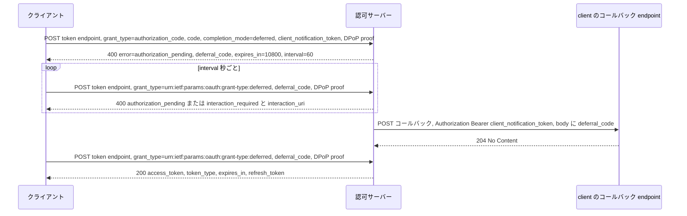

# Deferred Token Response

> 一言で言うと: 認可サーバーが今すぐ判断できないとき、トークン要求に対してトークンの代わりに `deferral_code` とポーリング `interval` を返し、client は本物のトークン応答ができるまでポーリングするかコールバックを待つ。

## どういうときに使うか

- **追加の確認が必要な高リスク取引**: 銀行の確認 (不正対策担当者による手動レビューを含むことがある) は帯域外で進む。銀行アプリはトークン要求を失敗させる代わりに deferral code を持ち、次のセッションでも結果をポーリングできる (Section 1, Appendix A.1)。
- **事前承認の範囲を超える権限を求める自律エージェント**: サーバーは人間の principal の承認を帯域外で得る間 defer し、エージェントはそのタスクだけ保留して残りの仕事を続ける (Appendix A.4)。
- **管理者とレビュアーが統制する企業内アクセス**: workforce client の機微なリソース要求はガバナンスのワークフローを待ち、ポーリングは承認でトークン、却下やタイムアウトで `access_denied` を返す (Appendix A.5)。
- **AI アシスタントが起こす機微な操作へのユーザーの明示的同意**: サーバーは `interaction_required` と `interaction_uri` を返し、ユーザーはそこで金額や宛先を確認し、承認後にはじめてトークンが出る (Appendix A.7, A.8)。

## 解決する問題

既存の OAuth グラントはどれも token endpoint が同期的に答えられる前提に立つ。不正レビュー、本人確認、エージェントの認可、企業のガバナンスはその時間内に終わらない。Device Authorization Grant はポーリングするが、1 つのグラント専用で、承認者は開始したエンドユーザーに限られる。この draft は deferral を token endpoint の性質にして、どのグラントからも使えるようにする。defer するかはサーバーが決め、承認者はフローを始めたユーザーでなくてよい (Section 1, 3)。6 つの substrate guarantee が安全性を支える。deferral は元の要求を狭めるか完了させるだけ、token endpoint でのポーリングが client 側から進める唯一の手段、元の要求の proof-of-possession が引き継がれる、元のパラメータは不変、`deferral_code` は不透明、そしてポーリングは常に正式な経路として残る (Section 4.1)。

## 仕組み

client はトークン要求に `completion_mode=deferred` を付けてオプトインする。ユーザーに `interaction_uri` を見せられるなら `deferred_interactive`。先行する endpoint があるグラントでは、同じ値をヒントとしてそちらに送ってもよい (Section 5.1, 5.2)。サーバーは同期的に答えてもよい。defer するなら HTTP 400 のエラー応答で `error=authorization_pending`、`deferral_code`、code の寿命を示す `expires_in`、`interval` を返す (Section 5.3, 6.4)。client は deferred グラント種別と code でポーリングし、`slow_down` で間隔を広げる (Section 6.5)。非終端のエラーは `authorization_pending`、`interaction_required`、`interaction_pending`。終端は `expired_token`、`access_denied`、`invalid_grant`、`invalid_request` (Section 6.6)。登録済みの `deferred_client_notification_endpoint` には最終結果が揃った時点で `deferral_code` 入りの POST が届くが、コールバックにトークンは乗らない。client は受け取りにポーリングする (Section 7, 7.1, 7.2)。取り消すには RFC 7009 の endpoint で deferral code を hint `urn:ietf:params:oauth:token-type:deferral-code` 付きで失効させる (Section 8.1, 8.2)。

## 仕様が求めること

- サーバーは `completion_mode` に `deferred` を含まない要求を defer してはならず、metadata を公開するサーバーは `deferred_token_response_supported` を `true` にしなければならない (Section 5.1, 5.3)。
- `deferral_code` は 128 bit 以上のエントロピー (160 bit 推奨) を持ち、client にとって不透明でなければならない。deferred 応答で `expires_in` と `interval` は必須で、期限後のポーリングには `expired_token` を返さなければならない (Section 6.4)。
- client は `interval` より速くポーリングしてはならず、`slow_down` の後は間隔を 5 秒以上広げなければならない。使用済みの code への以後のポーリングは `invalid_grant` を返さなければならない (Section 6.5, 6.5.2)。
- 全てのエラー応答は `Cache-Control: no-store` を付けなければならず、`interaction_required` は HTTPS で fragment を持たない `interaction_uri` を含まなければならない (Section 6.4, 6.6)。
- `client_notification_token` が渡されていれば、サーバーはコールバックでそれを Bearer credential として送り、client は不一致なら 401 を返さなければならない。client は正当なコールバックに 204 で答え、リダイレクトしてはならない (Section 7.1)。
- 認識済みの deferral code の失効は、要求を原子的に取り消し、未送信のコールバックを抑止し、以後のポーリングに `access_denied` を返させなければならない。すでに発行済みの access token を失効させてはならない (Section 8.2)。

## 注意点

- **public client は最初の要求で DPoP を使わなければならない**: deferral code はその鍵に束縛され、全てのポーリングと失効は同じ鍵を使わなければならない。mTLS や `private_key_jwt` の confidential client は省略してよく、client secret を使うものは束縛すべき (Section 11.1)。
- **コールバックは通知であって結果ではない**: client はポーリングで解決を確認しなければならず、notification token なしのコールバックは参考情報として扱う (Section 7, 11.4)。
- **コールバック endpoint は SSRF を招く**: サーバーは private、loopback、link-local 宛先を拒否し、配送時に再解決してアドレスを固定すべきで、deferral code や notification token を URL に置いてはならない (Section 11.5)。
- **待っている間に同意が古くなる**: トークン発行前にサーバーは同意と client の有効性を再確認し、何かが失効していれば `access_denied` を返さなければならない (Section 11.7)。
- **deferral code は refresh token と同じ扱い**: 盗難時の脅威は同じなので、どちらの側も寿命を過ぎて平文でログに残してはならない (Section 11.2, 11.8)。

## 出典

- [draft-ietf-oauth-deferred-token-response, Section 1](https://datatracker.ietf.org/doc/html/draft-ietf-oauth-deferred-token-response#section-1)
- [draft-ietf-oauth-deferred-token-response, Section 3](https://datatracker.ietf.org/doc/html/draft-ietf-oauth-deferred-token-response#section-3)
- [draft-ietf-oauth-deferred-token-response, Section 4.1](https://datatracker.ietf.org/doc/html/draft-ietf-oauth-deferred-token-response#section-4.1)
- [draft-ietf-oauth-deferred-token-response, Section 5.1](https://datatracker.ietf.org/doc/html/draft-ietf-oauth-deferred-token-response#section-5.1)
- [draft-ietf-oauth-deferred-token-response, Section 5.2](https://datatracker.ietf.org/doc/html/draft-ietf-oauth-deferred-token-response#section-5.2)
- [draft-ietf-oauth-deferred-token-response, Section 5.3](https://datatracker.ietf.org/doc/html/draft-ietf-oauth-deferred-token-response#section-5.3)
- [draft-ietf-oauth-deferred-token-response, Section 6.4](https://datatracker.ietf.org/doc/html/draft-ietf-oauth-deferred-token-response#section-6.4)
- [draft-ietf-oauth-deferred-token-response, Section 6.5](https://datatracker.ietf.org/doc/html/draft-ietf-oauth-deferred-token-response#section-6.5)
- [draft-ietf-oauth-deferred-token-response, Section 6.5.2](https://datatracker.ietf.org/doc/html/draft-ietf-oauth-deferred-token-response#section-6.5.2)
- [draft-ietf-oauth-deferred-token-response, Section 6.6](https://datatracker.ietf.org/doc/html/draft-ietf-oauth-deferred-token-response#section-6.6)
- [draft-ietf-oauth-deferred-token-response, Section 7](https://datatracker.ietf.org/doc/html/draft-ietf-oauth-deferred-token-response#section-7)
- [draft-ietf-oauth-deferred-token-response, Section 7.1](https://datatracker.ietf.org/doc/html/draft-ietf-oauth-deferred-token-response#section-7.1)
- [draft-ietf-oauth-deferred-token-response, Section 7.2](https://datatracker.ietf.org/doc/html/draft-ietf-oauth-deferred-token-response#section-7.2)
- [draft-ietf-oauth-deferred-token-response, Section 8.1](https://datatracker.ietf.org/doc/html/draft-ietf-oauth-deferred-token-response#section-8.1)
- [draft-ietf-oauth-deferred-token-response, Section 8.2](https://datatracker.ietf.org/doc/html/draft-ietf-oauth-deferred-token-response#section-8.2)
- [draft-ietf-oauth-deferred-token-response, Section 11.1](https://datatracker.ietf.org/doc/html/draft-ietf-oauth-deferred-token-response#section-11.1)
- [draft-ietf-oauth-deferred-token-response, Section 11.2](https://datatracker.ietf.org/doc/html/draft-ietf-oauth-deferred-token-response#section-11.2)
- [draft-ietf-oauth-deferred-token-response, Section 11.4](https://datatracker.ietf.org/doc/html/draft-ietf-oauth-deferred-token-response#section-11.4)
- [draft-ietf-oauth-deferred-token-response, Section 11.5](https://datatracker.ietf.org/doc/html/draft-ietf-oauth-deferred-token-response#section-11.5)
- [draft-ietf-oauth-deferred-token-response, Section 11.7](https://datatracker.ietf.org/doc/html/draft-ietf-oauth-deferred-token-response#section-11.7)
- [draft-ietf-oauth-deferred-token-response, Section 11.8](https://datatracker.ietf.org/doc/html/draft-ietf-oauth-deferred-token-response#section-11.8)
- [draft-ietf-oauth-deferred-token-response, Appendix A](https://datatracker.ietf.org/doc/html/draft-ietf-oauth-deferred-token-response#appendix-A)
