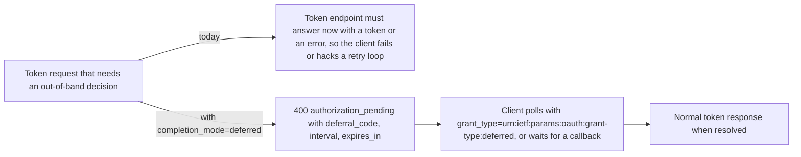
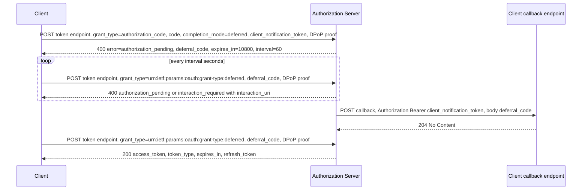

# Deferred Token Response

> In one line: when the authorization server cannot decide right now, it answers the token request with a `deferral_code` and a polling `interval` instead of a token, and the client polls, or gets a callback, until the real token response is ready.

## When you reach for it

- **A high-risk transaction that needs extra verification**: the bank's checks, possibly a manual fraud-analyst review, run out of band; the banking app keeps its deferral code and polls for the outcome, even in a later session, instead of failing the token request (Section 1, Appendix A.1).
- **An autonomous agent asking for more than it was pre-approved for**: the server defers while it gets the human principal's approval out of band, and the agent suspends that one task and keeps working on the rest (Appendix A.4).
- **Enterprise access governed by managers and reviewers**: a workforce client's request for a sensitive resource waits on a governance workflow, and polling returns the token on approval or `access_denied` on rejection or timeout (Appendix A.5).
- **Explicit user consent for a sensitive operation driven by an AI assistant**: the server answers `interaction_required` with an `interaction_uri`, the user reviews the amount and recipient there, and the token is issued only after they approve (Appendix A.7, A.8).

## The problem it solves

Every existing OAuth grant assumes the token endpoint can answer synchronously. Fraud review, identity verification, agent authorization and enterprise governance cannot finish in that window. The Device Authorization Grant polls, but only for one grant and only for the initiating end user. This draft makes deferral a property of the token endpoint that any grant can use: the server decides to defer, and the approver need not be the user who started the flow (Sections 1, 3). Six substrate guarantees keep it safe: a deferral can only constrain or complete the original request, polling at the token endpoint is the only client-initiated way to advance it, proof-of-possession from the original request carries through, the original parameters are immutable, the `deferral_code` is opaque, and polling always remains the authoritative path (Section 4.1).

## How it works

The client opts in by adding `completion_mode=deferred`, or `deferred_interactive` if it can show an `interaction_uri` to a user, to the token request. Grants with a preceding endpoint may send the same value there as a hint (Sections 5.1, 5.2). The server may still answer synchronously; if it defers, it returns an HTTP 400 error response with `error=authorization_pending`, a `deferral_code`, `expires_in` for the code's lifetime, and `interval` (Sections 5.3, 6.4). The client then polls with the deferred grant type and the code, backing off on `slow_down` (Section 6.5). Non-terminal errors are `authorization_pending`, `interaction_required` and `interaction_pending`; terminal ones are `expired_token`, `access_denied`, `invalid_grant` and `invalid_request` (Section 6.6). A registered `deferred_client_notification_endpoint` receives a POST with the `deferral_code` when a final result is ready, but no token travels in the callback; the client still polls to collect it (Sections 7, 7.1, 7.2). The client can cancel by revoking the deferral code at the RFC 7009 endpoint with hint `urn:ietf:params:oauth:token-type:deferral-code` (Sections 8.1, 8.2).

## What the spec requires

- The server MUST NOT defer a request whose `completion_mode` does not include `deferred`, and a server that publishes metadata MUST set `deferred_token_response_supported` to `true` (Sections 5.1, 5.3).
- `deferral_code` MUST have at least 128 bits of entropy (160 RECOMMENDED) and MUST be opaque to the client. `expires_in` and `interval` are REQUIRED in the deferred response, and polling after expiry MUST return `expired_token` (Section 6.4).
- The client MUST NOT poll faster than `interval` and MUST increase its interval by at least 5 seconds after `slow_down`. A redeemed code MUST return `invalid_grant` on any later poll (Sections 6.5, 6.5.2).
- Every error response MUST carry `Cache-Control: no-store`, and `interaction_required` MUST include an `interaction_uri` that is HTTPS and has no fragment (Sections 6.4, 6.6).
- If a `client_notification_token` was supplied, the server MUST send it as a Bearer credential on the callback and the client MUST return 401 on mismatch. The client MUST answer a valid callback with 204 and MUST NOT redirect (Section 7.1).
- Revoking a recognized deferral code MUST atomically cancel the request, suppress pending callbacks and make later polls return `access_denied`; it MUST NOT revoke an access token already issued (Section 8.2).

## Watch out

- **Public clients MUST use DPoP on the initial request**: the deferral code is bound to that key and every poll and revocation MUST use it. Confidential clients with mTLS or `private_key_jwt` MAY skip it; those with client secrets SHOULD bind (Section 11.1).
- **A callback is advisory, never the result**: the client MUST confirm resolution by polling, and a callback without a notification token must be treated as advisory (Sections 7, 11.4).
- **Callback endpoints invite SSRF**: the server SHOULD reject private, loopback and link-local targets, re-resolve and pin addresses at delivery, and MUST NOT put the deferral code or notification token in a URL (Section 11.5).
- **Consent can go stale while the request waits**: before issuing the token the server MUST re-check consent and client validity, returning `access_denied` if anything lapsed (Section 11.7).
- **Treat the deferral code like a refresh token**: same theft profile, so neither side may log it in plaintext past its lifetime (Sections 11.2, 11.8).

## Sources

- [draft-ietf-oauth-deferred-token-response, Section 1](https://datatracker.ietf.org/doc/html/draft-ietf-oauth-deferred-token-response#section-1)
- [draft-ietf-oauth-deferred-token-response, Section 3](https://datatracker.ietf.org/doc/html/draft-ietf-oauth-deferred-token-response#section-3)
- [draft-ietf-oauth-deferred-token-response, Section 4.1](https://datatracker.ietf.org/doc/html/draft-ietf-oauth-deferred-token-response#section-4.1)
- [draft-ietf-oauth-deferred-token-response, Section 5.1](https://datatracker.ietf.org/doc/html/draft-ietf-oauth-deferred-token-response#section-5.1)
- [draft-ietf-oauth-deferred-token-response, Section 5.2](https://datatracker.ietf.org/doc/html/draft-ietf-oauth-deferred-token-response#section-5.2)
- [draft-ietf-oauth-deferred-token-response, Section 5.3](https://datatracker.ietf.org/doc/html/draft-ietf-oauth-deferred-token-response#section-5.3)
- [draft-ietf-oauth-deferred-token-response, Section 6.4](https://datatracker.ietf.org/doc/html/draft-ietf-oauth-deferred-token-response#section-6.4)
- [draft-ietf-oauth-deferred-token-response, Section 6.5](https://datatracker.ietf.org/doc/html/draft-ietf-oauth-deferred-token-response#section-6.5)
- [draft-ietf-oauth-deferred-token-response, Section 6.5.2](https://datatracker.ietf.org/doc/html/draft-ietf-oauth-deferred-token-response#section-6.5.2)
- [draft-ietf-oauth-deferred-token-response, Section 6.6](https://datatracker.ietf.org/doc/html/draft-ietf-oauth-deferred-token-response#section-6.6)
- [draft-ietf-oauth-deferred-token-response, Section 7](https://datatracker.ietf.org/doc/html/draft-ietf-oauth-deferred-token-response#section-7)
- [draft-ietf-oauth-deferred-token-response, Section 7.1](https://datatracker.ietf.org/doc/html/draft-ietf-oauth-deferred-token-response#section-7.1)
- [draft-ietf-oauth-deferred-token-response, Section 7.2](https://datatracker.ietf.org/doc/html/draft-ietf-oauth-deferred-token-response#section-7.2)
- [draft-ietf-oauth-deferred-token-response, Section 8.1](https://datatracker.ietf.org/doc/html/draft-ietf-oauth-deferred-token-response#section-8.1)
- [draft-ietf-oauth-deferred-token-response, Section 8.2](https://datatracker.ietf.org/doc/html/draft-ietf-oauth-deferred-token-response#section-8.2)
- [draft-ietf-oauth-deferred-token-response, Section 11.1](https://datatracker.ietf.org/doc/html/draft-ietf-oauth-deferred-token-response#section-11.1)
- [draft-ietf-oauth-deferred-token-response, Section 11.2](https://datatracker.ietf.org/doc/html/draft-ietf-oauth-deferred-token-response#section-11.2)
- [draft-ietf-oauth-deferred-token-response, Section 11.4](https://datatracker.ietf.org/doc/html/draft-ietf-oauth-deferred-token-response#section-11.4)
- [draft-ietf-oauth-deferred-token-response, Section 11.5](https://datatracker.ietf.org/doc/html/draft-ietf-oauth-deferred-token-response#section-11.5)
- [draft-ietf-oauth-deferred-token-response, Section 11.7](https://datatracker.ietf.org/doc/html/draft-ietf-oauth-deferred-token-response#section-11.7)
- [draft-ietf-oauth-deferred-token-response, Section 11.8](https://datatracker.ietf.org/doc/html/draft-ietf-oauth-deferred-token-response#section-11.8)
- [draft-ietf-oauth-deferred-token-response, Appendix A](https://datatracker.ietf.org/doc/html/draft-ietf-oauth-deferred-token-response#appendix-A)
