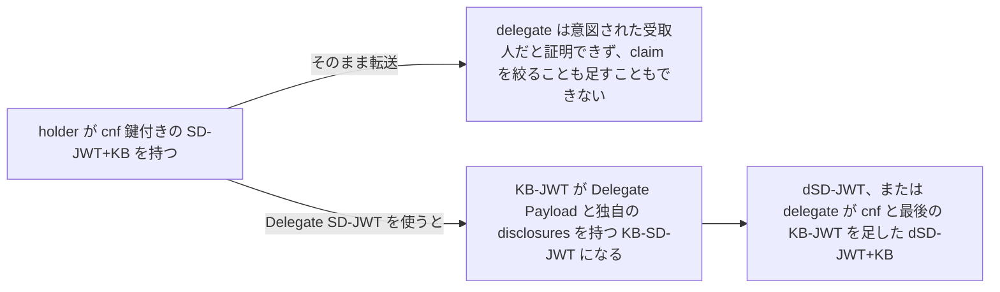
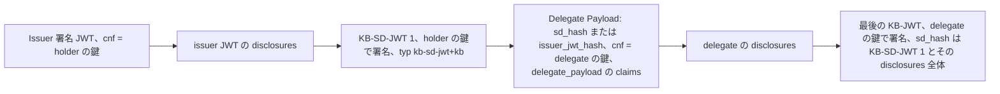

# Delegate SD-JWT

> 一言で言うと: SD-JWT+KB の末尾にある Key Binding JWT をそれ自体 SD-JWT にできるようにして、holder が絞り込んだ選択的開示可能な credential を delegate に渡し、delegate がさらに別の delegate に渡しても、issuer まで検証可能な鎖が残るようにする。

## どういうときに使うか

- **ユーザーが AI エージェントに代理購入を認める**: ユーザーは履行が有効な期間などの制約付きで購入権限を委任し、エージェントは他にどの merchant を検討したかを明かさずに、その merchant に対して自分が認可されていたことを証明できる (Section 1)。
- **転送された SD-JWT を受け取る verifier**: 今は自分が意図された受取人だと証明できず、transaction data を狭めることもできない。委任リンクは Delegate Payload と、任意で delegate 自身の鍵を加える (Section 1, 1.1)。
- **何段も続く委任**: 各 KB-SD-JWT が次のリンクの Issuer-JWT として働くので、delegate holder の鎖は元の issuer まで検証可能なまま (Section 4)。
- **wallet の presentation を通した委任**: OpenID4VP の `transaction_data` 型 `delegate` が delegate payload disclosure と disclosures を運び、holder の wallet は presentation の一部として委任に署名する (Section 7.1)。

## 解決する問題

RFC 9901 では holder は提示前に claim を落とせ、`cnf` で鍵の所持を証明できるが、presentation は holder で終わる。holder が SD-JWT+KB を別の相手に渡しても、その相手は自分が受け取るべき者だったと示す手段がなく、holder は制約を付ける手段がない。draft は KB-JWT が元の SD-JWT に連結する新しい SD-JWT を始められるようにして解決する。holder は delegate に対する issuer となり、issuer のセキュリティ上の義務を負う (Section 1, 8)。

## 仕組み

compact serialization では、1 段の委任は dSD-JWT なら `<SD-JWT>~~<KB-SD-JWT>~<delegate disclosures>~`、dSD-JWT+KB なら `<SD-JWT>~~<KB-SD-JWT>~<delegate KB-JWT>`。二重のチルダが、1 つの SD-JWT が終わり KB-SD-JWT が始まる位置を示す (Section 5.1.1)。KB-SD-JWT は KB-JWT の `typ` を `kb+sd-jwt` に、Delegate Payload が `cnf` を持つなら `kb-sd-jwt+kb` に置き換える。前のリンクへの束縛は、先行する SD-JWT とその disclosures 全体の `sd_hash` か、holder が delegate に以前の disclosures を省かせたい場合は issuer 署名部分だけの `issuer_jwt_hash` で行う。`delegate_payload` 配列が payload オブジェクトを持ち、複数あるなら全て disclosure で、presentation 時にちょうど 1 つが開示される (Section 4.1, 5.1.4)。verifier は鎖を分割し、最初の SD-JWT を検証し、各 KB-SD-JWT を前のリンクの `cnf` 鍵を issuer 鍵として SD-JWT+KB として検証し、ハッシュの束縛と `typ` を確認し、key binding が必要なら最後に delegate の KB-JWT を検証する (Section 6)。

## 仕様が求めること

- dSD-JWT+KB では Delegate Payload が `cnf` を含まなければならず、KB-SD-JWT+KB は `typ` に `kb-sd-jwt+kb` を持たなければならない (Section 2.2, 5.1.4)。
- KB-SD-JWT は、draft が別に定める点を除き RFC 9901 の KB-JWT と SD-JWT の要件を満たさなければならない。`sd_hash` が無ければ `issuer_jwt_hash` が無ければならず、どちらも先行コンポーネントのハッシュアルゴリズムを使う。`_sd_alg` 以外の issuer payload の claim は Delegate Payload に移さなければならない (Section 5.1.4)。
- delegate に先行 SD-JWT の disclosures を省かせるには、holder は `sd_hash` を外して `issuer_jwt_hash` を入れなければならない (Section 4.1)。
- `~` で分割したとき、各 SD-JWT または KB-SD-JWT と、それに続く KB-SD-JWT の間にはちょうど 1 つの空のコンポーネントがなければならない (Section 5.1.1)。
- JSON serialization では `kb_jwt` の unprotected header 自体が General または Flattened の SD-JWT でなければならず、`sd_hash` と `issuer_jwt_hash` は等価な compact serialization に対して計算しなければならない (Section 5.1.2)。
- key binding が必要な場合、verifier は key binding の無い dSD-JWT を拒否しなければならず、どの検証手順が失敗しても処理を中止しなければならない (Section 6)。

## 注意点

- **全てのリンクを検証する**: holder の `cnf` 鍵が再利用されていると、悪意ある delegate holder が鎖の部品を入れ替えられるので、各 KB-SD-JWT と、先行要素への `sd_hash` または `issuer_jwt_hash` の束縛を確認しなければならない (Section 8.1)。
- **何も言わなければ委任は無制限**: 委任を制限したい issuer や holder は、Issuer 署名 JWT や KB-SD-JWT+KB に可視の制約 claim を足してよい (MAY) (Section 8.2)。
- **失効が馴染まない**: 個々の holder は verifier に失効情報を配れない。短い `exp`、claim による利用制約、あるいは 1 つの主体が holder と delegate の両方を管理する構成で補う (Section 8.3)。
- **holder は issuer のセキュリティ上の義務を引き継ぐ**。RFC 9901 のセキュリティとプライバシーの考慮事項もそのまま適用される (Section 8, 9)。

## 出典

- [draft-ietf-oauth-delegate-sd-jwt, Section 1](https://datatracker.ietf.org/doc/html/draft-ietf-oauth-delegate-sd-jwt#section-1)
- [draft-ietf-oauth-delegate-sd-jwt, Section 1.1](https://datatracker.ietf.org/doc/html/draft-ietf-oauth-delegate-sd-jwt#section-1.1)
- [draft-ietf-oauth-delegate-sd-jwt, Section 2.2](https://datatracker.ietf.org/doc/html/draft-ietf-oauth-delegate-sd-jwt#section-2.2)
- [draft-ietf-oauth-delegate-sd-jwt, Section 4](https://datatracker.ietf.org/doc/html/draft-ietf-oauth-delegate-sd-jwt#section-4)
- [draft-ietf-oauth-delegate-sd-jwt, Section 4.1](https://datatracker.ietf.org/doc/html/draft-ietf-oauth-delegate-sd-jwt#section-4.1)
- [draft-ietf-oauth-delegate-sd-jwt, Section 5.1.1](https://datatracker.ietf.org/doc/html/draft-ietf-oauth-delegate-sd-jwt#section-5.1.1)
- [draft-ietf-oauth-delegate-sd-jwt, Section 5.1.2](https://datatracker.ietf.org/doc/html/draft-ietf-oauth-delegate-sd-jwt#section-5.1.2)
- [draft-ietf-oauth-delegate-sd-jwt, Section 5.1.4](https://datatracker.ietf.org/doc/html/draft-ietf-oauth-delegate-sd-jwt#section-5.1.4)
- [draft-ietf-oauth-delegate-sd-jwt, Section 6](https://datatracker.ietf.org/doc/html/draft-ietf-oauth-delegate-sd-jwt#section-6)
- [draft-ietf-oauth-delegate-sd-jwt, Section 7.1](https://datatracker.ietf.org/doc/html/draft-ietf-oauth-delegate-sd-jwt#section-7.1)
- [draft-ietf-oauth-delegate-sd-jwt, Section 8](https://datatracker.ietf.org/doc/html/draft-ietf-oauth-delegate-sd-jwt#section-8)
- [draft-ietf-oauth-delegate-sd-jwt, Section 8.1](https://datatracker.ietf.org/doc/html/draft-ietf-oauth-delegate-sd-jwt#section-8.1)
- [draft-ietf-oauth-delegate-sd-jwt, Section 8.2](https://datatracker.ietf.org/doc/html/draft-ietf-oauth-delegate-sd-jwt#section-8.2)
- [draft-ietf-oauth-delegate-sd-jwt, Section 8.3](https://datatracker.ietf.org/doc/html/draft-ietf-oauth-delegate-sd-jwt#section-8.3)
- [draft-ietf-oauth-delegate-sd-jwt, Section 9](https://datatracker.ietf.org/doc/html/draft-ietf-oauth-delegate-sd-jwt#section-9)
