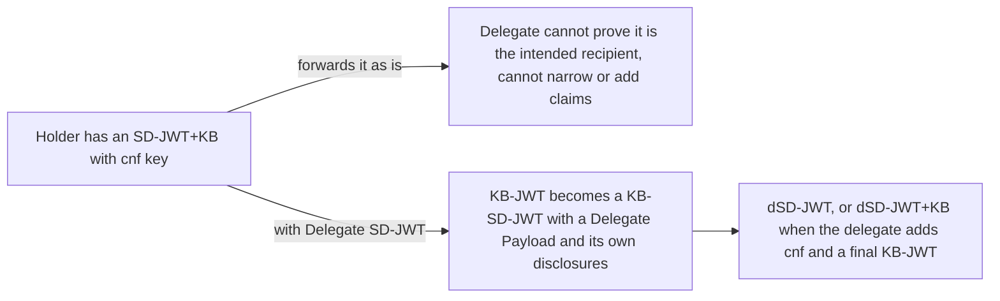
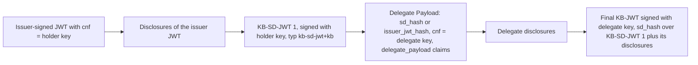

# Delegate SD-JWT

> In one line: the Key Binding JWT at the end of an SD-JWT+KB can itself be an SD-JWT, so a holder can hand a narrowed, selectively disclosable credential to a delegate, and the delegate to another, with a verifiable chain back to the issuer.

## When you reach for it

- **A user authorizing an AI agent to buy on their behalf**: the user delegates purchase authority with constraints on when fulfillment is valid, and the agent proves to a merchant that it was authorized for that merchant without revealing which other merchants were considered (Section 1).
- **A verifier that receives a forwarded SD-JWT today**: it cannot prove it was the intended recipient or narrow the transaction data. A delegation link adds a Delegate Payload and optionally the delegate's own key (Sections 1, 1.1).
- **Delegation that must go several hops**: each KB-SD-JWT acts as the Issuer-JWT of the next link, so a chain of delegate holders stays verifiable back to the original issuer (Section 4).
- **Delegating through a wallet presentation**: OpenID4VP `transaction_data` of type `delegate` carries the delegate payload disclosure and disclosures so the holder's wallet signs the delegation as part of a presentation (Section 7.1).

## The problem it solves

RFC 9901 lets a holder drop claims before presenting and prove key possession through `cnf`, but the presentation ends with the holder. If the holder gives the SD-JWT+KB to another party, that party has no way to show it was meant to receive it, and the holder has no way to attach constraints. The draft solves this by letting the KB-JWT start a new SD-JWT that links back to the original. The holder becomes an issuer for the delegate, with the issuer's security obligations (Sections 1, 8).

## How it works

In compact serialization a single delegation is `<SD-JWT>~~<KB-SD-JWT>~<delegate disclosures>~` for a dSD-JWT, and `<SD-JWT>~~<KB-SD-JWT>~<delegate KB-JWT>` for a dSD-JWT+KB; the double tilde marks where one SD-JWT ends and its KB-SD-JWT begins (Section 5.1.1). The KB-SD-JWT replaces the KB-JWT's `typ` with `kb+sd-jwt`, or `kb-sd-jwt+kb` when the Delegate Payload carries `cnf`. It binds to the previous link either with `sd_hash` over the preceding SD-JWT and its disclosures, or, when the holder wants the delegate to be able to omit earlier disclosures, with `issuer_jwt_hash` over the issuer-signed part alone. Its `delegate_payload` array holds the payload objects, and when there are several they must all be disclosures with exactly one disclosed at presentation (Sections 4.1, 5.1.4). The verifier splits the chain, validates the initial SD-JWT, then validates each KB-SD-JWT as an SD-JWT+KB using the previous link's `cnf` key as issuer key, checks the hash binding, checks `typ`, and finally verifies the delegate's KB-JWT when key binding is required (Section 6).

## What the spec requires

- In a dSD-JWT+KB the Delegate Payload MUST include `cnf`, and a KB-SD-JWT+KB MUST carry `typ` `kb-sd-jwt+kb` (Sections 2.2, 5.1.4).
- A KB-SD-JWT MUST satisfy the KB-JWT and SD-JWT requirements of RFC 9901 except where the draft says otherwise. If `sd_hash` is absent, `issuer_jwt_hash` MUST be present, both using the hash algorithm of the preceding component. Issuer-payload claims other than `_sd_alg` MUST move into the Delegate Payload (Section 5.1.4).
- To let a delegate omit disclosures from the preceding SD-JWT, the holder MUST leave out `sd_hash` and include `issuer_jwt_hash` (Section 4.1).
- When split on `~`, there MUST be exactly one empty component between each SD-JWT or KB-SD-JWT and the KB-SD-JWT that follows it (Section 5.1.1).
- In JSON serialization the `kb_jwt` unprotected header MUST itself be a General or Flattened SD-JWT, and `sd_hash` and `issuer_jwt_hash` MUST be computed over the equivalent compact serialization (Section 5.1.2).
- A verifier MUST reject a dSD-JWT without key binding when key binding is required, and MUST abort if any verification step fails (Section 6).

## Watch out

- **Verify every link**: a malicious delegate holder could swap chain parts when the holder's `cnf` key is reused, so each KB-SD-JWT and its `sd_hash` or `issuer_jwt_hash` binding to the preceding element must be checked (Section 8.1).
- **Delegation is unconstrained unless you say so**: an issuer or holder that wants to limit delegation MAY add visible constraint claims to the Issuer-signed JWT or KB-SD-JWT+KB (Section 8.2).
- **Revocation does not fit**: an individual holder cannot distribute revocation data to verifiers. Use a short `exp`, claim-based usage constraints, or an arrangement where one entity manages both holder and delegate (Section 8.3).
- **The holder inherits the issuer's security obligations**, and the RFC 9901 security and privacy considerations apply unchanged (Sections 8, 9).

## Sources

- [draft-ietf-oauth-delegate-sd-jwt, Section 1](https://datatracker.ietf.org/doc/html/draft-ietf-oauth-delegate-sd-jwt#section-1)
- [draft-ietf-oauth-delegate-sd-jwt, Section 1.1](https://datatracker.ietf.org/doc/html/draft-ietf-oauth-delegate-sd-jwt#section-1.1)
- [draft-ietf-oauth-delegate-sd-jwt, Section 2.2](https://datatracker.ietf.org/doc/html/draft-ietf-oauth-delegate-sd-jwt#section-2.2)
- [draft-ietf-oauth-delegate-sd-jwt, Section 4](https://datatracker.ietf.org/doc/html/draft-ietf-oauth-delegate-sd-jwt#section-4)
- [draft-ietf-oauth-delegate-sd-jwt, Section 4.1](https://datatracker.ietf.org/doc/html/draft-ietf-oauth-delegate-sd-jwt#section-4.1)
- [draft-ietf-oauth-delegate-sd-jwt, Section 5.1.1](https://datatracker.ietf.org/doc/html/draft-ietf-oauth-delegate-sd-jwt#section-5.1.1)
- [draft-ietf-oauth-delegate-sd-jwt, Section 5.1.2](https://datatracker.ietf.org/doc/html/draft-ietf-oauth-delegate-sd-jwt#section-5.1.2)
- [draft-ietf-oauth-delegate-sd-jwt, Section 5.1.4](https://datatracker.ietf.org/doc/html/draft-ietf-oauth-delegate-sd-jwt#section-5.1.4)
- [draft-ietf-oauth-delegate-sd-jwt, Section 6](https://datatracker.ietf.org/doc/html/draft-ietf-oauth-delegate-sd-jwt#section-6)
- [draft-ietf-oauth-delegate-sd-jwt, Section 7.1](https://datatracker.ietf.org/doc/html/draft-ietf-oauth-delegate-sd-jwt#section-7.1)
- [draft-ietf-oauth-delegate-sd-jwt, Section 8](https://datatracker.ietf.org/doc/html/draft-ietf-oauth-delegate-sd-jwt#section-8)
- [draft-ietf-oauth-delegate-sd-jwt, Section 8.1](https://datatracker.ietf.org/doc/html/draft-ietf-oauth-delegate-sd-jwt#section-8.1)
- [draft-ietf-oauth-delegate-sd-jwt, Section 8.2](https://datatracker.ietf.org/doc/html/draft-ietf-oauth-delegate-sd-jwt#section-8.2)
- [draft-ietf-oauth-delegate-sd-jwt, Section 8.3](https://datatracker.ietf.org/doc/html/draft-ietf-oauth-delegate-sd-jwt#section-8.3)
- [draft-ietf-oauth-delegate-sd-jwt, Section 9](https://datatracker.ietf.org/doc/html/draft-ietf-oauth-delegate-sd-jwt#section-9)
