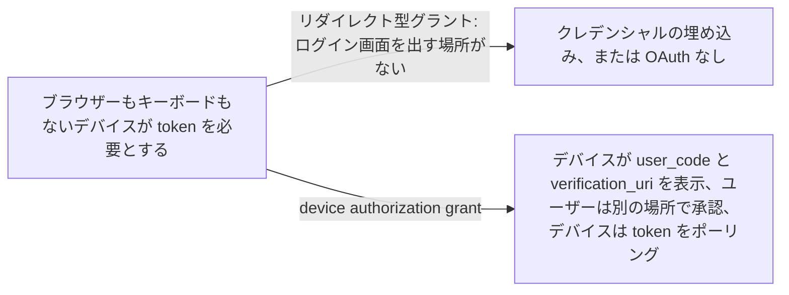
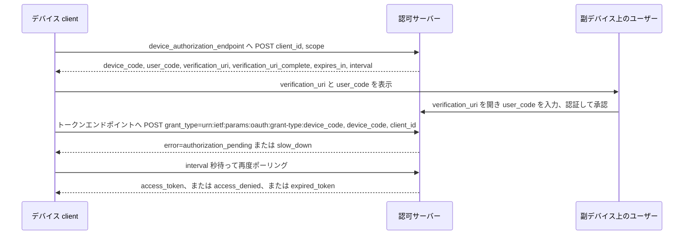

# Device Authorization Grant

> 一言で言うと: ブラウザーもキーボードもないデバイスが短いコードと URL をユーザーに見せ、ユーザーはスマートフォンやノート PC で承認し、デバイスは token が届くまでトークンエンドポイントをポーリングする。

## どういうときに使うか

- **API を呼ぶ必要のあるスマート TV、メディアコンソール、デジタルフォトフレーム、プリンター**: URI とコードは表示できるが、リダイレクトフローを回すブラウザーがないので、別のデバイスでログインを完了してもらう (Section 1)。
- **ヘッドレスサーバー上の CLI ツール**: デバイスが外向きの HTTPS リクエストを出せてコードを表示でき、ユーザーが要求を処理できる PC かスマートフォンを持っていること。これがまさに仕様の動作要件 (Section 1)。
- **長い URL を打ち込むのがつらいデバイス**: サーバーは `user_code` を埋め込んだ `verification_uri_complete` を返せるので、QR コードや NFC のように文字以外の形で提示し、ユーザーに URI を打たせずに済ませられる (Section 3.3.1)。
- **client secret を保持できない信頼度の低いデバイス群**: デバイス client は一般にクレデンシャルの機密を保てず、仕様のセキュリティ節はそれを前提に書かれている (Section 5.6)。

## 解決する問題

認可コードグラントは、認可サーバーへリダイレクトされて戻ってこられるユーザーエージェントを前提にしている。TV や CLI にはそれがないか、あってもクレデンシャルを打ち込むのが現実的でない。専用のグラントがなければ、そうしたデバイスは長期間有効なクレデンシャルを埋め込むか、限られた入力手段でパスワードを打たせることになる。

device authorization grant はやり取りを 2 つに分ける。デバイスは HTTPS で認可サーバーと話してコードの組を受け取り、ユーザーは副デバイスで承認する。仕様の要件は、デバイスがすでにインターネットに接続されていること、外向きの HTTPS リクエストを出せること、URI とコードを表示するか他の方法でユーザーに伝えられること、ユーザーが要求を処理できる副デバイスを持っていること (Section 1)。

## 仕組み

デバイスは `client_id` と任意の `scope` を付けて device authorization エンドポイントに POST する (Section 3.1)。サーバーは `device_code`、`user_code`、`verification_uri`、任意の `verification_uri_complete`、両コードの寿命である `expires_in`、任意の `interval` を返す (Section 3.2)。デバイスはユーザーに `verification_uri` と `user_code` を見せ、副デバイスのユーザーエージェントでその URI を開くよう指示する (Section 3.3)。`device_code` はエンドユーザーに見せるものではない (Section 3.3)。その間デバイスは `grant_type` を `urn:ietf:params:oauth:grant-type:device_code` にし、`device_code` と `client_id` を添えてトークンエンドポイントをポーリングする (Section 3.4)。ユーザーが完了するまでサーバーは `authorization_pending` を返し、デバイスは待ってから要求を繰り返す (Section 3.5)。ユーザーが承認すると、同じポーリングが access token を返す。

## 仕様が求めること

- device authorization リクエストの `client_id` は client が他の方法で認証しない場合に必須で、`scope` は任意 (Section 3.1)。
- 応答には `device_code`、`user_code`、`verification_uri`、`expires_in` が必須で、`verification_uri_complete` と `interval` は任意 (Section 3.2)。
- `interval` が与えられなければ、client は既定値として 5 秒を使わなければならない (Section 3.2)。
- トークンリクエストの `grant_type` は `urn:ietf:params:oauth:grant-type:device_code` でなければならず、`device_code` は必須 (Section 3.4)。
- 新しいリクエストの前に client は `interval` で指定された秒数以上待たなければならず、`slow_down` を受けたらこのリクエストと以降すべてで interval を 5 秒増やさなければならない (Section 3.5)。
- `access_denied` はユーザーが拒否したこと、`expired_token` は `device_code` が失効してセッションが終了したことを意味する (Section 3.5)。
- サーバーメタデータは `device_authorization_endpoint` を公開してよい (Section 4)。

## 注意点

- `user_code` は打ち込める程度に短いので、サーバーは user code の試行をレート制限すべきで、コードには寿命内に総当たりが成功しないだけのエントロピーが必要 (Section 5.1)。
- `device_code` はデバイスがポーリングに使うものなので、非常に高いエントロピーのコードを使うべき (Section 5.2)。
- 攻撃者が本物の `user_code` を被害者に送って承認を頼めるので、デバイスを認可しようとしていることをユーザーに知らせ、デバイスの情報を表示することが推奨される (Section 5.4)。
- 承認するユーザー自身のセッションやデバイスのシグナルは、認可対象のデバイスには必ずしも関係しない。信頼できるスマートフォンを TV が信頼できる証拠だと扱わない (Section 5.3)。
- コードを視覚以外、たとえば音声で伝えるなら、その経路は近くにいる人だけがアクセスできるものにすべき (Section 5.7)。

## 出典

- [RFC 8628, Section 1](https://www.rfc-editor.org/rfc/rfc8628#section-1)
- [RFC 8628, Section 3.1](https://www.rfc-editor.org/rfc/rfc8628#section-3.1)
- [RFC 8628, Section 3.2](https://www.rfc-editor.org/rfc/rfc8628#section-3.2)
- [RFC 8628, Section 3.3](https://www.rfc-editor.org/rfc/rfc8628#section-3.3)
- [RFC 8628, Section 3.3.1](https://www.rfc-editor.org/rfc/rfc8628#section-3.3.1)
- [RFC 8628, Section 3.4](https://www.rfc-editor.org/rfc/rfc8628#section-3.4)
- [RFC 8628, Section 3.5](https://www.rfc-editor.org/rfc/rfc8628#section-3.5)
- [RFC 8628, Section 4](https://www.rfc-editor.org/rfc/rfc8628#section-4)
- [RFC 8628, Section 5.1](https://www.rfc-editor.org/rfc/rfc8628#section-5.1)
- [RFC 8628, Section 5.2](https://www.rfc-editor.org/rfc/rfc8628#section-5.2)
- [RFC 8628, Section 5.3](https://www.rfc-editor.org/rfc/rfc8628#section-5.3)
- [RFC 8628, Section 5.4](https://www.rfc-editor.org/rfc/rfc8628#section-5.4)
- [RFC 8628, Section 5.6](https://www.rfc-editor.org/rfc/rfc8628#section-5.6)
- [RFC 8628, Section 5.7](https://www.rfc-editor.org/rfc/rfc8628#section-5.7)
