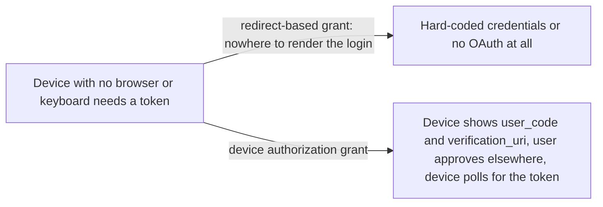
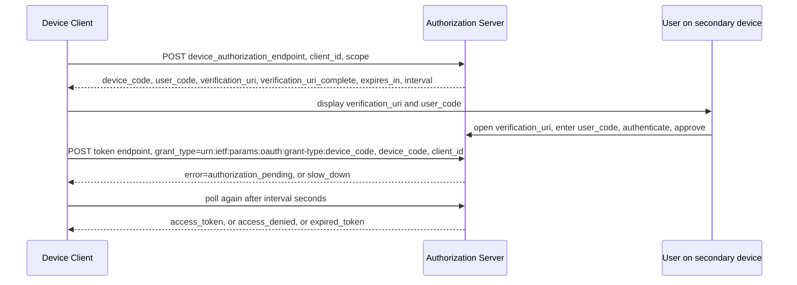

# Device Authorization Grant

> In one line: a device with no browser or keyboard shows the user a short code and a URL, the user approves on their phone or laptop, and the device polls the token endpoint until the token arrives.

## When you reach for it

- **A smart TV, media console, picture frame or printer that needs to call an API**: it can display a URI and a code but has no browser to run a redirect flow, so it asks the user to finish the login on a secondary device (Section 1).
- **A CLI tool on a headless server**: the device must be able to make outbound HTTPS requests and show a code, and the user needs a personal computer or smartphone from which they can process the request, which is exactly the spec's operating requirements (Section 1).
- **A device where typing a long URL is painful**: the server can return `verification_uri_complete` with the `user_code` already embedded, and present it non-textually, such as a QR code or NFC, to save the user from typing the URI (Section 3.3.1).
- **An untrusted device class that cannot keep a client secret**: device clients are generally incapable of maintaining the confidentiality of their credentials, and the spec's security section is written with that in mind (Section 5.6).

## The problem it solves

The authorization code grant assumes a user agent that can be redirected to the authorization server and back. A TV or a CLI has no such agent, or has one where typing credentials is impractical. Without a dedicated grant, those devices end up embedding long-lived credentials or asking the user to type a password into a limited input.

The device authorization grant splits the interaction in two. The device talks to the authorization server over HTTPS to get a pair of codes, and the user uses a secondary device to approve. The spec's requirements are that the device is already connected to the Internet, can make outbound HTTPS requests, can display or otherwise communicate a URI and code to the user, and that the user has a secondary device from which they can process the request (Section 1).

## How it works

The device posts to the device authorization endpoint with its `client_id` and optional `scope` (Section 3.1). The server answers with `device_code`, `user_code`, `verification_uri`, optionally `verification_uri_complete`, `expires_in` for both codes, and optionally `interval` (Section 3.2). The device shows the user the `verification_uri` and `user_code` and instructs them to visit the URI in a user agent on a secondary device (Section 3.3). The `device_code` is not intended for the end user (Section 3.3). Meanwhile the device polls the token endpoint with `grant_type` set to `urn:ietf:params:oauth:grant-type:device_code`, the `device_code` and its `client_id` (Section 3.4). Until the user finishes, the server returns `authorization_pending`, and the device repeats the request after waiting (Section 3.5). When the user approves, the same poll returns the access token.

## What the spec requires

- `client_id` is required in the device authorization request if the client is not otherwise authenticating, and `scope` is optional (Section 3.1).
- The response must include `device_code`, `user_code`, `verification_uri` and `expires_in`, with `verification_uri_complete` and `interval` optional (Section 3.2).
- If no `interval` is provided, clients must use 5 seconds as the default (Section 3.2).
- `grant_type` in the token request must be `urn:ietf:params:oauth:grant-type:device_code`, with `device_code` required (Section 3.4).
- Before each new request the client must wait at least the number of seconds given by `interval`, and on `slow_down` the interval must be increased by 5 seconds for this and all subsequent requests (Section 3.5).
- `access_denied` means the user refused, and `expired_token` means the `device_code` has expired and the session has concluded (Section 3.5).
- Server metadata may advertise `device_authorization_endpoint` (Section 4).

## Watch out

- The `user_code` is short enough to type, so the server should rate-limit user code attempts, and the code should have enough entropy that brute force fails within the code's lifetime (Section 5.1).
- The `device_code` is what the device polls with, so a very high entropy code should be used (Section 5.2).
- An attacker can send a real `user_code` to a victim and ask them to approve it, so it is recommended to inform the user that they are authorizing a device and to display information about the device (Section 5.4).
- The user's own session and device signals are not always relevant to the device being authorized, so do not treat a trusted phone as proof the TV is trustworthy (Section 5.3).
- If the code is transmitted other than visually, for example by audio, the channel should only be accessible by people in close proximity (Section 5.7).

## Sources

- [RFC 8628, Section 1](https://www.rfc-editor.org/rfc/rfc8628#section-1)
- [RFC 8628, Section 3.1](https://www.rfc-editor.org/rfc/rfc8628#section-3.1)
- [RFC 8628, Section 3.2](https://www.rfc-editor.org/rfc/rfc8628#section-3.2)
- [RFC 8628, Section 3.3](https://www.rfc-editor.org/rfc/rfc8628#section-3.3)
- [RFC 8628, Section 3.3.1](https://www.rfc-editor.org/rfc/rfc8628#section-3.3.1)
- [RFC 8628, Section 3.4](https://www.rfc-editor.org/rfc/rfc8628#section-3.4)
- [RFC 8628, Section 3.5](https://www.rfc-editor.org/rfc/rfc8628#section-3.5)
- [RFC 8628, Section 4](https://www.rfc-editor.org/rfc/rfc8628#section-4)
- [RFC 8628, Section 5.1](https://www.rfc-editor.org/rfc/rfc8628#section-5.1)
- [RFC 8628, Section 5.2](https://www.rfc-editor.org/rfc/rfc8628#section-5.2)
- [RFC 8628, Section 5.3](https://www.rfc-editor.org/rfc/rfc8628#section-5.3)
- [RFC 8628, Section 5.4](https://www.rfc-editor.org/rfc/rfc8628#section-5.4)
- [RFC 8628, Section 5.6](https://www.rfc-editor.org/rfc/rfc8628#section-5.6)
- [RFC 8628, Section 5.7](https://www.rfc-editor.org/rfc/rfc8628#section-5.7)
