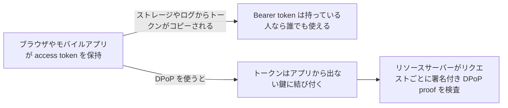
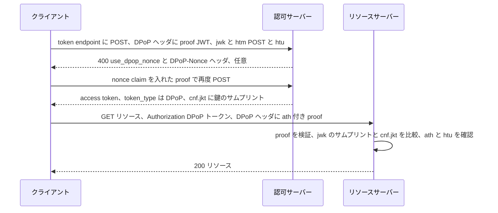

# DPoP

> 一言で言うと: クライアントが HTTP リクエストごとに小さな JWT に署名することで、盗まれた access token は、そのクライアントにしかない秘密鍵がなければ使えなくなる。

## どういうときに使うか

- **mutual TLS ができない SPA やモバイルアプリ**: DPoP はアプリ自身が生成した鍵に、アプリケーション層でトークンを結び付ける。ブラウザアプリでは使えない TLS クライアント認証や HTTP token binding に頼らない (Section 1)。
- **別レイヤのバグや XSS で access token が漏れた**: トークンだけを持つ攻撃者は拒否される。リソースサーバーは、結び付いた鍵で署名された新しい DPoP proof も要求するからだ (Section 2)。
- **public client が持つ refresh token**: refresh token も同じ鍵に結び付くので、コピーされた refresh token で別の場所から access token を発行できない (Section 5)。
- **Bearer token も受け付けているリソースサーバー**: DPoP 結合トークンは別のスキームで送られ、bearer として届いた DPoP 結合トークンは拒否されるので、bearer への格下げで使われることはない (Section 7.2)。

## 解決する問題

bearer の access token は道に落ちた現金と同じで、拾った人が使える。ブラウザアプリやネイティブアプリは、トークンを漏らす経路が十分に多く、これは現実の障害モードだ。mutual TLS ならトークンをクライアント証明書に結び付けられるが、ブラウザアプリは TLS ハンドシェイクを制御できないし、多くの配備では TLS をフロントで終端していて、クライアント証明書はバックエンドに届かない。

DPoP はこの結合をアプリケーション層に持ち上げる。クライアントは鍵ペアを持ち、リクエストごとに短い JWT に署名して所持を証明し、認可サーバーはその鍵に結び付いたトークンを発行する。DPoP はクライアント認証の方式ではなく、HTTPS の代わりでもない。常に TLS の中で使う (Section 1、2)。

## 仕組み

クライアントは DPoP proof を作る。ヘッダの `typ` は `dpop+jwt`、`alg` は非対称アルゴリズム、`jwk` に公開鍵を入れた JWS で、ペイロードには `jti`、`htm` (HTTP メソッド)、`htu` (query と fragment を除いた URI)、`iat` を入れる (Section 4.2)。これを `DPoP` ヘッダに載せて token endpoint を呼ぶ。認可サーバーは proof を検査し、`token_type` を `DPoP` にしてトークンを返す。トークンの `cnf` claim には結び付けた鍵の SHA-256 JWK サムプリント `jkt` が入る (Section 5、6.1)。リソースを呼ぶときは `DPoP` 認証スキームでトークンを送り、新しい proof の `ath` claim に access token の SHA-256 ハッシュを入れる (Section 4.2、7.1)。どちらのサーバーも `DPoP-Nonce` ヘッダで nonce を配れ、クライアントは `nonce` claim でそれを返す (Section 8、9)。

## 仕様が求めること

- proof の `alg` は非対称アルゴリズムでなければならず、`none` や MAC は不可。`jwk` ヘッダに秘密鍵を含めてはならない (Section 4.2)。
- サーバーは、`DPoP` ヘッダが 2 つ以上ないこと、`typ` が `dpop+jwt` であること、埋め込まれた鍵で署名が検証できること、`htm` と `htu` がリクエストに一致すること、要求した `nonce` が一致すること、`iat` が許容範囲内であることを確認する (Section 4.3)。
- トークンが結合されたことをクライアントに伝えるため、`token_type` に `DPoP` を返さなければならない。別の `token_type` が返ったら DPoP の保護は効いていない (Section 5)。
- DPoP proof を提示した public client に発行する refresh token はその鍵に結び付けなければならず、refresh token の使用時に結合を検証しなければならない (Section 5)。
- リソースサーバーは、proof を受け取ったこと、それが有効なこと、鍵が `cnf.jkt` と一致することを確認し、全部通らなければアクセスを許可してはならない (Section 7.1)。
- 認可リクエストの `dpop_jkt` パラメータで authorization code を鍵に結び付ける。token request の鍵が一致しなければサーバーは拒否しなければならない (Section 10)。

## 注意点

- **リプレイの窓**: proof はメソッドと URI にしか結び付かないので、サーバーは生成から限られた時間だけ受け付けなければならず、より強いリプレイ対策には `jti` の記録や nonce 配布が使える (Section 11.1)。
- **nonce のダウングレード**: 一度 nonce を配ったサーバーは、`nonce` claim のない proof を受け付けてはならない (Section 11.3)。
- **事前生成された proof**: クライアント内で動くコードは、はるか先の時刻の proof を事前に署名できる。対策はサーバー nonce で、クライアント実行環境に信頼できないコードがあれば DPoP の保証は崩れる (Section 11.2、11.4)。
- **守るのはメソッドと URI だけ**: DPoP はリクエストボディや他のヘッダの完全性を保証しない (Section 11.7)。

## 出典

- [RFC 9449, Section 1](https://www.rfc-editor.org/rfc/rfc9449#section-1)
- [RFC 9449, Section 2](https://www.rfc-editor.org/rfc/rfc9449#section-2)
- [RFC 9449, Section 4.2](https://www.rfc-editor.org/rfc/rfc9449#section-4.2)
- [RFC 9449, Section 4.3](https://www.rfc-editor.org/rfc/rfc9449#section-4.3)
- [RFC 9449, Section 5](https://www.rfc-editor.org/rfc/rfc9449#section-5)
- [RFC 9449, Section 6.1](https://www.rfc-editor.org/rfc/rfc9449#section-6.1)
- [RFC 9449, Section 7.1](https://www.rfc-editor.org/rfc/rfc9449#section-7.1)
- [RFC 9449, Section 7.2](https://www.rfc-editor.org/rfc/rfc9449#section-7.2)
- [RFC 9449, Section 8](https://www.rfc-editor.org/rfc/rfc9449#section-8)
- [RFC 9449, Section 9](https://www.rfc-editor.org/rfc/rfc9449#section-9)
- [RFC 9449, Section 10](https://www.rfc-editor.org/rfc/rfc9449#section-10)
- [RFC 9449, Section 11.1](https://www.rfc-editor.org/rfc/rfc9449#section-11.1)
- [RFC 9449, Section 11.2](https://www.rfc-editor.org/rfc/rfc9449#section-11.2)
- [RFC 9449, Section 11.3](https://www.rfc-editor.org/rfc/rfc9449#section-11.3)
- [RFC 9449, Section 11.4](https://www.rfc-editor.org/rfc/rfc9449#section-11.4)
- [RFC 9449, Section 11.7](https://www.rfc-editor.org/rfc/rfc9449#section-11.7)
