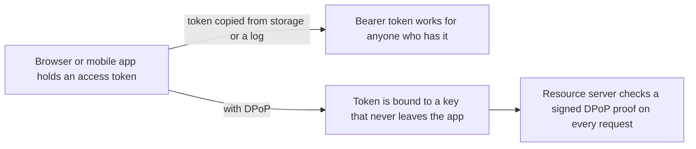
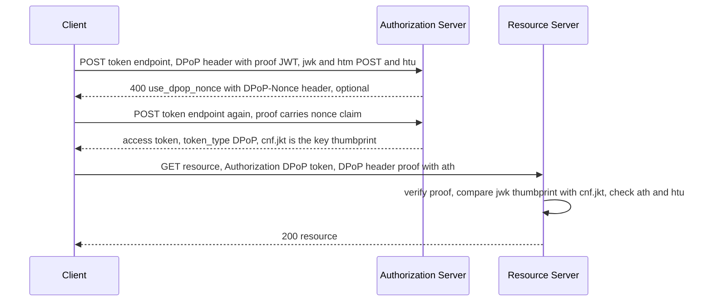

# DPoP

> In one line: the client signs a small JWT for every HTTP request, so an access token stolen from it is useless without the private key that lives only in that client.

## When you reach for it

- **A single-page app or mobile app that cannot do mutual TLS**: DPoP binds the token to a key the app generates itself, at the application layer, where TLS client authentication and HTTP token binding are not available to a browser app (Section 1).
- **An access token leaked through a bug in another layer of the stack or an XSS payload**: an attacker holding only the token is refused, because the resource server also demands a fresh DPoP proof signed by the bound key (Section 2).
- **Refresh tokens held by a public client**: the refresh token is bound to the same key, so a copied refresh token cannot mint new access tokens elsewhere (Section 5).
- **A resource server that still accepts Bearer tokens**: DPoP-bound tokens are sent with a different scheme, and the resource server rejects a DPoP-bound token that arrives as a bearer token, so the token cannot be downgraded to bearer use (Section 7.2).

## The problem it solves

A bearer access token is money in the street. Whoever picks it up can spend it, and browser-based and native clients leak tokens in enough ways that this is a real failure mode. Mutual TLS binds a token to a client certificate, but a browser app cannot drive the TLS handshake and many deployments terminate TLS at a front door that never sees the client certificate.

DPoP moves the binding to the application layer. The client holds a key pair, proves possession by signing a short JWT per request, and the authorization server issues tokens tied to that key. DPoP is not a client authentication method and does not replace HTTPS. It must always run inside TLS (Sections 1, 2).

## How it works

The client builds a DPoP proof: a JWS with header `typ` set to `dpop+jwt`, an asymmetric `alg`, and the public key in `jwk`. The payload carries `jti`, `htm` (the HTTP method), `htu` (the target URI without query or fragment), and `iat` (Section 4.2). The token request carries it in a `DPoP` header. The authorization server checks the proof and issues a token with `token_type` set to `DPoP`, and the token's `cnf` claim holds `jkt`, the SHA-256 JWK thumbprint of the bound key (Sections 5, 6.1). When the client calls a resource, it sends the token with the `DPoP` authentication scheme and a new proof whose `ath` claim is the SHA-256 hash of the access token (Sections 4.2, 7.1). Either server may hand out a nonce in a `DPoP-Nonce` header, which the client must echo in the `nonce` claim (Sections 8, 9).

## What the spec requires

- The proof's `alg` must be an asymmetric algorithm, never `none` or a MAC, and the `jwk` header must not contain a private key (Section 4.2).
- A server checks that there is not more than one `DPoP` header, that `typ` is `dpop+jwt`, that the signature verifies with the embedded key, that `htm` and `htu` match the request, that a required `nonce` matches, and that `iat` is within an acceptable window (Section 4.3).
- A `token_type` of `DPoP` must be returned so the client knows the token is bound. If the client gets a different `token_type`, DPoP protection is not in effect (Section 5).
- A refresh token issued to a public client that presented a DPoP proof must be bound to that key, and the binding must be checked when the refresh token is used (Section 5).
- The resource server must check that a proof was received, that it is valid, and that its key matches `cnf.jkt`. It must not grant access unless every check passes (Section 7.1).
- The `dpop_jkt` authorization request parameter binds the authorization code to the key. If the token request's key does not match, the server must reject it (Section 10).

## Watch out

- **Replay window**: a proof is only tied to method and URI, so servers must accept proofs only for a limited time after creation, and can track `jti` values or hand out nonces for stronger replay protection (Section 11.1).
- **Nonce downgrade**: once a server has handed out a nonce, it must not accept proofs that omit the `nonce` claim (Section 11.3).
- **Pre-generated proofs**: code running in the client can pre-sign proofs far into the future. Server nonces are the fix, and untrusted code in the client context breaks DPoP's guarantees entirely (Sections 11.2, 11.4).
- **Only the method and URI are covered**: DPoP does not protect the request body or other headers (Section 11.7).

## Sources

- [RFC 9449, Section 1](https://www.rfc-editor.org/rfc/rfc9449#section-1)
- [RFC 9449, Section 2](https://www.rfc-editor.org/rfc/rfc9449#section-2)
- [RFC 9449, Section 4.2](https://www.rfc-editor.org/rfc/rfc9449#section-4.2)
- [RFC 9449, Section 4.3](https://www.rfc-editor.org/rfc/rfc9449#section-4.3)
- [RFC 9449, Section 5](https://www.rfc-editor.org/rfc/rfc9449#section-5)
- [RFC 9449, Section 6.1](https://www.rfc-editor.org/rfc/rfc9449#section-6.1)
- [RFC 9449, Section 7.1](https://www.rfc-editor.org/rfc/rfc9449#section-7.1)
- [RFC 9449, Section 7.2](https://www.rfc-editor.org/rfc/rfc9449#section-7.2)
- [RFC 9449, Section 8](https://www.rfc-editor.org/rfc/rfc9449#section-8)
- [RFC 9449, Section 9](https://www.rfc-editor.org/rfc/rfc9449#section-9)
- [RFC 9449, Section 10](https://www.rfc-editor.org/rfc/rfc9449#section-10)
- [RFC 9449, Section 11.1](https://www.rfc-editor.org/rfc/rfc9449#section-11.1)
- [RFC 9449, Section 11.2](https://www.rfc-editor.org/rfc/rfc9449#section-11.2)
- [RFC 9449, Section 11.3](https://www.rfc-editor.org/rfc/rfc9449#section-11.3)
- [RFC 9449, Section 11.4](https://www.rfc-editor.org/rfc/rfc9449#section-11.4)
- [RFC 9449, Section 11.7](https://www.rfc-editor.org/rfc/rfc9449#section-11.7)
