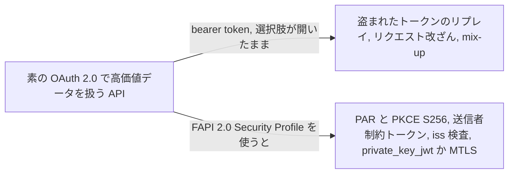
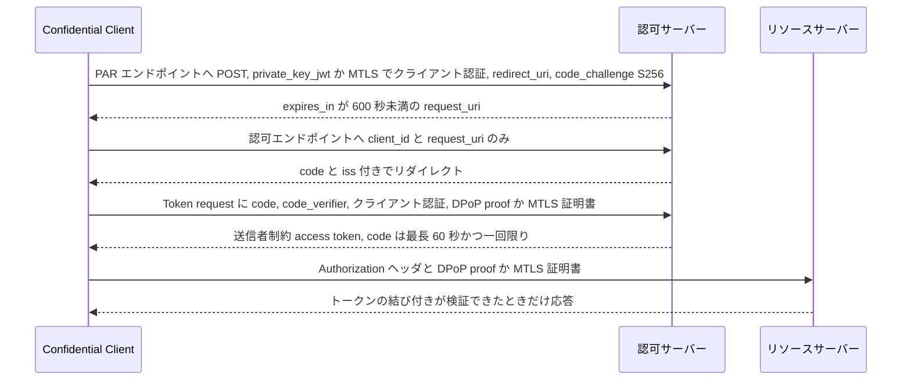

# FAPI 2.0 Security Profile

> 一言で言うと: 高価値データを扱う API 向けに OAuth 2.0 を締め上げたプロファイル。攻撃者に付け入られる選択肢を外し、残りを必須にする。PAR、PKCE、送信者制約トークン、private_key_jwt か MTLS によるクライアント認証。

## どういうときに使うか

- **高価値で機微なデータを公開する API**: 出自は金融だが、e-health や e-government など高価値で機微なデータを公開する API 全般を想定した設計 (Introduction)。明示された attacker model を満たすことが形式解析で証明されており、public client は同じ水準で守れないため対象は confidential client のみ (Section 1、Section 5.1.1)。
- **盗まれた access token を盗んだ側が使えないようにしたい**: 認可サーバーは MTLS か DPoP で結び付けた送信者制約トークンしか発行してはならず、リソースサーバーはその結び付きを検証しなければならない (Section 5.3.2.1、Section 5.3.4)。
- **ブラウザを経由する認可リクエストを改ざんさせたくない**: クライアントは Pushed Authorization Requests でリクエストを送り、認可エンドポイントに届くのは `client_id` と `request_uri` だけ (Section 5.3.2.2、Section 5.3.3.2)。
- **複数の認可サーバーの間の mix-up**: 認可サーバーは認可応答に `iss` パラメータを返さなければならず、クライアントはそれを検査しなければならない (Section 5.3.2.2、Section 5.3.3.2)。

## 解決する問題

OAuth 2.0 はセキュリティ上の選択の大半を配備側に委ねる。既定のまま作った銀行 API は、盗めば誰でもリプレイできる bearer token を受け入れ、ユーザーが書き換えられる認可リクエストをブラウザに運ばせ、どの認可サーバーが応答したか分からないまま複数のサーバーと話す。どれも既知の攻撃クラスで、このプロファイルは一つずつではなく一度にまとめて塞ぐためにある。

FAPI 2.0 は既存の RFC を confidential client、認可サーバー、リソースサーバー向けにプロファイルすることでそれを実現する。Introduction は Attacker Model に示されたセキュリティ目標の達成を目的として掲げ、プロファイルはその model を満たすことが形式解析で証明されている (Section 5.1.1、Section 5.1.2)。Section 5.5 は FAPI 1.0 からの変更点を列挙する。JAR の代わりに PAR、`s_hash` の代わりに PKCE、front channel で ID Token を返さない、送信者制約に MTLS か DPoP を使える。

## 仕組み

クライアントは `private_key_jwt` か MTLS で PAR エンドポイントに認証し、`redirect_uri` と `S256` の `code_challenge` を含む認可リクエスト全体を push する。サーバーは短命の `request_uri` を返す。ブラウザが認可エンドポイントに運ぶのは `client_id` と `request_uri` だけ。認可応答は `code` と `iss` パラメータを返し、クライアントは mix-up を検知できる。トークンエンドポイントではクライアントが DPoP proof か MTLS 証明書で鍵の所持を示し、その鍵に結び付いた access token を受け取る。リソースサーバーは HTTP ヘッダで渡されたトークンだけを、結び付きが検証できたときだけ受け入れる (Section 5.3.2.2、Section 5.3.3.2、Section 5.3.4)。

## 仕様が求めること

- 認可サーバーは MTLS か DPoP による送信者制約 access token だけを発行し、クライアント認証は `private_key_jwt` か MTLS で行い、confidential client だけをサポートし、resource owner password credentials grant を拒否しなければならない (Section 5.3.2.1)。
- 認可サーバーは PAR なしの認可リクエストを拒否し、`S256` の PKCE を必須とし、pushed authorization request に `redirect_uri` を必須とし、`iss` パラメータを返し、使用済みの authorization code を拒否しなければならない (Section 5.3.2.2)。authorization code の lifetime は最長 60 秒 (Section 5.3.2.1)。
- 発行する `request_uri` の `expires_in` は 600 秒未満でなければならない (Section 5.3.2.2)。
- クライアントは PAR、`S256` の PKCE とリクエストごとに新しい challenge を使い、`iss` パラメータを検査し、認可エンドポイントには `client_id` と `request_uri` だけを送り、issuer URL を信頼できる情報源から取得して metadata の `issuer` 値と一致することを確認しなければならない (Section 5.3.3.1、Section 5.3.3.2)。
- リソースサーバーは access token を HTTP ヘッダでのみ受け入れ、query parameter では受け入れず、有効性・完全性・期限・失効状態と送信者制約を検証しなければならない (Section 5.3.4)。
- すべてのエンドポイントは TLS 1.2 以上を使い、BCP 195 に従い、TLS サーバー証明書を検証しなければならない (Section 5.2.1)。ブラウザが使うエンドポイントは TLS stripping によるダウングレードを防ぎ、認可エンドポイントで CORS をサポートしてはならない (Section 5.2.3)。

## 注意点

- 短命の access token と refresh token の組み合わせは盗まれたトークンの使える時間を狭めるが、短すぎると認可サーバーの負荷が増える (Section 6.1)。
- type A5 の攻撃者は DPoP proof を入手してリプレイできる。DPoP は本体に署名しないので、本体を書き換えたリクエストにも使い回せる。挙げられている緩和策は、リソースサーバーでの短命な DPoP nonce、`jti` によるリプレイ検知、署名付きリクエスト、DPoP の代わりに MTLS (Section 6.2)。
- 盗んだ access token の注入 (Cuckoo's Token attack) は、クライアントが攻撃者の支配する認可サーバーを対象リソースサーバー向けのトークン発行元として信用していると送信者制約を迂回できる (Section 6.3)。
- 認可リクエストを読めた A3 攻撃者は自分でログインし、得た code を CSRF で被害者のブラウザに渡せる。緩和策は `request_uri` を一度しか受け付けないこと、認可エンドポイント呼び出し 1 回につき code grant 呼び出しを 1 回にすること、authorization code の lifetime を短くすること (Section 6.4)。
- 配備には認定済み実装を使うべき。不完全・不正確な実装では形式解析の結果が成り立たない (Section 6.6)。

## 出典

- [FAPI 2.0 Security Profile, Introduction](https://openid.net/specs/fapi-security-profile-2_0-final.html#name-introduction)
- [FAPI 2.0 Security Profile, Section 1](https://openid.net/specs/fapi-security-profile-2_0-final.html#section-1)
- [FAPI 2.0 Security Profile, Section 5.1.1](https://openid.net/specs/fapi-security-profile-2_0-final.html#section-5.1.1)
- [FAPI 2.0 Security Profile, Section 5.1.2](https://openid.net/specs/fapi-security-profile-2_0-final.html#section-5.1.2)
- [FAPI 2.0 Security Profile, Section 5.2.1](https://openid.net/specs/fapi-security-profile-2_0-final.html#section-5.2.1)
- [FAPI 2.0 Security Profile, Section 5.2.3](https://openid.net/specs/fapi-security-profile-2_0-final.html#section-5.2.3)
- [FAPI 2.0 Security Profile, Section 5.3.2.1](https://openid.net/specs/fapi-security-profile-2_0-final.html#section-5.3.2.1)
- [FAPI 2.0 Security Profile, Section 5.3.2.2](https://openid.net/specs/fapi-security-profile-2_0-final.html#section-5.3.2.2)
- [FAPI 2.0 Security Profile, Section 5.3.3.1](https://openid.net/specs/fapi-security-profile-2_0-final.html#section-5.3.3.1)
- [FAPI 2.0 Security Profile, Section 5.3.3.2](https://openid.net/specs/fapi-security-profile-2_0-final.html#section-5.3.3.2)
- [FAPI 2.0 Security Profile, Section 5.3.4](https://openid.net/specs/fapi-security-profile-2_0-final.html#section-5.3.4)
- [FAPI 2.0 Security Profile, Section 5.5](https://openid.net/specs/fapi-security-profile-2_0-final.html#section-5.5)
- [FAPI 2.0 Security Profile, Section 6.1](https://openid.net/specs/fapi-security-profile-2_0-final.html#section-6.1)
- [FAPI 2.0 Security Profile, Section 6.2](https://openid.net/specs/fapi-security-profile-2_0-final.html#section-6.2)
- [FAPI 2.0 Security Profile, Section 6.3](https://openid.net/specs/fapi-security-profile-2_0-final.html#section-6.3)
- [FAPI 2.0 Security Profile, Section 6.4](https://openid.net/specs/fapi-security-profile-2_0-final.html#section-6.4)
- [FAPI 2.0 Security Profile, Section 6.6](https://openid.net/specs/fapi-security-profile-2_0-final.html#section-6.6)
