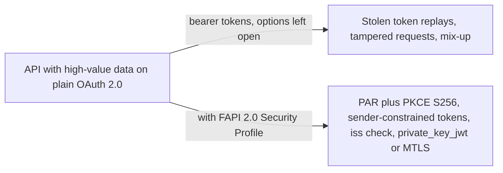
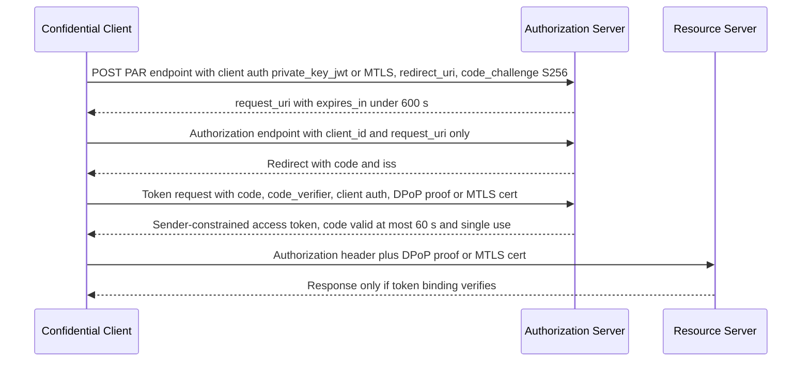

# FAPI 2.0 Security Profile

> In one line: a locked-down OAuth 2.0 profile for APIs that expose high-value data, where every option that an attacker could exploit is removed and the rest is mandatory: PAR, PKCE, sender-constrained tokens, private_key_jwt or MTLS client authentication.

## When you reach for it

- **An API exposing high-value, sensitive data**: the profile started in finance but is designed for any API exposing high-value and sensitive data, such as e-health or e-government (Introduction). It has been proved by formal analysis to meet a stated attacker model and is only for confidential clients, because public clients cannot be secured to the same degree (Section 1, Section 5.1.1).
- **A stolen access token must be useless to the thief**: the authorization server shall only issue sender-constrained access tokens, bound with MTLS or DPoP, and the resource server shall verify that binding (Section 5.3.2.1, Section 5.3.4).
- **Authorization requests crossing the browser must not be tampered with**: clients send the request by Pushed Authorization Requests and only `client_id` and `request_uri` reach the authorization endpoint (Section 5.3.2.2, Section 5.3.3.2).
- **Mix-up between several authorization servers**: the authorization server shall return the `iss` parameter in the authorization response, and the client shall check it (Section 5.3.2.2, Section 5.3.3.2).

## The problem it solves

OAuth 2.0 leaves most security choices to the deployment. A bank API built on default settings accepts bearer tokens that anyone who steals them can replay, lets the browser carry an authorization request the user can edit, and lets a client talk to several authorization servers without knowing which one answered. Each of these is a known attack class, and the profile exists to shut them all at once rather than one by one.

FAPI 2.0 does that by profiling existing RFCs for confidential clients, authorization servers and resource servers. Its introduction states the aim: to reach the security goals laid out in the Attacker Model, and the profile has been proved by formal analysis to meet that model (Section 5.1.1, Section 5.1.2). Section 5.5 lists what changed against FAPI 1.0: PAR replaces JAR, PKCE replaces `s_hash`, no ID Tokens are returned in the front channel, and MTLS or DPoP may be used for sender constraint.

## How it works

The client authenticates to the PAR endpoint with `private_key_jwt` or MTLS and pushes the whole authorization request, including `redirect_uri` and a `code_challenge` using `S256`. The server answers with a short-lived `request_uri`. The browser then carries only `client_id` and `request_uri` to the authorization endpoint. The authorization response returns `code` with the `iss` parameter so the client can detect mix-up. At the token endpoint the client proves possession with a DPoP proof or an MTLS certificate and receives an access token bound to that key. The resource server accepts the token only in the HTTP header and only when the binding verifies (Section 5.3.2.2, Section 5.3.3.2, Section 5.3.4).

## What the spec requires

- The authorization server shall only issue sender-constrained access tokens, using MTLS or DPoP, and shall authenticate clients with `private_key_jwt` or MTLS; it shall only support confidential clients and shall reject the resource owner password credentials grant (Section 5.3.2.1).
- The authorization server shall reject authorization requests sent without PAR, shall require PKCE with `S256`, shall require `redirect_uri` in pushed authorization requests, shall return the `iss` parameter, and shall reject an authorization code that has been used before (Section 5.3.2.2); it shall issue authorization codes with a maximum lifetime of 60 seconds (Section 5.3.2.1).
- Issued `request_uri` values shall have an `expires_in` under 600 seconds (Section 5.3.2.2).
- Clients shall use PAR, PKCE with `S256` and a fresh challenge per request, check the `iss` parameter, send only `client_id` and `request_uri` to the authorization endpoint, and obtain the issuer URL from an authoritative source and compare it with the `issuer` metadata value (Section 5.3.3.1, Section 5.3.3.2).
- Resource servers shall accept access tokens only in the HTTP header, not in query parameters, and shall verify validity, integrity, expiration and revocation status plus the sender constraint (Section 5.3.4).
- All endpoints shall use TLS 1.2 or later, follow BCP 195 and perform a TLS server certificate check (Section 5.2.1); browser-facing endpoints shall prevent TLS stripping downgrades and shall not support CORS on the authorization endpoint (Section 5.2.3).

## Watch out

- Short access token lifetimes with refresh tokens shrink the window for a stolen token, but very short lifetimes increase authorization server load (Section 6.1).
- An attacker of type A5 may obtain DPoP proofs and replay them, possibly with an altered request body, because DPoP does not sign the body; the listed mitigations are short-lived DPoP nonces at the resource server, `jti` replay detection, signed requests, or MTLS instead of DPoP (Section 6.2).
- Injection of stolen access tokens, the Cuckoo's Token attack, can bypass sender constraining when the client trusts an attacker-controlled authorization server to issue tokens for the target resource server (Section 6.3).
- An A3 attacker who reads an authorization request can log in and hand the resulting code to the victim's browser by CSRF; the mitigations are accepting a `request_uri` only once, one code grant call per authorization endpoint call, and a short authorization code lifetime (Section 6.4).
- Deployments should use certified implementations, because incomplete or incorrect implementations void the formal analysis (Section 6.6).

## Sources

- [FAPI 2.0 Security Profile, Introduction](https://openid.net/specs/fapi-security-profile-2_0-final.html#name-introduction)
- [FAPI 2.0 Security Profile, Section 1](https://openid.net/specs/fapi-security-profile-2_0-final.html#section-1)
- [FAPI 2.0 Security Profile, Section 5.1.1](https://openid.net/specs/fapi-security-profile-2_0-final.html#section-5.1.1)
- [FAPI 2.0 Security Profile, Section 5.1.2](https://openid.net/specs/fapi-security-profile-2_0-final.html#section-5.1.2)
- [FAPI 2.0 Security Profile, Section 5.2.1](https://openid.net/specs/fapi-security-profile-2_0-final.html#section-5.2.1)
- [FAPI 2.0 Security Profile, Section 5.2.3](https://openid.net/specs/fapi-security-profile-2_0-final.html#section-5.2.3)
- [FAPI 2.0 Security Profile, Section 5.3.2.1](https://openid.net/specs/fapi-security-profile-2_0-final.html#section-5.3.2.1)
- [FAPI 2.0 Security Profile, Section 5.3.2.2](https://openid.net/specs/fapi-security-profile-2_0-final.html#section-5.3.2.2)
- [FAPI 2.0 Security Profile, Section 5.3.3.1](https://openid.net/specs/fapi-security-profile-2_0-final.html#section-5.3.3.1)
- [FAPI 2.0 Security Profile, Section 5.3.3.2](https://openid.net/specs/fapi-security-profile-2_0-final.html#section-5.3.3.2)
- [FAPI 2.0 Security Profile, Section 5.3.4](https://openid.net/specs/fapi-security-profile-2_0-final.html#section-5.3.4)
- [FAPI 2.0 Security Profile, Section 5.5](https://openid.net/specs/fapi-security-profile-2_0-final.html#section-5.5)
- [FAPI 2.0 Security Profile, Section 6.1](https://openid.net/specs/fapi-security-profile-2_0-final.html#section-6.1)
- [FAPI 2.0 Security Profile, Section 6.2](https://openid.net/specs/fapi-security-profile-2_0-final.html#section-6.2)
- [FAPI 2.0 Security Profile, Section 6.3](https://openid.net/specs/fapi-security-profile-2_0-final.html#section-6.3)
- [FAPI 2.0 Security Profile, Section 6.4](https://openid.net/specs/fapi-security-profile-2_0-final.html#section-6.4)
- [FAPI 2.0 Security Profile, Section 6.6](https://openid.net/specs/fapi-security-profile-2_0-final.html#section-6.6)
