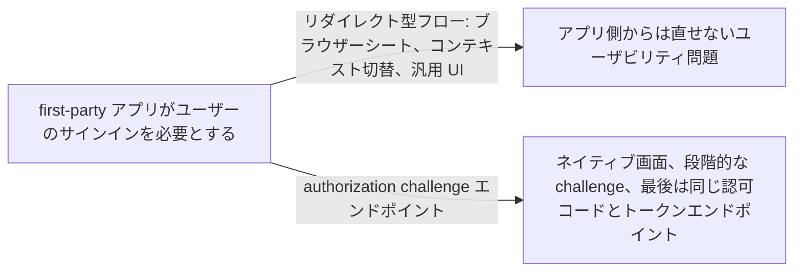
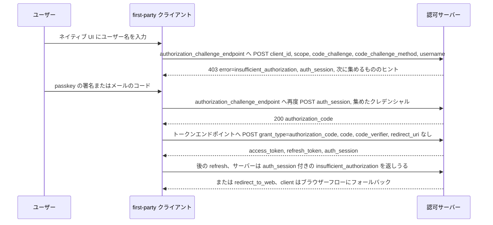

# OAuth for First-Party Apps

> 一言で言うと: アプリと認可サーバーが同じ会社のものなら、ブラウザーを開く代わりに authorization challenge エンドポイントへ POST してアプリ自身のネイティブ画面でログインを進め、最後は普通の認可コードを受け取れる。

## どういうときに使うか

- **ネイティブなサインイン画面が欲しい銀行の自社モバイルアプリ**: アプリはユーザー名を集め、次に passkey の署名やメールで届いたコードを集め、各ステップを authorization challenge エンドポイントに POST して、アプリを離れることなく `authorization_code` を受け取る (Section 3)。
- **再認証が必要になった refresh**: トークンエンドポイントは refresh token リクエストに `insufficient_authorization` と `auth_session` で応答でき、アプリは最初からやり直さずそこから challenge フローを再開する (Section 3.2、6.2)。
- **step-up を求めるリソースサーバー**: RFC 9470 のエラーを `acr_values` と `max_age` 付きで返し、client はそれらの値を持って新しい first-party 認可リクエストを始める (Section 7)。
- **ブラウザーを逃げ道として残さなければならない配備**: サーバーが自身のリスク評価に基づき直接のやり取りでは足りないと判断すると `redirect_to_web` を返し、client はブラウザー型の認可コードフローにフォールバックする (Section 5.2.2.1)。

## 解決する問題

OAuth のリダイレクト型フローはアプリと認可サーバーの間にブラウザーを置く。サードパーティアプリにとってはそれが肝心で、ユーザーのクレデンシャルはアプリに触れない。しかし認可サーバーと同じ事業者が管理する first-party アプリにとって、リダイレクトの利点は小さく、唐突なコンテキスト切替という代償が残る。このドラフトは OAuth 2.0 に新しいエンドポイントを足し、そうしたアプリケーションがネイティブな体験でユーザーから認可を得る過程を制御できるようにする。ブラウザーへのリダイレクトはフォールバックとして残す (Section 1)。

ドラフトはこれがより狭いセキュリティモデルであることを明言している。リダイレクト型のアプローチがユーザビリティ問題を起こす場合にだけ検討すべきで、first-party アプリケーション、つまりユーザーが認可サーバーと同じ主体のものと認識するアプリのセキュリティモデルのために設計されている (Section 1、1.1)。

## 仕組み

client はサインインの UI を出してユーザーから何かを集めることから始め、`client_id`、`scope`、PKCE の `code_challenge` と `code_challenge_method`、そして集めたものを添えて authorization challenge エンドポイントに POST する (Section 3、5.1)。サーバーがさらに必要とするなら HTTP 400 で、`insufficient_authorization` の場合は HTTP 403 で応答し、client が後続リクエストで送り返さなければならない `auth_session` を含める (Section 5.2.2、5.2.2.1)。このやり取りはサーバーが HTTP 200 の JSON ボディで `authorization_code` を発行するまで繰り返す (Section 5.2.1)。client は RFC 6749 とまったく同じようにトークンエンドポイントで code を引き換えるが、リダイレクトがなかったので `redirect_uri` は含めない (Section 6)。トークンレスポンスには `auth_session` を加えてよく、後の refresh や step-up で同じセッションを続けられる (Section 6.1)。

## 仕様が求めること

- authorization challenge エンドポイントの URL は `https` スキームでなければならず、トークンエンドポイントで認証を要求される client はここでも認証しなければならない (Section 4.1)。
- 認可サーバーは、認証フローを続ける前に client の "first-partyness" を検証しなければならない (Section 5)。
- `client_id` は、client を特定できる方法で認証するか、サーバーが client を割り出せる `auth_session` を送る場合を除いて必須で、`response_type` は `code` でなければならない (Section 5.1)。
- `insufficient_authorization` と `redirect_to_web` は HTTP 403 で返さなければならない (Section 5.2.2.1)。
- client が最初の challenge リクエストに PKCE の `code_challenge` を含めなかった場合、サーバーは `redirect_to_web` エラー応答に `request_uri` を返してはならない (Section 5.2.2.1.1)。
- client は challenge エンドポイントへの後続リクエストに `auth_session` を含めなければならず、それが固定だと仮定してはならない。サーバーはその値を client による検査から守らなければならない (Section 5.2.2、5.3.1)。
- サーバーメタデータは `authorization_challenge_endpoint` を公開する (Section 8)。

## 注意点

- この仕様はフィッシングのリスクを 2 つの形で高める。悪意あるアプリがネイティブのプロンプトを真似できること、ユーザーにブラウザーを確認するよう教えられなくなること。サーバーは自身のリスク評価に基づきリダイレクト型フローを要求してよい (Section 9.2)。
- すべてのクレデンシャルがアプリを通るようになるので、サーバーは credential stuffing を鈍らせるために同じ `auth_session` からのリクエストをレート制限すべき (Section 9.3)。
- client のなりすましが中心的なリスクなので、実装者は attestation のような追加の対策を検討すべき (Section 9.4)。
- このフローで発行する token は sender-constrained にすべきで、DPoP の authorization code binding を使うべきで、サーバーは以降のすべてのリクエストで同じ鍵が使われることを保証しなければならない (Section 9.5、9.5.1)。
- `auth_session` はデバイスに bind すべきで、サーバーは別のデバイスから提示されたものを拒否すべき (Section 5.3.1)。

## 出典

- [draft-ietf-oauth-first-party-apps, Section 1](https://datatracker.ietf.org/doc/html/draft-ietf-oauth-first-party-apps#section-1)
- [draft-ietf-oauth-first-party-apps, Section 1.1](https://datatracker.ietf.org/doc/html/draft-ietf-oauth-first-party-apps#section-1.1)
- [draft-ietf-oauth-first-party-apps, Section 3](https://datatracker.ietf.org/doc/html/draft-ietf-oauth-first-party-apps#section-3)
- [draft-ietf-oauth-first-party-apps, Section 3.2](https://datatracker.ietf.org/doc/html/draft-ietf-oauth-first-party-apps#section-3.2)
- [draft-ietf-oauth-first-party-apps, Section 4.1](https://datatracker.ietf.org/doc/html/draft-ietf-oauth-first-party-apps#section-4.1)
- [draft-ietf-oauth-first-party-apps, Section 5](https://datatracker.ietf.org/doc/html/draft-ietf-oauth-first-party-apps#section-5)
- [draft-ietf-oauth-first-party-apps, Section 5.1](https://datatracker.ietf.org/doc/html/draft-ietf-oauth-first-party-apps#section-5.1)
- [draft-ietf-oauth-first-party-apps, Section 5.2.1](https://datatracker.ietf.org/doc/html/draft-ietf-oauth-first-party-apps#section-5.2.1)
- [draft-ietf-oauth-first-party-apps, Section 5.2.2](https://datatracker.ietf.org/doc/html/draft-ietf-oauth-first-party-apps#section-5.2.2)
- [draft-ietf-oauth-first-party-apps, Section 5.2.2.1](https://datatracker.ietf.org/doc/html/draft-ietf-oauth-first-party-apps#section-5.2.2.1)
- [draft-ietf-oauth-first-party-apps, Section 5.2.2.1.1](https://datatracker.ietf.org/doc/html/draft-ietf-oauth-first-party-apps#section-5.2.2.1.1)
- [draft-ietf-oauth-first-party-apps, Section 5.3.1](https://datatracker.ietf.org/doc/html/draft-ietf-oauth-first-party-apps#section-5.3.1)
- [draft-ietf-oauth-first-party-apps, Section 6](https://datatracker.ietf.org/doc/html/draft-ietf-oauth-first-party-apps#section-6)
- [draft-ietf-oauth-first-party-apps, Section 6.1](https://datatracker.ietf.org/doc/html/draft-ietf-oauth-first-party-apps#section-6.1)
- [draft-ietf-oauth-first-party-apps, Section 6.2](https://datatracker.ietf.org/doc/html/draft-ietf-oauth-first-party-apps#section-6.2)
- [draft-ietf-oauth-first-party-apps, Section 7](https://datatracker.ietf.org/doc/html/draft-ietf-oauth-first-party-apps#section-7)
- [draft-ietf-oauth-first-party-apps, Section 8](https://datatracker.ietf.org/doc/html/draft-ietf-oauth-first-party-apps#section-8)
- [draft-ietf-oauth-first-party-apps, Section 9.2](https://datatracker.ietf.org/doc/html/draft-ietf-oauth-first-party-apps#section-9.2)
- [draft-ietf-oauth-first-party-apps, Section 9.3](https://datatracker.ietf.org/doc/html/draft-ietf-oauth-first-party-apps#section-9.3)
- [draft-ietf-oauth-first-party-apps, Section 9.4](https://datatracker.ietf.org/doc/html/draft-ietf-oauth-first-party-apps#section-9.4)
- [draft-ietf-oauth-first-party-apps, Section 9.5](https://datatracker.ietf.org/doc/html/draft-ietf-oauth-first-party-apps#section-9.5)
- [draft-ietf-oauth-first-party-apps, Section 9.5.1](https://datatracker.ietf.org/doc/html/draft-ietf-oauth-first-party-apps#section-9.5.1)
