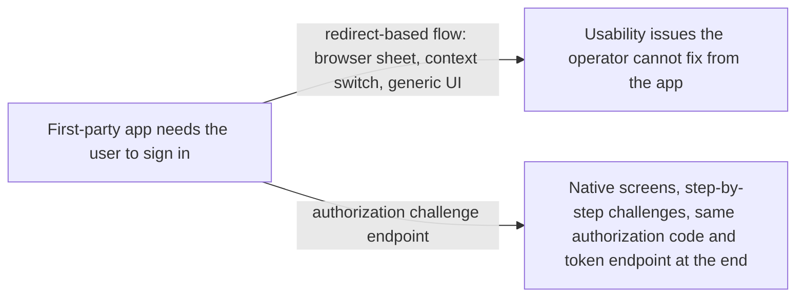
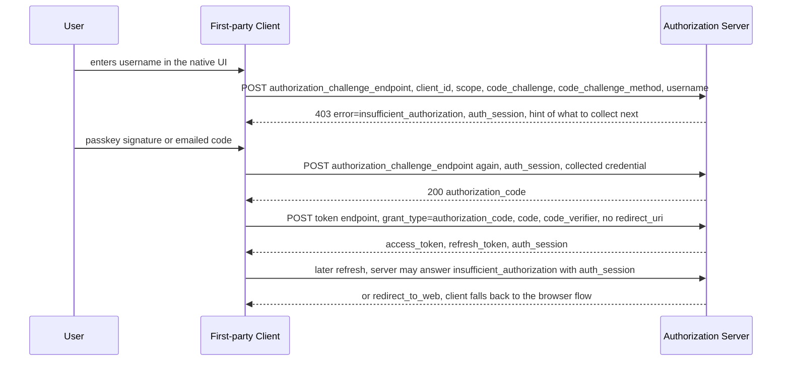

# OAuth for First-Party Apps

> In one line: when the app and the authorization server belong to the same company, the app can run the login in its own native screens by POSTing to an authorization challenge endpoint instead of opening a browser, and still end up with a normal authorization code.

## When you reach for it

- **A bank's own mobile app that wants a native sign-in screen**: the app collects the username, then a passkey signature or an emailed code, posts each step to the authorization challenge endpoint, and receives an `authorization_code` without ever leaving the app (Section 3).
- **A refresh that now needs re-authentication**: the token endpoint can answer a refresh token request with `insufficient_authorization` and an `auth_session`, and the app resumes the challenge flow from there instead of restarting (Sections 3.2 and 6.2).
- **A resource server asking for step-up**: it returns the RFC 9470 error with `acr_values` and `max_age`, and the client starts a new first-party authorization request carrying those values (Section 7).
- **A deployment that must keep the browser as an escape hatch**: when the server decides, based on its own risk assessment, that direct interaction is not enough, it returns `redirect_to_web` and the client falls back to a browser-based authorization code flow (Section 5.2.2.1).

## The problem it solves

OAuth's redirect-based flow puts a browser between the app and the authorization server. For a third-party app that is the point, the user's credentials never touch the app. For a first-party app, one controlled by the same entity as the authorization server, the redirect buys little and costs a jarring context switch. The draft extends OAuth 2.0 with a new endpoint so such applications can control the process of obtaining authorization from the user using a native experience, with browser redirection kept as a fallback (Section 1).

The draft is explicit that this is a narrower security model. It should be considered only when a redirect-based approach introduces usability issues, and it is designed for the security model of first-party applications, which users recognize as belonging to the same entity as the authorization server (Sections 1 and 1.1).

## How it works

The client starts by showing a sign-in control and collecting something from the user, then POSTs to the authorization challenge endpoint with `client_id`, `scope`, PKCE's `code_challenge` and `code_challenge_method`, and whatever it collected (Sections 3 and 5.1). If the server needs more, it responds with an HTTP 400 or, for `insufficient_authorization`, HTTP 403, including an `auth_session` the client must send back on follow-up requests (Sections 5.2.2 and 5.2.2.1). The exchange repeats until the server issues an `authorization_code` in an HTTP 200 JSON body (Section 5.2.1). The client exchanges the code at the token endpoint exactly as in RFC 6749, except that no `redirect_uri` is included because there was no redirect (Section 6). The token response may add `auth_session` so a later refresh or step-up can continue the same session (Section 6.1).

## What the spec requires

- The authorization challenge endpoint URL must use the `https` scheme, and a client that is required to authenticate at the token endpoint must also authenticate here (Section 4.1).
- The authorization server must verify the "first-partyness" of the client before continuing with the authentication flow (Section 5).
- `client_id` is required unless the client authenticates in a way that identifies it or sends an `auth_session` the server can map to a client, and `response_type` must be `code` (Section 5.1).
- `insufficient_authorization` and `redirect_to_web` must be returned with HTTP 403 (Section 5.2.2.1).
- If the client did not send a PKCE `code_challenge` in the initial challenge request, the server must not return a `request_uri` in the `redirect_to_web` error response (Section 5.2.2.1.1).
- The client must include `auth_session` in follow-up requests to the challenge endpoint, must not assume it is static, and the server must protect its value from inspection by the client (Sections 5.2.2 and 5.3.1).
- Server metadata advertises `authorization_challenge_endpoint` (Section 8).

## Watch out

- The spec increases phishing risk in two ways: a malicious app can imitate the native prompt, and users can no longer be taught to look for the browser. The server may require a redirect-based flow based on its own risk assessment (Section 9.2).
- Because every credential now passes through the app, the server should rate-limit requests from the same `auth_session` to blunt credential stuffing (Section 9.3).
- Client impersonation is the central risk, so implementers should consider additional measures, such as attestation, to limit it (Section 9.4).
- Tokens issued through this flow should be sender-constrained, DPoP authorization code binding should be used, and the server must ensure the same key is used in all subsequent requests (Sections 9.5 and 9.5.1).
- `auth_session` should be bound to the device, and the server should reject one presented from a different device (Section 5.3.1).

## Sources

- [draft-ietf-oauth-first-party-apps, Section 1](https://datatracker.ietf.org/doc/html/draft-ietf-oauth-first-party-apps#section-1)
- [draft-ietf-oauth-first-party-apps, Section 1.1](https://datatracker.ietf.org/doc/html/draft-ietf-oauth-first-party-apps#section-1.1)
- [draft-ietf-oauth-first-party-apps, Section 3](https://datatracker.ietf.org/doc/html/draft-ietf-oauth-first-party-apps#section-3)
- [draft-ietf-oauth-first-party-apps, Section 3.2](https://datatracker.ietf.org/doc/html/draft-ietf-oauth-first-party-apps#section-3.2)
- [draft-ietf-oauth-first-party-apps, Section 4.1](https://datatracker.ietf.org/doc/html/draft-ietf-oauth-first-party-apps#section-4.1)
- [draft-ietf-oauth-first-party-apps, Section 5](https://datatracker.ietf.org/doc/html/draft-ietf-oauth-first-party-apps#section-5)
- [draft-ietf-oauth-first-party-apps, Section 5.1](https://datatracker.ietf.org/doc/html/draft-ietf-oauth-first-party-apps#section-5.1)
- [draft-ietf-oauth-first-party-apps, Section 5.2.1](https://datatracker.ietf.org/doc/html/draft-ietf-oauth-first-party-apps#section-5.2.1)
- [draft-ietf-oauth-first-party-apps, Section 5.2.2](https://datatracker.ietf.org/doc/html/draft-ietf-oauth-first-party-apps#section-5.2.2)
- [draft-ietf-oauth-first-party-apps, Section 5.2.2.1](https://datatracker.ietf.org/doc/html/draft-ietf-oauth-first-party-apps#section-5.2.2.1)
- [draft-ietf-oauth-first-party-apps, Section 5.2.2.1.1](https://datatracker.ietf.org/doc/html/draft-ietf-oauth-first-party-apps#section-5.2.2.1.1)
- [draft-ietf-oauth-first-party-apps, Section 5.3.1](https://datatracker.ietf.org/doc/html/draft-ietf-oauth-first-party-apps#section-5.3.1)
- [draft-ietf-oauth-first-party-apps, Section 6](https://datatracker.ietf.org/doc/html/draft-ietf-oauth-first-party-apps#section-6)
- [draft-ietf-oauth-first-party-apps, Section 6.1](https://datatracker.ietf.org/doc/html/draft-ietf-oauth-first-party-apps#section-6.1)
- [draft-ietf-oauth-first-party-apps, Section 6.2](https://datatracker.ietf.org/doc/html/draft-ietf-oauth-first-party-apps#section-6.2)
- [draft-ietf-oauth-first-party-apps, Section 7](https://datatracker.ietf.org/doc/html/draft-ietf-oauth-first-party-apps#section-7)
- [draft-ietf-oauth-first-party-apps, Section 8](https://datatracker.ietf.org/doc/html/draft-ietf-oauth-first-party-apps#section-8)
- [draft-ietf-oauth-first-party-apps, Section 9.2](https://datatracker.ietf.org/doc/html/draft-ietf-oauth-first-party-apps#section-9.2)
- [draft-ietf-oauth-first-party-apps, Section 9.3](https://datatracker.ietf.org/doc/html/draft-ietf-oauth-first-party-apps#section-9.3)
- [draft-ietf-oauth-first-party-apps, Section 9.4](https://datatracker.ietf.org/doc/html/draft-ietf-oauth-first-party-apps#section-9.4)
- [draft-ietf-oauth-first-party-apps, Section 9.5](https://datatracker.ietf.org/doc/html/draft-ietf-oauth-first-party-apps#section-9.5)
- [draft-ietf-oauth-first-party-apps, Section 9.5.1](https://datatracker.ietf.org/doc/html/draft-ietf-oauth-first-party-apps#section-9.5.1)
