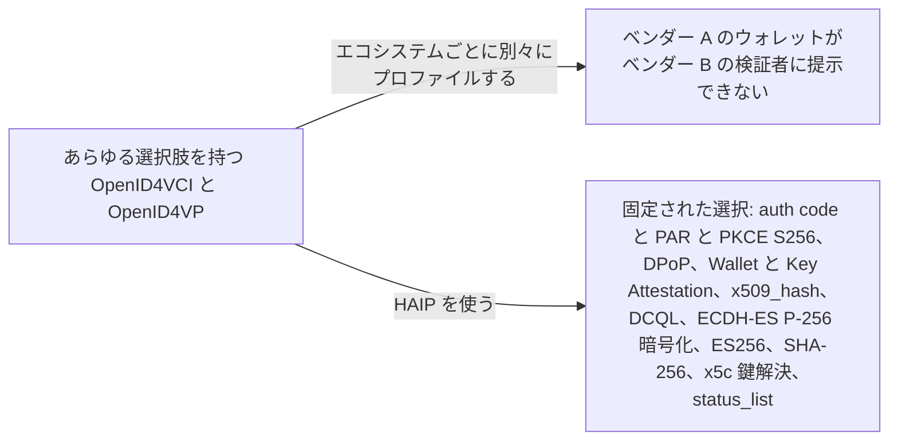
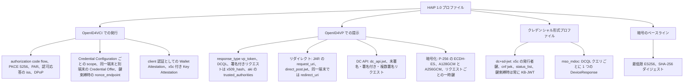

# OpenID4VC High Assurance Interoperability Profile

> 一言で言うと: OpenID4VCI、OpenID4VP、SD-JWT VC、ISO mdoc の選択肢から、セキュリティを固めた具体的な構成を 1 つ選び取る仕様。政府級クレデンシャルのために別々のベンダーが作ったウォレット・発行者・検証者が、実際に相互運用できるようにする。

## どういうときに使うか

- **eIDAS 2.0 のような国のアイデンティティウォレットのエコシステム**: 多数のベンダーの発行者・ウォレット・検証者が同じやり方で PID を発行・提示しなければならないので、このプロファイルがどの任意機能を必須にし、どの値を許すかを固定する (Section 1、Section 1.1)。
- **どのウォレットに発行するか、鍵がどう守られているかを知る必要のある発行者**: ウォレットは PAR とトークンエンドポイントで Wallet Attestation による認証をしなければならず、Credential Request での key attestation をサポートしなければならない (Section 4.4.1、Section 4.5.1)。
- **事前登録ではなく X.509 ベースの信頼が要る検証者**: 署名付きリクエストは `x509_hash` Client Identifier Prefix を使い、type `aki` の DCQL `trusted_authorities` でウォレットが認証局ごとに発行者を絞り込める (Section 5)。
- **ブラウザベースの検証者**: W3C Digital Credentials API 経由の提示を response mode `dc_api.jwt` で行い、ウォレットは未署名・署名付き・複数署名のリクエストをすべてサポートする (Section 5.2)。
- **既存の ISO 18013-5 mDL 配備を再利用する**: エコシステムは `mso_mdoc` と ISO のリーダー証明書プロファイルで提示部分だけを採用できる (Section 9.3.1.2)。

## 解決する問題

OpenID4VP は自ら「相互運用にはプロファイルが必要なフレームワーク」と述べ、OpenID4VCI も grant type、proof type、メタデータ署名、クレデンシャル形式を開いたままにしている。正しい実装が 2 つあっても選んだオプションが違えば相互運用できず、高保証の配備では送信者制約トークンや X.509 に根付いた鍵といった厳しい選択が任意ではなく必須である必要もある (Section 1、Section 3)。

HAIP はプロファイルである。土台の仕様を参照し、その任意機能の選ばれた集合を要件に変える。対象は発行フロー、2 つの提示フロー (リダイレクトと DC API)、2 つのクレデンシャル形式 (Section 3、Section 3.3)。どの発行者と検証者が認可されているかという trust management は範囲外のまま (Section 3.4)。

## 仕組み

発行は OpenID4VCI に従い、authorization code flow、FAPI 2.0 Security Profile の該当規定 (PKCE S256、PAR、認可応答の `iss`)、DPoP を使う (Section 4)。クレデンシャルは構成ごとに 1 つの `scope` で要求し (Section 4.1、Section 4.3)、ウォレットは Wallet Attestation で認証し (Section 4.4.1)、key attestation を提供する (Section 4.5.1)。提示は OpenID4VP に従い、`vp_token`、DCQL、署名付きリクエストの `x509_hash` prefix、一時鍵に向けた ECDH-ES の応答暗号化を使う (Section 5)。リダイレクトでは `direct_post.jwt` (Section 5.1)、DC API では `dc_api.jwt` になる (Section 5.2)。SD-JWT VC は発行者チェーンを `x5c` に持ち、`status_list` を使い、鍵束縛時は常に KB-JWT を含める (Section 6.1、Section 6.1.1、Section 6.1.1.1)。

## 仕様が求めること

- 発行者とウォレットは authorization code flow をサポートし、FAPI 2.0 Security Profile の該当規定 (PKCE S256、PAR、認可応答の `iss`) に従い、Nonce Endpoint からの `DPoP-Nonce` ヘッダの処理を含めて DPoP をサポートしなければならない (Section 4)。
- 認可サーバーは RFC 8414 のメタデータを公開しなければならない。発行者メタデータはクレデンシャル構成ごとに `scope` を含まなければならず、鍵束縛を要する構成があれば `nonce_endpoint` が存在しなければならない (Section 4.1)。
- ウォレットは client 認証をサポートするエンドポイントで OAuth client 認証を使わなければならず、発行者はそれを要求しなければならない。Wallet Attestation は発行者をまたいで再利用してはならず、インスタンス固有の識別子を持ってはならない (Section 4.4.1)。
- ウォレットは key attestation をサポートしなければならない。OpenID4VCI Appendix D 形式では、検証鍵は `x5c` に含め、トラストアンカーは含めず、署名証明書は自己署名であってはならない (Section 4.5.1)。
- 提示では `response_type` は `vp_token`、DCQL を使い、署名付きリクエストは `x509_hash` を使い、P-256 の ECDH-ES はサポート必須で、検証者は A128GCM と A256GCM の両方を列挙し、ウォレットは少なくとも一方をサポートし、検証者はリクエストごとに一時暗号化鍵を提供しなければならず、`aki` の trusted authorities をサポートしなければならない (Section 5)。
- リダイレクトでは署名付きリクエストは JAR の `request_uri` を使い、応答は `direct_post.jwt` を使い、同一端末では検証者は `redirect_uri` を返し、元のセッションにリダイレクトが戻ってこない提示を拒否しなければならない (Section 5.1)。
- SD-JWT VC: 形式識別子は `dc+sd-jwt`。鍵束縛を要するなら `cnf` は `jwk` を持たなければならない。`status` があるなら `status_list` を含めなければならず、Status List Token の鍵はその `x5c` に含める。各クレデンシャルは固有で予測不能なインデックスを持ち、発行者チェーンは `x5c` に含め、鍵束縛クレデンシャルには常に KB-JWT が必要 (Section 5.3.2、Section 6.1、Section 6.1.1、Section 6.1.1.1)。
- すべての当事者は最低限 ES256 と SHA-256 をサポートしなければならない (Section 7、Section 8)。

## 注意点

- **固定された pre-final ドラフト**: HAIP は SD-JWT VC draft -13 と Token Status List draft -14 をプロファイルし、新しいプロファイル版が言わない限り、最終版よりそのバージョンを使い続けるべきだとしている。ライブラリがどのドラフトを対象にしているか確認すること (Section 9.4)。
- **trust management は範囲外**: HAIP は至るところで X.509 を使うが、ルートの入手方法やどの発行者がどの型を発行できるかは定めない。エコシステムが定義する必要がある (Section 3.4)。
- **単体では LoA High ではない**: このプロファイルは eIDAS の「High」保証レベルの要件の一部しか満たさず、範囲外の措置と組み合わせる必要がある (Section 1)。
- **key attestation のバックエンド**: プラットフォームの attestation を Appendix D 形式に変換するウォレットは、可用性に影響するバックエンドサービスに依存し、それはプライバシーを考慮して設計しなければならない。たとえばステートレスにする (Section 9.2、Section 11.1)。

## 出典

- [HAIP 1.0, Section 1](https://openid.net/specs/openid4vc-high-assurance-interoperability-profile-1_0.html#name-introduction)
- [HAIP 1.0, Section 1.1](https://openid.net/specs/openid4vc-high-assurance-interoperability-profile-1_0.html#name-target-audience-usage)
- [HAIP 1.0, Section 3](https://openid.net/specs/openid4vc-high-assurance-interoperability-profile-1_0.html#name-scope)
- [HAIP 1.0, Section 3.3](https://openid.net/specs/openid4vc-high-assurance-interoperability-profile-1_0.html#name-standards-requirements)
- [HAIP 1.0, Section 3.4](https://openid.net/specs/openid4vc-high-assurance-interoperability-profile-1_0.html#name-out-of-scope)
- [HAIP 1.0, Section 4](https://openid.net/specs/openid4vc-high-assurance-interoperability-profile-1_0.html#name-openid-for-verifiable-crede)
- [HAIP 1.0, Section 4.1](https://openid.net/specs/openid4vc-high-assurance-interoperability-profile-1_0.html#name-issuer-metadata)
- [HAIP 1.0, Section 4.3](https://openid.net/specs/openid4vc-high-assurance-interoperability-profile-1_0.html#name-authorization-endpoint)
- [HAIP 1.0, Section 4.4.1](https://openid.net/specs/openid4vc-high-assurance-interoperability-profile-1_0.html#name-wallet-attestation)
- [HAIP 1.0, Section 4.5.1](https://openid.net/specs/openid4vc-high-assurance-interoperability-profile-1_0.html#name-key-attestation)
- [HAIP 1.0, Section 5](https://openid.net/specs/openid4vc-high-assurance-interoperability-profile-1_0.html#name-openid-for-verifiable-prese)
- [HAIP 1.0, Section 5.1](https://openid.net/specs/openid4vc-high-assurance-interoperability-profile-1_0.html#name-openid-for-verifiable-presen)
- [HAIP 1.0, Section 5.2](https://openid.net/specs/openid4vc-high-assurance-interoperability-profile-1_0.html#name-openid-for-verifiable-present)
- [HAIP 1.0, Section 5.3.2](https://openid.net/specs/openid4vc-high-assurance-interoperability-profile-1_0.html#name-ietf-sd-jwt-vc)
- [HAIP 1.0, Section 6.1](https://openid.net/specs/openid4vc-high-assurance-interoperability-profile-1_0.html#name-ietf-sd-jwt-vc-profile)
- [HAIP 1.0, Section 6.1.1](https://openid.net/specs/openid4vc-high-assurance-interoperability-profile-1_0.html#name-issuer-identification-and-k)
- [HAIP 1.0, Section 6.1.1.1](https://openid.net/specs/openid4vc-high-assurance-interoperability-profile-1_0.html#name-cryptographic-holder-bindin)
- [HAIP 1.0, Section 7](https://openid.net/specs/openid4vc-high-assurance-interoperability-profile-1_0.html#name-requirements-for-digital-si)
- [HAIP 1.0, Section 8](https://openid.net/specs/openid4vc-high-assurance-interoperability-profile-1_0.html#name-hash-algorithms)
- [HAIP 1.0, Section 9.2](https://openid.net/specs/openid4vc-high-assurance-interoperability-profile-1_0.html#name-interoperable-key-attestati)
- [HAIP 1.0, Section 9.3.1.2](https://openid.net/specs/openid4vc-high-assurance-interoperability-profile-1_0.html#name-example-2-achieving-compati)
- [HAIP 1.0, Section 9.4](https://openid.net/specs/openid4vc-high-assurance-interoperability-profile-1_0.html#name-pre-final-specifications)
- [HAIP 1.0, Section 11.1](https://openid.net/specs/openid4vc-high-assurance-interoperability-profile-1_0.html#name-interoperable-key-attestatio)
- [OpenID4VCI 1.0, Appendix D](https://openid.net/specs/openid-4-verifiable-credential-issuance-1_0.html#name-key-attestations)
- [OpenID4VCI 1.0, Appendix E](https://openid.net/specs/openid-4-verifiable-credential-issuance-1_0.html#name-wallet-attestations-in-jwt-)
