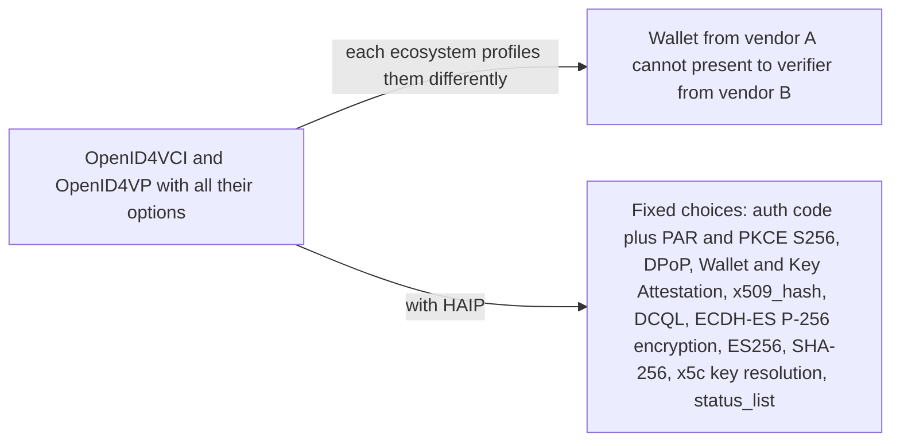
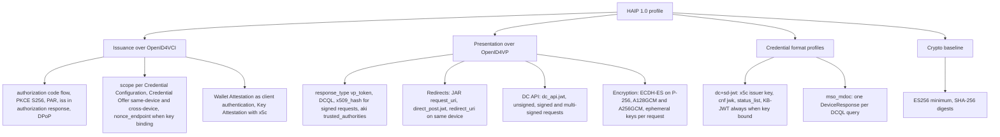

# OpenID4VC High Assurance Interoperability Profile

> In one line: Picks one concrete, security-hardened configuration of OpenID4VCI, OpenID4VP, SD-JWT VC and ISO mdoc so that wallets, issuers and verifiers from different vendors actually interoperate for government-grade credentials.

## When you reach for it

- **A national identity wallet ecosystem such as eIDAS 2.0**: issuers, wallets and verifiers from many vendors must issue and present a PID the same way, so the profile fixes which optional features are mandatory and which values are allowed (Section 1, Section 1.1).
- **An issuer that must know which wallet it is issuing to and how the keys are protected**: wallets authenticate with a Wallet Attestation at the PAR and token endpoints and supply key attestations in the Credential Request (Section 4.4.1, Section 4.5.1).
- **A verifier that needs X.509-based trust rather than pre-registration**: signed requests use the `x509_hash` Client Identifier Prefix, and DCQL `trusted_authorities` of type `aki` filter issuers by certificate authority (Section 5).
- **A browser-based verifier**: presentation over the W3C Digital Credentials API with response mode `dc_api.jwt`; the wallet supports unsigned, signed and multi-signed requests (Section 5.2).
- **Reusing an existing ISO 18013-5 mDL deployment**: an ecosystem can adopt only the presentation part with `mso_mdoc` and the ISO reader certificate profile (Section 9.3.1.2).

## The problem it solves

OpenID4VP calls itself a framework that requires profiling, and OpenID4VCI leaves grant types, proof types, metadata signing and credential formats open. Two correct implementations can still fail to interoperate because they chose different options, and a high-assurance deployment needs the stricter choices, such as sender-constrained tokens and X.509-anchored keys, to be mandatory (Section 1, Section 3).

HAIP is a profile: it turns a chosen set of optional features of the base specifications into requirements for the issuance flow, the two presentation flows (redirects and the DC API), and the two credential formats (Section 3, Section 3.3). Trust management, meaning which issuers and verifiers are authorized, stays out of scope (Section 3.4).

## How it works

Issuance follows OpenID4VCI with the authorization code flow, the applicable FAPI 2.0 provisions (PKCE S256, PAR, `iss` in the authorization response) and DPoP (Section 4). The credential is requested by `scope`, one per credential configuration (Section 4.1, Section 4.3); the wallet authenticates with a Wallet Attestation (Section 4.4.1) and supplies key attestations (Section 4.5.1). Presentation follows OpenID4VP with `vp_token`, DCQL, the `x509_hash` prefix for signed requests and ECDH-ES encrypted responses to ephemeral keys (Section 5): `direct_post.jwt` over redirects (Section 5.1), `dc_api.jwt` over the DC API (Section 5.2). SD-JWT VCs carry the issuer chain in `x5c`, use `status_list`, and always include a KB-JWT when key bound (Section 6.1, Section 6.1.1, Section 6.1.1.1).

## What the spec requires

- Issuers and wallets MUST support the authorization code flow, the applicable FAPI 2.0 Security Profile provisions (PKCE S256, PAR, `iss` in the authorization response), and DPoP, including the `DPoP-Nonce` header from the Nonce Endpoint (Section 4).
- The authorization server MUST publish RFC 8414 metadata; credential issuer metadata MUST include a `scope` per credential configuration, and `nonce_endpoint` MUST be present when any configuration requires key binding (Section 4.1).
- Wallets MUST use, and issuers MUST require, OAuth client authentication at endpoints that support it; Wallet Attestations MUST NOT be reused across issuers and MUST NOT carry a per-instance identifier (Section 4.4.1).
- Wallets MUST support key attestations; with the OpenID4VCI Appendix D format, the validating key MUST be in `x5c`, the trust anchor MUST NOT be, and the signing certificate MUST NOT be self-signed (Section 4.5.1).
- For presentation, `response_type` MUST be `vp_token`, DCQL MUST be used, signed requests MUST use `x509_hash`, ECDH-ES on P-256 MUST be supported, verifiers MUST list both A128GCM and A256GCM while wallets MUST support at least one, verifiers MUST supply ephemeral keys per request, and `aki` trusted authorities MUST be supported (Section 5).
- Over redirects, requests MUST use JAR with `request_uri`, responses MUST use `direct_post.jwt`, and on the same device the verifier MUST return a `redirect_uri` and reject presentations whose redirect does not arrive in the original session (Section 5.1).
- SD-JWT VC: format identifier `dc+sd-jwt`; `cnf` MUST hold a `jwk` when key binding is required; `status`, if present, MUST contain `status_list`, with the Status List Token's key in its `x5c`; every credential MUST have a unique, unpredictable index; the issuer chain MUST be in `x5c`; key-bound credentials MUST always carry a KB-JWT (Section 5.3.2, Section 6.1, Section 6.1.1, Section 6.1.1.1).
- All parties MUST support ES256 and SHA-256 at minimum (Section 7, Section 8).

## Watch out

- **Pinned pre-final drafts**: HAIP profiles SD-JWT VC draft -13 and Token Status List draft -14 and says implementations should keep using those versions in preference to the final ones unless a new profile version says otherwise; check which draft your library targets (Section 9.4).
- **Trust management is out of scope**: HAIP uses X.509 everywhere but does not say how roots are obtained or which issuers may issue which types; the ecosystem defines that (Section 3.4).
- **Not LoA High by itself**: the profile fulfils some, not all, requirements for eIDAS "High" level of assurance and must be combined with measures outside its scope (Section 1).
- **Key attestation backends**: wallets that convert platform attestations into the Appendix D format depend on a backend that affects availability and MUST be designed with its users' privacy in mind, for example by being stateless (Section 9.2, Section 11.1).

## Sources

- [HAIP 1.0, Section 1](https://openid.net/specs/openid4vc-high-assurance-interoperability-profile-1_0.html#name-introduction)
- [HAIP 1.0, Section 1.1](https://openid.net/specs/openid4vc-high-assurance-interoperability-profile-1_0.html#name-target-audience-usage)
- [HAIP 1.0, Section 3](https://openid.net/specs/openid4vc-high-assurance-interoperability-profile-1_0.html#name-scope)
- [HAIP 1.0, Section 3.3](https://openid.net/specs/openid4vc-high-assurance-interoperability-profile-1_0.html#name-standards-requirements)
- [HAIP 1.0, Section 3.4](https://openid.net/specs/openid4vc-high-assurance-interoperability-profile-1_0.html#name-out-of-scope)
- [HAIP 1.0, Section 4](https://openid.net/specs/openid4vc-high-assurance-interoperability-profile-1_0.html#name-openid-for-verifiable-crede)
- [HAIP 1.0, Section 4.1](https://openid.net/specs/openid4vc-high-assurance-interoperability-profile-1_0.html#name-issuer-metadata)
- [HAIP 1.0, Section 4.3](https://openid.net/specs/openid4vc-high-assurance-interoperability-profile-1_0.html#name-authorization-endpoint)
- [HAIP 1.0, Section 4.4.1](https://openid.net/specs/openid4vc-high-assurance-interoperability-profile-1_0.html#name-wallet-attestation)
- [HAIP 1.0, Section 4.5.1](https://openid.net/specs/openid4vc-high-assurance-interoperability-profile-1_0.html#name-key-attestation)
- [HAIP 1.0, Section 5](https://openid.net/specs/openid4vc-high-assurance-interoperability-profile-1_0.html#name-openid-for-verifiable-prese)
- [HAIP 1.0, Section 5.1](https://openid.net/specs/openid4vc-high-assurance-interoperability-profile-1_0.html#name-openid-for-verifiable-presen)
- [HAIP 1.0, Section 5.2](https://openid.net/specs/openid4vc-high-assurance-interoperability-profile-1_0.html#name-openid-for-verifiable-present)
- [HAIP 1.0, Section 5.3.2](https://openid.net/specs/openid4vc-high-assurance-interoperability-profile-1_0.html#name-ietf-sd-jwt-vc)
- [HAIP 1.0, Section 6.1](https://openid.net/specs/openid4vc-high-assurance-interoperability-profile-1_0.html#name-ietf-sd-jwt-vc-profile)
- [HAIP 1.0, Section 6.1.1](https://openid.net/specs/openid4vc-high-assurance-interoperability-profile-1_0.html#name-issuer-identification-and-k)
- [HAIP 1.0, Section 6.1.1.1](https://openid.net/specs/openid4vc-high-assurance-interoperability-profile-1_0.html#name-cryptographic-holder-bindin)
- [HAIP 1.0, Section 7](https://openid.net/specs/openid4vc-high-assurance-interoperability-profile-1_0.html#name-requirements-for-digital-si)
- [HAIP 1.0, Section 8](https://openid.net/specs/openid4vc-high-assurance-interoperability-profile-1_0.html#name-hash-algorithms)
- [HAIP 1.0, Section 9.2](https://openid.net/specs/openid4vc-high-assurance-interoperability-profile-1_0.html#name-interoperable-key-attestati)
- [HAIP 1.0, Section 9.3.1.2](https://openid.net/specs/openid4vc-high-assurance-interoperability-profile-1_0.html#name-example-2-achieving-compati)
- [HAIP 1.0, Section 9.4](https://openid.net/specs/openid4vc-high-assurance-interoperability-profile-1_0.html#name-pre-final-specifications)
- [HAIP 1.0, Section 11.1](https://openid.net/specs/openid4vc-high-assurance-interoperability-profile-1_0.html#name-interoperable-key-attestatio)
- [OpenID4VCI 1.0, Appendix D](https://openid.net/specs/openid-4-verifiable-credential-issuance-1_0.html#name-key-attestations)
- [OpenID4VCI 1.0, Appendix E](https://openid.net/specs/openid-4-verifiable-credential-issuance-1_0.html#name-wallet-attestations-in-jwt-)
