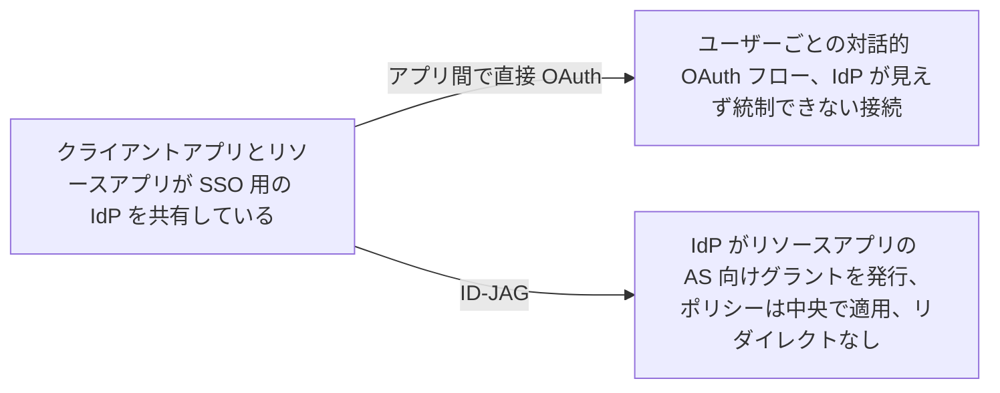
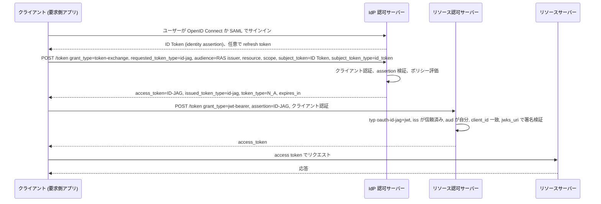

# Identity Assertion JWT Authorization Grant (ID-JAG)

> 一言で言うと: 2 つのアプリが SSO で共有している企業 IdP が短命な JWT グラントを発行し、片方のアプリがそれをもう片方の認可サーバーで access token に交換する。ユーザーへのリダイレクトはなく、IdP が主導権を持つ。

## どういうときに使うか

- **同じ IdP でサインインした wiki アプリが、チャットアプリのユーザーデータを読みたい**: 今日の wiki はチャットアプリに対して自前の OAuth フローを始める。これは IdP の目に入らないアプリ間の直接接続になる。ID-JAG なら wiki は代わりに IdP にチャットアプリの認可サーバー向けのグラントを求める (Section 1, Section 4.1)。
- **どのアプリ同士が通信してよいかを IdP 運用者が決めるべき企業**: IdP はグラント発行前に client、ユーザー、audience、resource、scope についてポリシーを評価するので、接続は中央で管理される (Section 4.3.3, Appendix A.1)。
- **従業員に代わって外部ツールを呼ぶ AI エージェント**: エージェントは企業 IdP から ID-JAG を得て、ツールの認可サーバーから `jwt-bearer` で access token を得る (Appendix A.4)。
- **プロバイダをまたぐメールとカレンダーのアプリ、または顧客 ID 基盤の背後にある開発者向け SaaS コンポーネント**: 同じグラントのパターンが workforce 以外のケースにも当てはまる (Appendix A.2, Appendix A.3)。

## 解決する問題

企業内のアプリは、OpenID Connect か SAML で共通の IdP と SSO するよう設定されている。あるアプリが別のアプリの API 向け access token を必要としたとき、その認可サーバーに見せられるものは、新たな対話的 OAuth フローの結果しかない。そのフローはログインに使った IdP から見えない 2 アプリ間の直接関係を作るので、IdP 運用者はどのユーザー・どのアプリがアクセスするかを管理できない。ID-JAG は IdP での RFC 8693 Token Exchange と、リソースアプリの認可サーバーでの RFC 7523 JWT グラントをプロファイルし、IdP がアクセスを仲介しつつ、リソース側の認可サーバーは自分のトークンとポリシーの主導権を保つ (Section 1)。

## 仕組み

SSO の後、クライアントは identity assertion を持っている。IdP に token exchange を要求し、`requested_token_type=urn:ietf:params:oauth:token-type:id-jag`、`audience` にリソース認可サーバーの issuer 識別子、`subject_token` に assertion を入れる。IdP はクライアントを認証し、assertion を検証してポリシーを適用し、ID-JAG を返す。これは `typ` が `oauth-id-jag+jwt`、`iss` が IdP、`sub` がユーザー、`aud` がリソース認可サーバー、`client_id` がそのサーバーでのクライアント識別子で、`jti`、`exp`、`iat` と、許可された `scope` を持つ JWT。クライアントはこれを `grant_type=urn:ietf:params:oauth:grant-type:jwt-bearer` で提示し、リソース認可サーバーが検証して自分の access token を発行する (Section 3.1, Section 4.3, Section 4.4)。

## 仕様が求めること

- ID-JAG の `typ` は `oauth-id-jag+jwt` でなければならない。`iss`、`sub`、`aud`、`client_id`、`jti`、`exp`、`iat` は REQUIRED (Section 3.1)。RS256 は両方のサーバーで実装必須 (Section 3)。
- token exchange では `requested_token_type` が REQUIRED で値は `urn:ietf:params:oauth:token-type:id-jag`。`audience` は REQUIRED でちょうど 1 つ。`subject_token_type` は `id_token`、`saml2`、対応していれば `refresh_token` (Section 4.3)。
- IdP はクライアントを認証しなければならず、未認証のリクエストは `invalid_client` で拒否する。identity assertion は検証し、その audience が認証した `client_id` と一致することを確認しなければならない (Section 4.3.3)。
- token exchange の応答は `access_token` に ID-JAG、`token_type` は `N_A`、`issued_token_type` は `urn:ietf:params:oauth:token-type:id-jag` (Section 4.3.4)。
- リソース認可サーバーでは、クライアント認証も sender-constrained な ID-JAG もないリクエストを `invalid_client` で拒否しなければならない。`aud` にはそのサーバーの issuer 識別子が含まれなければならず、信頼していない `iss` は `invalid_grant`、`client_id` は認証したクライアントと一致しなければならない (Section 4.4, Section 4.4.1)。
- リソース認可サーバーは refresh token を返すべきでない。クライアントは ID-JAG を再提示するか、新しく取得する (Section 4.4.4)。
- `authorization_grant_profiles_supported` に `urn:ietf:params:oauth:grant-profile:id-jag` を載せるリソース認可サーバーは、`grant_types_supported` にも `urn:ietf:params:oauth:grant-type:jwt-bearer` を載せなければならない (Section 7.2)。

## 注意点

- `sub` はクライアント向けではなくリソース認可サーバー向けに IdP が選ぶ。同じユーザーには、そのサーバー向けのすべての ID-JAG で同じ値を使わなければならない (Section 5.2)。
- 保管した subject token は credential。クライアントはログや URI に書くべきでなく、キャッシュより新しい ID-JAG の取得を優先すべき (Section 9.2)。
- ID-JAG を別のリソース認可サーバーに使い回してはならない。IdP は明示的に設定されない限り、自分が発行した ID-JAG に対して access token を発行してはならない (Section 9.4)。
- クライアントは取得した認可サーバーメタデータの `issuer` が取得に使った識別子と一致することを検証しなければならず (Section 9.5)、サーバーは `authorization_grant_profiles_supported` で issuer の許可リストを開示してはならない (Section 9.7)。
- ID-JAG に `cnf` claim (DPoP の `jkt` か mTLS の `x5t#S256`) があれば、リソース認可サーバーで所持証明を示さなければならず、その確認方式に対応していないサーバーは `invalid_grant` で拒否しなければならない (Section 9.11)。

## 出典

- [draft-ietf-oauth-identity-assertion-authz-grant, Section 1](https://datatracker.ietf.org/doc/html/draft-ietf-oauth-identity-assertion-authz-grant#section-1)
- [draft-ietf-oauth-identity-assertion-authz-grant, Section 3](https://datatracker.ietf.org/doc/html/draft-ietf-oauth-identity-assertion-authz-grant#section-3)
- [draft-ietf-oauth-identity-assertion-authz-grant, Section 3.1](https://datatracker.ietf.org/doc/html/draft-ietf-oauth-identity-assertion-authz-grant#section-3.1)
- [draft-ietf-oauth-identity-assertion-authz-grant, Section 4.1](https://datatracker.ietf.org/doc/html/draft-ietf-oauth-identity-assertion-authz-grant#section-4.1)
- [draft-ietf-oauth-identity-assertion-authz-grant, Section 4.3](https://datatracker.ietf.org/doc/html/draft-ietf-oauth-identity-assertion-authz-grant#section-4.3)
- [draft-ietf-oauth-identity-assertion-authz-grant, Section 4.3.3](https://datatracker.ietf.org/doc/html/draft-ietf-oauth-identity-assertion-authz-grant#section-4.3.3)
- [draft-ietf-oauth-identity-assertion-authz-grant, Section 4.3.4](https://datatracker.ietf.org/doc/html/draft-ietf-oauth-identity-assertion-authz-grant#section-4.3.4)
- [draft-ietf-oauth-identity-assertion-authz-grant, Section 4.4](https://datatracker.ietf.org/doc/html/draft-ietf-oauth-identity-assertion-authz-grant#section-4.4)
- [draft-ietf-oauth-identity-assertion-authz-grant, Section 4.4.1](https://datatracker.ietf.org/doc/html/draft-ietf-oauth-identity-assertion-authz-grant#section-4.4.1)
- [draft-ietf-oauth-identity-assertion-authz-grant, Section 4.4.4](https://datatracker.ietf.org/doc/html/draft-ietf-oauth-identity-assertion-authz-grant#section-4.4.4)
- [draft-ietf-oauth-identity-assertion-authz-grant, Section 5.2](https://datatracker.ietf.org/doc/html/draft-ietf-oauth-identity-assertion-authz-grant#section-5.2)
- [draft-ietf-oauth-identity-assertion-authz-grant, Section 7.2](https://datatracker.ietf.org/doc/html/draft-ietf-oauth-identity-assertion-authz-grant#section-7.2)
- [draft-ietf-oauth-identity-assertion-authz-grant, Section 9.2](https://datatracker.ietf.org/doc/html/draft-ietf-oauth-identity-assertion-authz-grant#section-9.2)
- [draft-ietf-oauth-identity-assertion-authz-grant, Section 9.4](https://datatracker.ietf.org/doc/html/draft-ietf-oauth-identity-assertion-authz-grant#section-9.4)
- [draft-ietf-oauth-identity-assertion-authz-grant, Section 9.5](https://datatracker.ietf.org/doc/html/draft-ietf-oauth-identity-assertion-authz-grant#section-9.5)
- [draft-ietf-oauth-identity-assertion-authz-grant, Section 9.7](https://datatracker.ietf.org/doc/html/draft-ietf-oauth-identity-assertion-authz-grant#section-9.7)
- [draft-ietf-oauth-identity-assertion-authz-grant, Section 9.11](https://datatracker.ietf.org/doc/html/draft-ietf-oauth-identity-assertion-authz-grant#section-9.11)
- [draft-ietf-oauth-identity-assertion-authz-grant, Appendix A.1](https://datatracker.ietf.org/doc/html/draft-ietf-oauth-identity-assertion-authz-grant#appendix-A.1)
- [draft-ietf-oauth-identity-assertion-authz-grant, Appendix A.2](https://datatracker.ietf.org/doc/html/draft-ietf-oauth-identity-assertion-authz-grant#appendix-A.2)
- [draft-ietf-oauth-identity-assertion-authz-grant, Appendix A.3](https://datatracker.ietf.org/doc/html/draft-ietf-oauth-identity-assertion-authz-grant#appendix-A.3)
- [draft-ietf-oauth-identity-assertion-authz-grant, Appendix A.4](https://datatracker.ietf.org/doc/html/draft-ietf-oauth-identity-assertion-authz-grant#appendix-A.4)
