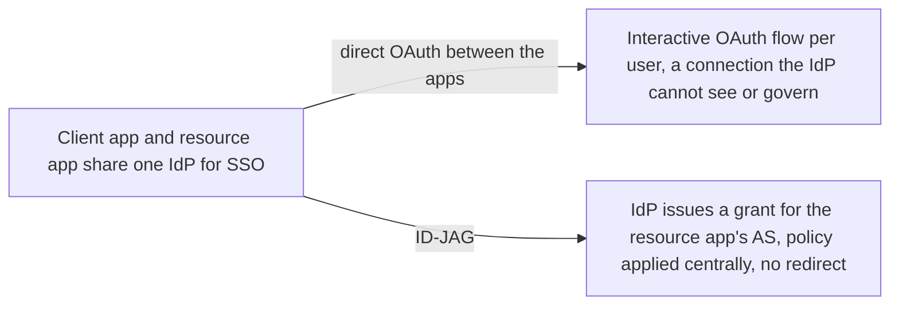
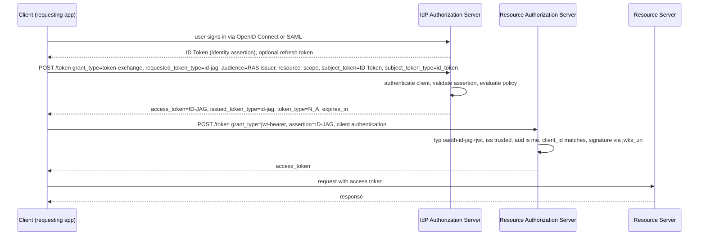

# Identity Assertion JWT Authorization Grant (ID-JAG)

> In one line: the enterprise IdP that two apps already use for SSO issues a short-lived JWT grant, and the first app trades it at the second app's authorization server for an access token, with no redirect to the user and the IdP in control.

## When you reach for it

- **A wiki app that needs to read the user's data in a chat app, both signed in through the same IdP**: instead of running its own OAuth flow against the chat app, a connection the IdP never sees, the wiki asks the IdP for a grant for the chat app's authorization server (Section 1, Section 4.1).
- **An enterprise where the IdP operator must decide which apps may talk to which**: the IdP evaluates policy for client, user, audience, resources and scopes before issuing any grant (Section 4.3.3, Appendix A.1).
- **An AI agent calling external tools on the employee's behalf**: the agent gets an ID-JAG from the enterprise IdP, then a `jwt-bearer` access token from the tool's authorization server (Appendix A.4).
- **Email and calendar apps across providers, or developer SaaS components behind a customer identity system**: the same grant pattern applies outside the workforce case (Appendix A.2, Appendix A.3).

## The problem it solves

Enterprise applications sign users in through a common IdP over OpenID Connect or SAML. When one application needs an access token for another application's API, its only option is a fresh interactive OAuth flow against that application. That creates a direct relationship between the two apps which the IdP cannot see, so the IdP operator cannot manage which users and apps get access. ID-JAG profiles RFC 8693 Token Exchange at the IdP and the RFC 7523 JWT grant at the resource authorization server: the IdP brokers access while the resource authorization server keeps control of its own tokens and policy (Section 1).

## How it works

After SSO the client sends a token exchange request to the IdP with `requested_token_type=urn:ietf:params:oauth:token-type:id-jag`, the resource authorization server's issuer identifier in `audience`, and the assertion as `subject_token`. The IdP authenticates the client, validates the assertion and applies policy, then returns the ID-JAG: a JWT with `typ` `oauth-id-jag+jwt`, `iss` the IdP, `sub` the user, `aud` the resource authorization server, `client_id` the client's identifier at that server, plus `jti`, `exp`, `iat` and the granted `scope`. The client presents it with `grant_type=urn:ietf:params:oauth:grant-type:jwt-bearer`; the resource authorization server validates it and issues its own access token (Section 3.1, Section 4.3, Section 4.4).

## What the spec requires

- The ID-JAG MUST carry `typ` `oauth-id-jag+jwt`; `iss`, `sub`, `aud`, `client_id`, `jti`, `exp` and `iat` are REQUIRED (Section 3.1); RS256 is mandatory to implement for both servers (Section 3).
- In the token exchange, `requested_token_type` is REQUIRED and is `urn:ietf:params:oauth:token-type:id-jag`; `audience` is REQUIRED with exactly one value; `subject_token_type` is `id_token`, `saml2` or, when supported, `refresh_token` (Section 4.3).
- The IdP MUST authenticate the client and reject unauthenticated requests with `invalid_client`; for an identity assertion it MUST validate it and check that its audience matches the authenticated `client_id` (Section 4.3.3).
- The token exchange response carries the ID-JAG in `access_token` with `token_type` `N_A` and `issued_token_type` `urn:ietf:params:oauth:token-type:id-jag` (Section 4.3.4).
- At the resource authorization server, a request with neither client authentication nor a sender-constrained ID-JAG MUST be rejected with `invalid_client`; `aud` MUST contain that server's issuer identifier, an untrusted `iss` fails with `invalid_grant`, and `client_id` MUST match the authenticated client (Section 4.4, Section 4.4.1).
- The resource authorization server SHOULD NOT return a refresh token; clients resubmit the ID-JAG or fetch a new one (Section 4.4.4).
- A resource authorization server advertising `urn:ietf:params:oauth:grant-profile:id-jag` in `authorization_grant_profiles_supported` MUST also list `urn:ietf:params:oauth:grant-type:jwt-bearer` in `grant_types_supported` (Section 7.2).

## Watch out

- The IdP picks `sub` for the resource authorization server, not for the client, and MUST use the same value for a user across every ID-JAG for that server (Section 5.2).
- Treat stored subject tokens as credentials: do not log them or put them in URIs, and prefer requesting a fresh ID-JAG over caching one (Section 9.2).
- An ID-JAG MUST NOT be reused for a different resource authorization server, and the IdP MUST NOT issue access tokens for its own ID-JAG unless explicitly configured (Section 9.4).
- Clients MUST verify that the `issuer` in fetched authorization server metadata matches the identifier used to retrieve it (Section 9.5), and servers MUST NOT use `authorization_grant_profiles_supported` to disclose issuer allow lists (Section 9.7).
- If the ID-JAG carries a `cnf` claim (DPoP `jkt` or mTLS `x5t#S256`), proof of possession MUST be demonstrated at the resource authorization server, and a server that does not support that confirmation method MUST reject with `invalid_grant` (Section 9.11).

## Sources

- [draft-ietf-oauth-identity-assertion-authz-grant, Section 1](https://datatracker.ietf.org/doc/html/draft-ietf-oauth-identity-assertion-authz-grant#section-1)
- [draft-ietf-oauth-identity-assertion-authz-grant, Section 3](https://datatracker.ietf.org/doc/html/draft-ietf-oauth-identity-assertion-authz-grant#section-3)
- [draft-ietf-oauth-identity-assertion-authz-grant, Section 3.1](https://datatracker.ietf.org/doc/html/draft-ietf-oauth-identity-assertion-authz-grant#section-3.1)
- [draft-ietf-oauth-identity-assertion-authz-grant, Section 4.1](https://datatracker.ietf.org/doc/html/draft-ietf-oauth-identity-assertion-authz-grant#section-4.1)
- [draft-ietf-oauth-identity-assertion-authz-grant, Section 4.3](https://datatracker.ietf.org/doc/html/draft-ietf-oauth-identity-assertion-authz-grant#section-4.3)
- [draft-ietf-oauth-identity-assertion-authz-grant, Section 4.3.3](https://datatracker.ietf.org/doc/html/draft-ietf-oauth-identity-assertion-authz-grant#section-4.3.3)
- [draft-ietf-oauth-identity-assertion-authz-grant, Section 4.3.4](https://datatracker.ietf.org/doc/html/draft-ietf-oauth-identity-assertion-authz-grant#section-4.3.4)
- [draft-ietf-oauth-identity-assertion-authz-grant, Section 4.4](https://datatracker.ietf.org/doc/html/draft-ietf-oauth-identity-assertion-authz-grant#section-4.4)
- [draft-ietf-oauth-identity-assertion-authz-grant, Section 4.4.1](https://datatracker.ietf.org/doc/html/draft-ietf-oauth-identity-assertion-authz-grant#section-4.4.1)
- [draft-ietf-oauth-identity-assertion-authz-grant, Section 4.4.4](https://datatracker.ietf.org/doc/html/draft-ietf-oauth-identity-assertion-authz-grant#section-4.4.4)
- [draft-ietf-oauth-identity-assertion-authz-grant, Section 5.2](https://datatracker.ietf.org/doc/html/draft-ietf-oauth-identity-assertion-authz-grant#section-5.2)
- [draft-ietf-oauth-identity-assertion-authz-grant, Section 7.2](https://datatracker.ietf.org/doc/html/draft-ietf-oauth-identity-assertion-authz-grant#section-7.2)
- [draft-ietf-oauth-identity-assertion-authz-grant, Section 9.2](https://datatracker.ietf.org/doc/html/draft-ietf-oauth-identity-assertion-authz-grant#section-9.2)
- [draft-ietf-oauth-identity-assertion-authz-grant, Section 9.4](https://datatracker.ietf.org/doc/html/draft-ietf-oauth-identity-assertion-authz-grant#section-9.4)
- [draft-ietf-oauth-identity-assertion-authz-grant, Section 9.5](https://datatracker.ietf.org/doc/html/draft-ietf-oauth-identity-assertion-authz-grant#section-9.5)
- [draft-ietf-oauth-identity-assertion-authz-grant, Section 9.7](https://datatracker.ietf.org/doc/html/draft-ietf-oauth-identity-assertion-authz-grant#section-9.7)
- [draft-ietf-oauth-identity-assertion-authz-grant, Section 9.11](https://datatracker.ietf.org/doc/html/draft-ietf-oauth-identity-assertion-authz-grant#section-9.11)
- [draft-ietf-oauth-identity-assertion-authz-grant, Appendix A.1](https://datatracker.ietf.org/doc/html/draft-ietf-oauth-identity-assertion-authz-grant#appendix-A.1)
- [draft-ietf-oauth-identity-assertion-authz-grant, Appendix A.2](https://datatracker.ietf.org/doc/html/draft-ietf-oauth-identity-assertion-authz-grant#appendix-A.2)
- [draft-ietf-oauth-identity-assertion-authz-grant, Appendix A.3](https://datatracker.ietf.org/doc/html/draft-ietf-oauth-identity-assertion-authz-grant#appendix-A.3)
- [draft-ietf-oauth-identity-assertion-authz-grant, Appendix A.4](https://datatracker.ietf.org/doc/html/draft-ietf-oauth-identity-assertion-authz-grant#appendix-A.4)
