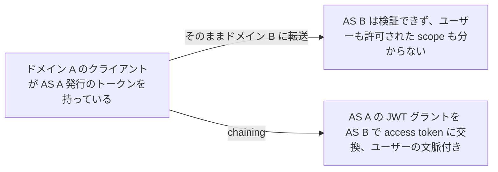
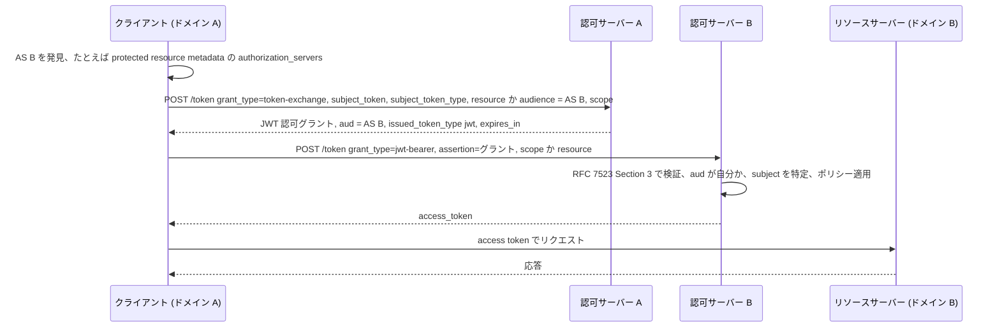

# Identity and Authorization Chaining

> 一言で言うと: トラストドメイン A のクライアントが、手元のトークンを A の認可サーバーで JWT グラントに交換し、そのグラントをドメイン B の認可サーバーに提示して access token を得る。ユーザーのアイデンティティと認可がドメイン境界を越えて残る。

## どういうときに使うか

- **ユーザーのリクエストがオンプレとクラウドの別ドメインのワークロードにまたがる**: 境界でユーザーの文脈を失わず、各ワークロードが同じ文脈に自分のポリシーを適用できる (Appendix A.1)。
- **別の認可サーバー配下の外部リソースを使う CI システム**: commit hash やリポジトリといったビルドのアイデンティティが、グラントの中でドメインを越えて運ばれる (Appendix A.2)。
- **家庭用カメラの映像を要求するパートナーのダッシュボード**: デバイス会社は「パートナーが呼んだ」だけでなく、「許可されたユーザーが認可した」ことを自分で検証できる (Appendix A.3)。
- **企業 SSO を API アクセスにまで広げる**: クライアントが IdP の identity assertion を、その IdP を信頼する SaaS の認可サーバーが受け付けるグラントに交換する。追加のユーザー操作はない (Appendix A.4, Appendix A.5)。

## 解決する問題

1 つのリクエストが、それぞれ独自の認可サーバーを持つ複数のトラストドメインのリソースサーバーを通ることがある。途中の各保護リソースは、誰のためのリクエストか、どんな認可が与えられたか、任意でどのリソースサーバーを経由してきたかを知る必要がある。ドメイン A のトークンはドメイン B にとって意味を持たない。このドラフトは、ドメイン A 内の RFC 8693 Token Exchange と、ドメイン B での RFC 7523 JWT グラントを組み合わせ、検証可能なグラントが 1 つ以上のドメイン境界を越えて文脈を運ぶようにする (Section 1, Section 2.1)。

## 仕組み

クライアントはまずドメイン B の認可サーバーを見つける。たとえば RFC 9728 の protected resource metadata にある `authorization_servers` から (Section 2.2)。次に自分の認可サーバーに token exchange を要求し、`resource` か `audience` でドメイン B のサーバーを指定する。返ってくるグラントは `aud` がドメイン B のサーバーである JWT で、ドメイン A は途中で claim を足したり、削ったり、書き換えたりしてよい。subject 識別子の対応付けや、B に不要な claim の削除がその例 (Section 2.3, Section 2.5)。クライアントはこのグラントを `grant_type=urn:ietf:params:oauth:grant-type:jwt-bearer` の `assertion` として提示し、ドメイン B は RFC 7523 のグラントとして検証して通常の access token を返す (Section 2.4)。

## 仕様が求めること

- token exchange リクエストでは、`resource` (ドメイン B の認可サーバーの URI) か `audience` (その論理名) のどちらかが REQUIRED。`scope` は、必要ならグラントに含める scope を指定する (Section 2.3.1)。
- ドメイン A の認可サーバーは、リクエストが不正なとき、または `resource` や `audience` が未知かポリシー上受け入れられないときは拒否しなければならない (Section 2.3.2)。
- 発行するグラントの `aud` はドメイン B の認可サーバーを示さなければならない。複数も許されるが、1 つに絞ることが RECOMMENDED (Section 2.3.3)。
- ドメイン B の認可サーバーは RFC 7523 の Section 3 と 3.1 に従ってグラントを検証しなければならず、`aud` はトークンエンドポイントか issuer 識別子でそのサーバーを示さなければならない。subject を特定できなければ拒否しなければならない (Section 2.4.2)。
- access token の応答は RFC 6749 Section 5.1 の標準的な応答 (Section 2.4.3)。
- OPTIONAL なメタデータ `identity_chaining_requested_token_types_supported` は、`requested_token_type` として要求できるトークン種別を列挙する。載っていないからといって未対応とは限らない (Section 3)。

## 注意点

- グラントは bearer credential。実装はリプレイのリスクを評価する必要がある。対策は短い寿命、ワンタイム利用、ドメイン B でのクライアント認証 (Section 5.5)。
- ドメイン B はこのフローで refresh token を発行すべきでない。クライアントはグラントを再提示するか、ドメイン A から新しいものを得る (Section 5.4)。
- 認可サーバーはクライアント認証 (RFC 9700 の Section 2.5) と sender-constrained token について RFC 9700 に従うのがよい。bearer token が依然として最も普及した access token の形 (Section 5.1, Section 5.2)。
- downscoping では、要求された scope が `subject_token` の scope より高い権限でないことを認可サーバーが検証する必要がある (Section 2.5)。
- グラントには最小限のデータだけ入れ、両ドメインのプライバシーポリシーを揃える (Section 6)。

## 出典

- [draft-ietf-oauth-identity-chaining, Section 1](https://datatracker.ietf.org/doc/html/draft-ietf-oauth-identity-chaining#section-1)
- [draft-ietf-oauth-identity-chaining, Section 2.1](https://datatracker.ietf.org/doc/html/draft-ietf-oauth-identity-chaining#section-2.1)
- [draft-ietf-oauth-identity-chaining, Section 2.2](https://datatracker.ietf.org/doc/html/draft-ietf-oauth-identity-chaining#section-2.2)
- [draft-ietf-oauth-identity-chaining, Section 2.3](https://datatracker.ietf.org/doc/html/draft-ietf-oauth-identity-chaining#section-2.3)
- [draft-ietf-oauth-identity-chaining, Section 2.3.1](https://datatracker.ietf.org/doc/html/draft-ietf-oauth-identity-chaining#section-2.3.1)
- [draft-ietf-oauth-identity-chaining, Section 2.3.2](https://datatracker.ietf.org/doc/html/draft-ietf-oauth-identity-chaining#section-2.3.2)
- [draft-ietf-oauth-identity-chaining, Section 2.3.3](https://datatracker.ietf.org/doc/html/draft-ietf-oauth-identity-chaining#section-2.3.3)
- [draft-ietf-oauth-identity-chaining, Section 2.4](https://datatracker.ietf.org/doc/html/draft-ietf-oauth-identity-chaining#section-2.4)
- [draft-ietf-oauth-identity-chaining, Section 2.4.2](https://datatracker.ietf.org/doc/html/draft-ietf-oauth-identity-chaining#section-2.4.2)
- [draft-ietf-oauth-identity-chaining, Section 2.4.3](https://datatracker.ietf.org/doc/html/draft-ietf-oauth-identity-chaining#section-2.4.3)
- [draft-ietf-oauth-identity-chaining, Section 2.5](https://datatracker.ietf.org/doc/html/draft-ietf-oauth-identity-chaining#section-2.5)
- [draft-ietf-oauth-identity-chaining, Section 3](https://datatracker.ietf.org/doc/html/draft-ietf-oauth-identity-chaining#section-3)
- [draft-ietf-oauth-identity-chaining, Section 5.1](https://datatracker.ietf.org/doc/html/draft-ietf-oauth-identity-chaining#section-5.1)
- [draft-ietf-oauth-identity-chaining, Section 5.2](https://datatracker.ietf.org/doc/html/draft-ietf-oauth-identity-chaining#section-5.2)
- [draft-ietf-oauth-identity-chaining, Section 5.4](https://datatracker.ietf.org/doc/html/draft-ietf-oauth-identity-chaining#section-5.4)
- [draft-ietf-oauth-identity-chaining, Section 5.5](https://datatracker.ietf.org/doc/html/draft-ietf-oauth-identity-chaining#section-5.5)
- [draft-ietf-oauth-identity-chaining, Section 6](https://datatracker.ietf.org/doc/html/draft-ietf-oauth-identity-chaining#section-6)
- [draft-ietf-oauth-identity-chaining, Appendix A.1](https://datatracker.ietf.org/doc/html/draft-ietf-oauth-identity-chaining#appendix-A.1)
- [draft-ietf-oauth-identity-chaining, Appendix A.2](https://datatracker.ietf.org/doc/html/draft-ietf-oauth-identity-chaining#appendix-A.2)
- [draft-ietf-oauth-identity-chaining, Appendix A.3](https://datatracker.ietf.org/doc/html/draft-ietf-oauth-identity-chaining#appendix-A.3)
- [draft-ietf-oauth-identity-chaining, Appendix A.4](https://datatracker.ietf.org/doc/html/draft-ietf-oauth-identity-chaining#appendix-A.4)
- [draft-ietf-oauth-identity-chaining, Appendix A.5](https://datatracker.ietf.org/doc/html/draft-ietf-oauth-identity-chaining#appendix-A.5)
