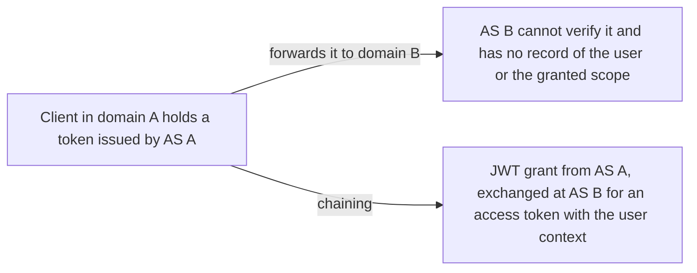
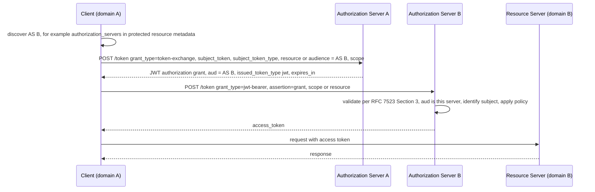

# Identity and Authorization Chaining

> In one line: a client in trust domain A exchanges the token it holds for a JWT grant from A's authorization server, then presents that grant to domain B's authorization server for an access token, so the user's identity and authorization survive the domain crossing.

## When you reach for it

- **A user's request spans on-premise and cloud workloads in different trust domains**: each workload applies its own policy to the same user context instead of losing it at the boundary (Appendix A.1).
- **A CI system that needs external resources under another authorization server**: the build identity, such as commit hash and repository, travels across domains inside the grant (Appendix A.2).
- **A partner dashboard requesting a home camera feed**: the device company can verify on its own that a permitted user authorized the request, not just that a partner called (Appendix A.3).
- **Extending enterprise SSO to API access**: a client exchanges the IdP's identity assertion for a grant that a SaaS authorization server trusting that IdP accepts, with no extra user interaction (Appendix A.4, Appendix A.5).

## The problem it solves

A request can pass through resource servers in several trust domains, each with its own authorization server. Every protected resource along the way needs to know who the request was made for, what authorization was granted, and optionally which resource servers were called before. A token from domain A means nothing to domain B. The draft combines RFC 8693 Token Exchange inside domain A with the RFC 7523 JWT grant at domain B, so that a verifiable grant carries the context across one or more domain boundaries (Section 1, Section 2.1).

## How it works

The client first finds domain B's authorization server, for example from the `authorization_servers` field of RFC 9728 protected resource metadata (Section 2.2). It then sends a token exchange request to its own authorization server, naming domain B's server in `resource` or `audience`. The grant that comes back is a JWT whose `aud` is domain B's server; domain A may add, remove or rewrite claims on the way, for example mapping the subject identifier or dropping claims domain B does not need (Section 2.3, Section 2.5). The client presents the grant as `assertion` with `grant_type=urn:ietf:params:oauth:grant-type:jwt-bearer`, domain B validates it as an RFC 7523 grant and returns an ordinary access token (Section 2.4).

## What the spec requires

- In the token exchange request, one of `resource` (the URI of domain B's authorization server) or `audience` (its logical name) is REQUIRED; `scope` names the scopes to include in the grant, if any (Section 2.3.1).
- Domain A's authorization server MUST deny the request if it is invalid or if the `resource` or `audience` is unknown or unacceptable under its policy (Section 2.3.2).
- The `aud` of the issued grant MUST identify domain B's authorization server; listing several is allowed but restricting it to one is RECOMMENDED (Section 2.3.3).
- Domain B's authorization server MUST validate the grant per RFC 7523 Sections 3 and 3.1, `aud` MUST identify that server by token endpoint or issuer identifier, and the server MUST deny the request if it cannot identify the subject (Section 2.4.2).
- The access token response is a standard RFC 6749 Section 5.1 response (Section 2.4.3).
- The OPTIONAL metadata parameter `identity_chaining_requested_token_types_supported` lists token types that can be requested as `requested_token_type`; a type left out is not necessarily unsupported (Section 3).

## Watch out

- The grant is a bearer credential. Implementations must evaluate the replay risk; mitigations are short lifetimes, single use and client authentication at domain B (Section 5.5).
- Domain B SHOULD NOT issue refresh tokens in this flow; the client resubmits the grant or gets a new one from domain A (Section 5.4).
- Authorization servers should follow RFC 9700 (its Section 2.5 for client authentication) for client authentication and sender-constrained tokens; bearer tokens remain the predominant access token type (Section 5.1, Section 5.2).
- When downscoping, authorization servers need to verify that the requested scopes are not higher privileged than those of the `subject_token` (Section 2.5).
- Include only the minimum data in the grant, and keep privacy policies aligned across the two domains (Section 6).

## Sources

- [draft-ietf-oauth-identity-chaining, Section 1](https://datatracker.ietf.org/doc/html/draft-ietf-oauth-identity-chaining#section-1)
- [draft-ietf-oauth-identity-chaining, Section 2.1](https://datatracker.ietf.org/doc/html/draft-ietf-oauth-identity-chaining#section-2.1)
- [draft-ietf-oauth-identity-chaining, Section 2.2](https://datatracker.ietf.org/doc/html/draft-ietf-oauth-identity-chaining#section-2.2)
- [draft-ietf-oauth-identity-chaining, Section 2.3](https://datatracker.ietf.org/doc/html/draft-ietf-oauth-identity-chaining#section-2.3)
- [draft-ietf-oauth-identity-chaining, Section 2.3.1](https://datatracker.ietf.org/doc/html/draft-ietf-oauth-identity-chaining#section-2.3.1)
- [draft-ietf-oauth-identity-chaining, Section 2.3.2](https://datatracker.ietf.org/doc/html/draft-ietf-oauth-identity-chaining#section-2.3.2)
- [draft-ietf-oauth-identity-chaining, Section 2.3.3](https://datatracker.ietf.org/doc/html/draft-ietf-oauth-identity-chaining#section-2.3.3)
- [draft-ietf-oauth-identity-chaining, Section 2.4](https://datatracker.ietf.org/doc/html/draft-ietf-oauth-identity-chaining#section-2.4)
- [draft-ietf-oauth-identity-chaining, Section 2.4.2](https://datatracker.ietf.org/doc/html/draft-ietf-oauth-identity-chaining#section-2.4.2)
- [draft-ietf-oauth-identity-chaining, Section 2.4.3](https://datatracker.ietf.org/doc/html/draft-ietf-oauth-identity-chaining#section-2.4.3)
- [draft-ietf-oauth-identity-chaining, Section 2.5](https://datatracker.ietf.org/doc/html/draft-ietf-oauth-identity-chaining#section-2.5)
- [draft-ietf-oauth-identity-chaining, Section 3](https://datatracker.ietf.org/doc/html/draft-ietf-oauth-identity-chaining#section-3)
- [draft-ietf-oauth-identity-chaining, Section 5.1](https://datatracker.ietf.org/doc/html/draft-ietf-oauth-identity-chaining#section-5.1)
- [draft-ietf-oauth-identity-chaining, Section 5.2](https://datatracker.ietf.org/doc/html/draft-ietf-oauth-identity-chaining#section-5.2)
- [draft-ietf-oauth-identity-chaining, Section 5.4](https://datatracker.ietf.org/doc/html/draft-ietf-oauth-identity-chaining#section-5.4)
- [draft-ietf-oauth-identity-chaining, Section 5.5](https://datatracker.ietf.org/doc/html/draft-ietf-oauth-identity-chaining#section-5.5)
- [draft-ietf-oauth-identity-chaining, Section 6](https://datatracker.ietf.org/doc/html/draft-ietf-oauth-identity-chaining#section-6)
- [draft-ietf-oauth-identity-chaining, Appendix A.1](https://datatracker.ietf.org/doc/html/draft-ietf-oauth-identity-chaining#appendix-A.1)
- [draft-ietf-oauth-identity-chaining, Appendix A.2](https://datatracker.ietf.org/doc/html/draft-ietf-oauth-identity-chaining#appendix-A.2)
- [draft-ietf-oauth-identity-chaining, Appendix A.3](https://datatracker.ietf.org/doc/html/draft-ietf-oauth-identity-chaining#appendix-A.3)
- [draft-ietf-oauth-identity-chaining, Appendix A.4](https://datatracker.ietf.org/doc/html/draft-ietf-oauth-identity-chaining#appendix-A.4)
- [draft-ietf-oauth-identity-chaining, Appendix A.5](https://datatracker.ietf.org/doc/html/draft-ietf-oauth-identity-chaining#appendix-A.5)
