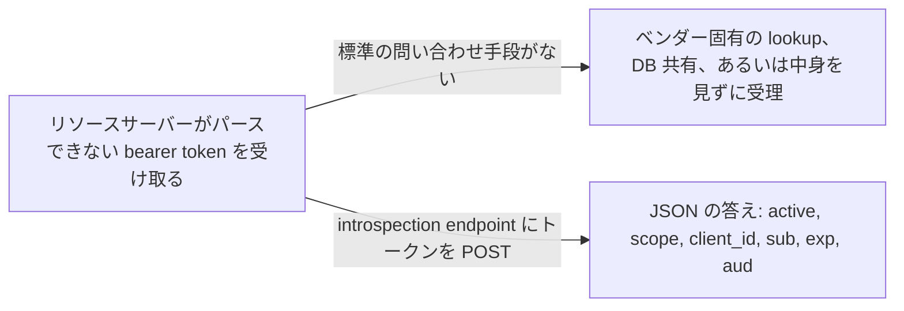
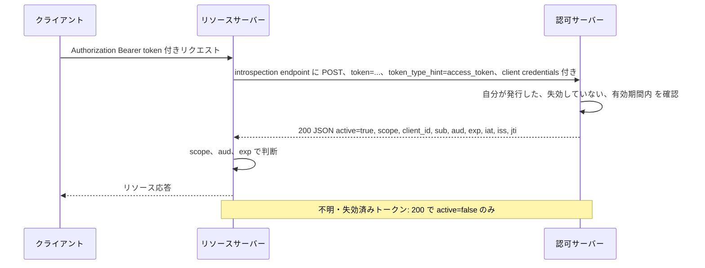

# Token Introspection (RFC 7662)

> 一言で言うと: リソースサーバーが認可サーバーにトークンを POST すると、有効かどうかと何を許しているかが返ってくる。

## どういうときに使うか

- **access token が不透明な文字列**: リソースサーバーはトークンから scope・有効期限・subject を読めないので、発行した認可サーバーに聞く (Section 1)。
- **失効を即座に効かせたい**: 自己完結な JWT は `exp` まで有効なままだが、introspection の応答は失効を含む認可サーバーの現在の状態を映す (Section 2.2、4)。
- **複数のリソースサーバーが 1 つの認可サーバーを使い、DB は共有していない**: 独自のサービス間問い合わせの代わりに、標準のエンドポイント 1 つで済む (Section 1)。
- **gateway や API がトークンのメタ情報から認可判断をしたい**: 応答に `scope`、`client_id`、`sub`、`aud`、`exp` が載る。仕様はこれを認可判断に不可欠な情報と呼ぶ (Section 1、2.2)。

## 解決する問題

OAuth 2.0 ではトークンの中身はクライアントにとって不透明で、リソースサーバーがトークンのメタ情報を知るためのプロトコルは定義されていない (Section 1)。それでもリソースサーバーは、リクエストに応える前に、トークンがまだ有効か、どのクライアントが持っているか、誰が認可したか、どの scope を持つかを知る必要がある。現場は構造化トークンや独自のサービス間通信で答えてきた。

introspection はその問い合わせを標準化する。認可サーバーは TLS と呼び出し元認証で守られたエンドポイントを公開し、トークンを受け取ってそれを記述する JSON オブジェクトを返す (Section 2)。リソースサーバーはトークン DB を持たず、認可サーバーの答えを信頼する。

## 仕組み

リソースサーバーは introspection endpoint に HTTP POST を送る。body は `application/x-www-form-urlencoded` で、トークンの文字列値である `token` と、lookup を助ける任意の `token_type_hint` を載せる (Section 2.1)。この呼び出し自体に認可が要り、たとえばリソースサーバーの client credentials や別の bearer token を使う (Section 2.1)。認可サーバーは JSON オブジェクトで答え、必須のメンバーは `active` だけで、この boolean は「このサーバーが発行し、失効しておらず、有効期間内」を意味する (Section 2.2)。トークンが有効なら、応答に `scope`、`client_id`、`username`、`token_type`、`exp`、`iat`、`nbf`、`sub`、`aud`、`iss`、`jti` を足してよい (Section 2.2)。無効なトークン、不明なトークン、呼び出し元が introspect を許されていないトークンはエラーではなく、サーバーは `active` を `false` にして返す (Section 2.2、2.3)。401 は呼び出し元自身の credentials が無効か不足しているときのためのものだ (Section 2.3)。

## 仕様が求めること

- introspection endpoint は transport-layer のセキュリティ機構で守られなければならず (MUST)、token scanning 攻撃を防ぐために何らかの認可を要求しなければならない (MUST) (Section 2、2.1)。
- `token` は REQUIRED。`token_type_hint` は OPTIONAL で、サーバーは無視してもよく (MAY)、hint でトークンが見つからなければサポートする全トークン種別に検索を広げなければならない (MUST) (Section 2.1)。
- 応答の `active` は REQUIRED。無効なトークンには `active` を `false` にして返さなければならず (MUST)、追加情報なしに状態を判定できないトークンにも同じ応答を返すべきである (SHOULD) (Section 2.1、2.2)。
- リソースサーバーは認可サーバーに全面的に頼るので、認可サーバーはトークンの状態に対して該当するすべての検査を行わなければならない (MUST) (Section 4)。
- サーバーはこのエンドポイントで TLS 1.2 をサポートしなければならない (MUST) (Section 4)。
- 応答に `exp` が含まれるなら、リソースサーバーはその時刻を超えてキャッシュしてはならない (MUST NOT) (Section 4)。

## 注意点

- 無効なトークンへの応答には、無効な理由を含め追加情報を入れるべきではない (SHOULD NOT)。認可サーバーの内部状態を漏らさないためだ (Section 2.2、4)。
- サーバーは、同じ要求でも protected resource ごとに違う応答を返してよい (MAY) (Section 2.2)。
- キャッシュは鮮度と負荷のトレードオフで、キャッシュ期間中は失効済みトークンが受理されうる。機微な環境ではキャッシュを無効にすることも考える (Section 4)。
- クエリパラメータ経由でトークン値がサーバーログに残らないよう、サーバーは HTTP GET を禁止してよい (MAY) (Section 4)。
- 応答にはユーザー識別子などプライバシーに関わる情報が含まれうる。意図しない相手への開示を防ぐ措置を取らなければならず (MUST)、そうした情報を載せないのが最も単純な措置だ (Section 5)。

## 出典

- [RFC 7662, Section 1](https://www.rfc-editor.org/rfc/rfc7662.html#section-1)
- [RFC 7662, Section 2](https://www.rfc-editor.org/rfc/rfc7662.html#section-2)
- [RFC 7662, Section 2.1](https://www.rfc-editor.org/rfc/rfc7662.html#section-2.1)
- [RFC 7662, Section 2.2](https://www.rfc-editor.org/rfc/rfc7662.html#section-2.2)
- [RFC 7662, Section 2.3](https://www.rfc-editor.org/rfc/rfc7662.html#section-2.3)
- [RFC 7662, Section 4](https://www.rfc-editor.org/rfc/rfc7662.html#section-4)
- [RFC 7662, Section 5](https://www.rfc-editor.org/rfc/rfc7662.html#section-5)
