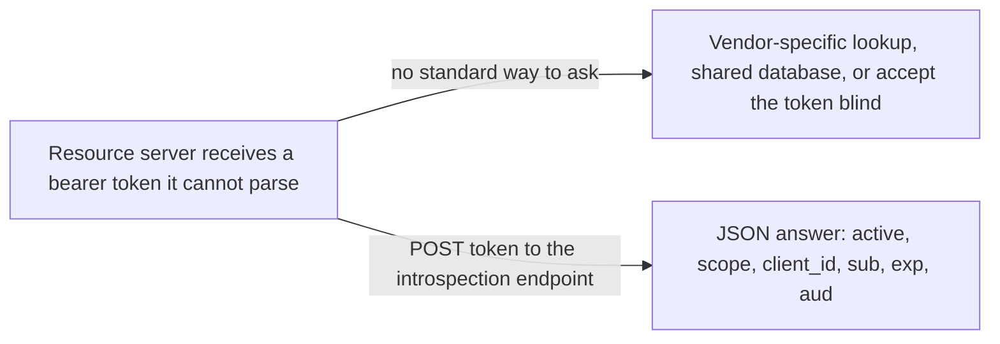
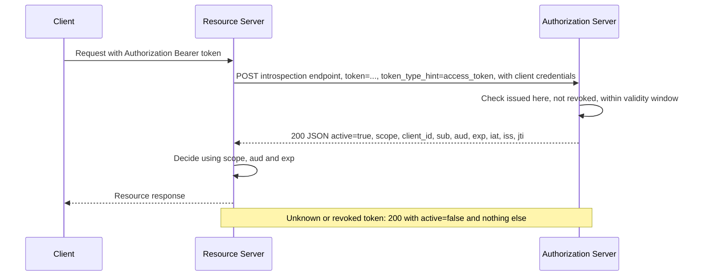

# Token Introspection (RFC 7662)

> In one line: a resource server POSTs a token to the authorization server and gets back whether it is active and what it covers.

## When you reach for it

- **Access tokens are opaque strings**: the resource server cannot read scope, expiry or subject out of the token, so it asks the authorization server that issued it (Section 1).
- **Revocation must take effect now**: a self-contained JWT stays valid until `exp`, but an introspection response reflects the authorization server's current state, including revocation (Sections 2.2, 4).
- **Several resource servers share one authorization server with no shared database**: introspection replaces proprietary inter-service lookups with one standard endpoint (Section 1).
- **A gateway or API must make an authorization decision from token metadata**: the response carries `scope`, `client_id`, `sub`, `aud` and `exp`, which the spec calls vital to those decisions (Sections 1, 2.2).

## The problem it solves

In OAuth 2.0 the contents of tokens are opaque to clients, and the framework defines no protocol for the resource server to learn meta-information about a token (Section 1). Yet a resource server must know whether the token is still valid, which client holds it, who authorized it and what scopes it carries before it can serve the request. Deployments answered with structured tokens or proprietary inter-service communication.

Introspection standardizes the question. The authorization server exposes an endpoint, protected by TLS and by caller authentication, that takes a token and returns a JSON object describing it (Section 2). The resource server keeps no token database and trusts the authorization server's answer.

## How it works

The resource server calls the introspection endpoint with an HTTP POST whose body is `application/x-www-form-urlencoded` and carries `token`, the string value of the token, and optionally `token_type_hint` to help the lookup (Section 2.1). The call itself must be authorized, for example with the resource server's client credentials or a separate bearer token (Section 2.1). The authorization server answers with a JSON object whose only required member is `active`, a boolean meaning the token was issued by this server, has not been revoked, and is within its validity window (Section 2.2). When the token is active, the response may add `scope`, `client_id`, `username`, `token_type`, `exp`, `iat`, `nbf`, `sub`, `aud`, `iss` and `jti` (Section 2.2). An inactive or unknown token, or one the caller is not allowed to introspect, is not an error: the server returns `active` set to `false` (Sections 2.2, 2.3). A 401 is reserved for a caller whose own credentials are invalid or insufficient (Section 2.3).

## What the spec requires

- The introspection endpoint MUST be protected by a transport-layer security mechanism and MUST require some form of authorization to call it, to prevent token scanning attacks (Sections 2, 2.1).
- `token` is REQUIRED; `token_type_hint` is OPTIONAL, the server MAY ignore it, and if the token is not found with the hint the server MUST extend its search across all of its supported token types (Section 2.1).
- `active` is REQUIRED in the response. For an inactive token the server MUST return `active` set to `false`, and when it cannot determine the token's state without additional information it SHOULD do the same (Sections 2.1, 2.2).
- The authorization server MUST perform all applicable checks against a token's state, since resource servers rely on it entirely (Section 4).
- The server MUST support TLS 1.2 on the endpoint (Section 4).
- If a response includes `exp`, the resource server MUST NOT cache it beyond that time (Section 4).

## Watch out

- The response for an inactive token SHOULD NOT include any additional information, including why it is inactive, so the authorization server's internal state is not disclosed (Sections 2.2, 4).
- The server MAY respond differently to different protected resources making the same request (Section 2.2).
- Caching trades freshness for load: a revoked token can still be accepted during the cache window, so sensitive deployments may disable caching (Section 4).
- The server MAY disallow HTTP GET so token values do not land in server logs via query parameters (Section 4).
- The response may contain privacy-sensitive data such as user identifiers. Measures MUST be taken to prevent disclosure to unintended parties, and omitting such data is the simplest measure (Section 5).

## Sources

- [RFC 7662, Section 1](https://www.rfc-editor.org/rfc/rfc7662.html#section-1)
- [RFC 7662, Section 2](https://www.rfc-editor.org/rfc/rfc7662.html#section-2)
- [RFC 7662, Section 2.1](https://www.rfc-editor.org/rfc/rfc7662.html#section-2.1)
- [RFC 7662, Section 2.2](https://www.rfc-editor.org/rfc/rfc7662.html#section-2.2)
- [RFC 7662, Section 2.3](https://www.rfc-editor.org/rfc/rfc7662.html#section-2.3)
- [RFC 7662, Section 4](https://www.rfc-editor.org/rfc/rfc7662.html#section-4)
- [RFC 7662, Section 5](https://www.rfc-editor.org/rfc/rfc7662.html#section-5)
