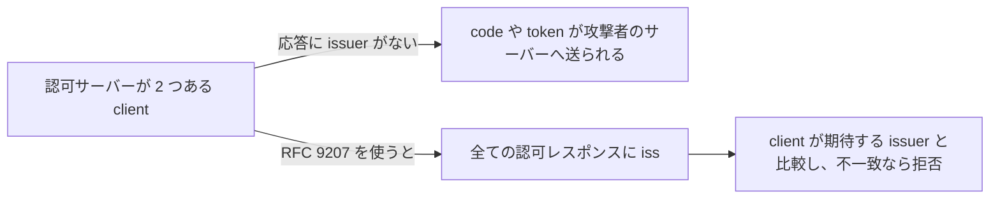
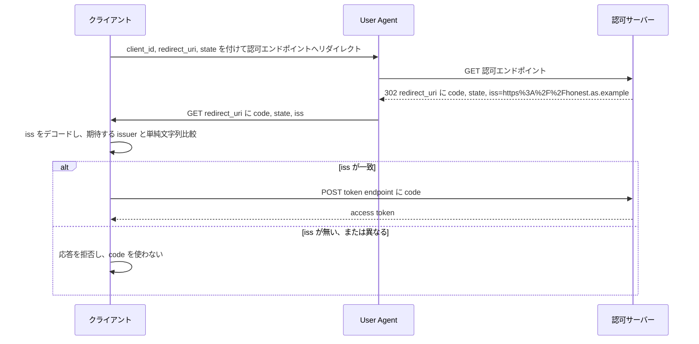

# Authorization Server Issuer Identification

> 一言で言うと: 認可サーバーが自分の issuer identifier を `iss` として全ての認可レスポンスに入れることで、複数の認可サーバーを使う client がどのサーバーから返ってきた応答なのかを判別できるようにする。

## どういうときに使うか

- **複数の認可サーバーに登録している client で、そのうち 1 つが悪意を持った**: `iss` がないと、攻撃者が握った認可サーバーが client を騙し、正規サーバー向けの authorization code や access token を攻撃者側に送らせられる (Section 1)。
- **今は 1 サーバーだが、2 つ目を足そうとしている client**: 仕様は単一サーバーの client は影響を受けないが、2 つ目を設定した瞬間に脆弱になると述べている。追加する前にチェックを入れておく (Section 1, 4)。
- **RFC 8414 metadata でサーバーを発見する client**: `iss` は metadata の `issuer` と一致しなければならないので、すでに信頼している metadata と応答を突き合わせられる (Section 2.3, 2.4)。
- **エラーのリダイレクトを受け取る client**: `iss` はエラー応答にも付くので、`error=access_denied` が本当に送った先のサーバーから来たのかを確かめられる (Section 2, 2.2, 2.4)。

## 解決する問題

RFC 6749 の認可レスポンスは user agent 経由で届き、`code` と `state` は持つが、どの認可サーバーが生成したかを示す情報を持たない。複数のサーバーを設定した client は、応答の出どころを確かめようがない。mix-up 攻撃では、そのうち 1 つのサーバーを攻撃者が握り、この不確かさを突いて、正規サーバーのものである code や access token を間違った token endpoint やリソースサーバーに送らせる (Section 1)。

対策は応答パラメータ 1 つ。認可サーバーは RFC 8414 で定義された issuer identifier を `iss` として認可レスポンスに含め、client はそれを期待する issuer と照合する (Section 1, 2)。

## 仕組み

サーバーはリダイレクトに `iss` を付ける。エラー応答でも同じ。値は query も fragment も持たない `https` URL (Section 2)。client は form エンコードとしてデコードし、要求を送った先のサーバーの issuer identifier と RFC 3986 Section 6.2.1 の単純文字列比較で突き合わせる。サーバーが RFC 8414 metadata を公開していれば、比較対象はその `issuer` 値。不一致なら応答を拒否し、グラントを先に進めない (Section 2.4)。対応サーバーは metadata の `authorization_response_iss_parameter_supported: true` で対応を宣言する (Section 2.3, 3)。

## 仕様が求めること

- この仕様に対応する認可サーバーは、エラー応答を含む認可レスポンスに `iss` を含めなければならない (MUST)。値は query と fragment を持たない `https` URL でなければならない (Section 2)。
- RFC 8414 metadata を公開するサーバーは `issuer` と `iss` に同じ値を使い、`authorization_response_iss_parameter_supported` を `true` にしなければならない (Section 2.3)。
- 対応する client は `iss` を取り出してデコードし、期待する issuer と単純文字列比較しなければならない。不一致なら応答を拒否し、グラントを進めてはならない (Section 2.4)。
- 対応サーバーと非対応サーバーの両方を使う client は、どのサーバーが `iss` に対応するかを記憶し、対応と設定したサーバーからの `iss` 無し応答を拒否しなければならない。非対応とされたサーバーから `iss` 付きの応答が来たら破棄すべき (SHOULD) (Section 2.4)。
- 認可エンドポイントから OpenID Connect の ID Token が返る場合、`iss` はその ID Token の `iss` claim と同一でなければならない (Section 2.4)。
- metadata パラメータ `authorization_response_iss_parameter_supported` は boolean で、省略時は `false` (Section 3)。

## 注意点

- **2 つのサーバーが同じ issuer identifier を持ってはいけない**: client はそれを許してはならず、手動設定なら受け入れる各 `iss` 値は 1 つのサーバーに固有でなければならない (Section 4)。
- **`iss` は暗号的に保護されていない**: 応答を改ざんできる攻撃者はすでに code を持っており mix-up を仕掛ける必要がないので、これで十分だと仕様は述べている (Section 4)。
- **JARM や `code id_token` は issuer をすでに運ぶ**: issuer が別の経路で届き Section 2.4 と同様に検証されるなら `iss` は省略してよい (MAY)。応答に複数の issuer identifier があって食い違う場合、client は拒否しなければならない (Section 4)。
- **エラー応答もそのままでは信用できない**: `iss` を確認するまで、エラー応答が意図したサーバーから来たと仮定してはならない (Section 2.4)。

## 出典

- [RFC 9207, Section 1](https://www.rfc-editor.org/rfc/rfc9207#section-1)
- [RFC 9207, Section 2](https://www.rfc-editor.org/rfc/rfc9207#section-2)
- [RFC 9207, Section 2.2](https://www.rfc-editor.org/rfc/rfc9207#section-2.2)
- [RFC 9207, Section 2.3](https://www.rfc-editor.org/rfc/rfc9207#section-2.3)
- [RFC 9207, Section 2.4](https://www.rfc-editor.org/rfc/rfc9207#section-2.4)
- [RFC 9207, Section 3](https://www.rfc-editor.org/rfc/rfc9207#section-3)
- [RFC 9207, Section 4](https://www.rfc-editor.org/rfc/rfc9207#section-4)
