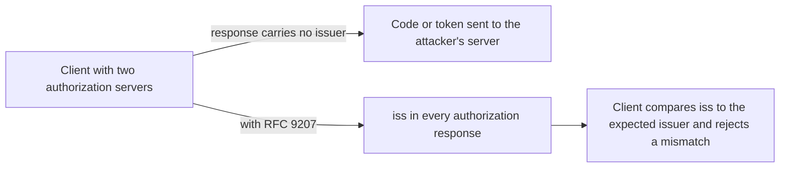
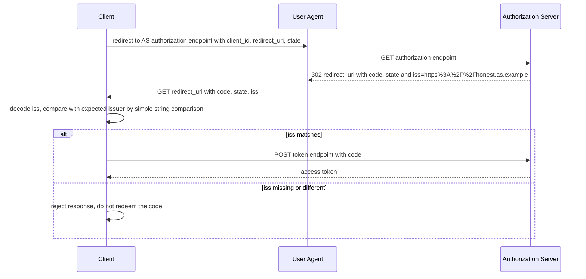

# Authorization Server Issuer Identification

> In one line: the authorization server puts its own issuer identifier into every authorization response as `iss`, so a client that talks to more than one server can tell which one actually answered.

## When you reach for it

- **A client registered with several authorization servers, one of which turns hostile**: without `iss`, an attacker-controlled server can trick the client into sending an authorization code or access token meant for an honest server to the attacker (Section 1).
- **A single-server client that is about to add a second server**: the spec says single-server clients are not affected, but become vulnerable the moment a second server is configured, so the check should be in place before that day (Sections 1, 4).
- **A client that discovers servers through RFC 8414 metadata**: `iss` must equal the `issuer` in the metadata document, so the client compares the response against the metadata it already trusts (Sections 2.3, 2.4).
- **A client receiving an error redirect**: `iss` is also present on error responses, so the client can tell whether `error=access_denied` really came from the server it sent the user to (Sections 2, 2.2, 2.4).

## The problem it solves

An RFC 6749 authorization response arrives through the user agent and carries `code` and `state`, but nothing that says which authorization server produced it. A client configured for more than one server therefore cannot be sure where the response came from. In a mix-up attack, one of those servers is controlled by the attacker, who uses that uncertainty to make the client deliver a code or access token belonging to an honest server to the wrong token endpoint or resource server (Section 1).

The fix is a single response parameter. The authorization server includes `iss`, its issuer identifier as defined in RFC 8414, in the authorization response, and the client checks it against the issuer it expected (Sections 1, 2).

## How it works

The server adds `iss` to the redirect, including on error responses. Its value is an `https` URL with no query or fragment (Section 2). The client decodes it as form-encoded data and compares it to the issuer identifier of the server it sent the request to, using simple string comparison per RFC 3986 Section 6.2.1. If the server publishes RFC 8414 metadata, the comparison target is the `issuer` value from that document. On any mismatch the client rejects the response and does not continue the grant (Section 2.4). A server that supports the parameter advertises it with `authorization_response_iss_parameter_supported: true` in its metadata (Sections 2.3, 3).

## What the spec requires

- An authorization server that supports this spec MUST include `iss` in the authorization response, including error responses. The value MUST be an `https` URL without query or fragment (Section 2).
- A server that publishes RFC 8414 metadata MUST use the same value for `issuer` and `iss`, and MUST set `authorization_response_iss_parameter_supported` to `true` (Section 2.3).
- A client that supports this spec MUST extract and decode `iss`, compare it to the expected issuer with simple string comparison, and on a mismatch MUST reject the response and MUST NOT proceed with the grant (Section 2.4).
- A client that uses both supporting and non-supporting servers MUST remember which servers support `iss`, MUST reject responses without `iss` from servers configured as supporting it, and SHOULD discard responses carrying `iss` from servers not marked as supporting it (Section 2.4).
- When an OpenID Connect ID Token is returned from the authorization endpoint, `iss` MUST be identical to the `iss` claim in that ID Token (Section 2.4).
- The metadata parameter `authorization_response_iss_parameter_supported` is a boolean and defaults to `false` when omitted (Section 3).

## Watch out

- **Two servers must never share an issuer identifier**: clients MUST NOT allow that, and with manual configuration each accepted `iss` value MUST be unique to one server (Section 4).
- **`iss` is not cryptographically protected**: the spec argues this is acceptable because an attacker who can tamper with the response already holds the code and does not need a mix-up (Section 4).
- **JARM and `code id_token` already carry an issuer**: when the issuer arrives another way and is checked as in Section 2.4, `iss` MAY be omitted. If a response contains more than one issuer identifier and they disagree, the client MUST reject it (Section 4).
- **Error responses are not trustworthy on their own**: a client MUST NOT assume an error response came from the intended server until `iss` is checked (Section 2.4).

## Sources

- [RFC 9207, Section 1](https://www.rfc-editor.org/rfc/rfc9207#section-1)
- [RFC 9207, Section 2](https://www.rfc-editor.org/rfc/rfc9207#section-2)
- [RFC 9207, Section 2.2](https://www.rfc-editor.org/rfc/rfc9207#section-2.2)
- [RFC 9207, Section 2.3](https://www.rfc-editor.org/rfc/rfc9207#section-2.3)
- [RFC 9207, Section 2.4](https://www.rfc-editor.org/rfc/rfc9207#section-2.4)
- [RFC 9207, Section 3](https://www.rfc-editor.org/rfc/rfc9207#section-3)
- [RFC 9207, Section 4](https://www.rfc-editor.org/rfc/rfc9207#section-4)
