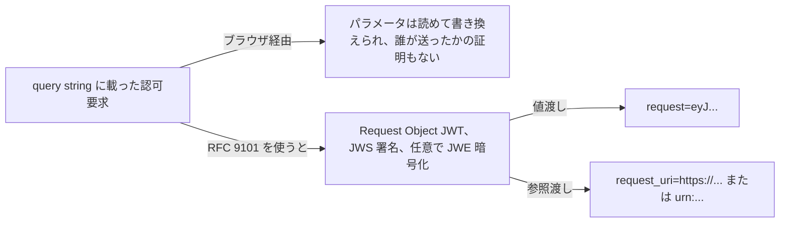
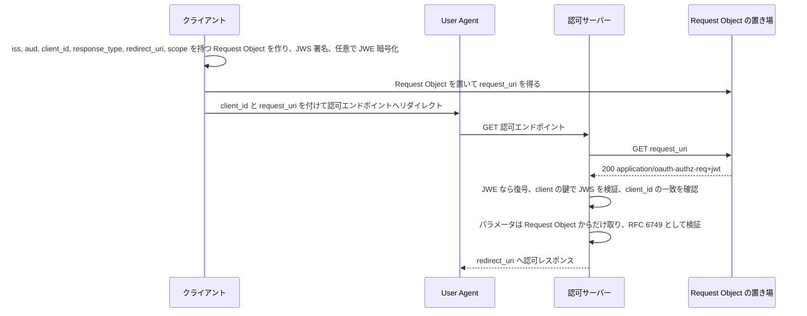

# JWT-Secured Authorization Request (JAR)

> 一言で言うと: client が認可要求全体を署名 (任意で暗号化) した JWT に詰め、`request` で渡すか `request_uri` で参照させることで、ブラウザを経由する途中で要求を改ざんも盗み見もできなくする。

## どういうときに使うか

- **認可要求が query string としてブラウザを通る**: TLS は user agent や中継装置で終端するので、パラメータは覗けるし書き換えられる。要求を JWT として署名すれば完全性と送信元認証が得られる (Section 1)。
- **user agent に見せたくない scope や claims、拡張パラメータがある**: Request Object を JWE で暗号化すれば、TLS の終端より先でも機密性が保たれる (Section 1, 11.2.1)。
- **要求が URL に収まらない、または client がアプリ層の暗号処理を持ちたくない**: `request_uri` で参照渡しにする。URI はサーバーや信頼できる第三者が発行していてもよい (Section 1, 5.2, 5.2.1)。
- **素の RFC 6749 要求を拒否しなければならない配備**: client または server metadata の `require_signed_request_object` を使うと、サーバーは未署名の要求と `alg: none` を拒否し、ダウングレード経路を塞げる (Section 10.5)。

## 解決する問題

RFC 6749 では client が認可要求を URL の query パラメータとして組み立て、user agent を認可エンドポイントへ送る。TLS が守るのはブラウザまでの区間で、ブラウザ内や終端する proxy で何が起きるかは守れない。認可サーバーには完全性の保証も、どの client が要求を作ったかの証明も、内容の機密性もなく、redirect URI の書き換えのような攻撃が可能になる (Section 1)。

RFC 9101 はパラメータを JWT (Request Object) に移す。JWS が完全性と送信元認証を、JWE が機密性を与える。オブジェクトは `request` パラメータにそのまま入れるか、`request_uri` で参照させる (Section 1, 2.1, 2.2)。

## 仕組み

Request Object は、claims が認可要求パラメータそのものの JWT。`request` と `request_uri` 以外の、サーバーが処理に必要とする全てを含む。署名する場合は `iss` と `aud` を持つべきで、`aud` はサーバーの issuer identifier。署名と暗号化の両方を使うなら、先に署名し、次に暗号化した Nested JWT にする。media type は `application/oauth-authz-req+jwt` (Section 4)。client は `client_id` と、`request` か `request_uri` のどちらかを送る (Section 5)。`request_uri` の場合、サーバーは別の安全な手段で取得できるのでなければ HTTP GET で取りに行く (Section 5.2.3)。その後、復号し (Section 6.1)、client に紐づく鍵で署名を検証し (Section 6.2)、Request Object からだけパラメータを組み立てる (Section 6.3)。

## 仕様が求めること

- Request Object は `request` と `request_uri` 以外の、処理に必要な全パラメータを含まなければならず、その 2 つを含んではならない。署名と暗号化を併用するなら、署名してから暗号化しなければならない (Section 4)。
- `client_id` は要求に必須で、Request Object 内の `client_id` と一致しなければならない。オブジェクトは JWS 署名、または JWS 署名の上に JWE 暗号化されていなければならない。query に重複したパラメータがあっても、サーバーはオブジェクト内の値だけを使わなければならない (Section 5, 6.3)。
- `request` と `request_uri` は排他 (Section 5)。client が用意した `request_uri` は `https` でなければならず、サーバーが発行したものは URN でなければならない。Request URI は 512 ASCII 文字を超えるべきでない (Section 5.2)。
- 公開取得できる Request Object URI は、有効期間中に推測されないだけのエントロピーを持たなければならない (Section 5.2.1)。
- サーバーは client に紐づく鍵で JWS 署名を検証し、RFC 8725 のアルゴリズム検査に従わなければならない。鍵が client のものでないか検証に失敗したら `invalid_request_object` を返さなければならない。JWE の復号失敗も `invalid_request_object` (Section 6.1, 6.2)。
- 新しいエラー値: `invalid_request_uri`、`invalid_request_object`、`request_not_supported`、`request_uri_not_supported` (Section 7)。

## 注意点

- **送信元は毎回検証する**: JWS 署名か対称鍵の JWE が送信者を証明する。公開鍵暗号だけでは証明にならず、`request_uri` のホストの TLS identity も一般に信頼できない (Section 10.2)。
- **`request_uri` は DoS と書き換えの経路**: 値そのものは署名されていないので、man-in-the-browser が別の場所を指させられる。期待する場所を指しているか、応答の media type、取得のタイムアウトを確認し、再帰的に取りに行かない (Section 10.4.1, 10.4.2)。
- **素の OAuth へのダウングレード**: `require_signed_request_object` を設定しない限り、攻撃者は RFC 6749 の要求をそのまま送れる。設定すればサーバーは非準拠の要求と `alg: none` を拒否しなければならない (Section 10.5)。
- **Cross-JWT confusion**: client ID を `sub` に使わない、Request Object 用の署名鍵を他の用途と分ける、新しいプロファイルでは `typ` に `oauth-authz-req+jwt` を明示する (Section 10.8)。
- **Request Object は漏れるし追跡に使える**: 機微なパラメータは JWE で暗号化し、個人データを運ぶ `request_uri` は単回使用かつ短命にし、ユーザーごとに固定の URI は避ける (Section 11.2.1, 11.2.2)。

## 出典

- [RFC 9101, Section 1](https://www.rfc-editor.org/rfc/rfc9101#section-1)
- [RFC 9101, Section 2.1](https://www.rfc-editor.org/rfc/rfc9101#section-2.1)
- [RFC 9101, Section 2.2](https://www.rfc-editor.org/rfc/rfc9101#section-2.2)
- [RFC 9101, Section 4](https://www.rfc-editor.org/rfc/rfc9101#section-4)
- [RFC 9101, Section 5](https://www.rfc-editor.org/rfc/rfc9101#section-5)
- [RFC 9101, Section 5.2](https://www.rfc-editor.org/rfc/rfc9101#section-5.2)
- [RFC 9101, Section 5.2.1](https://www.rfc-editor.org/rfc/rfc9101#section-5.2.1)
- [RFC 9101, Section 5.2.3](https://www.rfc-editor.org/rfc/rfc9101#section-5.2.3)
- [RFC 9101, Section 6.1](https://www.rfc-editor.org/rfc/rfc9101#section-6.1)
- [RFC 9101, Section 6.2](https://www.rfc-editor.org/rfc/rfc9101#section-6.2)
- [RFC 9101, Section 6.3](https://www.rfc-editor.org/rfc/rfc9101#section-6.3)
- [RFC 9101, Section 7](https://www.rfc-editor.org/rfc/rfc9101#section-7)
- [RFC 9101, Section 10.2](https://www.rfc-editor.org/rfc/rfc9101#section-10.2)
- [RFC 9101, Section 10.4.1](https://www.rfc-editor.org/rfc/rfc9101#section-10.4.1)
- [RFC 9101, Section 10.4.2](https://www.rfc-editor.org/rfc/rfc9101#section-10.4.2)
- [RFC 9101, Section 10.5](https://www.rfc-editor.org/rfc/rfc9101#section-10.5)
- [RFC 9101, Section 10.8](https://www.rfc-editor.org/rfc/rfc9101#section-10.8)
- [RFC 9101, Section 11.2.1](https://www.rfc-editor.org/rfc/rfc9101#section-11.2.1)
- [RFC 9101, Section 11.2.2](https://www.rfc-editor.org/rfc/rfc9101#section-11.2.2)
