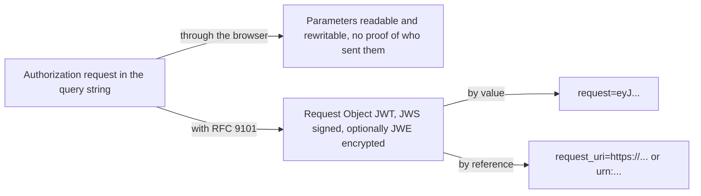
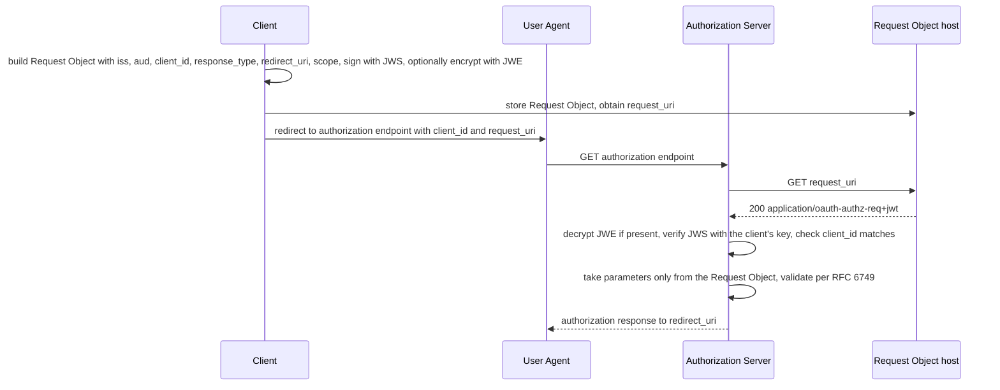

# JWT-Secured Authorization Request (JAR)

> In one line: the client packs the whole authorization request into a signed, optionally encrypted JWT and sends it as `request` or points to it with `request_uri`, so the request cannot be altered or read on its way through the browser.

## When you reach for it

- **An authorization request that travels through the browser as a query string**: TLS ends at the user agent or a middlebox, so the parameters can be observed and rewritten. Signing the request as a JWT gives it integrity and source authentication (Section 1).
- **Scopes, claims or extension parameters the user agent should not see**: encrypting the Request Object with JWE keeps them confidential beyond the TLS endpoints (Sections 1, 11.2.1).
- **A request too large for a URL, or a client that wants no application-layer crypto of its own**: pass by reference with `request_uri`, which a server or trusted third party may have issued (Sections 1, 5.2, 5.2.1).
- **A deployment that must refuse plain RFC 6749 requests**: `require_signed_request_object` in client or server metadata makes the server reject unsigned requests and `alg: none`, closing the downgrade path (Section 10.5).

## The problem it solves

In RFC 6749 the client builds the authorization request as URL query parameters and sends the user agent to the authorization endpoint. TLS protects the hop to the browser, but not what happens inside it or at a terminating proxy. The authorization server gets no integrity protection, no proof of which client authored the request, and no confidentiality for its contents, which enables attacks such as redirect URI rewriting (Section 1).

RFC 9101 moves the parameters into a JWT, the Request Object. JWS gives integrity and source authentication; JWE adds confidentiality. The object goes either inline in the `request` parameter or by reference through `request_uri` (Sections 1, 2.1, 2.2).

## How it works

The Request Object is a JWT whose claims are the authorization request parameters, everything the server needs except `request` and `request_uri` themselves. When signed it should carry `iss` and `aud`, with `aud` set to the server's issuer identifier. If both signing and encryption are applied, the JWT is signed first and then encrypted as a Nested JWT. The media type is `application/oauth-authz-req+jwt` (Section 4). The client sends `client_id` plus either `request` or `request_uri` (Section 5). For `request_uri`, the server fetches the object with HTTP GET unless it can retrieve it securely another way (Section 5.2.3). It then decrypts (Section 6.1), validates the signature with a key associated with the client (Section 6.2), and assembles parameters only from the Request Object (Section 6.3).

## What the spec requires

- The Request Object MUST contain all parameters needed to process the request except `request` and `request_uri`, and MUST NOT contain those two. When both signing and encryption are used it MUST be signed first, then encrypted (Section 4).
- `client_id` MUST be present in the request and MUST match the `client_id` inside the Request Object. The object MUST be JWS-signed, or JWS-signed and JWE-encrypted. The server MUST use only the parameters in the object, even if duplicates appear in the query (Sections 5, 6.3).
- `request` and `request_uri` are mutually exclusive (Section 5). A client-supplied `request_uri` MUST be `https`; a server-issued one MUST be a URN. The Request URI SHOULD NOT exceed 512 ASCII characters (Section 5.2).
- A publicly retrievable Request Object URI MUST have enough entropy for its lifetime to be unguessable (Section 5.2.1).
- The server MUST validate the JWS signature with a key associated with the client, following RFC 8725 algorithm checks, and MUST return `invalid_request_object` when the key is not the client's or validation fails. A JWE decryption failure also yields `invalid_request_object` (Sections 6.1, 6.2).
- New error values: `invalid_request_uri`, `invalid_request_object`, `request_not_supported`, `request_uri_not_supported` (Section 7).

## Watch out

- **Verify the source every time**: a JWS signature or a symmetric JWE key proves the sender. Public-key encryption alone does not, and the TLS identity of a `request_uri` host is generally unreliable (Section 10.2).
- **`request_uri` is a DoS and rewrite vector**: the value itself is unsigned, so a man-in-the-browser can point it elsewhere. Check that it targets an expected location, check the response media type, enforce a fetch timeout, and never fetch recursively (Sections 10.4.1, 10.4.2).
- **Downgrade to plain OAuth**: unless `require_signed_request_object` is set, an attacker can simply send an RFC 6749 request. With it set, the server MUST reject non-conforming requests and `alg: none` (Section 10.5).
- **Cross-JWT confusion**: never use the client ID as `sub`, use distinct signing keys for Request Objects, and prefer an explicit `typ` of `oauth-authz-req+jwt` in new profiles (Section 10.8).
- **Request Objects can leak and track**: encrypt sensitive parameters with JWE, make a `request_uri` carrying personal data single-use and short-lived, and avoid persistent per-user URIs (Sections 11.2.1, 11.2.2).

## Sources

- [RFC 9101, Section 1](https://www.rfc-editor.org/rfc/rfc9101#section-1)
- [RFC 9101, Section 2.1](https://www.rfc-editor.org/rfc/rfc9101#section-2.1)
- [RFC 9101, Section 2.2](https://www.rfc-editor.org/rfc/rfc9101#section-2.2)
- [RFC 9101, Section 4](https://www.rfc-editor.org/rfc/rfc9101#section-4)
- [RFC 9101, Section 5](https://www.rfc-editor.org/rfc/rfc9101#section-5)
- [RFC 9101, Section 5.2](https://www.rfc-editor.org/rfc/rfc9101#section-5.2)
- [RFC 9101, Section 5.2.1](https://www.rfc-editor.org/rfc/rfc9101#section-5.2.1)
- [RFC 9101, Section 5.2.3](https://www.rfc-editor.org/rfc/rfc9101#section-5.2.3)
- [RFC 9101, Section 6.1](https://www.rfc-editor.org/rfc/rfc9101#section-6.1)
- [RFC 9101, Section 6.2](https://www.rfc-editor.org/rfc/rfc9101#section-6.2)
- [RFC 9101, Section 6.3](https://www.rfc-editor.org/rfc/rfc9101#section-6.3)
- [RFC 9101, Section 7](https://www.rfc-editor.org/rfc/rfc9101#section-7)
- [RFC 9101, Section 10.2](https://www.rfc-editor.org/rfc/rfc9101#section-10.2)
- [RFC 9101, Section 10.4.1](https://www.rfc-editor.org/rfc/rfc9101#section-10.4.1)
- [RFC 9101, Section 10.4.2](https://www.rfc-editor.org/rfc/rfc9101#section-10.4.2)
- [RFC 9101, Section 10.5](https://www.rfc-editor.org/rfc/rfc9101#section-10.5)
- [RFC 9101, Section 10.8](https://www.rfc-editor.org/rfc/rfc9101#section-10.8)
- [RFC 9101, Section 11.2.1](https://www.rfc-editor.org/rfc/rfc9101#section-11.2.1)
- [RFC 9101, Section 11.2.2](https://www.rfc-editor.org/rfc/rfc9101#section-11.2.2)
