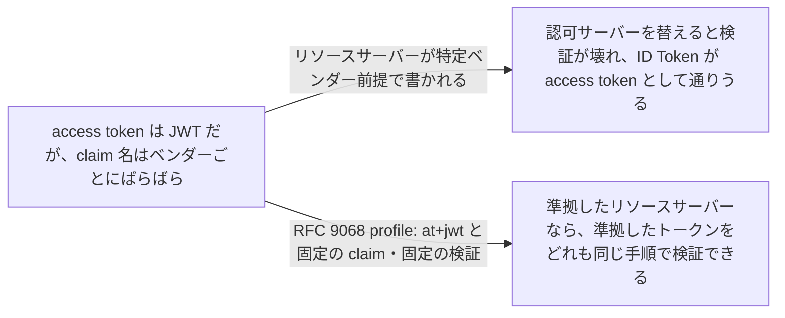
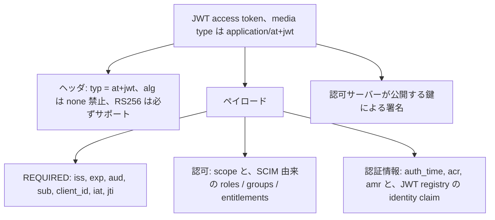

# JWT Access Token Profile (RFC 9068)

> 一言で言うと: 認可サーバーが access token を JWT で発行するときの、ヘッダ・claim・検証手順の共通形。どのリソースサーバーもこれを前提にできる。

## どういうときに使うか

- **認可サーバーとリソースサーバーのベンダーが違う**: 両者が同じ構成 (`typ` は `at+jwt`、`iss`、`aud`、`sub`、`client_id`、`exp`、`jti`) に従うので、リソースサーバーはベンダー固有のコードなしでトークンを検証できる (Abstract、Section 1)。
- **ID Token を access token として受け付けてはいけない**: 明示的な型 `at+jwt` があるので、access token 以外は拒否でき、cross-JWT confusion を塞げる (Section 2.1、5)。
- **1 つの認可サーバーが複数の API を守る**: `resource` パラメータが `aud` になり、API ごとに別の audience 値が付くので、ある API 向けのトークンは別の API で通らない (Section 3、5)。
- **UserInfo を呼ばずにユーザー属性やロールが欲しい**: identity claim と、SCIM の名前を使った `roles`、`groups`、`entitlements` をトークンに載せられる (Section 2.2.2、2.2.3.1)。

## 解決する問題

OAuth 2.0 は access token の形式を定めていない。それでもベンダー各社は JWT の access token を作り、claim は似て非なるものになった。その結果、ある認可サーバーのトークンを検証できるリソースサーバーが、別の認可サーバーのトークンは検証できない (Section 1)。認可サーバーとリソースサーバーの運用者が別のとき、これが一番効いてくる。

この profile は、ヘッダ、claim の集合、認可リクエストのパラメータがトークンにどう反映されるか、リソースサーバーが何を検査するかを標準化する。トークン専用の media type も定めるので、同じ発行者の ID Token やその他の JWT が access token として紛れ込めない。

## 仕組み

ヘッダは `typ` に `at+jwt` を持ち、トークンは署名必須で、`none` は禁止、`RS256` はサポートするアルゴリズムに含めなければならない (Section 2.1)。ペイロードには常に `iss`、`exp`、`aud`、`sub`、`client_id`、`iat`、`jti` が入る (Section 2.2)。`sub` はユーザーが関わるなら resource owner で、client credentials のようにユーザーのいない grant ではサーバーがクライアントを指すのに使う識別子にすべきである (Section 2.2)。`auth_time`、`acr`、`amr` を足してユーザーが行った認証を記述してもよい (Section 2.2.1)。リクエストに `scope` があったなら、トークンにも `scope` claim を載せるべきで、その scope 文字列はすべて `aud` のリソースにとって意味を持たなければならない (Section 2.2.3)。ロール・グループ・entitlement は SCIM の属性名をそのまま claim 名にする (Section 2.2.3.1)。リクエスト側では `resource` パラメータが `aud` の値になり、なければサーバーが既定の resource indicator を選ばなければならず、通常は scope から推定する (Section 3)。

## 仕様が求めること

- JWT access token は `typ` に media type `at+jwt` を含み (MUST)、署名され (MUST)、`none` を使わず (MUST NOT)、認可サーバーとリソースサーバーの両方が `RS256` をサポートしなければならない (MUST) (Section 2.1)。
- `iss`、`exp`、`aud`、`sub`、`client_id`、`iat`、`jti` は REQUIRED (Section 2.2)。
- 認可サーバーは、付与される認可がリソース間で曖昧になるトークンを発行してはならず (MUST NOT)、scope が別々の既定リソースを指すなら `invalid_scope` でリクエストを拒否すべきである (SHOULD) (Section 3)。
- リソースサーバーは、`typ` が `at+jwt` か `application/at+jwt` であること、`iss` が完全一致すること、`aud` に自分の resource indicator があること、認可サーバーの鍵で署名が検証でき `none` でないこと、現在時刻が `exp` より前であることを確認しなければならない (MUST) (Section 4)。
- 検証に失敗したら RFC 6750 に従って `invalid_token` で応答しなければならない (MUST) (Section 4)。
- クライアントは access token の中身を覗いてはならない (MUST NOT) (Section 6)。

## 注意点

- リソースごとに別の `aud` 値が要る。認可サーバーはリソースごとに異なる識別子を使わなければならず (MUST)、これであるリソース向けのトークンを別のリソースで再生できなくなる (Section 5)。
- 認可サーバーは、クライアントが `sub` に影響できる状況を防ぐべきである。`client_id` を `sub` に使うなら、ユーザー識別子と衝突する任意の `client_id` をクライアントが登録できないようにすべきである (Section 5)。
- ID Token と access token で署名鍵を分けても鍵漏洩の対策にはならない。リソースサーバーは認可サーバーが公開するどの鍵でも受け入れるからで、防御になるのは明示的な型付けである (Section 5)。
- トークン内の認可 claim は判断材料であって判断そのものではない。リソースサーバーは呼び出しを認可する前に、他の文脈情報と組み合わせるべきである (SHOULD) (Section 4)。
- claim はトークンを持つ誰からも読める。リソースサーバーがそれを読む正当性がないなら、トークンや機微な claim を暗号化する、載せない、不透明なトークンを使う (Section 6)。

## 出典

- [RFC 9068, Abstract](https://www.rfc-editor.org/rfc/rfc9068.html#abstract)
- [RFC 9068, Section 1](https://www.rfc-editor.org/rfc/rfc9068.html#section-1)
- [RFC 9068, Section 2.1](https://www.rfc-editor.org/rfc/rfc9068.html#section-2.1)
- [RFC 9068, Section 2.2](https://www.rfc-editor.org/rfc/rfc9068.html#section-2.2)
- [RFC 9068, Section 2.2.1](https://www.rfc-editor.org/rfc/rfc9068.html#section-2.2.1)
- [RFC 9068, Section 2.2.2](https://www.rfc-editor.org/rfc/rfc9068.html#section-2.2.2)
- [RFC 9068, Section 2.2.3](https://www.rfc-editor.org/rfc/rfc9068.html#section-2.2.3)
- [RFC 9068, Section 2.2.3.1](https://www.rfc-editor.org/rfc/rfc9068.html#section-2.2.3.1)
- [RFC 9068, Section 3](https://www.rfc-editor.org/rfc/rfc9068.html#section-3)
- [RFC 9068, Section 4](https://www.rfc-editor.org/rfc/rfc9068.html#section-4)
- [RFC 9068, Section 5](https://www.rfc-editor.org/rfc/rfc9068.html#section-5)
- [RFC 9068, Section 6](https://www.rfc-editor.org/rfc/rfc9068.html#section-6)
