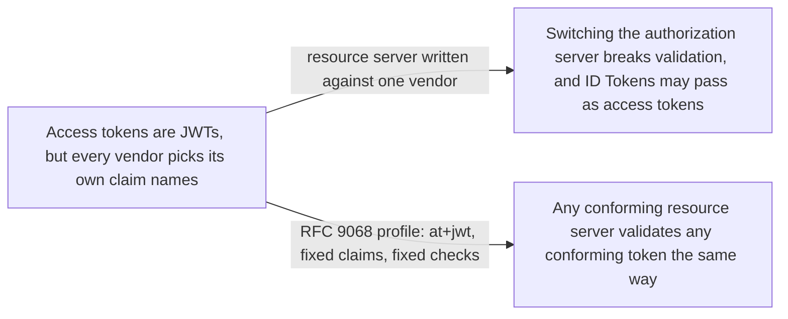
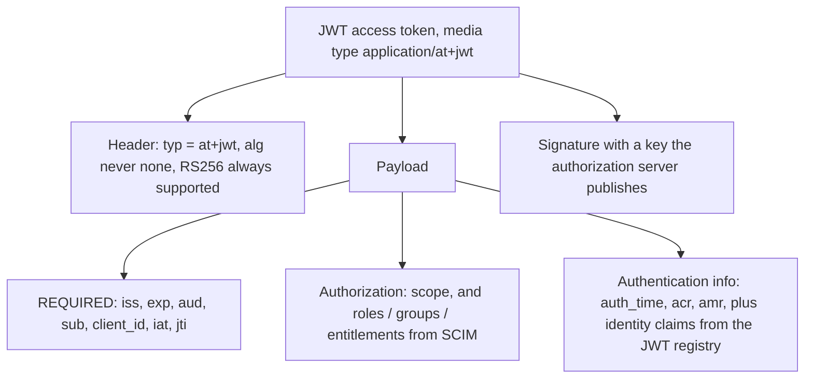

# JWT Access Token Profile (RFC 9068)

> In one line: when an authorization server issues access tokens as JWTs, this is the header, the claims and the validation steps every resource server can rely on.

## When you reach for it

- **Authorization server and resource server come from different vendors**: both sides follow one layout (`typ` of `at+jwt`, `iss`, `aud`, `sub`, `client_id`, `exp`, `jti`), so the resource server validates tokens without vendor-specific code (Abstract, Section 1).
- **A resource server must not accept an ID Token as an access token**: the explicit `at+jwt` type lets it reject anything that is not an access token, which closes cross-JWT confusion (Sections 2.1, 5).
- **One authorization server protects several APIs**: the `resource` parameter maps to `aud`, each API gets a distinct audience value, and a token for one API fails at another (Sections 3, 5).
- **The resource server needs user attributes or roles without a UserInfo call**: identity claims and SCIM-named `roles`, `groups` and `entitlements` can be carried in the token (Sections 2.2.2, 2.2.3.1).

## The problem it solves

OAuth 2.0 never defined an access token format. Vendors built JWT access tokens anyway, each with similar but not identical claims, so a resource server validating tokens from one authorization server could not validate tokens from another (Section 1). This matters most when the authorization server and the resource server are run by different parties.

The profile standardizes the header, the claim set, how authorization request parameters shape the token, and what the resource server checks. It also gives the token its own media type, so an ID Token or any other JWT from the same issuer cannot slip through as an access token.

## How it works

The header carries `typ` of `at+jwt` and the token must be signed; `none` is prohibited and `RS256` must be among the supported algorithms (Section 2.1). The payload always holds `iss`, `exp`, `aud`, `sub`, `client_id`, `iat` and `jti` (Section 2.2). `sub` is the resource owner when a user is involved, and for grants with no user, such as client credentials, it should be an identifier the server uses for the client (Section 2.2). `auth_time`, `acr` and `amr` may be added to describe the authentication the user performed (Section 2.2.1). When the request carried a `scope`, the token should carry a `scope` claim, and every scope string must have meaning for the resources in `aud` (Section 2.2.3). Roles, groups and entitlements use the SCIM attribute names as claim names (Section 2.2.3.1). On the request side, a `resource` parameter becomes the `aud` value; without it, the server must choose a default resource indicator, usually inferred from the scopes (Section 3).

## What the spec requires

- JWT access tokens MUST include the `at+jwt` media type in `typ`, MUST be signed, MUST NOT use `none`, and both authorization servers and resource servers MUST support `RS256` (Section 2.1).
- `iss`, `exp`, `aud`, `sub`, `client_id`, `iat` and `jti` are REQUIRED (Section 2.2).
- The authorization server MUST NOT issue a token whose granted authorization would be ambiguous across resources, and SHOULD reject the request with `invalid_scope` when scopes point to different default resources (Section 3).
- A resource server MUST verify `typ` is `at+jwt` or `application/at+jwt`, MUST exactly match `iss`, MUST find its own resource indicator in `aud`, MUST validate the signature with the authorization server's keys and reject `none`, and MUST confirm the current time is before `exp` (Section 4).
- Validation failures MUST be reported as `invalid_token` following RFC 6750 (Section 4).
- The client MUST NOT inspect the content of the access token (Section 6).

## Watch out

- Each resource must get a distinct `aud` value; an authorization server MUST use a distinct identifier per resource so a token for one cannot be replayed at another (Section 5).
- Authorization servers should prevent clients from affecting `sub`. If `client_id` is used as `sub`, the server should prevent clients from registering arbitrary `client_id` values that collide with user identifiers (Section 5).
- Using different signing keys for ID Tokens and access tokens does not protect against key leakage, because the resource server accepts any key the authorization server publishes. Explicit typing is the defence (Section 5).
- The authorization claims in the token are inputs, not the decision: the resource server SHOULD combine them with other contextual information before authorizing a call (Section 4).
- The claims are readable by anyone holding the token. Encrypt the token or sensitive claims, omit them, or use opaque tokens when the resource server's access to them is not justified (Section 6).

## Sources

- [RFC 9068, Abstract](https://www.rfc-editor.org/rfc/rfc9068.html#abstract)
- [RFC 9068, Section 1](https://www.rfc-editor.org/rfc/rfc9068.html#section-1)
- [RFC 9068, Section 2.1](https://www.rfc-editor.org/rfc/rfc9068.html#section-2.1)
- [RFC 9068, Section 2.2](https://www.rfc-editor.org/rfc/rfc9068.html#section-2.2)
- [RFC 9068, Section 2.2.1](https://www.rfc-editor.org/rfc/rfc9068.html#section-2.2.1)
- [RFC 9068, Section 2.2.2](https://www.rfc-editor.org/rfc/rfc9068.html#section-2.2.2)
- [RFC 9068, Section 2.2.3](https://www.rfc-editor.org/rfc/rfc9068.html#section-2.2.3)
- [RFC 9068, Section 2.2.3.1](https://www.rfc-editor.org/rfc/rfc9068.html#section-2.2.3.1)
- [RFC 9068, Section 3](https://www.rfc-editor.org/rfc/rfc9068.html#section-3)
- [RFC 9068, Section 4](https://www.rfc-editor.org/rfc/rfc9068.html#section-4)
- [RFC 9068, Section 5](https://www.rfc-editor.org/rfc/rfc9068.html#section-5)
- [RFC 9068, Section 6](https://www.rfc-editor.org/rfc/rfc9068.html#section-6)
