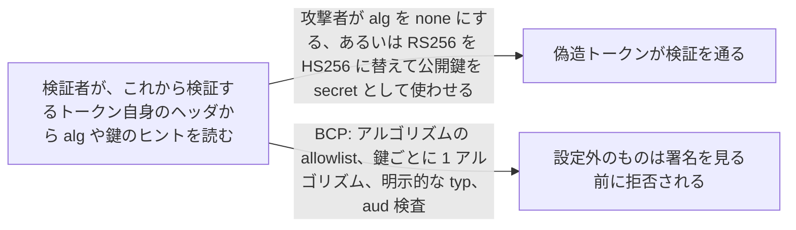
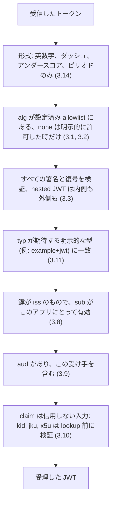

# JWT Best Current Practices (bis)

> 一言で言うと: JWT を作る・検証する・仕様に組み込む人のためのチェックリスト。RFC 8725 以降に見つかった攻撃とそれぞれの対策を集め、RFC 8725 を置き換える。

## どういうときに使うか

- **JWT ライブラリを選ぶ・設定する**: アルゴリズムの制限、頼まれない限り `none` を拒むこと、署名付き・暗号化・unsecured を区別できることなど、ライブラリが提供しなければならないものがこの draft に書いてある (Section 3.1、3.2、3.3)。
- **1 つの発行者が何種類もの JWT を発行する**: 明示的な `typ`、別の鍵、別の claim、別々の `aud` のどれかで種類を見分けない限り、ある用途向けに発行したトークンを別の用途に提示できてしまう (Section 2.8、3.11、3.12)。
- **リソースサーバーが `kid`、`jku`、`x5u` から鍵を引く**: これらのヘッダ値は攻撃者が制御できる入力で、検証しなければ injection や server-side request forgery の入口になる (Section 2.9、3.10)。
- **外部からの JWE を受け付ける**: 巨大な `p2c` 回数や decompression bomb は DoS の道具になるので、上限を設けよと draft は言う (Section 2.10、2.12、3.13、3.15)。

## 解決する問題

JWT の検証コードは、トークン自身のヘッダを読んで検証方法を決める。古典的な攻撃の根はそこにある。`alg` を `none` に変えれば署名検査が消え、`RS256` を `HS256` に変えれば検証者は発行者の公開鍵を HMAC の secret として使う (Section 2.1)。`none` の blocklist が大文字小文字を区別しないと `noNE` が通る (Section 2.11)。ある受け手・ある用途向けのトークンが別の受け手に受理される (Section 2.7、2.8)。JSON serialization の JWS を検証しておきながら、claim は compact 形式とみなして文字列を分割して取り出すアプリケーションは、偽造したペイロードを渡されうる (Section 2.13)。

この文書はそれらの脅威を集め、それぞれを塞ぐ practice を名指しする。RFC 7519 を更新し、承認されれば RFC 8725 を廃止して、RFC 8725 の公開以降に見つかった攻撃への推奨を足し、Unsecured JWT の使い方を制限する (Abstract、Section 1)。読者はライブラリの実装者、ライブラリを使う開発者、JWT の上に仕様を作る人だ (Section 1.1)。

## 仕組み

practice はパイプラインをなす。まず文字列がそもそも compact な JWT かを確認する (Section 3.14)。次にアルゴリズムをアプリケーションが設定した集合と照合する。ヘッダだけを根拠にしてはならず、各鍵はちょうど 1 つのアルゴリズムに束縛する (Section 3.1)。`none` は呼び出し側が明示的に頼んだときだけ生成・消費する (Section 3.2)。すべての暗号操作を検証し、1 つでも失敗したらトークン全体を拒否する (Section 3.3)。`application/example+jwt` のような登録済み media type と `example+jwt` という `typ` による明示的な型付けで、検証者は種類違いのトークンを拒否できる (Section 3.11)。issuer、subject、audience をこのアプリケーションが期待する値と照合する (Section 3.8、3.9)。そこまで済んで初めて残りの claim を使うが、それでも攻撃者が制御したデータとして扱う (Section 3.10)。

## 仕様が求めること

- ライブラリは、許可するアルゴリズムの集合を明示的に制限する仕組みを提供しなければならず (MUST)、その集合外のアルゴリズムを使ってはならない (MUST NOT)。各鍵はちょうど 1 つのアルゴリズムと組で使わなければならない (MUST) (Section 3.1)。
- ライブラリは、呼び出し側が明示的に要求しない限り `none` の JWT を生成してはならず (MUST NOT)、明示的に許可しない限り消費してはならない (MUST NOT) (Section 3.2)。
- すべての暗号操作を検証し、1 つでも失敗したら JWT 全体を拒否しなければならない (MUST)。nested JWT では外側と内側の両方を検証しなければならない (MUST)。ライブラリは受け手が unsecured・署名付き・暗号化・nested の JWT を区別できるようにしなければならない (MUST) (Section 3.3)。
- `iss` があるなら、アプリケーションは使われた鍵がその issuer のものであることを検証しなければならず (MUST)、`sub` は有効な subject に対応していなければならない (MUST)。そうでなければ JWT を拒否する (Section 3.8)。
- 発行者が複数の relying party に向けて発行するなら JWT は `aud` を含まなければならず (MUST)、受け手はそれを検証し (MUST)、一致しなければ拒否しなければならない (MUST) (Section 3.9)。
- 同じ発行者の異なる種類の JWT に対する検証規則は互いに排他的でなければならず (MUST)、種類違いの JWT は拒否される (Section 3.12)。
- 実装はパース中に JWT が正しい形式であることを確認しなければならない (MUST)。他の文字、特に波括弧や引用符を含む内容は JWT ではなく、拒否しなければならない (MUST) (Section 3.14)。

## 注意点

- `typ` の値 `JWT` は有効な明示的型付けにならない。固有の media type を使う (Section 3.11)。
- `kid` は鍵の lookup に使われるので、SQL や LDAP の injection を起こさないことをアプリケーションが保証しなければならない (MUST)。`jku` と `x5u` は allowlist で守り、allowlist がなければホスト名の解決先を確認し (MUST)、loopback やローカルアドレスへは要求しない (Section 3.10)。
- 人が覚えられるパスワードを HMAC 鍵として直接使ってはならない。パスワードの出番は鍵の暗号化だけ (Section 2.2、3.5)。
- PBES2 の `p2c` が OWASP 推奨 600,000 回の 2 倍を超えるものは拒否することが推奨され (RECOMMENDED)、JWE の展開後サイズに上限を設けることも推奨される (RECOMMENDED)。実装の上限は数百 KB 程度 (Section 3.13、3.15)。
- 暗号化の入力を圧縮するのは避けるべきである。暗号文の長さが平文の情報を漏らす (Section 2.4、3.6)。

## 出典

- [draft-ietf-oauth-rfc8725bis, Abstract](https://datatracker.ietf.org/doc/html/draft-ietf-oauth-rfc8725bis#abstract)
- [draft-ietf-oauth-rfc8725bis, Section 1](https://datatracker.ietf.org/doc/html/draft-ietf-oauth-rfc8725bis#section-1)
- [draft-ietf-oauth-rfc8725bis, Section 1.1](https://datatracker.ietf.org/doc/html/draft-ietf-oauth-rfc8725bis#section-1.1)
- [draft-ietf-oauth-rfc8725bis, Section 2.1](https://datatracker.ietf.org/doc/html/draft-ietf-oauth-rfc8725bis#section-2.1)
- [draft-ietf-oauth-rfc8725bis, Section 2.2](https://datatracker.ietf.org/doc/html/draft-ietf-oauth-rfc8725bis#section-2.2)
- [draft-ietf-oauth-rfc8725bis, Section 2.4](https://datatracker.ietf.org/doc/html/draft-ietf-oauth-rfc8725bis#section-2.4)
- [draft-ietf-oauth-rfc8725bis, Section 2.7](https://datatracker.ietf.org/doc/html/draft-ietf-oauth-rfc8725bis#section-2.7)
- [draft-ietf-oauth-rfc8725bis, Section 2.8](https://datatracker.ietf.org/doc/html/draft-ietf-oauth-rfc8725bis#section-2.8)
- [draft-ietf-oauth-rfc8725bis, Section 2.9](https://datatracker.ietf.org/doc/html/draft-ietf-oauth-rfc8725bis#section-2.9)
- [draft-ietf-oauth-rfc8725bis, Section 2.10](https://datatracker.ietf.org/doc/html/draft-ietf-oauth-rfc8725bis#section-2.10)
- [draft-ietf-oauth-rfc8725bis, Section 2.11](https://datatracker.ietf.org/doc/html/draft-ietf-oauth-rfc8725bis#section-2.11)
- [draft-ietf-oauth-rfc8725bis, Section 2.12](https://datatracker.ietf.org/doc/html/draft-ietf-oauth-rfc8725bis#section-2.12)
- [draft-ietf-oauth-rfc8725bis, Section 2.13](https://datatracker.ietf.org/doc/html/draft-ietf-oauth-rfc8725bis#section-2.13)
- [draft-ietf-oauth-rfc8725bis, Section 3.1](https://datatracker.ietf.org/doc/html/draft-ietf-oauth-rfc8725bis#section-3.1)
- [draft-ietf-oauth-rfc8725bis, Section 3.2](https://datatracker.ietf.org/doc/html/draft-ietf-oauth-rfc8725bis#section-3.2)
- [draft-ietf-oauth-rfc8725bis, Section 3.3](https://datatracker.ietf.org/doc/html/draft-ietf-oauth-rfc8725bis#section-3.3)
- [draft-ietf-oauth-rfc8725bis, Section 3.5](https://datatracker.ietf.org/doc/html/draft-ietf-oauth-rfc8725bis#section-3.5)
- [draft-ietf-oauth-rfc8725bis, Section 3.6](https://datatracker.ietf.org/doc/html/draft-ietf-oauth-rfc8725bis#section-3.6)
- [draft-ietf-oauth-rfc8725bis, Section 3.8](https://datatracker.ietf.org/doc/html/draft-ietf-oauth-rfc8725bis#section-3.8)
- [draft-ietf-oauth-rfc8725bis, Section 3.9](https://datatracker.ietf.org/doc/html/draft-ietf-oauth-rfc8725bis#section-3.9)
- [draft-ietf-oauth-rfc8725bis, Section 3.10](https://datatracker.ietf.org/doc/html/draft-ietf-oauth-rfc8725bis#section-3.10)
- [draft-ietf-oauth-rfc8725bis, Section 3.11](https://datatracker.ietf.org/doc/html/draft-ietf-oauth-rfc8725bis#section-3.11)
- [draft-ietf-oauth-rfc8725bis, Section 3.12](https://datatracker.ietf.org/doc/html/draft-ietf-oauth-rfc8725bis#section-3.12)
- [draft-ietf-oauth-rfc8725bis, Section 3.13](https://datatracker.ietf.org/doc/html/draft-ietf-oauth-rfc8725bis#section-3.13)
- [draft-ietf-oauth-rfc8725bis, Section 3.14](https://datatracker.ietf.org/doc/html/draft-ietf-oauth-rfc8725bis#section-3.14)
- [draft-ietf-oauth-rfc8725bis, Section 3.15](https://datatracker.ietf.org/doc/html/draft-ietf-oauth-rfc8725bis#section-3.15)
