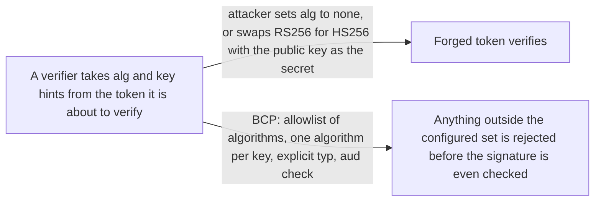
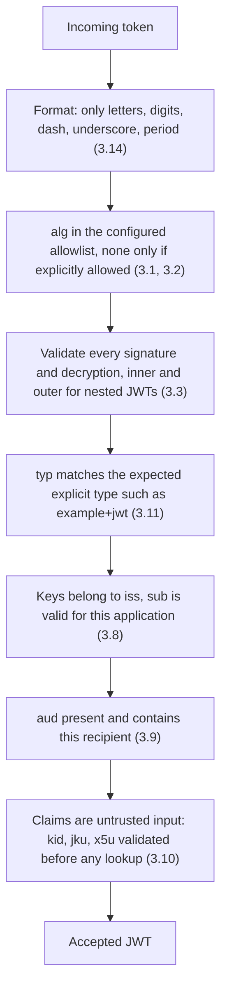

# JWT Best Current Practices (bis)

> In one line: the checklist for anyone producing, consuming or specifying JWTs, with the attacks seen since RFC 8725 and the defences for each, as a replacement for RFC 8725.

## When you reach for it

- **You are picking or configuring a JWT library**: the draft says what a library must let you do, such as restrict the algorithms, refuse `none` unless asked, and tell signed from encrypted from unsecured tokens (Sections 3.1, 3.2, 3.3).
- **One issuer produces more than one kind of JWT**: a token issued for one purpose can be presented for another unless the kinds are told apart by explicit `typ` values, different keys, different claims or distinct `aud` values (Sections 2.8, 3.11, 3.12).
- **Your resource server looks up keys from `kid`, `jku` or `x5u`**: those header values are attacker-controlled input and feed injection and server-side request forgery unless validated (Sections 2.9, 3.10).
- **You accept JWEs from outside**: oversized `p2c` counts and decompression bombs are denial-of-service levers the draft tells you to cap (Sections 2.10, 2.12, 3.13, 3.15).

## The problem it solves

JWTs are verified by code that reads the token's own header to decide how to verify it. That is the root of the classic attacks: change `alg` to `none` and the signature check disappears, or change `RS256` to `HS256` so the verifier uses the issuer's public key as an HMAC secret (Section 2.1). A blocklist for `none` that compares case-insensitively still lets `noNE` through (Section 2.11). A token meant for one recipient or one purpose is accepted by another (Sections 2.7, 2.8). An application that verifies a JSON-serialized JWS but then extracts the claims by splitting it as if it were compact can be handed a forged payload (Section 2.13).

This document collects those threats and names the practice that closes each one. It updates RFC 7519 and, if approved, obsoletes RFC 8725, adding recommendations for attacks discovered since RFC 8725 was published and restricting how Unsecured JWTs are used (Abstract, Section 1). Its audience is library implementers, developers using those libraries, and authors of specifications that build on JWT (Section 1.1).

## How it works

The practices form a pipeline. First confirm the string is a compact JWT at all (Section 3.14). Then check the algorithm against a set the application configured, never against the header alone; each key is bound to exactly one algorithm (Section 3.1). `none` is generated or consumed only when the caller explicitly asks (Section 3.2). Every cryptographic operation is validated, and the whole token is rejected if any fails (Section 3.3). Explicit typing with a registered media type such as `application/example+jwt` and a `typ` of `example+jwt` lets the verifier reject tokens of the wrong kind (Section 3.11). Issuer, subject and audience are checked against what this application expects (Sections 3.8, 3.9). Only then are the remaining claims used, and still as attacker-controlled data (Section 3.10).

## What the spec requires

- Libraries MUST provide a mechanism to explicitly restrict the set of permitted algorithms and MUST NOT employ any algorithm outside that set; each key MUST be used with exactly one algorithm (Section 3.1).
- Libraries MUST NOT generate JWTs using `none` unless explicitly requested by the caller, and MUST NOT consume them unless explicitly allowed by the caller (Section 3.2).
- All cryptographic operations MUST be validated and the entire JWT rejected if any fails; for nested JWTs both the outer and inner operations MUST be validated; libraries MUST let the recipient distinguish unsecured, signed, encrypted and nested JWTs (Section 3.3).
- When `iss` is present, the application MUST validate that the keys used belong to the issuer, and `sub` MUST correspond to a valid subject, rejecting the JWT otherwise (Section 3.8).
- When an issuer serves more than one relying party, the JWT MUST contain `aud`, the recipient MUST validate it, and MUST reject the JWT on mismatch (Section 3.9).
- Validation rules for different kinds of JWT from the same issuer MUST be mutually exclusive, so a JWT of the wrong kind is rejected (Section 3.12).
- Implementations MUST confirm the JWT is in a legal format while parsing; content with other characters, especially braces and quotation marks, is not a JWT and MUST be rejected (Section 3.14).

## Watch out

- A `typ` value of `JWT` does not constitute effective explicit typing; use a specific media type (Section 3.11).
- `kid` is used for key lookup, so applications MUST ensure it cannot cause SQL or LDAP injection. For `jku` and `x5u`, use an allowlist; without one, the server MUST check what a hostname resolves to and avoid loopback or local addresses (Section 3.10).
- Human-memorable passwords must not be used directly as HMAC keys; they belong only in key encryption (Sections 2.2, 3.5).
- Rejecting PBES2 `p2c` values above twice OWASP's recommended 600,000 iterations is RECOMMENDED, and setting an upper limit on the decompressed size of a JWE is RECOMMENDED, with implementations using limits on the order of a few hundred kilobytes (Sections 3.13, 3.15).
- Compression of encryption inputs should be avoided, since ciphertext length leaks plaintext information (Sections 2.4, 3.6).

## Sources

- [draft-ietf-oauth-rfc8725bis, Abstract](https://datatracker.ietf.org/doc/html/draft-ietf-oauth-rfc8725bis#abstract)
- [draft-ietf-oauth-rfc8725bis, Section 1](https://datatracker.ietf.org/doc/html/draft-ietf-oauth-rfc8725bis#section-1)
- [draft-ietf-oauth-rfc8725bis, Section 1.1](https://datatracker.ietf.org/doc/html/draft-ietf-oauth-rfc8725bis#section-1.1)
- [draft-ietf-oauth-rfc8725bis, Section 2.1](https://datatracker.ietf.org/doc/html/draft-ietf-oauth-rfc8725bis#section-2.1)
- [draft-ietf-oauth-rfc8725bis, Section 2.2](https://datatracker.ietf.org/doc/html/draft-ietf-oauth-rfc8725bis#section-2.2)
- [draft-ietf-oauth-rfc8725bis, Section 2.4](https://datatracker.ietf.org/doc/html/draft-ietf-oauth-rfc8725bis#section-2.4)
- [draft-ietf-oauth-rfc8725bis, Section 2.7](https://datatracker.ietf.org/doc/html/draft-ietf-oauth-rfc8725bis#section-2.7)
- [draft-ietf-oauth-rfc8725bis, Section 2.8](https://datatracker.ietf.org/doc/html/draft-ietf-oauth-rfc8725bis#section-2.8)
- [draft-ietf-oauth-rfc8725bis, Section 2.9](https://datatracker.ietf.org/doc/html/draft-ietf-oauth-rfc8725bis#section-2.9)
- [draft-ietf-oauth-rfc8725bis, Section 2.10](https://datatracker.ietf.org/doc/html/draft-ietf-oauth-rfc8725bis#section-2.10)
- [draft-ietf-oauth-rfc8725bis, Section 2.11](https://datatracker.ietf.org/doc/html/draft-ietf-oauth-rfc8725bis#section-2.11)
- [draft-ietf-oauth-rfc8725bis, Section 2.12](https://datatracker.ietf.org/doc/html/draft-ietf-oauth-rfc8725bis#section-2.12)
- [draft-ietf-oauth-rfc8725bis, Section 2.13](https://datatracker.ietf.org/doc/html/draft-ietf-oauth-rfc8725bis#section-2.13)
- [draft-ietf-oauth-rfc8725bis, Section 3.1](https://datatracker.ietf.org/doc/html/draft-ietf-oauth-rfc8725bis#section-3.1)
- [draft-ietf-oauth-rfc8725bis, Section 3.2](https://datatracker.ietf.org/doc/html/draft-ietf-oauth-rfc8725bis#section-3.2)
- [draft-ietf-oauth-rfc8725bis, Section 3.3](https://datatracker.ietf.org/doc/html/draft-ietf-oauth-rfc8725bis#section-3.3)
- [draft-ietf-oauth-rfc8725bis, Section 3.5](https://datatracker.ietf.org/doc/html/draft-ietf-oauth-rfc8725bis#section-3.5)
- [draft-ietf-oauth-rfc8725bis, Section 3.6](https://datatracker.ietf.org/doc/html/draft-ietf-oauth-rfc8725bis#section-3.6)
- [draft-ietf-oauth-rfc8725bis, Section 3.8](https://datatracker.ietf.org/doc/html/draft-ietf-oauth-rfc8725bis#section-3.8)
- [draft-ietf-oauth-rfc8725bis, Section 3.9](https://datatracker.ietf.org/doc/html/draft-ietf-oauth-rfc8725bis#section-3.9)
- [draft-ietf-oauth-rfc8725bis, Section 3.10](https://datatracker.ietf.org/doc/html/draft-ietf-oauth-rfc8725bis#section-3.10)
- [draft-ietf-oauth-rfc8725bis, Section 3.11](https://datatracker.ietf.org/doc/html/draft-ietf-oauth-rfc8725bis#section-3.11)
- [draft-ietf-oauth-rfc8725bis, Section 3.12](https://datatracker.ietf.org/doc/html/draft-ietf-oauth-rfc8725bis#section-3.12)
- [draft-ietf-oauth-rfc8725bis, Section 3.13](https://datatracker.ietf.org/doc/html/draft-ietf-oauth-rfc8725bis#section-3.13)
- [draft-ietf-oauth-rfc8725bis, Section 3.14](https://datatracker.ietf.org/doc/html/draft-ietf-oauth-rfc8725bis#section-3.14)
- [draft-ietf-oauth-rfc8725bis, Section 3.15](https://datatracker.ietf.org/doc/html/draft-ietf-oauth-rfc8725bis#section-3.15)
