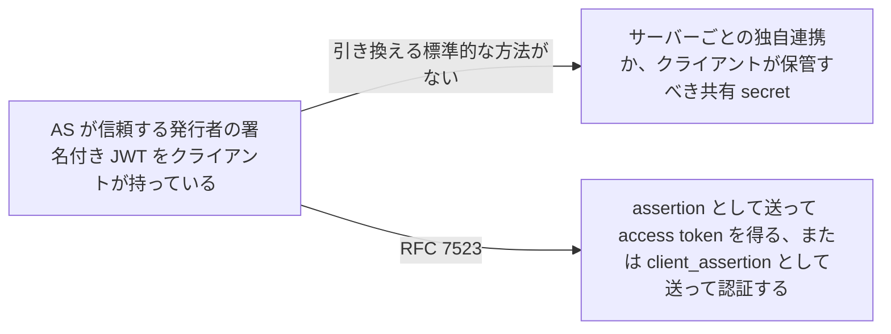
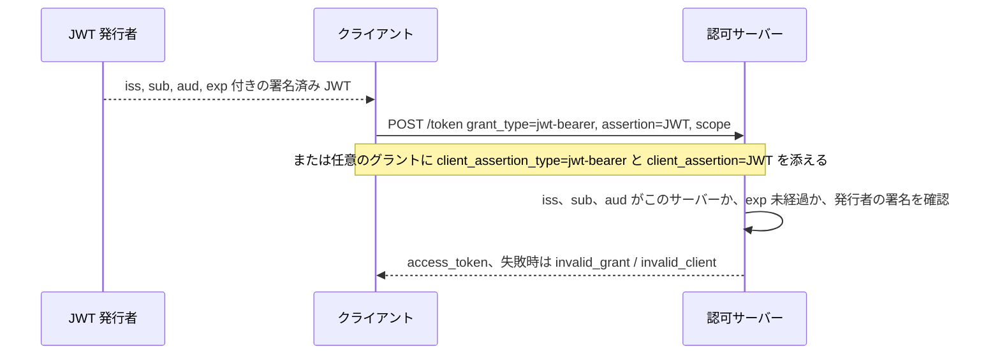

# JWT Bearer Grant and Client Authentication

> 一言で言うと: 発行者との信頼関係がすでにあるなら、署名付き JWT をトークンエンドポイントでの認可グラントの代わりにも、クライアントの credential の代わりにも使える。

## どういうときに使うか

- **認可サーバーと信頼関係がすでにあり、ユーザーを承認画面に通さずに access token が欲しいサービス**: JWT をグラントとして提示すると、"without a direct user-approval step at the authorization server" で access token を得られる (Section 1)。
- **トークンエンドポイントで別の認証手段を使いたいクライアント**: 署名付き JWT を `client_assertion` として、使っているグラントに添えて送る。本文の例は authorization code の交換 (Section 1, Section 2.2)。
- **信頼する IdP が発行した assertion を受け付ける認可サーバー**: `https://jwt-idp.example.com` が `mailto:mike@example.com` について発行し、サーバー宛てにした JWT が、そのまま access token のグラントになる (Section 4)。
- **両方同時に**: グラントとクライアント認証は直交していて分離できるので、JWT グラントを別の認証方式と組み合わせても、JWT クライアント認証を任意のグラントと組み合わせてもよい (Section 1)。

## 解決する問題

OAuth Assertion Framework (RFC 7521) は assertion がグラントにもクライアント credential にもなりうると言うが、JWT がその役をどう果たすかは定めていない。プロファイルがなければ、認可サーバーごとに claim や audience の規則、エラーコードが違ってしまい、クライアントは署名付き JWT の形式をサーバー間で使い回せない。RFC 7523 は 2 つのパラメータ名、JWT が持つべき claim、サーバーの検証手順、失敗時のエラーを固定する。クライアントがそもそも JWT をどう手に入れるかは範囲外 (Section 1)。

## 仕組み

グラントとして使うとき、クライアントは `grant_type=urn:ietf:params:oauth:grant-type:jwt-bearer` と `assertion` に JWT、任意で `scope` を送る。クライアント認証として使うときは `client_assertion_type=urn:ietf:params:oauth:client-assertion-type:jwt-bearer` と `client_assertion` に JWT を、使っているグラントに添えて送る。どちらの場合も認可サーバーは、`iss` が既知の発行者か、`sub` が正しい当事者か (認証なら client の `client_id`)、`aud` にサーバー自身の識別子が含まれるか、`exp` が過ぎていないか、署名や MAC が発行者の鍵で検証できるかを確認する (Section 2.1, Section 2.2, Section 3)。

## 仕様が求めること

- グラントでは `grant_type` が `urn:ietf:params:oauth:grant-type:jwt-bearer` で、`assertion` は単一の JWT を含まなければならない。`client_id` はそれに依存するクライアント認証方式を使うときだけ必要 (Section 2.1)。
- クライアント認証では `client_assertion_type` が `urn:ietf:params:oauth:client-assertion-type:jwt-bearer` で、`client_assertion` に複数の JWT を含めてはならない (Section 2.2)。
- JWT は `iss`、`sub`、`aud`、`exp` を含まなければならない。`aud` は認可サーバーを示さなければならず、サーバーは自分の識別子を audience に含まない JWT を拒否しなければならない (Section 3)。
- クライアント認証では `sub` は `client_id` でなければならない。グラントでは認可されたアクセス主体を示す (Section 3)。
- JWT は発行者が署名するか MAC を付けなければならず、サーバーは署名や MAC が無効なもの、`exp` を過ぎたものを拒否しなければならない (Section 3)。
- グラントの失敗は `invalid_grant` (Section 3.1)、クライアント認証の失敗は `invalid_client` を返す (Section 3.2)。
- RS256 は実装必須 (Section 5)。

## 注意点

- リプレイ防止は必須ではない。サーバーは使用済みの `jti` を JWT の失効まで追跡してもよいが、やるかどうかは実装の判断 (Section 3, Section 6)。
- issuer と audience の識別子、トークンエンドポイントの場所、署名鍵、ワンタイム利用の制約、JWT の最大寿命、claim の要件は事前合意が必要で、その交換方法は範囲外 (Section 5)。
- サーバーは不合理に遠い未来の `exp` や、不合理に古い `iat` を拒否することがある。JWT は短命に発行する (Section 3)。
- JWT はプライバシーに関わるデータを含みうる。TLS のような暗号化された経路でだけ送り、クライアントに読ませたくなければサーバー向けに暗号化し、必要な claim だけ入れる (Section 7)。

## 出典

- [RFC 7523, Section 1](https://www.rfc-editor.org/rfc/rfc7523#section-1)
- [RFC 7523, Section 2.1](https://www.rfc-editor.org/rfc/rfc7523#section-2.1)
- [RFC 7523, Section 2.2](https://www.rfc-editor.org/rfc/rfc7523#section-2.2)
- [RFC 7523, Section 3](https://www.rfc-editor.org/rfc/rfc7523#section-3)
- [RFC 7523, Section 3.1](https://www.rfc-editor.org/rfc/rfc7523#section-3.1)
- [RFC 7523, Section 3.2](https://www.rfc-editor.org/rfc/rfc7523#section-3.2)
- [RFC 7523, Section 4](https://www.rfc-editor.org/rfc/rfc7523#section-4)
- [RFC 7523, Section 5](https://www.rfc-editor.org/rfc/rfc7523#section-5)
- [RFC 7523, Section 6](https://www.rfc-editor.org/rfc/rfc7523#section-6)
- [RFC 7523, Section 7](https://www.rfc-editor.org/rfc/rfc7523#section-7)
