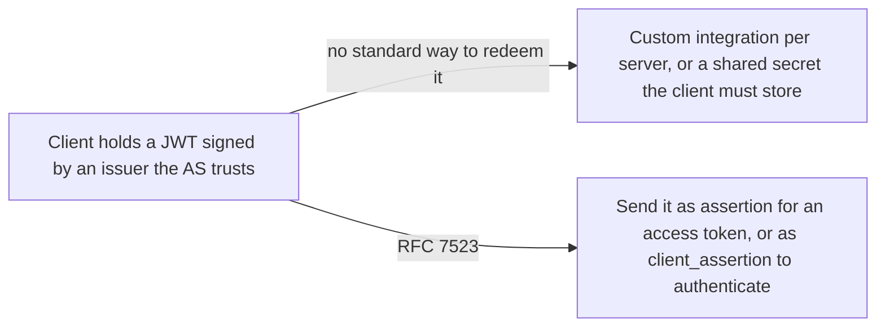
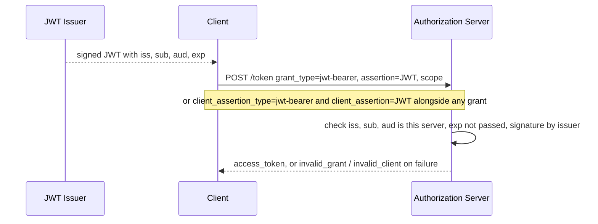

# JWT Bearer Grant and Client Authentication

> In one line: a signed JWT can stand in for an authorization grant at the token endpoint, or for the client's credential, whenever a trust relationship with the issuer already exists.

## When you reach for it

- **A service that already has a trust relationship with the authorization server and needs access tokens without sending a user through an approval step**: it presents a JWT as the grant and gets an access token "without a direct user-approval step at the authorization server" (Section 1).
- **A client that wants another way to authenticate at the token endpoint**: it sends a signed JWT as `client_assertion` together with whatever grant it is using, the example in the text being an authorization code exchange (Section 1, Section 2.2).
- **An authorization server that accepts assertions issued by a trusted identity provider**: a JWT from `https://jwt-idp.example.com` about `mailto:mike@example.com`, addressed to the server, becomes the grant for an access token (Section 4).
- **Both at once**: grant and client authentication are orthogonal and separable, so a client can use a JWT grant with a different authentication method, or JWT client authentication with any grant type (Section 1).

## The problem it solves

The OAuth Assertion Framework (RFC 7521) says an assertion can be a grant or a client credential, but it does not say how a JWT fills either role. Without a profile, each authorization server would define its own claims, audience rules and error codes, and a client could not reuse one signed JWT format across servers. RFC 7523 fixes the two parameter names, the claims the JWT must carry, how the server validates them and which error it returns when they fail. How the client obtains the JWT in the first place is out of scope (Section 1).

## How it works

For the grant use, the client sends `grant_type=urn:ietf:params:oauth:grant-type:jwt-bearer` with the JWT in `assertion` and an optional `scope`. For client authentication it sends `client_assertion_type=urn:ietf:params:oauth:client-assertion-type:jwt-bearer` and the JWT in `client_assertion`, together with whatever grant it is using. In both cases the authorization server checks that `iss` names a known issuer, `sub` identifies the right party (the client's `client_id` for authentication), `aud` contains the server's own identity, `exp` has not passed, and the signature or MAC verifies with the issuer's key (Section 2.1, Section 2.2, Section 3).

## What the spec requires

- For a grant, `grant_type` is `urn:ietf:params:oauth:grant-type:jwt-bearer` and `assertion` MUST contain a single JWT; `client_id` is needed only when a client authentication method relies on it (Section 2.1).
- For client authentication, `client_assertion_type` is `urn:ietf:params:oauth:client-assertion-type:jwt-bearer` and `client_assertion` MUST NOT contain more than one JWT (Section 2.2).
- The JWT MUST contain `iss`, `sub`, `aud` and `exp`. `aud` MUST identify the authorization server, and the server MUST reject any JWT that does not contain its own identity as an intended audience (Section 3).
- For client authentication the `sub` MUST be the `client_id`; for a grant it identifies the authorized accessor (Section 3).
- The JWT MUST be signed or carry a MAC by the issuer, and the server MUST reject an invalid signature or MAC, or a JWT whose `exp` has passed (Section 3).
- A failed grant returns `invalid_grant` (Section 3.1); a failed client authentication returns `invalid_client` (Section 3.2).
- RS256 is mandatory to implement (Section 5).

## Watch out

- Replay protection is not required. The server MAY track used `jti` values until the JWT expires, but implementations must decide whether to do so (Section 3, Section 6).
- Issuer and audience identifiers, the token endpoint location, the signing key, one-time-use restrictions, maximum JWT lifetime and claim requirements all have to be agreed in advance; exchanging that information is out of scope (Section 5).
- The server may reject an `exp` unreasonably far in the future or an `iat` unreasonably far in the past, so issue short-lived JWTs (Section 3).
- A JWT can carry privacy-sensitive data: send it only over an encrypted channel such as TLS, encrypt it to the server if the client must not read it, and include only the claims needed (Section 7).

## Sources

- [RFC 7523, Section 1](https://www.rfc-editor.org/rfc/rfc7523#section-1)
- [RFC 7523, Section 2.1](https://www.rfc-editor.org/rfc/rfc7523#section-2.1)
- [RFC 7523, Section 2.2](https://www.rfc-editor.org/rfc/rfc7523#section-2.2)
- [RFC 7523, Section 3](https://www.rfc-editor.org/rfc/rfc7523#section-3)
- [RFC 7523, Section 3.1](https://www.rfc-editor.org/rfc/rfc7523#section-3.1)
- [RFC 7523, Section 3.2](https://www.rfc-editor.org/rfc/rfc7523#section-3.2)
- [RFC 7523, Section 4](https://www.rfc-editor.org/rfc/rfc7523#section-4)
- [RFC 7523, Section 5](https://www.rfc-editor.org/rfc/rfc7523#section-5)
- [RFC 7523, Section 6](https://www.rfc-editor.org/rfc/rfc7523#section-6)
- [RFC 7523, Section 7](https://www.rfc-editor.org/rfc/rfc7523#section-7)
